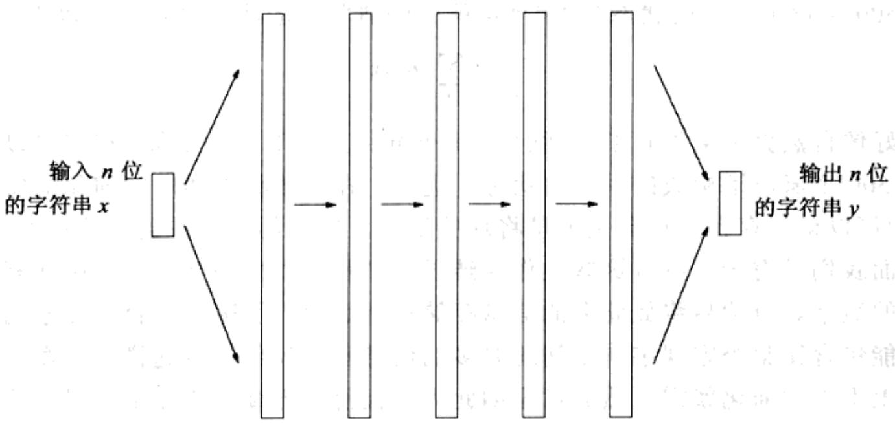

import Guide from '@/components/Guide.astro';
import Knowledge from '@/components/Knowledge.astro';
import Example from '@/components/Example.astro';
import Analysis from '@/components/Analysis.astro';
import Solution from '@/components/Solution.astro';
import Variant from '@/components/Variant.astro';
import Note from '@/components/Note.astro';
import Block from '@/components/Block.astro';
import Method from '@/components/Method.astro';
import Exercise from '@/components/Exercise.astro';
import Algorithm from '@/components/Algorithm.astro';

## 10.2 算法设计

量子算法与前面看到的所有算法不同。它的结构反映了 $n$ -量子位元系统的指数量级“私有空间”和能通过度量得到的仅仅 $n$ 位信息之间的权衡。

量子算法的输入由 $n$ 个经典位构成，输出也为 $n$ 个经典位。当量子系统还没有被人们从自然界中观察到的时候，人们已经捕捉到了量子效应，并且为了整个人类的利益，人们做了很多异常艰难的工作，这将会为人类带来很大的收益。

如果问题的输入是一个 $n$ 位的字符串 $x$ ，则量子计算机会将输入的 $n$ 个量子位元当作状态 $|x\rangle$ 。然后接下来，实施一系列的量子操作，将 $n$ 个量子位元的状态转换为某个叠加状态 $\sum_{y} \alpha_{y}|y\rangle$ 。最后，通过一个度量，以概率 $|\alpha_{y}|^{2}$ 得到某个 $n$ 位的字符串输出 $y$ 。由观察可知，这个输出是随机的。不过，正如我们在类似素性测试的随机算法中所见，这并不是一个问题。如果 $y$ 正确的概率足够高，我们可以通过重复整个处理过程使得算法失败的概率小到忽略不计。

  
指数级的叠加状态

图10-3 量子算法将 $n$ 个“经典”位作为输入，操作它们用以产生一个由 $2^{n}$ 个可能状态叠加构成的状态，然后利用这个指数规模的叠加状态得到最终的量子结果，并对结果进行度量，以一定的概率得到一个 $n$ 位的输出。在算法的中间阶段，存在一个基本的操作，我们也可以将其视为处理的一个步骤，它操纵了叠加状态的所有指数多个振幅值

下面我们更进一步探讨算法的量子部分。一些关键的量子操作(下面我们很快将会讨论)可以看成是在一个状态叠加中查找某些模式。正因为如此，为了更好地理解算法，我们将它分解为两个阶段。在第一个阶段中，输入的 $n$ 个经典位被“解包”为一个指数规模的状态叠加。这种专门建立的叠加中包含了某种潜在的模式或规律性，一旦这些模式或规律被检测到，解决问题也就变得易如反掌了。第二阶段由一些适当的量子操作集合构成，然后将对其进行度量，通过度量揭示出隐含的模式。

所有这些现在看起来都非常神秘，但是下面还有更多的细节。在10.3节中，我们将对量子计算机能够有效实现的最重要操作——量子版本的快速傅立叶变换(FFT)给出一个高层次的描述。然后，我们将描述一些非常适合用这个量子FFT来检测的模式，并通过精确地检测一个这样的模式来重新考虑整数 $N$ 的因子分解问题。最后，我们将看到建立量子算法的初始步骤，将输入 $N$ 转化为具有正确模式的指数规模叠加状态。

分解大整数 $N$ 的算法可以看成是一系列的转化过程(以下用黑体表示的内容很快将进行定义):

\- 因子分解可以转化为寻找1模 $N$ 的一个非平凡平方根。

\- 寻找这样的非平凡平方根可以转化为计算随机整数模 $N$ 的序。

\- 一个整数的序正好就是某个周期性叠加的周期。

\- 最后，叠加的周期可以通过量子FFT得到。

下面，我们从最后一步开始。
