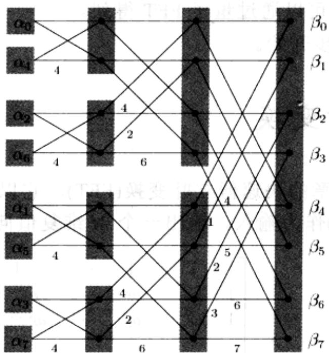
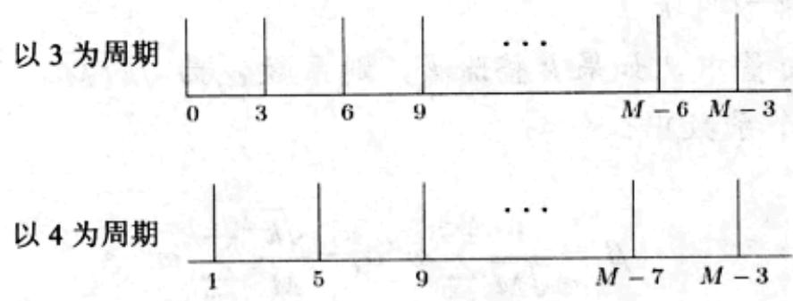

import Guide from '@/components/Guide.astro';
import Knowledge from '@/components/Knowledge.astro';
import Example from '@/components/Example.astro';
import Analysis from '@/components/Analysis.astro';
import Solution from '@/components/Solution.astro';
import Variant from '@/components/Variant.astro';
import Note from '@/components/Note.astro';
import Block from '@/components/Block.astro';
import Method from '@/components/Method.astro';
import Exercise from '@/components/Exercise.astro';
import Algorithm from '@/components/Algorithm.astro';

## 10.3 量子傅立叶变换

我们先回顾一下第2章的快速傅立叶变换(FFT)。它以 $M$ 维复值向量 $\alpha$ (其中 $M$ 为2的幂，也就是 $M = 2^{m}$ ) 作为输入，输出一个 $M$ 维复值向量 $\beta$ ：

$$
\left[ \begin{array}{c} {\beta_ {0}} \\ {\beta_ {1}} \\ {\beta_ {2}} \\ {\vdots} \\ {\beta_ {M - 1}} \end{array} \right] = \frac {1}{\sqrt {M}} \left[ \begin{array}{c c c c c} {1} & {1} & {1} & {\dots} & {1} \\ {1} & {\omega} & {\omega^ {2}} & {\dots} & {\omega^ {M - 1}} \\ {1} & {\omega^ {2}} & {\omega^ {4}} & {\dots} & {\omega^ {2 (M - 1)}} \\ & {\vdots} & & & \\ {1} & {\omega^ {j}} & {\omega^ {2 j}} & {\dots} & {\omega^ {(M - 1) j}} \\ & {\vdots} & & & \\ {1} & {\omega^ {(M - 1)}} & {\omega^ {2 (M - 1)}} & {\dots} & {\omega^ {(M - 1) (M - 1)}} \end{array} \right] \left[ \begin{array}{c} {\alpha_ {0}} \\ {\alpha_ {1}} \\ {\alpha_ {2}} \\ {\vdots} \\ {\alpha_ {M - 1}} \end{array} \right]
$$

其中， $\omega$ 是 1 的一个 $M$ 次复数根(公式前面的因子 $\sqrt{M}$ 是额外的，它的作用是保证所有 $|\alpha_i|^2$ 相加为 1， $|\beta_i|^2$ 也是如此)。虽然一般的处理过程需要用到一个 $O(M^2)$ 的算法，而经典的 FFT 能够在 $O(M \log M)$ 步之内完成计算。正是因为 FFT 带来的这一速度改进才使得数字信号处理变得切实可行。我们下面将看到量子计算机是如何在 $O(\log^2 M)$ 时间内指数倍地更快实现 FFT 算法的！

在此之前，我们应该想想算法是如何在少于 $M$ (输入长度)步操作内实现的？要点在于我们将输入编码为一个叠加状态，也就是 $m = \log M$ 个量子位元，毕竟这个叠加状态包含了 $2^{m}$ 个振幅值。在早前我们介绍的概念中，我们可以将叠加状态表示为 $\left|\alpha \right\rangle = \sum_{j=0}^{M-1} \alpha_{j} \left|j\right\rangle$ ，其中 $\alpha_{j}$ 是对应于正常方式下的整数 $j$ 的 $m$ 位二值字符串的振幅。对于这种处理方法，也存在一个很重要的观点： $\left|j\right\rangle$ 概念实际上是另一种向量表示方法，向量中每个分量的下标可以通过特定的括号标记显式写出来。

从输入叠加状态 $|\alpha\rangle$ 开始，量子傅立叶变换(QFT)共有 $m = \log M$ 个步骤。在每一步中，叠加状态不断变化，以至于它能编码与传统FFT相同步骤的中间结果(传统FFT电路也有 $m = \log M$ 个步骤，图10-4中回顾了第2章的相关内容)。我们将在10.5节中看到，量子傅立叶变换的每个步骤可以在 $m$ 次量子操作内完成。因此最终，在完成了这 $m$ 个步骤，也即 $m^2 = \log^2 M$ 次基本量子操作之后，我们可以得到QFT的期望输出相对应的叠加状态 $|\beta \rangle$ 。

  
图10-4 第2章中的传统FFT电路。输入为 $M$ 位二值向量，它将顺序经过 $m = \log M$ 步的处理过程

到目前为止，我们只是考虑了 QFT 的优越性——令人惊讶的速度。下面我们来分析一下其中的细节。传统 FFT 算法实际输出 M 个复数 $\beta_{0}, \ldots, \beta_{M-1}$ 。相反，QFT 算法的输出为一个叠加状态 $\left|\beta\right\rangle = \sum_{j=0}^{M-1} \beta_{j} \left|j\right\rangle$ ，并且我们在前面也曾看到，该叠加状态的振幅是量子系统的私有空间的一部分。

因此，处理 QFT 这个结果的唯一方法是度量它！并且，度量系统的状态只需要使用 $m=\log M$ 个传统比特：输出 j 的概率为 $\left|\beta_{j}\right|^{2}$ 。

因此，与 QFT 这个名称相比，该算法更准确的名称应该是量子傅立叶采样 (quantum Fourier sampling)。而且，虽然在本节中我们将处理的问题限制在 $M = 2^{m}$ 的情况下，实际上算法可以处理任意 $M$ 值的问题。我们对算法总结如下：

输入： $m=\log M$ 个量子比特的叠加状态 $\left|\alpha\right\rangle=\sum_{j=0}^{M-1}\alpha_{j}\left|j\right\rangle$ 。

方法：使用 $O(m^{2})=O(\log^{2}M)$ 次量子操作实现量子 FFT，得到叠加状态 $\left|\beta\right\rangle=\sum_{j=0}^{M-1}\beta_{j}\left|j\right\rangle$ 。

输出：服从概率分布 $\operatorname{Pr}[j] = |\beta_j|^2$ 的随机 $m$ 位二值数 $j$ (其中， $0 \leq j \leq M - 1$ )。

通过量子傅立叶采样，我们可以快速地粗略了解传统 FFT 的输出，量子傅立叶采样只需要检查输出向量中的较大分量。实际上，我们甚至不需要知道该分量的值，而只需知道它在向量中的序数就可以了。那么我们将如何使用这些很不充分的信息呢？在 FFT 的哪些应用中只需知道输出向量中较大分量的序数就已足够了呢？这将是我们下一步要探讨的问题。

  
图10-5 周期性叠加状态的例子
