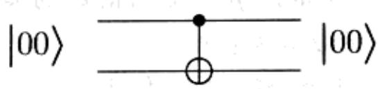
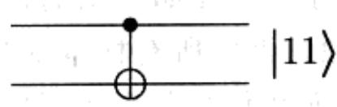
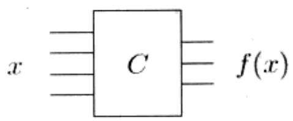
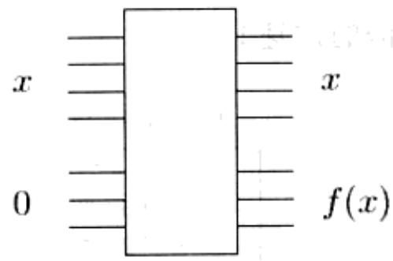
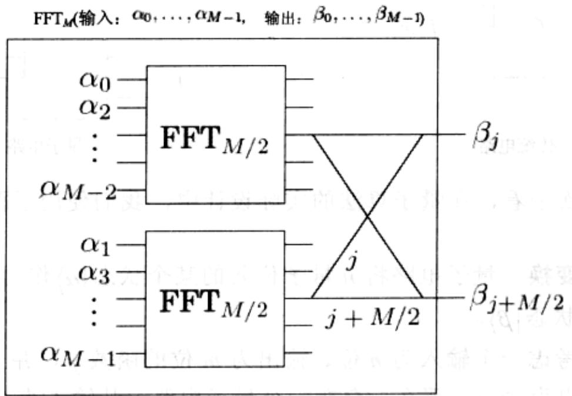
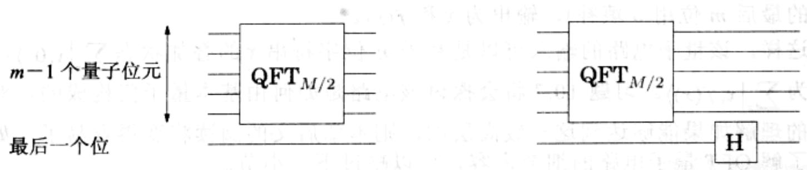

import Guide from '@/components/Guide.astro';
import Knowledge from '@/components/Knowledge.astro';
import Example from '@/components/Example.astro';
import Analysis from '@/components/Analysis.astro';
import Solution from '@/components/Solution.astro';
import Variant from '@/components/Variant.astro';
import Note from '@/components/Note.astro';
import Block from '@/components/Block.astro';
import Method from '@/components/Method.astro';
import Exercise from '@/components/Exercise.astro';
import Algorithm from '@/components/Algorithm.astro';

## 10.5 量子电路

我们已知量子计算机在执行傅立叶变换时比传统计算机快指数倍。量子计算机到底是什么样子的？量子电路的组成是什么，它又是怎样做到执行傅立叶变换如此之快呢？

## 10.5.1 基本量子门

一个基本量子操作与传统电路中的基本门操作(类似于“与门”或者“非门”)是相似的。它是基于一个或者两个量子位元来计算的。一个重要的例子是 Hadamard 门，我们用 H 来表示，其操作针对单个量子位元进行。如果输入为 $\left|0\right\rangle$ ，则该门的输出为 $H(|0\rangle) = \frac{1}{\sqrt{2}} |0\rangle +\frac{1}{\sqrt{2}} |1\rangle$ 。如果输入为 $|1\rangle$ ，则该门的输出为 $H(|1\rangle) = \frac{1}{\sqrt{2}} |0\rangle -\frac{1}{\sqrt{2}} |1\rangle$ 。图形表示如下： $|0\rangle -\boxed{\mathbf{H}}\rightarrow \frac{1}{\sqrt{2}} |0\rangle +\frac{1}{\sqrt{2}} |1\rangle$ $|1\rangle -\boxed{\mathbf{H}}\rightarrow \frac{1}{\sqrt{2}} |0\rangle -\frac{1}{\sqrt{2}} |1\rangle$

注意到，在以上任意一种情况下，输出量子位元的度量为0和度量为1的概率均为 $1 / 2$ 。然而，如果Hadamard门的输入是任意的叠加状态 $\alpha_0|0\rangle +\alpha_1|1\rangle$ ，输出会怎样呢？这决定于量子物理的线性特征，输出将是叠加状态 $\alpha_0H(|0\rangle) + \alpha_1H(|1\rangle) = \frac{\alpha_0 + \alpha_1}{\sqrt{2}} |0\rangle +\frac{\alpha_0 - \alpha_1}{\sqrt{2}} |1\rangle$ 。因此，如果我们以Hadamard门的输出作为该门的输入，则最终得到的输出量子位元即为最初的输入位。

另外一个基本的门是控制非门，可以记为CNOT门。它是对两个量子位元进行操作的，第一个作为控制量子位元，第二个作为目标量子位元。当且仅当CNOT门的第一个量子位元为1时，该门将第二个电子位元的取值进行翻转。也就是说 $CNOT(|00\rangle)=|00\rangle$ ； $CNOT(|10\rangle)=|11\rangle$ ：

还有另外一种基本门电路——控制相位门，我们将在讨论 QFT 量子电路的后续章节中对其进行描述。

至此，我们还需考虑如下问题：假设我们有一个关于 $n$ 个量子位元的量子状态 $\left|\alpha\right\rangle = \sum_{x\in \{0,1\}^n}\alpha_x\left|x\right\rangle$ 。如果我们只对其第一个量子位元应用Hadamard门操作，那么该量子状态的 $2^n$ 个振幅中将有多少个发生变化？答案会让您感到惊讶——所有振幅都发生了变化！这个新的叠加状态变为 $\left|\beta \right\rangle = \sum_{x\in \{0,1\}^n}\beta_x\left|x\right\rangle$ ，其中 $\beta_{0y} = \frac{\alpha_{0y} + \alpha_{1y}}{\sqrt{2}}$ ： $\beta_{1y} = \frac{\alpha_{0y} - \alpha_{1y}}{\sqrt{2}}$ 。当我们进一步分析该结果时就会发现，对第一个量子位元的量子操作分别对 $n - 1$ 位下标逐个进行处理。因此，原来状态中的振幅 $\alpha_{0y}$ 和 $\alpha_{1y}$ 被变换为 $\left(\alpha_{0y} + \alpha_{1y}\right) / \sqrt{2}$ 和 $\left(\alpha_{0y} - \alpha_{1y}\right) / \sqrt{2}$ 。正是这一特点使得量子傅立叶变换的指数倍加速成为可能。

## 10.5.2 量子电路的两种基本类型

量子电路通常将某个 n 量子位元的数作为输入，输出相同数目的量子位元。在下图中，这 $n$ 个量子位元分别用从左到右的 $n$ 条线段来表示。量子电路是由作用于单个量子位元或成对量子位元上的一系列的基本量子门操作(包括上文讨论过的几种量子门操作)的应用构成的。

  
传统电路

  
量子电路

从较高的层次来看，在量子算法的实际设计中，我们使用了两种基本功能的量子电路：

量子傅立叶变换 量子电路将 $n$ 量子位元的某个状态 $\left|\alpha\right\rangle$ 作为输入，对该状态应用 QFT，输出为状态 $\left|\beta\right\rangle$ 。

传统函数 考虑一个输入为 n 位、输出为 m 位的函数 f，并且假设我们有一个传统电路，其输出为 $f(x)$ 。那么，存在一个量子电路，其输入为 n 位的字符串 x（字符串的最后 m 位用 0 填补），输出为 x 和 $f(x)$ 。

这样，该量子电路的输入可以是基于 $n$ 位字符串 $x$ 的叠加状态 $\sum_{x} |x, 0^k\rangle$ ，此时输出为 $\sum_{x} |x, f(x) \rangle$ 。习题10.7将会探讨该电路是如何由基本量子门构成的。对量子电路的理解如果能够达到这一较高层次，则本章后文的阅读将变得容易了。如果您不想了解QFT量子电路的细节内容，可以略过下一小节。

## 10.5.3 量子傅立叶变换电路

首先，我们重新画出传统FFT电路的示意图(引自2.6.4节)，图中FFT电路以 $M$ 维向量为输入，该电路包含了两个以 $M / 2$ 维向量为输入的FFT电路，两者中的每一个都由一些简单门电路构成。

下面，让我们看看如何在量子系统上进行类似的处理。系统的输入是 $m = \log M$ 个量子位元，其中蕴含了 $2^{m}$ 个振幅信息。因此，我们可以将输入分解为偶数位和奇数位，就像前面图中显示的一样，这个划分仅用一个量子位元(最后一个量子位元)就可以决定了。那么，我们如何将输入分解为偶数位和奇数位，并应用递归电路对每个分解得到的每一半输入计算其 $FFT_{M/2}$ ？答案是显然的：只需将量子电路 $QFT_{M/2}$ 应用于剩余的 $m - 1$ 个量子位元即可。这一结论的实际意义在于：可以将 $QFT_{M / 2}$ 分别应用于所有 $x0$ 形式和 $x1$ 形式的 $m$ 位字符串(各自分别存在 $M / 2$ 个字符串)的叠加状态，并且两个应用过程彼此独立。因此，两个递归传统电路完全可以被一个单独的量子电路来模拟——当我们展开递归处理过程时，量子电路执行FFT的过程就能取得指数倍的加速！

我们再来考虑传统 FFT 电路迭代调用 $FFT_{M/2}$ 之后进行的门操作：标记着 $j$ 和 $M/2 + j$ 的电线是成对的，暂时忽略对第 $M/2 + j$ 根电线上值施加的相位，我们必须将这一对电线上的值相加或者相减以分别得到第 $j$ 个和第 $M/2 + j$ 个输出。然而，量子电路是如何得到这 $M$ 个传统门操作得到的结果的呢？其实很简单：只需对第一个量子位元执行 Hadamard 门操作即可！回顾前面讨论的内容(参见 10.5.1 节)可知，对于剩下的 $m - 1$ 个量子位元 $x$ 的所有可能取值情况，字符串 $0x$ 和 $1x$ 被配成一对。从二值表示的意义上讲，意味着我们将 $x$ 和 $M/2 + x$ 进行配对。另外，Hadamard 门操作的效果在于：对于每一对输入量子位元，原来输出的振幅信息分别被替换为量子位元的和与差(当然，还需要用 $1/\sqrt{2}$ 进行归一化)。这样一来，QFT 基本上不需要任何门

电路！

相比而言，对于每个 $j$ ，我们对施加到第 $M / 2 + j$ 根电线上值的相位进行分析需要多点的工作量。注意到，只有当第一个量子位元为1时，必须对其施加相位 $\omega^j$ 。因此，如果将 $j$ 表示为 $m - 1$ 位 $j_{1}\ldots j_{m - 1}$ ，则有 $\omega^{j} = \prod_{l = 1}^{m - 1}\omega^{2jl}$ 。从而，施加相位 $\omega^j$ 可以转化为对第 $l$ 根( $l$ 取不同的值)电线分别进行如下操作：如果第 $l$ 个量子位元为1且第一个量子位元也为1，则我们将相位 $\omega^{2j}$ 施加于其上。这个过程可以通过另外一个量子门(两量子位元的门)——控制相位门来完成。该门的处理过程如下：如果两个输入量子位元都为1，则该门会对输入施加一个特定的相位因子，否则两个量子位元保持不变。

至此，我们已给出了 QFT 电路的全貌。电路中量子门的个数由公式 $S(m) = S(m - 1) + O(m)$ 指定（因此，最终有解 $S(m) = O(m^2)$ ）。因此，如果 QFT 的输入规模为 $M = 2^m$ ，它将需要 $O(m^2) = O(\log^2 M)$ 次量子操作。
