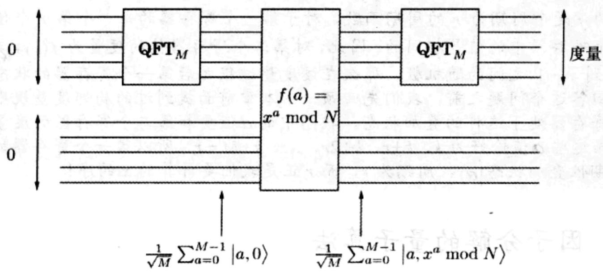

import Guide from '@/components/Guide.astro';
import Knowledge from '@/components/Knowledge.astro';
import Example from '@/components/Example.astro';
import Analysis from '@/components/Analysis.astro';
import Solution from '@/components/Solution.astro';
import Variant from '@/components/Variant.astro';
import Note from '@/components/Note.astro';
import Block from '@/components/Block.astro';
import Method from '@/components/Method.astro';
import Exercise from '@/components/Exercise.astro';
import Algorithm from '@/components/Algorithm.astro';

## 10.7 因子分解的量子算法

下面我们将本章前面讲述的关于因子分解量子算法的分析总结一下(如图10-6)。由于我们可以在多项式时间内测试一个输入是否是质数或质数的幂，所以不妨假设输入的素性测试已经进行完毕，测试结果表明输入是一个奇合数，且该数至少有两个不同的质因子。

输入：一个奇合数 N。

输出： $N$ 的一个因子。

1. 在 $1 \leqslant x \leqslant N - 1$ 范围内均匀随机地选择一个 $x$ 值。

2. 令 $M$ 为接近 $N$ 的 2 的一个幂(这样选取的原因此处我们不提及了，不过最好选择 $M \approx N^2$ )。

3. 重复下面的操作 $s = 2\log N$ 次：

(a) 首先，两个量子寄存器初始都置为 0。第一个量子寄存器要求足够大，可以存储模 M 的数，第二个寄存器存储模 N 的数。

(b) 使用周期性函数 $f(a) \equiv x^{a} \mod N$ 创建一个长度为 $M$ 的周期性叠加状态 $|\alpha\rangle$ ，具体操作如下(详细细节请参见下面的灰色方框):

i. 对第一个寄存器值进行 QFT，得到叠加状态 $\sum_{a=0}^{M-1}\frac{1}{\sqrt{M}}|a,0\rangle$ 。

ii. 利用量子电路计算 $f(a)=x^{a}\bmod N$ ，得到叠加状态 $\sum_{a=0}^{M-1}\frac{1}{\sqrt{M}}\left|a,x^{a}\bmod N\right\rangle$ 。

iii. 度量第二个寄存器值。此时，第一个寄存器中存储着周期性叠加状态 $|\alpha\rangle = \sum_{j=0}^{M/r-1}\sqrt{\frac{r}{M}}|jr+k\rangle$ ，其中 $k$ 表示在 0 和 $r-1$ 之间的随机偏移值(回顾前述内容可

知，r 为 x 模 N 的序)。

  
图10-6 量子因子分解

(c) 对叠加状态 $|\alpha\rangle$ 进行傅立叶采样，得到0到 $M - 1$ 之间的一个序数值。

令 g 为输出序数 $j_{1}, \ldots, j_{s}$ 的最大公因数。

4. 如果 $M / g$ 为偶数，则计算 $\gcd(N, x^{M / 2g} + 1)$ ，如果它是 $N$ 的一个非平凡因子，则输出它，否则返回步骤1。

从前面的引理可知，该方法至少能处理 $x$ 所有取值的一半情况，因此，在找到 $N$ 的一个因子之前，整个处理过程平均仅仅需要重复两次。

但这只是该算法的一个方面。如果我们必须处理数 $M$ ，还存在一个问题是非常不明确的： $M$ 作为FFT的规模，必须是2的幂。并且我们求解周期的算法中，周期必须要整除 $M$ ，因此该周期也应当是2的幂。然而在上述处理过程中，周期是 $x$ 的序，它肯定不是2的一个幂！

不过，该算法仍能正常工作，其原因是：即使一个周期向量的周期不能整除 $M$ ，量子傅立叶变换也能求得该周期。然而个中缘由并不像周期能整除 $M$ 的情况的缘由那么清晰，因此我们不准备就此进行深入探讨。

令 $n = \log N$ 为输入 $N$ 的位数。算法运行时间决定于步骤3的重复次数—— $2\log N = O(n)$ 。由于模的求幂操作需要 $O(n^3)$ 步操作(参见1.2.2节)，而量子傅立叶变换需要 $O(n^2)$ 步操作，因此量子因子分解算法的总运行时间为 $O(n^3\log n)$ 。

<Knowledge title="专栏: 计算机科学和量子物理的交叉">

在计算机科学的早期，人们怀疑是否存在比用基本门电路组成的计算机更加强大的机器。但是，20世纪70年代之后这个问题就被认为已完全解决。实现了von Neumann体系的基于硅的计算机显然是胜利者，并且基于其他方法设计的计算机被公认为与von Neumann计算机在运行时间上有多项式等价关系。换言之，在任一台计算机上需要 $T$ 步操作的一个计算任务在另一台计算机上需要的操作步数至多是 $T$ 的多项式。这一基本原理被称为扩展邱奇-图灵论题(the extended Church-Turing thesis)。量子计算机打破了这个基本论题，从而对我们关于计算机的大多数基本假设提出了质疑。

到底能否构建量子计算机呢？这是一个挑战，它令全世界范围内很多研究小组在不竭工作，这样的研究小组通常由物理学家和计算机科学家组成。其中的主要难点在于量子叠加状态是非常微弱的，需要很好的防护措施，以免被环境中不利的度量方法所破坏。在这方面有了一些进展，但是都很缓慢：到目前为止，公开的最有前景的量子计算是使用核磁共振(NMR)技术将数15的因子分解为3和5。即使在这一实验中，仍存在这样的疑问：量子因子分解算法的思想被忠实实现的程度有多少？未来十年，将是一个让人期待的十年，我们的目标是在物理操作量子比特方面提升我们的能力，并实现量子计算机。

然而还存在另外一种可能：如果所有这些实现量子计算机的努力都失败了怎么办？换一个角度看，这或许将更加有趣，因为它或许会指出量子物理的一些基本缺陷，毕竟量子物理理论已经在过去的一个世纪中没有被挑战和质疑过了。

量子计算的研究动力来源于两个方面：揭开量子物理神秘面纱的冲动和创建新奇的超级计算机的努力，这两方面难分伯仲。

</Knowledge>
