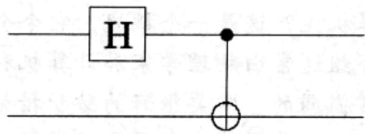
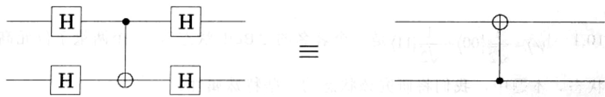

import Guide from '@/components/Guide.astro';
import Knowledge from '@/components/Knowledge.astro';
import Example from '@/components/Example.astro';
import Analysis from '@/components/Analysis.astro';
import Solution from '@/components/Solution.astro';
import Variant from '@/components/Variant.astro';
import Note from '@/components/Note.astro';
import Block from '@/components/Block.astro';
import Method from '@/components/Method.astro';
import Exercise from '@/components/Exercise.astro';
import Algorithm from '@/components/Algorithm.astro';

## 第10章 习题

<Exercise title="习题 10.1">

$\left|\psi\right\rangle=\frac{1}{\sqrt{2}}\left|00\right\rangle+\frac{1}{\sqrt{2}}\left|11\right\rangle$ 是一个著名的 “Bell 状态”，一个两量子位元高度纠

缠的状态。本题中，我们将研究该状态的一些特殊属性。

(a) 假设这个 Bell 状态能分解为两个量子位元的张量积(回顾前面 10.1 节)，第一个量子位元状态为 $\alpha_{0}|0\rangle + \alpha_{1}|1\rangle$ ，第二个量子位元的状态为 $\beta_{0}|0\rangle + \beta_{1}|1\rangle$ 。请写出振幅 $\alpha_{0}$ 、 $\alpha_{1}$ 、 $\beta_{0}$ 和 $\beta_{1}$ 必须满足的四个方程。并证明 Bell 状态是不可分解的。

(b) 对处于状态 $|\psi\rangle$ 的第一个量子位元进行度量的结果是什么？

(c) 度量第一个量子位元之后，对第二个量子位元进行度量的结果是什么？

(d) 如果处于状态 $|\psi\rangle$ 的两个量子位元的度量值差距很大，您能说明(c)的答案为什么是令人惊讶的吗？

</Exercise>

<Exercise title="习题 10.2">

证明下图中的量子电路针对输入 $|00\rangle$ ，输出为 Bell 状态 $|\psi\rangle = \frac{1}{\sqrt{2}} |00\rangle + \frac{1}{\sqrt{2}} |11\rangle$ ：对第一个量子位元进行 Hadamard 门操作，然后对第一个量子位元和第二个量子位元进行 CNOT 门操作，其中前者作为控制量子位元，后者作为目标量子位元。

当输入为 10、01 和 11 时(这些状态是其他的 Bell 基准状态)，这个电路的输出是什么？

</Exercise>

<Exercise title="习题 10.3">

均匀叠加状态 $\frac{1}{\sqrt{M}} \sum_{j=0}^{M-1} |j\rangle$ 的量子傅立叶变换模 $M$ 是怎样的？

</Exercise>

<Exercise title="习题 10.4">

状态 $|j\rangle$ 的QFT模 $M$ 是怎样的？

</Exercise>

<Exercise title="习题 10.5">

卷积-乘法(Convolution-Multiplication)。假设我们将叠加状态 $|\alpha\rangle = \sum_{j}\alpha_{j}|j\rangle$ 偏移 $l$ 得到另外一个叠加状态 $|\alpha^{\prime}\rangle = \sum_{j}\alpha_{j}|j + l\rangle$ 。如果 $|\alpha \rangle$ 的QFT结果为 $|\beta \rangle$ ，证明 $\alpha'$ 的QFT结果为 $\beta'$ ，其中 $\beta' = \beta_j\omega^{lj}$ 。并证明如下结论：如果 $|\alpha^{\prime}\rangle = \sum_{j=0}^{M/k-1}\sqrt{\frac{k}{M}} |jk + l\rangle$ ，则 $|\beta^{\prime}\rangle = \frac{1}{\sqrt{k}}\sum_{j=0}^{k-1}\omega^{ljM/k}|jM / k\rangle$ 。

</Exercise>

<Exercise title="习题 10.6">

证明: 如果对 CNOT 门的输入和输出进行 Hadamard 门操作, 输出是 CNOT 门的控制量子位元和目标量子位元互换后的输出。

</Exercise>

<Exercise title="习题 10.7">

控制交换门(CONTROLLED SWAP)(C-SWAP)以3个量子位元作为输入，当且仅当第一个量子位元是1时，对第二和第三个量子位元进行互换。

(a) 证明：NOT、CNOT 和 C-SWAP 门都具有自反性。

(b) 说明如何利用 $C$ -SWAP门实现AND门，也就是说，指定什么样的输入 $a, b$

$c$ 给 $C$ -SWAP 门，才能得到输出结果为 $a \wedge b$ ?

(c) 如何仅使用(a)中的三个门来实现扇出？即当输入 $a$ 和0时，输出为 $a$ 和 $a$ 。

(d) 证明：对于任何传统电路 $C$ ，都存在一个等价量子电路 $Q$ ，其中仅使用 NOT 门和 C-SWAP 门，使用规则如下：如果 $C$ 针对输入 $x$ ，输出 $y$ ，则 $Q$ 针对输入 $|x,0,0\rangle$ ，输出 $|x,y,z\rangle$ 。（其中， $z$ 是计算过程中产生的无关位元集合。）

(e) 证明：存在一个量子电路 $Q^{-1}$ ，针对输入 $\left|x, y, z\right\rangle$ ，输出为 $\left|x, 0, 0\right\rangle$ 。

(f) 证明：存在一个由 NOT、CNOT 和 C-SWAP 门构成的量子电路 $Q'$ ，其输入为 $|x,0,0\rangle$ 而输出为 $|x,y,0\rangle$ 。

</Exercise>

<Exercise title="习题 10.8">

本题中，我们将证明：如果 $N = pq$ 是两个奇素数的积，且 $x$ 是在0到 $N - 1$ 范围内均匀随机选取的数，从而满足 $\gcd(x, N) = 1$ ，则 $x \bmod N$ 的序 $r$ 是偶数的概率至少为 $3/8$ ，并且 $r$ 是偶数时， $x^{r/2}$ 为 $1 \bmod N$ 的一个非平凡平方根。

(a) 令 $p$ 为一个奇素数，令 $x$ 为一个均匀随机选取的模 $p$ 的数。证明： $x \bmod p$ 的序是偶数的概率至少为 $1/2$ 。（提示：利用费马小定理，参见 1.3 节。）

(b) 利用中国剩余定理(参见习题 1.37)证明 $x \bmod N$ 的序为偶数的概率至少是 $3/4$ 。

(c) 如果 r 是偶数，证明 $x^{r/2} \equiv \pm 1$ 的概率最多为 1/2。

?d ∧ p 次果指出解怪桥端卡，[1] 9KW2-0 余。

。D味D式出解，如0则n人解当明？出鼠肥夹来[1个三闭中(s)田外又回咲(3)

TOM 田赴外中其，Q 溶由干量分等个一迹存满，C 溶由禁卦同于执：即五（b）· $\langle0,0,x|$ 人解怀持 Q 即 $x$ 出解，x 人解怀持 C 果玻：形成顶脉甲虫，[1] 9AW2-C 味门
(。合果元外关天的主产中置域算书是 z，中其)。 $\langle s,y,z|$ 出解

。 $\langle0,0,x|$ 次出解， $\langle=x,y|$ 人解恢复； $^{1}Q$ 离子量个一齐异：即证 (3)

人解其，Q程由千量的如律口QAW2-3味TOIC，TOI由个一至者：即五(1)。 $\langle0,y,x|$ 次出解面 $\langle0,0,x|$

V. 0 正县 x 且，则因费素个两县 pq = V 果吨：即五洲以下，中题本 8.01
则因费群县、官断 V boron x 顷，1 = (V, x)bog 虽断而从，使的郊域共图区内围游 I 一。则式平凡平非一个 [V boron] 共 x ，如费群县、且并，g/ε 大处至率

的qbomx：即五，贼的q射的难数脉前区个一次x令，贼衰有个一次q令（s）（。若E.I.灵参，匪宝小已费用（味：示勋）。S\I次处至率的贼群是

景心至率肺的波卧区引起的Vbomx即面(ΓE.I 圈区见参)野宝余喉固中肌味(d)

。S|U式差量率测的I±≡ $^{5}$ y.即πr，故断是γ.果时(0)

</Exercise>

