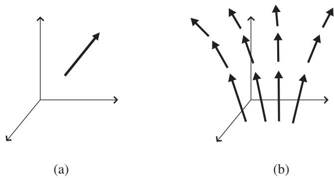
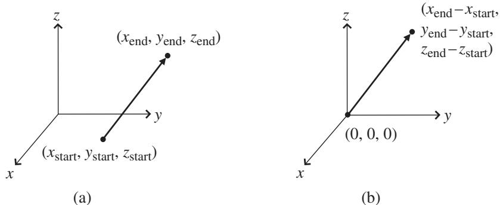

import Guide from '@/components/Guide.astro';
import Knowledge from '@/components/Knowledge.astro';
import Example from '@/components/Example.astro';
import Analysis from '@/components/Analysis.astro';
import Solution from '@/components/Solution.astro';
import Variant from '@/components/Variant.astro';
import Note from '@/components/Note.astro';
import Block from '@/components/Block.astro';
import Method from '@/components/Method.astro';
import Exercise from '@/components/Exercise.astro';

## 1.1 Definitions (basic)

There are many ways to define a vector. For starters, here's the most basic:

A vector is the mathematical representation of a physical entity that may be characterized by size (or "magnitude") and direction.

In keeping with this definition, speed (how fast an object is going) is not represented by a vector, but velocity (how fast and in which direction an object is going) does qualify as a vector quantity. Another example of a vector quantity is force, which describes how strongly and in what direction something is being pushed or pulled. But temperature, which has magnitude but no direction, is not a vector quantity.

The word "vector" comes from the Latin vehere meaning "to carry;" it was first used by eighteenth-century astronomers investigating the mechanism by which a planet is "carried" around the Sun.1 In text, the vector nature of an object is often indicated by placing a small arrow over the variable representing the object (such as $\vec { F } )$ , or by using a bold font (such as F), or by underlining (such as $\underline { { \boldsymbol { F } } } \ o \boldsymbol { \mathbf { r } } \ \boldsymbol { F } )$ . When you begin hand-writing equations involving vectors, it's very important that you get into the habit of denoting vectors using one of these techniques (or another one of your choosing). The important thing is not how you denote vectors, it's that you don't simply write them the same way you write non-vector quantities.

A vector is most commonly depicted graphically as a directed line seg ment or an arrow, as shown in Figure 1.1(a). And as you'll see later in this section, a vector may also be represented by an ordered set of N numbers, where N is the number of dimensions in the space in which the vector resides.

  
Figure 1.1 Graphical depiction of a vector (a) and a vector field (b).

Of course, the true value of a vector comes from knowing what it represents. The vector in Figure 1.1(a), for example, may represent the velocity of the wind at some location, the acceleration of a rocket, the force on a football, or any of the thousands of vector quantities that you encounter in the world every day. Whatever else you may learn about vectors, you can be sure that every one of them has two things: size and direction. The magnitude of a vector is usually indicated by the length of the arrow, and it tells you the amount of the quantity represented by the vector. The scale is up to you (or whoever's drawing the vector), but once the scale has been established, all other vectors should be drawn to the same scale. Once you know that scale, you can determine the magnitude of any vector just by finding its length. The direction of the vector is usually given by indicating the angle between the arrow and one or more specified directions (usually the "coordinate axes"), and it tells you which way the vector is pointing.

So if vectors are characterized by their magnitude and direction, does that mean that two equally long vectors pointing in the same direction could in fact be considered to be the same vector? In other words, if you were to move the vector shown in Figure 1.1(a) to a different location without varying its length or its pointing direction, would it still be the same vector? In some applications, the answer is "yes," and those vectors are called free vectors. You can move a free vector anywhere you'd like as long as you don't change its length or direction, and it remains the same vector. But in many physics and engineering problems, you'll be dealing with vectors that apply at a given location; such vectors are called "bound" or "anchored" vectors, and you're not allowed to

## 1.1 Definitions (basic)

relocate bound vectors as you can free vectors.2 You may see the term "sliding" vectors used for vectors that are free to move along their length but are not free to change length or direction; such vectors are useful for problems involving torque and angular motion.

You can understand the usefulness of bound vectors if you think about an application such as representing the velocity of the wind at various points in the atmosphere. To do that, you could choose to draw a bound vector at each point of interest, and each of those vectors would show the speed and direction of the wind at that location (most people draw the vector with its tail – the end without the arrow – at the point to which the vector is bound). A collection of such vectors is called a vector field; an example is shown in Figure 1.1(b).

If you think about the ways in which you might represent a bound vector, you may realize that the vector can be defined simply by specifying the start and end points of the arrow. So in a three-dimensional Cartesian coordinate system, you only need to know the values of x, y, and z for each end of the vector, as shown in Figure 1.2(a) (you can read about vector representation in non-Cartesian coordinate systems later in this chapter).

Now consider the special case in which the vector is anchored to the origin of the coordinate system (that is, the end without the arrowhead is at the point of intersection of the coordinate axes, as shown in Figure 1.2(b).3 Such vectors may be completely specified simply by listing the three numbers that represen the x-, y-, and z-coordinates of the vector's end point. Hence a vector anchored to the origin and stretching five units along the x-axis may be represented as (5,0,0). In this representation, the values that represent the vector are called the "components" of the vector, and the number of components it takes to define a vector is equal to the number of dimensions in the space in which the vector exists. So in a two-dimensional space a vector may be represented by a pair of numbers, and in four-dimensional spacetime vectors may appear as lists of four numbers. This explains why a horizontal list of numbers is called a "row vector" and a vertical list of numbers is called a "column vector" in compute science. The number of values in such vectors tells you how many dimensions there are in the space in which the vector resides.

  
Figure 1.2 A vector in 3-D Cartesian coordinates.

To understand how vectors are different from other entities, it may help to consider the nature of some things that are clearly not vectors. Think about the temperature in the room in which you're sitting – at each point in the room, the temperature has a value, which you can represent by a single number. That value may well be different from the value at other locations, but at any given point the temperature can be represented by a single number, the magnitude. Such magnitude-only quantities have been called "scalars" ever since W.R. Hamilton referred to them as "all values contained on the one scale of progres sion of numbers from negative to positive infinity."4 Thus

A scalar is the mathematical representation of a physical entity that may be characterized by magnitude only.

Other examples of scalar quantities include mass, charge, energy, and speed (defined as the magnitude of the velocity vector). It is worth noting that the change in temperature over a region of space does have both magnitude and direction and may therefore be represented by a vector, so it's possible to pro duce vectors from groups of scalars. You can read about just such a vecto (called the "gradient" of a scalar field) in Chapter 2.

Since scalars can be represented by magnitude only (single numbers) and vectors by magnitude and direction (three numbers in three-dimensiona space), you might suspect that there are other entities involving magnitude and directions that are more complex than vectors (that is, requiring more numbers than the number of spatial dimensions). Indeed there are, and such entities are called "tensors."5 You can read about tensors in the last three chapters of this book, but for now this simple definition will suffice:

A tensor is the mathematical representation of a physical entity that may be characterized by magnitude and multiple directions.

An example of a tensor is the inertia that relates the angular velocity of a rotating object to its angular momentum. Since the angular velocity vecto has a direction and the angular momentum vector has a (potentially different) direction, the inertia tensor involves multiple directions.

And just as a scalar may be represented by a single number and a vector may be represented by a sequence of three numbers in 3-dimensional space, a tensor may be represented by an array of $3 ^ { R }$ numbers in 3-dimensional space. In this expression, $" R "$ represents the rank of the tensor. So in 3-dimensional space, a second-rank tensor is represented by $3 ^ { 2 } = 9$ numbers. In N-dimensional space, scalars still require only one number, vectors require N numbers, and tensors require $\mathbf { N } ^ { R }$ numbers.

Recognizing scalars, vectors, and tensors is easy once you realize that a scalar can be represented by a single number, a vector by an ordered set of numbers, and a tensor by an array of numbers. So in three-dimensional space, they look like this:

Scalar

Tensor (Rank 2)

(x)

$$
(x _ {1}, x _ {2}, x _ {3}) \quad \text { or } \quad \left( \begin{array}{c} x _ {1} \\ x _ {2} \\ x _ {3} \end{array} \right) \qquad \left( \begin{array}{c c c} x _ {1 1} & x _ {1 2} & x _ {1 3} \\ x _ {2 1} & x _ {2 2} & x _ {2 3} \\ x _ {3 1} & x _ {3 2} & x _ {3 3} \end{array} \right)
$$

Note that scalars require no subscripts, vectors require a single subscript, and tensors require two or more subscripts – the tensor shown here is a tenso of rank 2, but you may also encounter higher-rank tensors, as discussed in Chapter 5. A tensor of rank 3 may be represented by a three-dimensional array of values.

With these basic definitions in hand, you're ready to begin considering the ways in which vectors can be put to use. Among the most useful of all vectors are the Cartesian unit vectors, which you can read about in the next section.
