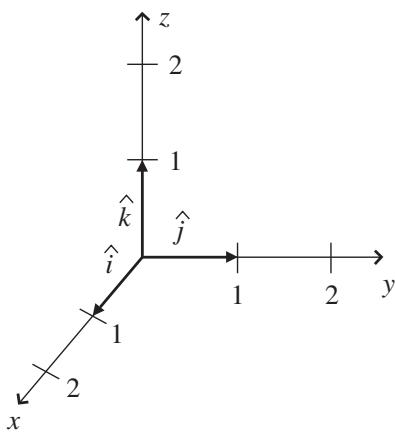
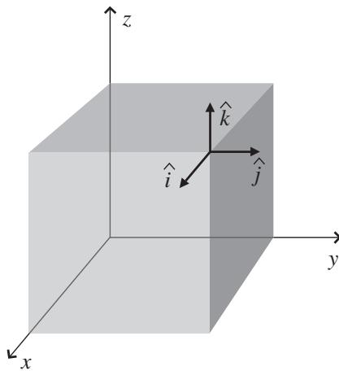

import Guide from '@/components/Guide.astro';
import Knowledge from '@/components/Knowledge.astro';
import Example from '@/components/Example.astro';
import Analysis from '@/components/Analysis.astro';
import Solution from '@/components/Solution.astro';
import Variant from '@/components/Variant.astro';
import Note from '@/components/Note.astro';
import Block from '@/components/Block.astro';
import Method from '@/components/Method.astro';
import Exercise from '@/components/Exercise.astro';

## 1.2 Cartesian unit vectors

If you hope to use vectors to solve problems, it's essential that you learn how to handle situations involving more than one vector. The first step in that process is to understand the meaning of special vectors called "unit vectors" that often serve as markers for various directions of interest (unit vectors may also be called "versors").

  
Figure 1.3 Unit vectors in 3-D Cartesian coordinates.

The first unit vectors you're likely to encounter are the unit vectors x, y, z (also called ı , j , kˆ) that point in the direction of the x -, y-, and z-axes of the three-dimensional Cartesian coordinate system, as shown in Figure 1.3. These vectors are called unit vectors because their length (or magnitude) is always exactly equal to unity, which is another name for "one." One what? One of whatever units you're using for that axis.

You should note that the Cartesian unit vectors ı, j, $\hat { k }$ can be drawn at any location, not just at the origin of the coordinate system. This is illustrated in Figure 1.4. As long as you draw a vector of unit length pointing in the same direction as the direction of the (increasing) x-axis, you've drawn the ı unit vector. So the Cartesian unit vectors show you the directions of the x, y, and z axes, not the location of the origin.

As you'll see in Chapter 2, unit vectors can be extremely helpful when doing certain operations such as specifying the portion of a given vector pointing in a certain direction. That's because unit vectors don't have their own magnitude to throw into the mix (actually, they do have their own magnitude, but it is always one).

So when you see an expression such as "5ı," you should think "5 units along the positive x-direction." Likewise, $- 3 \hat { \jmath }$ refers to 3 units along the negative y-direction, and $\hat { k }$ indicates one unit along the positive z-direction.

Of course, there are other coordinate systems in addition to the three perpen dicular axes of the Cartesian system, and unit vectors exist in those coordinate systems as well; you can see some examples in Section 1.5. One advantage of the Cartesian unit vectors is that they point in the same direction no matter where you go; the $x \mathrm { - } , y \mathrm { - } ,$ , and z-axes run in straight lines all the way out to infinity, and the Cartesian unit vectors are parallel to the directions of those lines everywhere.

  
Figure 1.4 Cartesian unit vectors at an arbitrary point.

To put unit vectors such as $\hat { \imath } , \hat { \jmath } , \hat { k }$ to work, you need to understand the concept of vector components. The next section shows you how to represent vectors using unit vectors and vector components.
