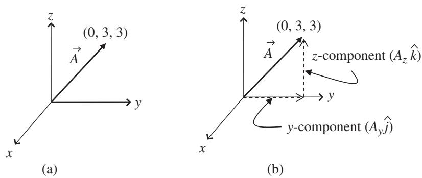
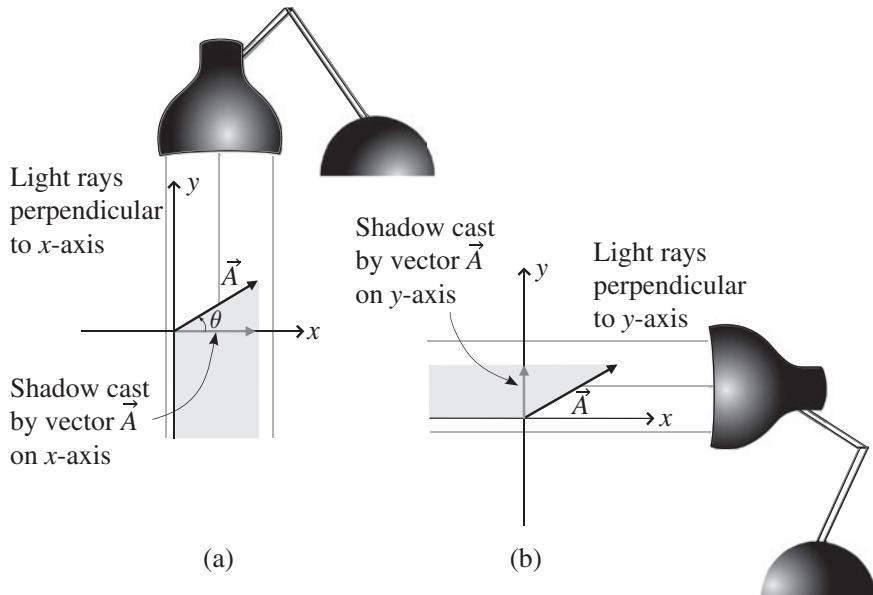

import Guide from '@/components/Guide.astro';
import Knowledge from '@/components/Knowledge.astro';
import Example from '@/components/Example.astro';
import Analysis from '@/components/Analysis.astro';
import Solution from '@/components/Solution.astro';
import Variant from '@/components/Variant.astro';
import Note from '@/components/Note.astro';
import Block from '@/components/Block.astro';
import Method from '@/components/Method.astro';
import Exercise from '@/components/Exercise.astro';

## 1.3 Vector components

The unit vectors described in the previous section are especially useful when they become part of the "components" of a vector. And what are the compo nents of a vector? Simply stated, they are the pieces that can be used to make up the vector.

To understand vector components, think about the vector $\vec { A }$ shown in Figure 1.5. This is a bound vector, anchored at the origin and extending to the point $( x = 0 , y = 3 , z = 3 )$ in a three-dimensional Cartesian coordinate system. So if you consider the coordinate axes as representing the corner of a room, this vector is embedded in the back wall (the yz plane).

Imagine you're trying to get from the beginning of vector $\vec { A }$ to the end – the direct route would be simply to move in the direction of the vector. But if you were constrained to move only in the directions of the axes, you could get from the origin to your destination by taking three (unit) steps along the y-axis, then turning $9 0 ^ { \circ }$ to your left, and then taking three more (unit) steps in the direction of the z-axis.

  
Figure 1.5 Vector $\vec { A }$ and its components.

What does this little journey have to do with the components of a vector? Simply this: the lengths of the components of vector $\vec { A }$ are the distances you traveled in the directions of the axes. Specifically, in this case the magnitude of the y-component of vector $\vec { A }$ (written as $A _ { y } )$ is just the distance you traveled in the direction of the y-axis (3 units), and the magnitude of the z-component of vector $\vec { A }$ (written as $A _ { z } )$ is the distance you traveled in the direction of the z-axis (also 3 units). Since you didn't move at all in the direction of the x-axis, the magnitude of the x-component of vector $\vec { A }$ (written as $A _ { x } )$ is zero.

A very handy and compact way of writing a vector as a combination of vector components is this:

$$
\vec {A} = A _ {x} \hat {\imath} + A _ {y} \hat {j} + A _ {z} \hat {k},\tag{1.1}
$$

where the magnitudes of the vector components $( A _ { x } , A _ { y }$ , and $A _ { z } )$ tell you how many unit steps to take in each direction $( \hat { \imath } , \hat { \jmath }$ , and $\hat { k } )$ to get from the beginning to the end of vector $\vec { A } . ^ { 6 }$

When you read about vectors and vector components, you're likely to run across statements such as "The components of a vector are the projections of the vector onto the coordinate axes." As you can see in Chapter 4, exactly how those projections are made can have a significant influence on the nature of the components you get. But in Cartesian coordinate systems (and other "orthogonal" systems in which the axes are perpendicular to one another), the concept of projection onto the coordinate axes is unambiguous and may be very helpful in picturing the components of a vector.

  
Figure 1.6 Vector components as projections onto x- and y-axes.

To understand how this works, take a look at vector $\vec { A }$ and the light sources and shadows in Figure 1.6. As you can see in Figure 1.6(a), the direction of the light that produces the shadow on the x-axis is parallel to the y-axis (actually antiparallel since it's moving in the negative y-direction), which in this case is the same as saying that the direction of the light is perpendicular to the x-axis.

Likewise, in Figure 1.6(b), the direction of the light that produces the shadow on the y-axis is antiparallel to the x-axis, which is of course perpendic ular to the y-axis. This may seem like a trivial point, but when you encounter non-orthogonal coordinate systems, you'll find that the direction parallel to one axis is not necessarily perpendicular to another axis, which gives rise to an entirely different type of vector component. This simple fact has profound implications for the behavior of vectors and tensors for observers in different reference frames, as you'll see in Chapters 4, 5, and 6.

No such issues arise in the two-dimensional Cartesian coordinate system shown in Figure 1.6, and in this case the magnitudes of the components of vector $\vec { A }$ are easy to determine. If the angle between vector $\vec { A }$ and the positive x-axis is $\theta$ , as shown in Figure 1.6a, it's clear that the length of $\vec { A }$ can be seen as the hypotenuse of a right triangle. The sides of that triangle along the x- and y-axes are the components $A _ { x }$ and $A _ { y }$ . Hence by simple trigonometry you can write:

$$
\begin{array}{l} A _ {x} = | \vec {A} | \cos (\theta), \\ A _ {y} = | \vec {A} | \sin (\theta), \end{array}\tag{1.2}
$$

where the vertical bars on each side of $\vec { A }$ signify the magnitude (length) of vector $\vec { A } .$ . Notice that so long as you measure the angle θ from the positive x-axis in the direction toward the positive y-axis (that is, counterclockwise in this case), these equations will give the correct sign for the x- and y-components no matter which quadrant the vector occupies.

For example, if vector $\vec { A }$ is a vector with a length of $^ { 7 }$ meters pointing in a direction $2 1 0 ^ { \circ }$ counter-clockwise from the +x-axis, the x- and y-components are given by Eq. 1.2 as

$$
\begin{array}{l} A _ {x} = | \vec {A} | \cos (\theta) = 7 \mathrm{m} \cos 2 1 0 ^ {\circ} = - 6. 1 \mathrm{m}, \\ A _ {y} = | \vec {A} | \sin (\theta) = 7 \mathrm{m} \sin 2 1 0 ^ {\circ} = - 3. 5 \mathrm{m}. \end{array}\tag{1.3}
$$

As expected for a vector pointing down and to the left from the origin, both components are negative.

It's equally straightforward to find the length and direction of a vector if you're given the vector's Cartesian components. Since the vector forms the hypotenuse of a right triangle with sides $A _ { x }$ and $A _ { y }$ , the Pythagorean theorem tells you that the length of $\vec { A }$ must be

$$
| \vec {A} | = \sqrt {A _ {x} ^ {2} + A _ {y} ^ {2}},\tag{1.4}
$$

and from trigonometry

$$
\theta = \arctan \left(\frac {A _ {y}}{A _ {x}}\right),\tag{1.5}
$$

where $\theta$ is measured counter-clockwise from the positive x-axis in a right handed coordinate system. If you try this with the components of vector $\vec { A }$ from Eq. 1.3 and end up with a direction of $3 0 ^ { \circ }$ rather than $2 1 0 ^ { \circ }$ , remember that unless you have a four-quadrant arctan function on your calculator, you must add $1 8 0 ^ { \circ }$ to the angle whenever the denominator of the expression $( A _ { x }$ in this case) is negative.

Once you have a working understanding of unit vectors and vector components, you're ready to do basic vector operations. The entirety of Chapter 2 is devoted to such operations, but two of them are needed for the remainder of this chapter. For that reason, you can read about vector addition and multiplication by a scalar in the next section.
