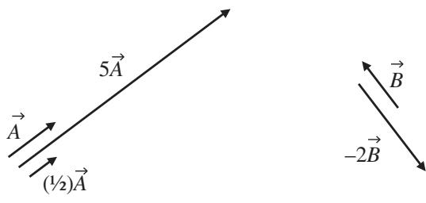
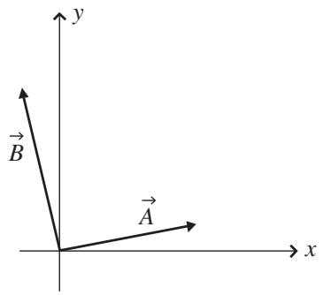
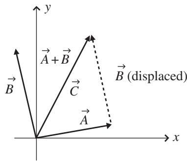
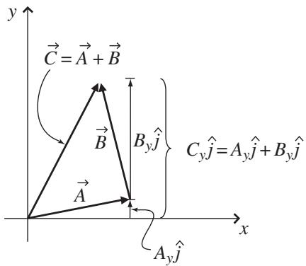
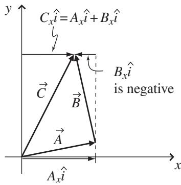

import Guide from '@/components/Guide.astro';
import Knowledge from '@/components/Knowledge.astro';
import Example from '@/components/Example.astro';
import Analysis from '@/components/Analysis.astro';
import Solution from '@/components/Solution.astro';
import Variant from '@/components/Variant.astro';
import Note from '@/components/Note.astro';
import Block from '@/components/Block.astro';
import Method from '@/components/Method.astro';
import Exercise from '@/components/Exercise.astro';

## 1.4 Vector addition and multiplication by a scalar

If you've read the previous section on vector components, you've already seen two vector operations in action. Those two operations are the addition of vectors and multiplication of a vector by a scalar. Both of these operations are used in the expansion of a vector in terms of vector components as in Eq. 1.1 from Section 1.3:

$$
\vec {A} = A _ {x} \hat {\imath} + A _ {y} \hat {j} + A _ {z} \hat {k}.
$$

In each of these terms, the unit vector $( \hat { \imath } , \hat { \jmath } ,$ , or $\hat { k } )$ is being multiplied by a scalar $( A _ { x } , A _ { y } , \mathrm { o r } \ A _ { z } )$ , and you already know the effect of that: it produces a new vector, in the same direction as the unit vector, but longer than unity by the value of the component (or shorter if the magnitude of the component is between zero and one). So multiplying a vector by any positive scalar does not change the direction of the vector, but only scales the length of the vector. Hence, $5 \vec { A }$ is a vector in exactly the same direction as ${ \vec { A } } .$ , but with length five times that of $\vec { A }$ , as shown in Figure 1.7(a). Likewise, multiplying $\vec { A }$ by (1/2) produces a vector that points in the same direction as $\vec { A }$ but is only half as long. So the vector component $A _ { x } \hat { \imath }$ is a vector in the $\hat { \imath }$ direction, but with length $A _ { x }$ units (since $\hat { \imath }$ has a length of one unit).

There is a caveat that goes with the "changes length, not direction" rule when multiplying a vector by a scalar: if the scalar is negative, then the vector is reversed in direction in addition to being scaled in length. Thus multiplying vector $\vec { B }$ by 2 produces the new vector $- 2 \vec { B }$ , and that vecto is twice as long as $\vec { B }$ and points in the opposite direction to $\vec { B }$ , as shown in Figure 1.7(b).

The other operation going on in Eq. 1.1 is vector addition, and you already have an idea of what that means if you recall Figure 1.5 and the process of getting from the beginning of vector $\vec { A }$ to the end. In that process, the quantity

(a)  
  
(b)  
Figure 1.7 Multiplication of a vector by a scalar.

$A _ { y } \hat { \jmath }$ represented not only the number of steps you took, but also the direction in which you took them. Likewise, the quantity $A _ { z } \hat { k }$ represented the number of steps you took in a different direction. The fact that these two quantities include directional information means that you cannot simply add them together algebraically; you must add them "as vectors."

To accomplish vector addition graphically, you simply imagine moving one vector (without changing its length or direction) so that its tail is at the head of the other vector. The sum is then determined by making a new vector that begins at the start of the first vector and terminates at the end of the second vector. You can do this graphically, as in Figure 1.5(b), where the tail of vector $A _ { z } \hat { k }$ is placed at the head of vector $A _ { y } \hat { \jmath }$ , and the sum is the vector from the beginning of $A _ { y } \hat { \jmath }$ to the end of $A _ { z } \hat { k }$

This graphical "head-to-tail" approach to vector addition works for any vectors (and any number of vectors), not just two vectors that are perpendicular to one another (as $A _ { y } \hat { \jmath }$ and $A _ { z } \hat { k }$ were). An example of this is shown in Figure 1.8. To graphically add the two vectors $\vec { A }$ and $\vec { B }$ in Figure 1.8(a), you simply imagine moving one of the two vectors so that its tail is at the position of the other vector's head (it doesn't matter which vector you choose to move; the result will be the same). This is illustrated in Figure 1.8(b), in which vector $\vec { B }$ has been displaced so that its tail is at the head of vector $\vec { A } .$ . The sum of these two vectors (called the "resultant" vector $\vec { C } = \vec { A } + \vec { B } )$ is the vector that extends from the beginning of $\vec { A }$ to the end of $\vec { B }$ .

Knowing how to add vectors graphically means you can always determine the sum of two or more vectors simply using a ruler and a protractor; just draw the vectors head-to-tail (being careful to maintain each vector's length and angle), sketch the resultant from the beginning of the first to the end of the last, and then measure the length (using the ruler) and angle (using the protractor) of the resultant. This approach can be both tedious and inaccurate, so here's an alternative approach that uses the components of each vector: if vector $\vec { C }$ is the sum of two vectors $\vec { A }$ and $\vec { B }$ , then the magnitude of the x-component of vector $\vec { C }$ (which is just $C _ { x } )$ is the sum of the magnitudes of the x-components of vectors $\vec { A }$ and $\vec { B }$ (that is, $A _ { x } + B _ { x } )$ ), and the magnitude of the y-component of vector $\vec { C }$ (called $C _ { y } )$ is the sum of the magnitudes of the y-components of vectors $\vec { A }$ and $\vec { B }$ (that is, $A _ { y } + B _ { y } )$ . Thus

  
(a)

  
Figure 1.8 Graphical addition of vectors.  
(b)

$$
\begin{array}{l} C _ {x} = A _ {x} + B _ {x}, \\ C _ {y} = A _ {y} + B _ {y}. \end{array}\tag{1.6}
$$

The rationale for this is shown in Figure 1.9.

Once you have the components $C _ { x }$ and $C _ { y }$ of the resultant vector ${ \vec { C } } ,$ , you can find the magnitude and direction of $\vec { C }$ using

$$
| \vec {C} | = \sqrt {C _ {x} ^ {2} + C _ {y} ^ {2}}\tag{1.7}
$$

and

$$
\theta = \arctan \left(\frac {C _ {y}}{C _ {x}}\right)\tag{1.8}
$$

To see how this works in practice, imagine that vector $\vec { A }$ in Figure 1.9 is given by $\vec { A } = 6 \hat { \imath } + \hat { \jmath }$ and vector $\vec { B }$ is given by $\vec { B } = - 2 \hat { \imath } + 8 \hat { \jmath }$ . To add these two vectors algebraically, you simply use Eqs. 1.6:

(a)  

  
(b)  
Figure 1.9 Component addition of vectors.

$$
\begin{array}{l} C _ {x} = A _ {x} + B _ {x} = 6 + (- 2) = 4, \\ C _ {y} = A _ {y} + B _ {y} = 1 + 8 = 9, \end{array}
$$

so $\vec { C } = 4 \hat { \imath } + 9 \hat { \jmath }$ . If you wish to know the magnitude of ${ \vec { C } } ,$ , you can just plug the components into Eq. 1.7 to get

$$
\begin{array}{c} | \vec {C} | = \sqrt {C _ {x} ^ {2} + C _ {y} ^ {2}} = \sqrt {4 ^ {2} + 9 ^ {2}} \\ = \sqrt {1 6 + 8 1} = 9. 8 5. \end{array}
$$

And the angle that $\vec { C }$ makes with the positive x-axis is given by Eq. 1.8:

$$
\begin{array}{r l} \theta & = \arctan \left(\frac {C _ {y}}{C _ {x}}\right) \\ & = \arctan \left(\frac {9}{4}\right) = 6 6. 0 ^ {\circ}. \end{array}
$$

With the basic operations of vector addition and multiplication of a vector by a scalar in hand, you're ready to begin thinking about the more advanced uses of vectors. But you're also ready to attack a variety of problems involving vectors, and you can find a set of such problems at the end of this chapter.7
