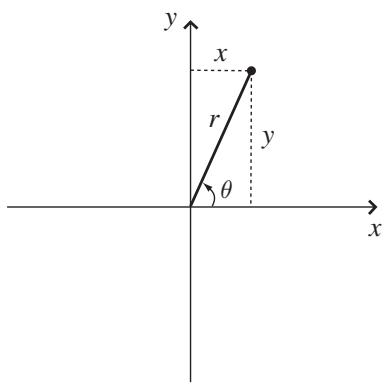
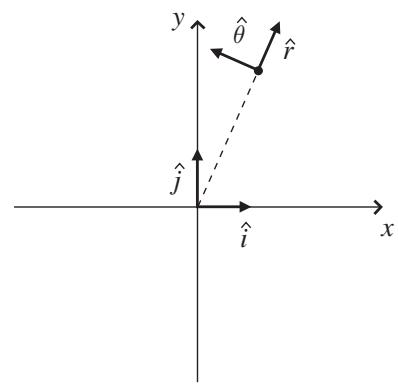
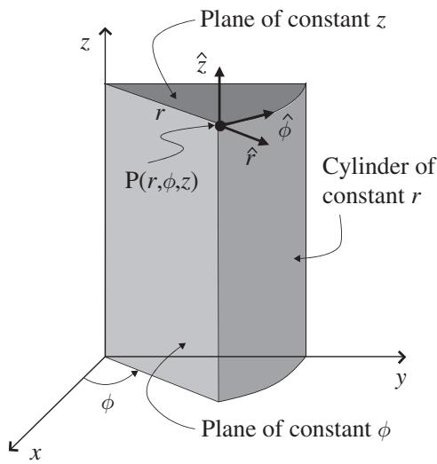
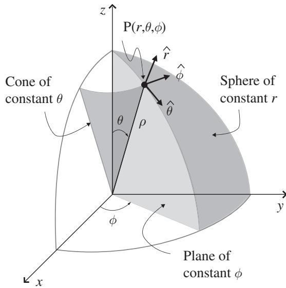

import Guide from '@/components/Guide.astro';
import Knowledge from '@/components/Knowledge.astro';
import Example from '@/components/Example.astro';
import Analysis from '@/components/Analysis.astro';
import Solution from '@/components/Solution.astro';
import Variant from '@/components/Variant.astro';
import Note from '@/components/Note.astro';
import Block from '@/components/Block.astro';
import Method from '@/components/Method.astro';
import Exercise from '@/components/Exercise.astro';

## 1.5 Non-Cartesian unit vectors

The three straight, mutually perpendicular axes of the Cartesian coordinate system are immensely useful for a variety of problems in physics and engineering. Some problems, however, are much easier to solve in other coordinate systems, often because the axes of those systems more closely align with the directions over which one or more of the parameters relevant to the problem remain constant or vary in a predictable manner. The unit vectors of such non-Cartesian coordinate systems are the subject of this section, and transformations between coordinate systems are discussed in Chapter 4.

As described earlier, it takes exactly N numbers to unambiguously represent any location in a space of N dimensions, which means you have to specify three numbers (such as x, y, and z) to designate a location in our Universe of three spatial dimensions. However, on the two-dimensional surface of the Earth (ignoring height variation for the moment) it takes only two numbers (latitude and longitude, for example) to designate a specific point. And one of the few benefits to living on a long, infinitely thin island is that you can set up a rendezvous using only a single number to describe the location ("I'll be waiting for you at 3.75 kilometers").

Of course, numbers define locations only after you've defined the coordi nate system that you're using. For example, do you mean 3.75 kilometers from the east end of the island or from the west end? In every space of 1, 2, 3, or more dimensions, you can devise an infinite number of coordinate systems to specify locations in that space. In each of those coordinate systems, at each location there's one direction in which one of the coordinates is increasing the fastest, and if you lay a vector with length of one unit in that direction, you've defined a coordinate unit vector for that system. So in the Cartesian coordinate system, the $\hat { \imath }$ unit vector shows you the direction in which the x-coordinate increases, the $\hat { \jmath }$ unit vector shows you the direction in which the y-coordinate increases, and the $\hat { k }$ unit vector shows you the direction in which the z-coordinate increases. Other coordinate systems have their own coordinate unit vectors, as well.

Consider the two-dimensional coordinate systems shown in Figure 1.10. In a two-dimensional space, you know that it takes two numbers to specify any location, and those numbers could be x and y, defined along two straight axes that intersect at a right angle. The x value tells you how far you are to the right of the y-axis (or to the left if the x value is negative), and the y value tells you how far you are above the x-axis (or below if the y value is negative). But you could equally well specify any location in this two-dimensional space by noting how far and in what direction you've moved from the origin. In the standard version of these "polar" coordinates, the distance from the origin is called r and the direction is specified by giving the angle $\theta$ measured counter clockwise from the positive x-axis.

  
(a)

  
(b)  
Figure 1.10 2-D rectangular (a) and polar (b) coordinates.

It's easy enough to figure out one set of coordinates if you know the others; for example, if you know the values of x and y, you can find r and $\theta$ using

$$
\begin{array}{l} r = \sqrt {x ^ {2} + y ^ {2}} \\ \theta = \arctan \left(\frac {y}{x}\right). \end{array}\tag{1.9}
$$

Likewise, if you have the values of $r$ and $\theta .$ , you can find x and y using

$$
\begin{array}{l} x = r \cos (\theta) \\ y = r \sin (\theta). \end{array}\tag{1.10}
$$

For the point shown in Figure 1.10, if the values of x and y are 4 cm and 9 cm, then r has a value of approximately 9.85 cm and θ has a value o $6 6 . 0 ^ { \circ }$ . Clearly, whether you write $( x , y ) = ( 4 \mathrm { c m } , 9 \mathrm { c m } )$ or $( r , \theta ) = ( 9 . 8 5 \mathrm { c m } , 6 6 . 0 ^ { \circ } )$ , you're referring to the same location; it's not the point that's changed, it's only the point's coordinates that are different.

And if you choose to use the polar coordinate system to represent the point, do unit vectors exist that serve the same function as $\hat { \imath }$ and $\hat { \jmath }$ in Cartesian coordinates? They certainly do, and with a little logic you can figure out which direction they must point. After all, you know that the unit vector $\hat { \imath }$ shows you the direction of increasing x and the unit vector $\hat { \jmath }$ shows you the direction of increasing y, but now you're using r and $\theta$ instead of x and y. So it seems reasonable that the unit vector $\hat { r }$ at any location should point in the direction of increasing r, and the unit vector $\hat { \theta }$ should point in the direction of increasing $\theta$ . For the point shown in Figure 1.10, that means that $\hat { r }$ should point up and to the right, in the direction of increasing r if $\theta$ is held constant. At that same point, $\hat { \theta }$ should point up and to the left, in the direction of increasing $\theta$ if $r$ is held constant. These polar unit vectors are shown for one point in Figure 1.10(b).

An important consequence of this definition is that the directions of $\hat { r }$ and $\hat { \theta }$ will be different at different locations. They'll always be perpendicular to one another, but they will not point in the same directions as they do for the point in Figure 1.10. The dependence of the polar unit vectors on position can be seen in the following relations:

$$
\begin{array}{r l} & {\hat {r} = \cos (\theta) \hat {i} + \sin (\theta) \hat {j}} \\ & {\hat {\theta} = - \sin (\theta) \hat {i} + \cos (\theta) \hat {j}.} \end{array}\tag{1.11}
$$

So if $\theta = 0$ (which means your location is on the $+ x { \mathrm { - } } { \mathrm { a x i s } } )$ , then $\hat { r } = \hat { \imath }$ and $\hat { \theta } = \hat { J }$ . But if $\theta = 9 0 ^ { \circ }$ (so your location is on the +y-axis), then $\hat { r } = \hat { \jmath }$ and $\hat { \theta } = - \hat { \imath }$

Does this dependence on position mean that these unit vectors are not "real" vectors? That depends on your definition of a real vector. If you define a vecto as a quantity with magnitude and direction, the polar unit vectors do meet your definition. But they do not meet the definition of free vectors described in Section 1.1, since they may not be moved without changing their direction.

This means that if you express a vector in polar coordinates and then take the derivative of that vector, you'll have to account for the change in the unit vectors, as well. That's one of the advantages offered by Cartesian coordinates – the unit vectors do not change no matter where you go in the space.

As you might expect, the situation is slightly more complicated for threedimensional coordinate systems. Whether you choose to use Cartesian or non-Cartesian coordinates, you're going to need three variables to represent all the possible locations in a three-dimensional space, and each of the coordinates is going to come with its own unit vector. The two most common threedimensional non-Cartesian coordinate systems are cylindrical and spherical coordinates, which you can see in Figures 1.11 and 1.12.

In cylindrical coordinates a point P is specified by $r , \phi , z .$ , where $r$ (sometimes called $\rho )$ is the perpendicular distance from the z-axis, $\phi$ is the angle measured from the x-axis to the projection of $r$ onto the xy plane, and $z$ is the same as the $z$ in Cartesian coordinates. Here's how you find $r , \phi$ , and $z \operatorname { i f }$ you know x, y, and $z \mathrm { : }$

  
Figure 1.11 Cylindrical coordinates.

  
Figure 1.12 Spherical coordinates.

$$
\begin{array}{l} r = \sqrt {x ^ {2} + y ^ {2}} \\ \phi = \arctan \left(\frac {y}{x}\right) \\ z = z. \end{array}\tag{1.12}
$$

And if you have the values of $r , \phi .$ , and z, you can find x, y, and z using

$$
\begin{array}{l} x = r \cos (\phi) \\ y = r \sin (\phi) \\ z = z. \end{array}\tag{1.13}
$$

A vector at the point P is specified in cylindrical coordinates in terms of three mutually perpendicular components with unit vectors perpendicular to the cylinder of radius r, perpendicular to the plane through the z-axis at angle $\phi .$ , and perpendicular to the xy plane at distance z. As in the Cartesian case, each cylindrical coordinate unit vector points in the direction in which that parameter is increasing, so $\hat { r }$ points in the direction of increasing r, $\hat { \phi }$ points in the direction of increasing $\phi .$ , and $\hat { z }$ points in the direction of increasing z. The unit vectors $( \hat { r } , \hat { \phi } , \hat { z } )$ form a right-handed set, so if you point the fingers of your right hand along $\hat { r }$ and push it into $\hat { \phi }$ with your right palm, your right thumb will show you the direction of ${ \hat { z } } .$ .

The following equations relate the Cartesian to the cylindrical unit vectors:

$$
\begin{array}{l} \hat {r} = \cos (\phi) \hat {\imath} + \sin (\phi) \hat {j} \\ \hat {\phi} = - \sin (\phi) \hat {\imath} + \cos (\phi) \hat {j} \\ \hat {z} = \hat {z}. \end{array}\tag{1.14}
$$

In spherical coordinates a point P is specified by $r , \theta , \phi$ where r represents the distance from the origin, $\theta$ is the angle measured from the z-axis toward the xy plane, and $\phi$ is the angle measured from the x-axis (or xz plane) to the constant-φ plane containing point P. With the z-axis up, $\theta$ is sometimes called the zenith angle and $\phi$ the azimuth angle. You can determine the spherica coordinates r, θ, and $\phi .$ , from x, y, and z using the following equations:

$$
\begin{array}{l} r = \sqrt {x ^ {2} + y ^ {2} + z ^ {2}} \\ \theta = \arccos \left(\frac {z}{\sqrt {x ^ {2} + y ^ {2} + z ^ {2}}}\right) \\ \phi = \arctan \left(\frac {y}{x}\right). \end{array}\tag{1.15}
$$

And you can find x, y, and $z$ from $r , \theta$ , and $\phi$ using:

$$
\begin{array}{l} x = r \sin (\theta) \cos (\phi) \\ y = r \sin (\theta) \sin (\phi) \\ z = r \cos (\theta). \end{array}\tag{1.16}
$$

In spherical coordinates, a vector at the point P is specified in terms of three mutually perpendicular components with unit vectors perpendicular to the sphere of radius r, perpendicular to the plane through the z-axis at angle $\phi$ , and perpendicular to the cone of angle $\theta .$ . The unit vectors $( \hat { r } , \hat { \theta } , \hat { \phi } )$ form a right-handed set, and are related to the Cartesian unit vectors as follows:

$$
\begin{array}{l} \hat {r} = \sin (\theta) \cos (\phi) \hat {\imath} + \sin (\theta) \sin (\phi) \hat {j} + \cos (\theta) \hat {k} \\ \hat {\theta} = \cos (\theta) \cos (\phi) \hat {\imath} + \cos (\theta) \sin (\phi) \hat {j} - \sin (\theta) \hat {k} \\ \hat {\phi} = - \sin (\phi) \hat {\imath} + \cos (\phi) \hat {j}. \end{array}\tag{1.17}
$$

You may be asking yourself "Do I really need all these different unit vector $? ^ { \ast }$ Well, need may be a bit strong, but your life will certainly be easier if you're trying to describe motion along a line of constant longitude on a spherical planet (the $\hat { \theta }$ direction) or the direction of a magnetic field around a current-carrying wire (the $\hat { \phi }$ direction). You'll find some examples of that in the problems at the end of this chapter.
