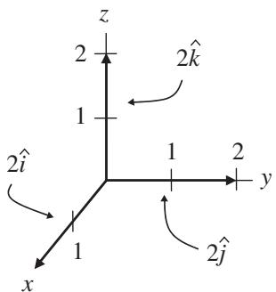
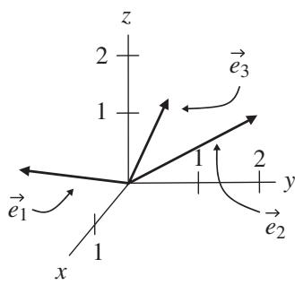

import Guide from '@/components/Guide.astro';
import Knowledge from '@/components/Knowledge.astro';
import Example from '@/components/Example.astro';
import Analysis from '@/components/Analysis.astro';
import Solution from '@/components/Solution.astro';
import Variant from '@/components/Variant.astro';
import Note from '@/components/Note.astro';
import Block from '@/components/Block.astro';
import Method from '@/components/Method.astro';
import Exercise from '@/components/Exercise.astro';

## 1.6 Basis vectors

If you think about the unit vectors $\hat { \imath } , \hat { \jmath } .$ , and $\hat { k }$ and vector components such as $A _ { x } \hat { \imath } , A _ { y } \hat { \jmath }$ , and $A _ { z } \hat { k }$ , you may realize that any vector in our three-dimensional Cartesian coordinate system can be made up of three components, each one telling you how many steps to take in the direction of one of the coordi nate axes. Since those steps may be large or small, in the positive or negative direction, you can reach any point in the space containing these vectors. Little wonder, then, that $\hat { \imath } , \hat { \jmath }$ , and $\hat { k }$ are one example of "basis vectors" in this space; combined with appropriate magnitudes, they form the basis of any vector in the space.

And you don't need to use only these particular vectors to make up any vector in this space – you can easily imagine using three vectors that are twice as long as the unit vectors $\hat { \imath } , \hat { \jmath } ,$ , and $\hat { k } .$ , as shown in Figure 1.13(a). Although the vector components would change if you switched to these longer basis vectors, you'd have no trouble using them to make up any vector within the space. Specifically, if the unit vectors were twice as long, the values of $A _ { x } , A _ { y }$ and $A _ { z }$ would have to be only half as big to reach a given point in space.

You might even think of using three non-orthogonal, non-unit vectors such as the vectors $\vec { e } _ { 1 } , \vec { e } _ { 2 }$ , and $\vec { e } _ { 3 }$ in Figure 1.13(b) as your basis vectors. Of course, if you were to select three coplanar vectors (that is, vectors lying in the same plane), you'd quickly find that scaling and combining those vectors allows you to reach any point within that plane, but all points outside the plane would be unreachable. But as long as one of the three vectors is not coplanar with the other two, then appropriate scaling and combining will get you to any point in the space, and the vectors $\vec { e } _ { 1 } , \vec { e } _ { 2 }$ , and $\vec { e } _ { 3 }$ form a perfectly usable basis set (mathematicans say that they "span" the vector space).

  
(a)  
Figure 1.13 Alternative basis vectors.

  
(b)

You can ensure that three vectors are not coplanar by requiring them to be "linearly independent," which means that no two of the vectors may be scaled and combined to give the third, and no two are collinear (that is, lying along the same line or parallel to one another). This is often stated as the requirement that the only way to scale and combine the three vectors and get zero as the result is to scale each of the vectors by zero. In other words, for three linearly independent vectors $\vec { e } _ { 1 } , \vec { e } _ { 2 }$ , and $\vec { e } _ { 3 }$ , the equation

$$
A \vec {e} _ {1} + B \vec {e} _ {2} + C \vec {e} _ {3} = 0\tag{1.18}
$$

can only be true if $\mathbf { A } = \mathbf { B } = \mathbf { C } = 0$

So as long as you pick three linearly independent vectors, you have a viable set of basis vectors. And if you choose three non-coplanar vectors $\vec { e } _ { 1 } , \vec { e } _ { 2 }$ , and $\vec { e } _ { 3 }$ of non-unit length, it's quite simple to form unit vectors from these vec tors. Since dividing a vector by a positive scalar changes its length but not its direction, you simply divide each vector by its magnitude:

$$
\begin{array}{l} \hat {e} _ {1} = \frac {\vec {e} _ {1}}{| \vec {e} _ {1} |} \\ \hat {e} _ {2} = \frac {\vec {e} _ {2}}{| \vec {e} _ {2} |} \\ \hat {e} _ {3} = \frac {\vec {e} _ {3}}{| \vec {e} _ {3} |}. \end{array}\tag{1.19}
$$

The concepts described in this section may be used to construct an infinite number of bases, but the most common are the "orthonormal" bases such as $\hat { \imath } , \hat { \jmath } .$ , and ${ \hat { k } } .$ . These bases are called "ortho" because they're orthogonal (per pendicular to one another) and "normal" because they are normalized to a magnitude of one. Orthonormal bases will get you through the majority of problems you're likely to face.

One last fact about basis vectors in various coordinate systems will serve you very well if you study physics and engineering beyond the basic level, espe cially if your studies include the tensors discussed in Chapters 4 through 6. That fact is this: basis vectors that point along the axes of one coordi nate system may be described in another coordinate system using partial derivatives.8 Specifically, imagine that you're converting from spherical to rectangular coordinates. The basis vector along the original spherical (r) axis can be written in the Cartesian (x, y, and z) system as

$$
\begin{array}{l} \vec {e} _ {r} = \frac {\partial x}{\partial r} \hat {i} + \frac {\partial y}{\partial r} \hat {j} + \frac {\partial z}{\partial r} \hat {k} \\ \qquad = \sin \theta \cos \phi   \hat {i} + \sin \theta \sin \phi   \hat {j} + \cos \theta   \hat {k}. \end{array}
$$

Likewise, the $\scriptstyle { \vec { e } } _ { \theta }$ and $\vec { e } _ { \phi }$ basis vectors can be written as

$$
\begin{array}{r l} & {\vec {e} _ {\theta} = \frac {\partial x}{\partial \theta} \hat {\imath} + \frac {\partial y}{\partial \theta} \hat {j} + \frac {\partial z}{\partial \theta} \hat {k}} \\ & {\qquad = r \cos \theta \cos \phi \hat {\imath} + r \cos \theta \sin \phi \hat {j} - r \sin \theta \hat {k},} \\ & {\vec {e} _ {\phi} = \frac {\partial x}{\partial \phi} \hat {\imath} + \frac {\partial y}{\partial \phi} \hat {j} + \frac {\partial z}{\partial \phi} \hat {k}} \\ & {\qquad = - r \sin \theta \sin \phi \hat {\imath} + r \sin \theta \cos \phi \hat {j}.} \end{array}
$$

Notice that these basis vectors are not all unit vectors (because their magnitudes are not all equal to one), nor do they all have the same dimensions $( \vec { e } _ { r }$ is dimensionless, but $\scriptstyle { \vec { e } } _ { \theta }$ and $\vec { e } _ { \phi }$ have dimensions of length). Neither of these characteristics disqualifies these as basis vectors, and you can always turn them into unit vectors by dividing by their magnitudes (take a look at the problems at the end of this chapter and their on-line solutions if you want to see how this works).

In general, if the coordinates of the original system are called $x _ { 1 } , x _ { 2 }$ , and $x _ { 3 }$ (these were $r , \theta$ , and $\phi$ in the example just discussed), and the coordinates of the new system are called $x _ { 1 } ^ { \prime } , x _ { 2 } ^ { \prime }$ , and $x _ { 3 } ^ { \prime }$ (these were x, y, and $z$ in the example), then the basis vectors along the original coordinate axes can be written in the new system as

$$
\begin{array}{r l} & {\vec {e} _ {1} = \frac {\partial x _ {1} ^ {\prime}}{\partial x _ {1}} \vec {e} _ {1} ^ {\prime} + \frac {\partial x _ {2} ^ {\prime}}{\partial x _ {1}} \vec {e} _ {2} ^ {\prime} + \frac {\partial x _ {3} ^ {\prime}}{\partial x _ {1}} \vec {e} _ {3} ^ {\prime},} \\ & {\vec {e} _ {2} = \frac {\partial x _ {1} ^ {\prime}}{\partial x _ {2}} \vec {e} _ {1} ^ {\prime} + \frac {\partial x _ {2} ^ {\prime}}{\partial x _ {2}} \vec {e} _ {2} ^ {\prime} + \frac {\partial x _ {3} ^ {\prime}}{\partial x _ {2}} \vec {e} _ {3} ^ {\prime},} \\ & {\vec {e} _ {3} = \frac {\partial x _ {1} ^ {\prime}}{\partial x _ {3}} \vec {e} _ {1} ^ {\prime} + \frac {\partial x _ {2} ^ {\prime}}{\partial x _ {3}} \vec {e} _ {2} ^ {\prime} + \frac {\partial x _ {3} ^ {\prime}}{\partial x _ {3}} \vec {e} _ {3} ^ {\prime}.} \end{array}\tag{1.20}
$$

In other words, the partial derivatives $\displaystyle \frac { \partial x _ { 1 } ^ { \prime } } { \partial x _ { 1 } } \vec { e } _ { \ 1 } ^ { \prime } , \ \frac { \partial x _ { 2 } ^ { \prime } } { \partial x _ { 1 } } \vec { e } _ { \ 2 } ^ { \prime }$ , and $\frac { \partial x _ { 3 } ^ { \prime } } { \partial x _ { 1 } } \vec { e } _ { 3 } ^ { \prime }$ are the compo nents of the first original (unprimed) basis vector expressed in the new (primed)

coordinate system. For this reason, you'll find that some authors define basis vectors in terms of partial derivatives.

These relationships will prove to be extremely valuable in the study of coordinate-system transformation and tensor analysis, so file them away if you studies include those topics.
