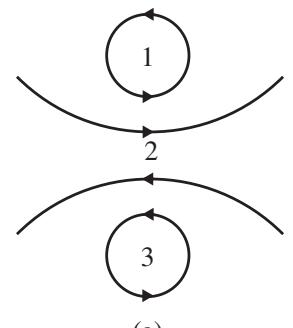
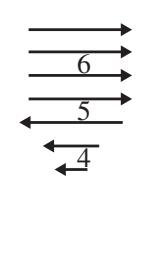
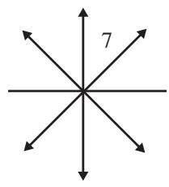
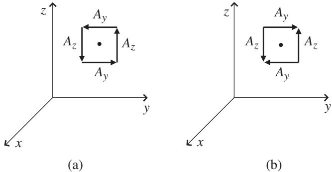
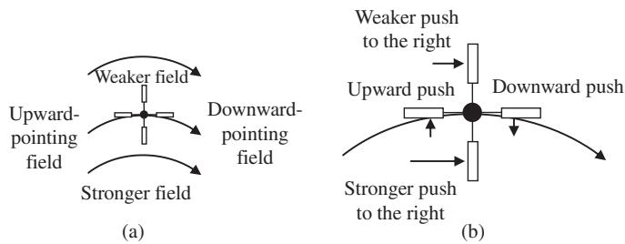

import Guide from '@/components/Guide.astro';
import Knowledge from '@/components/Knowledge.astro';
import Example from '@/components/Example.astro';
import Analysis from '@/components/Analysis.astro';
import Solution from '@/components/Solution.astro';
import Variant from '@/components/Variant.astro';
import Note from '@/components/Note.astro';
import Block from '@/components/Block.astro';
import Method from '@/components/Method.astro';
import Exercise from '@/components/Exercise.astro';

## 2.10 Curl

The del operator followed by a cross $( \vec { \nabla } \times )$ signifies the differential operation of curl. The curl of a vector field is a measure of the field's tendency to circulate about a point, much like the divergence is a measure of the tendency of the field to flow away from a point. But unlike the divergence, which produces a scalar result, the curl produces a vector. The magnitude of the curl vector is proportional to the amount of circulation of the field around the point of interest, and the direction of the curl vector is perpendicular to the plane in which the field's circulation is a maximum.

The curl at a point in a vector field can be understood by considering the vector fields shown in Figure 2.14. To find the locations of large curl in each of these fields, look for points at which the flow vectors on one side of the point are significantly different (in magnitude, direction, or both) from the flow vectors on the opposite side of the point. Once again a thought experi ment is helpful: imagine holding a tiny paddlewheel at each point in the flow. If the flow would cause the paddlewheel to rotate, the center of the wheel marks a point of non-zero curl. The direction of the curl is along the axis of the paddlewheel. By convention, the positive-curl direction is determined by the right-hand rule: if you curl the fingers of your right hand along the circulation direction, your thumb points in the direction of positive curl.

  
(a)

  
(b)

  
(c)  
Figure 2.14 Vector fields with various values of curl.

Using the paddlewheel test, you can see that points 1, 2, and 3 in Figure 2.14(a) and point 5 in Figure 2.14(b) are high-curl locations, and some curl also exists at point 4. The uniform flow around point 6 and the diverging flow lines around Point 7 in Figure 2.14(c) would not cause a tiny paddlewheel to rotate, meaning that these are points of low or zero curl.

To make this quantitative, you can use the differential form of the curl o "del cross" $( \vec { \nabla } \times )$ operator in Cartesian coordinates:

$$
\vec {\nabla} \times \vec {A} = \left(\hat {i} \frac {\partial}{\partial x} + \hat {j} \frac {\partial}{\partial y} + \hat {k} \frac {\partial}{\partial z}\right) \times \left(\hat {i} A _ {x} + \hat {j} A _ {y} + \hat {k} A _ {z}\right).\tag{2.38}
$$

Recall that the vector cross-product may be written as a determinant:

$$
\vec {\nabla} \times \vec {A} = \left| \begin{array}{c c c} \hat {\imath} & \hat {j} & \hat {k} \\ \frac {\partial}{\partial x} & \frac {\partial}{\partial y} & \frac {\partial}{\partial z} \\ A _ {x} & A _ {y} & A _ {z} \end{array} \right|,\tag{2.39}
$$

which expands to

$$
\vec {\nabla} \times \vec {A} = \left(\frac {\partial A _ {z}}{\partial y} - \frac {\partial A _ {y}}{\partial z}\right) \hat {i} + \left(\frac {\partial A _ {x}}{\partial z} - \frac {\partial A _ {z}}{\partial x}\right) \hat {j} + \left(\frac {\partial A _ {y}}{\partial x} - \frac {\partial A _ {x}}{\partial y}\right) \hat {k}.\tag{2.40}
$$

Notice that each component of the curl of $\vec { A }$ indicates the tendency of the field to rotate in one of the coordinate planes. If the curl of the field has a large x-component, it means that the field has significant circulation about that point in the $y z$ plane. The overall direction of the curl represents the axis about which the rotation is greatest, with the sense of the rotation given by the right-hand rule.

If you're wondering how the terms in this equation measure rotation, consider the vector fields shown in Figure 2.15. Look first at the field in Figure 2.15(a) and the x-component of the curl in the equation: this term involves the change in $A _ { z }$ with y and the change in $A _ { y }$ with $z .$ . Proceeding in the positive y-direction from the left side of the point of interest to the right, $A _ { z }$ is clearly increasing (it's pointing in the negative z-direction on the left side of the point of interest and the positive z-direction on the right side), so the term $\frac { \partial A _ { z } } { \partial y }$ must be positive. Looking now at $A _ { y }$ , you can see that it is positive below the point of interest and negative above, so it is decreasing in the positive $z -$ direction. Thus $\frac { \partial A _ { y } } { \partial z }$ is negative, which means that it increases the value of the curl when it is subtracted from $\frac { \partial A _ { z } } { \partial y }$ . Thus the curl has a large value at the poin of interest, as expected in light of the circulation of $\vec { A }$ about this point.

  
Figure 2.15 Effect of $\frac { \partial A _ { y } } { \partial z }$ and $\frac { \partial A _ { z } } { \partial y }$ on the value of the curl.

The situation in Figure 2.15(b) is quite different. In this case, both $\frac { \partial A _ { y } } { \partial z }$ and $\frac { \partial A _ { z } } { \partial y }$ are positive, and subtracting $\frac { \partial A _ { y } } { \partial z }$ from $\frac { \partial A _ { z } } { \partial y }$ gives a small result. The value of the x-component of the curl is therefore small in this case. Vector fields with zero curl at all points are called "irrotational."

Here are expressions for the curl in cylindrical and spherical coordinates:

$$
\vec {\nabla} \times \vec {A} = \left(\frac {1}{r} \frac {\partial A _ {z}}{\partial \phi} - \frac {\partial A _ {\phi}}{\partial z}\right) \hat {r} + \left(\frac {\partial A _ {r}}{\partial z} - \frac {\partial A _ {z}}{\partial r}\right) \hat {\phi} + \frac {1}{r} \left(\frac {\partial (r A _ {\phi})}{\partial r} - \frac {\partial A _ {r}}{\partial \phi}\right) \hat {z},
$$

(cylindrical)

$$
\begin{array}{c} \vec {\nabla} \times \vec {A} = \frac {1}{r \sin \theta} \left(\frac {\partial (A _ {\phi} \sin \theta)}{\partial \theta} - \frac {\partial A _ {\theta}}{\partial \phi}\right) \hat {r} + \frac {1}{r} \left(\frac {1}{\sin \theta} \frac {\partial A _ {r}}{\partial \phi} - \frac {\partial (r A _ {\phi})}{\partial r}\right) \hat {\theta} \\ + \frac {1}{r} \left(\frac {\partial (r A _ {\theta})}{\partial r} - \frac {\partial A _ {r}}{\partial \theta}\right) \hat {\phi}. \end{array}\tag{2.41}
$$

(spherical)

(2.42)

A common misconception is that the curl of a vector field is non-zero wherever the field appears to curve. However, just as the divergence depended both on the spreading out and the changing length of field lines, the curl depends not only on the curvature of the lines but also on the strength of the field. Consider a curving field that points in the $\hat { \phi }$ direction and decreases as $1 / r$

$$
\vec {A} = \frac {k}{r} \hat {\phi}.
$$

Finding the curl of this field is particularly straightforward in cylindrical coordinates:

$$
\vec {\nabla} \times \vec {A} = \left(\frac {1}{r} \frac {\partial A _ {z}}{\partial \phi} - \frac {\partial A _ {\phi}}{\partial z}\right) \hat {r} + \left(\frac {\partial A _ {r}}{\partial z} - \frac {\partial A _ {z}}{\partial r}\right) \hat {\phi} + \frac {1}{r} \left(\frac {\partial (r A _ {\phi})}{\partial r} - \frac {\partial A _ {r}}{\partial \phi}\right) \hat {z}.
$$

Since $A _ { r }$ and $A _ { z }$ are both zero, this is

$$
\begin{array}{l} \vec {\nabla} \times \vec {A} \\ = \left(- \frac {\partial A _ {\phi}}{\partial z}\right) \hat {r} + \frac {1}{r} \left(\frac {\partial (r A _ {\phi})}{\partial r}\right) \hat {z} = \left(- \frac {\partial (k / r)}{\partial z}\right) \hat {r} + \frac {1}{r} \left(\frac {\partial (r k / r)}{\partial r}\right) \hat {z} = 0. \end{array}
$$

To understand the physical basis for this result, consider again the fluid-flow and paddlewheel analogy. Imagine the forces on the paddlewheel placed in the field shown in Figure 2.16(a). The center of curvature is well below the bottom of the figure, and the spacing of the arrows indicates that the field is getting weaker with distance from the center. At first glance, it may seem that this paddlewheel would rotate clockwise due to the curvature of the field, since the flow lines are pointing slightly upward at the left paddle and slightly downward at the right. But consider the effect of the weakening of the field above the axis of the paddlewheel: the top paddle receives a weaker push from the field than the bottom paddle, as shown in Figure 2.16(b). The stronger force on the bot tom paddle will attempt to cause the paddlewheel to rotate counter-clockwise. Thus the downward curvature of the field is offset by the weakening of the field with distance from the center of curvature. And if the field diminishes as $1 / r$ , the upward-downward push on the left and right paddles is exactly compensated by the weaker-stronger push on the top and bottom paddles. The clockwise and counter-clockwise forces balance, and the paddlewheel does not turn – the curl at this location is zero, even though the field lines are curved.

  
Figure 2.16 Offsetting components of the curl of ${ \vec { A } } .$

For this $1 / r$ field, the curl is zero everywhere except at the center of curvature (where a singularity exists and must be handled using the delta function).
