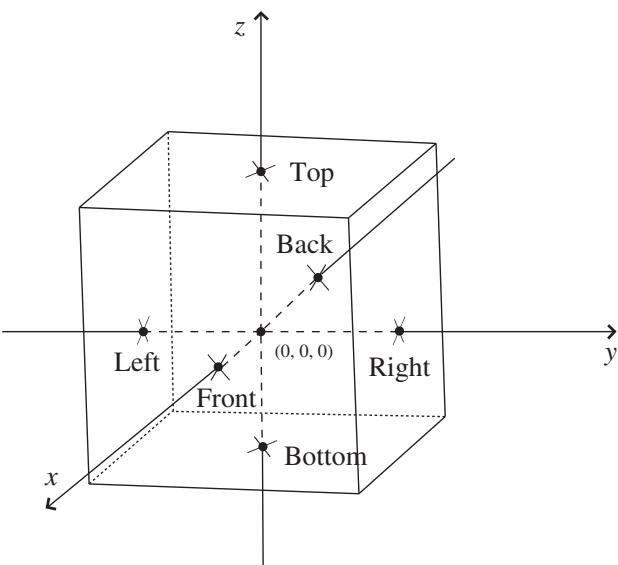
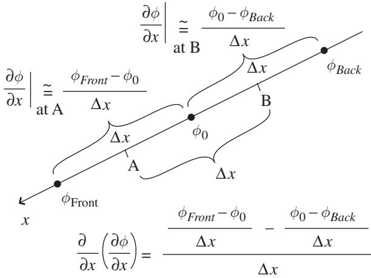
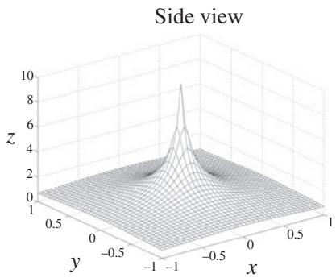
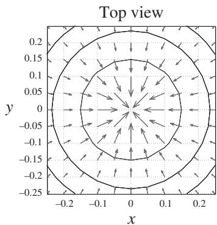
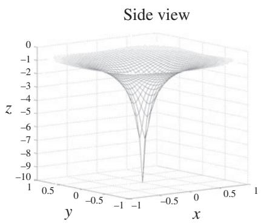
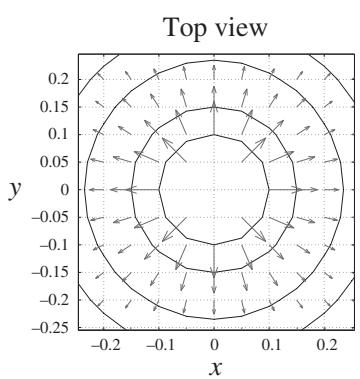

import Guide from '@/components/Guide.astro';
import Knowledge from '@/components/Knowledge.astro';
import Example from '@/components/Example.astro';
import Analysis from '@/components/Analysis.astro';
import Solution from '@/components/Solution.astro';
import Variant from '@/components/Variant.astro';
import Note from '@/components/Note.astro';
import Block from '@/components/Block.astro';
import Method from '@/components/Method.astro';
import Exercise from '@/components/Exercise.astro';

## 2.11 Laplacian

Once you know that the gradient operates on a scalar function and produces a vector and that the divergence operates on a vector and produces a scalar, it's natural to wonder whether these two operations can be combined in a mean ingful way. As it turns out, the divergence of the gradient of a scalar function $\phi .$ , written as $\vec { \nabla } \circ ( \vec { \nabla } \phi )$ , is one of the most useful mathematical operations in physics and engineering. This operation, usually written as $\nabla ^ { 2 } \phi$ (but sometimes as $\Delta \phi )$ , is called the "Laplacian" in honor of Pierre-Simon Laplace, the great French mathematician and astronomer.

Before trying to understand why the Laplacian operator is so valuable, you should begin by recalling the operations of gradient and divergence in Cartesian coordinates:

Gradient:

$$
\vec {\nabla} \phi = \hat {\imath} \frac {\partial \phi}{\partial x} + \hat {j} \frac {\partial \phi}{\partial y} + \hat {k} \frac {\partial \phi}{\partial z}.\tag{2.43}
$$

Divergence:

$$
\vec {\nabla} \circ \vec {A} = \frac {\partial A _ {x}}{\partial x} + \frac {\partial A _ {y}}{\partial y} + \frac {\partial A _ {z}}{\partial z}.\tag{2.44}
$$

Since the x-component of the gradient of $\phi$ is $\frac { \partial \phi } { \partial x }$ , the y-component of the gra dient of $\phi$ is $\frac { \partial \phi } { \partial y }$ , and the z-component of the gradient of $\phi$ is $\frac { \partial \phi } { \partial z }$ , the divergence of the vector produced by the gradient is

$$
\vec {\nabla} \circ \vec {\nabla} \phi = \nabla^ {2} \phi = \frac {\partial^ {2} \phi}{\partial x ^ {2}} + \frac {\partial^ {2} \phi}{\partial y ^ {2}} + \frac {\partial^ {2} \phi}{\partial z ^ {2}}.\tag{2.45}
$$

Just as the gradient $( \vec { \nabla } )$ , divergence $( \vec { \nabla } \circ )$ , and curl $( \vec { \nabla } \times )$ represent differential operators, so too the Laplacian $( \nabla ^ { 2 } )$ is an operator waiting to be fed a function. As you may recall, the gradient operator tells you the direc tion of greatest increase of the function (and how steep the increase is), the divergence tells you how strongly a vector function "flows" away from a point (or toward that point if the divergence is negative), and the curl tells you how strongly a vector function tends to circulate around a point. So what does the Laplacian, the divergence of the gradient, tell you?

If you write the Laplacian operator as $\begin{array} { r } { \nabla ^ { 2 } = \frac { \partial ^ { 2 } } { \partial x ^ { 2 } } + \frac { \partial ^ { 2 } } { \partial y ^ { 2 } } + \frac { \partial ^ { 2 } } { \partial z ^ { 2 } } } \end{array}$ , it should help you see that this operator finds the change in the change of the function (if you make a graph, the change in the slope) in all directions from the poin of interest. That may not seem very interesting, until you consider that acceleration is the change in the change of position with time, or that the maxima and minima of functions (peaks and valleys) are regions in which the slope changes significantly, or that one way to find blobs and edges in a digital image is to look for points at which the gradient of the brightness suddenly changes.

To understand why the Laplacian performs such a diverse set of useful tasks, it helps to understand that at each point in space, the Laplacian of a function represents the difference between the value of the function at that point and the average of the values at surrounding points. How does it do that? Consider the region around the point labeled (0, 0, 0) in Figure 2.17. The function $\phi$ exists in all three dimensions around this region, and the cube is shown only to illustrate the location of six points around the central point (0, 0, 0), where the value of the function $\phi$ is $\phi _ { 0 }$ . Notice that there are points in front of and behind the central point (along the x-axis), points to the left and right (along the y-axis), and points above and below (along the z-axis). To see how the change in the change in $\phi$ is related to $\phi _ { 0 } .$ , consider for now the points along the x-axis, as shown in Figure 2.18. Notice that the value of $\phi$ at the point in back of the central point is labeled $\phi _ { B a c k }$ and the value of $\phi$ in front of the central point is labeled $\phi _ { F r o n t }$ . If each of these points is located a distance of $\Delta x$ from $( 0 , 0 , 0 )$ , then the partial derivative of $\phi$ at point B can be approximated by $( \phi _ { 0 } - \phi _ { B a c k } ) / \Delta x$ . Likewise, the partial derivative of $\phi$ at point A can be approximated by $( \phi _ { F r o n t } - \phi _ { 0 } ) / \Delta x$

  
Figure 2.17 Points surrounding (0, 0, 0) at which $\phi = \phi _ { 0 }$

  
Figure 2.18 Change in $\phi$ along x-axis.

But the Laplacian involves not just the change in $\phi .$ , but the change in the change of $\phi .$ . For that, you can write

$$
\begin{array}{c} \frac {\partial}{\partial x} \left(\frac {\partial \phi}{\partial x}\right) = \frac {(\phi_ {F r o n t} - \phi_ {0}) / \Delta x - (\phi_ {0} - \phi_ {B a c k}) / \Delta x}{\Delta x}, \\ \frac {\partial^ {2} \phi}{\partial x ^ {2}} = \frac {\phi_ {F r o n t} + \phi_ {B a c k} - 2 \phi_ {0}}{\Delta x ^ {2}}. \end{array}\tag{2.46}
$$

And although this might not look very helpful, good things happen when you combine this expression with the expression for the two points to the right and left of (0, 0, 0):

$$
\frac {\partial^ {2} \phi}{\partial y ^ {2}} = \frac {\phi_ {R i g h t} + \phi_ {L e f t} - 2 \phi_ {0}}{\Delta y ^ {2}},\tag{2.47}
$$

and the equation for the points on top and on the bottom of (0, 0, 0):

$$
\frac {\partial^ {2} \phi}{\partial z ^ {2}} = \frac {\phi_ {T o p} + \phi_ {B o t t o m} - 2 \phi_ {0}}{\Delta z ^ {2}}.\tag{2.48}
$$

If you pick your locations symmetrically so tha $\Delta x = \Delta y = \Delta z$ , then these three equations together give you the following:

$$
\begin{array}{l} \frac {\partial^ {2} \phi}{\partial x ^ {2}} + \frac {\partial^ {2} \phi}{\partial y ^ {2}} + \frac {\partial^ {2} \phi}{\partial z ^ {2}} \\ = \frac {\phi_ {F r o n t} + \phi_ {B a c k} + \phi_ {R i g h t} + \phi_ {L e f t} + \phi_ {T o p} + \phi_ {B o t t o m} - 6 \phi_ {0}}{\Delta x ^ {2}}. \end{array}\tag{2.49}
$$

Using the del-squared notation for the Laplacian and a little rearranging makes this

$$
\begin{array}{l} \nabla^ {2} \phi = \frac {- 6}{\Delta x ^ {2}} \left[ \phi_ {0} - \frac {1}{6} (\phi_ {\text { Front }} + \phi_ {\text { Back }} + \phi_ {\text { Right }} + \phi_ {\text { Left }} + \phi_ {\text { Top }} + \phi_ {\text { Bottom }}) \right] \\ = \frac {- 6}{\Delta x ^ {2}} (\phi_ {0} - \phi_ {\text { avg }}), \end{array} \tag {2.50}
$$

where the average value of the function $\phi$ over the six surrounding points is $\begin{array} { r } { \phi _ { a v g } = \frac { 1 } { 6 } ( \phi _ { F r o n t } + \phi _ { B a c k } + \phi _ { R i g h t } + \phi _ { L e f t } + \phi _ { T o p } + \phi _ { B o t t o m } ) } \end{array}$

Equation 2.50 tells you that the Laplacian of a function $\phi$ at any point is proportional to the difference between the value of $\phi$ at that point and the average value of $\phi$ at the surrounding points. The negative sign in this equation tells you that the Laplacian is negative if the value of the function at the point of interest is greater than the average of the function's value at the surrounding points, and the Laplacian is positive if the value at the point of interest is smaller than the average of the value at the surrounding points.

And how does the difference between a function's value at a point and the average value at neighboring points relate to the divergence of the gradient of that function? To understand that, think about a point at which the function's value is greater than the surrounding average – such a point represents a local maximum of the function. Likewise, a point at which the function's value is less than the surrounding average represents a local minimum. This is the reason you may find the Laplacian described as a "concavity detector" or a "peak finder" – it finds points at which the value of the function sticks above or falls below the values at the surrounding points.

To better understand how peaks and valleys relate to the divergence of the gradient of a function, recall that the gradient points in direction of steepest incline (or decline if the gradient is negative), and divergence measures the "flow" of a vector field out of a region (or into the region if the divergence is negative). Now consider the peak of the function shown in Figure 2.19(a) and the gradient of the function in the vicinity of that peak, shown in Fig ure 2.19(b). Near the peak, the gradient vectors "flow" toward the peak from all directions. Vector fields that converge upon a point have negative divergence, so this means that the divergence of the gradient in the vicinity of a peak will be a large negative number. This is consistent with the conclusion that the Laplacian is negative near a function's maximum point.

  
(a)

  
(b)  
Figure 2.19 Function $\phi$ (varying as 1/r) and the gradient and contours of $\phi$ near the peak.

  
(a)

  
(b)  
Figure 2.20 Function $\phi$ (varying as 1/r) and the gradient and contours of $\phi$ near the bottom of the valley.

The alternative case is shown in Figures 2.20(a) and 2.20(b). Near the bot tom of a valley, the gradient "flows" outward in all directions, so the divergence of the gradient is a large positive number in this case (again consistent with the conclusion that the Laplacian of a minimum point is positive). And what is the value of the Laplacian of a function away from a peak or valley? The answer to that question depends on the shape of the function in the vicinity of the point in question. As described in Section 2.9, the value of the divergence depends on how strongly the function "flows" away from a small volume surrounding the point of interest. Since the Laplacian involves the divergence of the gradient, the question is whether the gradient vectors "flow" toward or away from the point (in other words, whether the gradient vectors tend to concentrate toward or disperse away from that point). If the inward flow of gradient vectors equals the outward flow, then the Laplacian of the function is zero at that point. But if the length and direction of the gradient vectors conspire to make the outward flow greater than the inward flow at some point, then the Laplacian is positive at that point.

For example, if you're climbing out of a circularly symmetric valley with constant slope, the gradient vectors are spreading apart without changing in length, which means the divergence of the gradient (and hence the Laplacian) will have a positive value at that point. But if a different valley has walls for which the slope gets less steep (so the gradient vectors get shorter) as you move away from the bottom of the valley, it's possible for the reduced strength of the gradient vectors to exactly compensate for the spreading apart of those vectors, in which case the Laplacian will be zero.

To see how this works mathematically, consider a three-dimensional function $\phi$ whose value decreases in inverse proportion to the distance r from the origin. This function may be written as $\phi = k / r$ , where $k$ is just a constant of proportionality and r is the distance from the origin. Thus $r = ( x ^ { 2 } + y ^ { 2 } + z ^ { 2 } ) ^ { 1 / 2 }$ and $\phi = k / ( x ^ { 2 } + y ^ { 2 } + z ^ { 2 } ) ^ { 1 / 2 }$ . You can find the value of the Laplacian for this case using Eq. 2.45; the first step is to find the partial derivative of $\phi$ with respect to x

$$
\frac {\partial \phi}{\partial x} = \frac {- k (2 x)}{2 (x ^ {2} + y ^ {2} + z ^ {2}) ^ {3 / 2}} = \frac {- k x}{(x ^ {2} + y ^ {2} + z ^ {2}) ^ {3 / 2}},
$$

after which you take another partial with respect to x:

$$
\begin{array}{c} \frac {\partial^ {2} \phi}{\partial x ^ {2}} = \frac {- k}{(x ^ {2} + y ^ {2} + z ^ {2}) ^ {3 / 2}} + \left(\frac {3}{2}\right) \frac {k x (2 x)}{(x ^ {2} + y ^ {2} + z ^ {2}) ^ {5 / 2}} \\ = \frac {- k}{(x ^ {2} + y ^ {2} + z ^ {2}) ^ {3 / 2}} + \frac {3 k x ^ {2}}{(x ^ {2} + y ^ {2} + z ^ {2}) ^ {5 / 2}}. \end{array}
$$

The same approach for the second-order partials with respect to $y$ and z gives

$$
\frac {\partial^ {2} \phi}{\partial y ^ {2}} = \frac {- k}{(x ^ {2} + y ^ {2} + z ^ {2}) ^ {3 / 2}} + \frac {3 k y ^ {2}}{(x ^ {2} + y ^ {2} + z ^ {2}) ^ {5 / 2}},
$$

and

$$
\frac {\partial^ {2} \phi}{\partial z ^ {2}} = \frac {- k}{(x ^ {2} + y ^ {2} + z ^ {2}) ^ {3 / 2}} + \frac {3 k z ^ {2}}{(x ^ {2} + y ^ {2} + z ^ {2}) ^ {5 / 2}}.
$$

Now it's just a matter of adding all three second-order partials:

$$
\begin{array}{c} \frac {\partial^ {2} \phi}{\partial x ^ {2}} + \frac {\partial^ {2} \phi}{\partial y ^ {2}} + \frac {\partial^ {2} \phi}{\partial z ^ {2}} = \frac {- 3 k}{(x ^ {2} + y ^ {2} + z ^ {2}) ^ {3 / 2}} + \frac {3 k (x ^ {2} + y ^ {2} + z ^ {2})}{(x ^ {2} + y ^ {2} + z ^ {2}) ^ {5 / 2}} \\ = \frac {- 3 k}{(x ^ {2} + y ^ {2} + z ^ {2}) ^ {3 / 2}} + \frac {3 k}{(x ^ {2} + y ^ {2} + z ^ {2}) ^ {3 / 2}} = 0. \end{array}
$$

So for a three-dimensional function with 1/r-dependence, the Laplacian of the function is zero everywhere away from the origin. What about at the origin itself? That point requires special treatment, since the 1/r-dependence of the function becomes problematic at $r = 0$ . That special treatment involves the Dirac delta function and integral rather than differential techniques.

You may occasionally have need to calculate the Laplacian in non-Cartesian coordinates. For function $\psi$ , the Laplacian in cylindrical and spherical coordi nates is given by:

Cylindrical

$$
\nabla^ {2} \psi = \frac {1}{r} \frac {\partial}{\partial r} \left(r \frac {\partial \psi}{\partial r}\right) + \frac {1}{r ^ {2}} \frac {\partial^ {2} \psi}{\partial \phi^ {2}} + \frac {\partial^ {2} \psi}{\partial z ^ {2}},\tag{2.51}
$$

Spherical

$$
\nabla^ {2} \psi = \frac {1}{r ^ {2}} \frac {\partial}{\partial r} \left(r ^ {2} \frac {\partial \psi}{\partial r}\right) + \frac {1}{r ^ {2} \sin \theta} \frac {\partial}{\partial \theta} \left(\sin \theta \frac {\partial \psi}{\partial \theta}\right) + \frac {1}{r ^ {2} \sin^ {2} \theta} \frac {\partial^ {2} \psi}{\partial \phi^ {2}}.\tag{2.52}
$$
