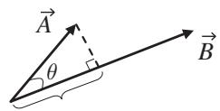
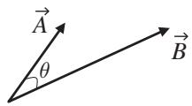

import Guide from '@/components/Guide.astro';
import Knowledge from '@/components/Knowledge.astro';
import Example from '@/components/Example.astro';
import Analysis from '@/components/Analysis.astro';
import Solution from '@/components/Solution.astro';
import Variant from '@/components/Variant.astro';
import Note from '@/components/Note.astro';
import Block from '@/components/Block.astro';
import Method from '@/components/Method.astro';
import Exercise from '@/components/Exercise.astro';

## 2.1 Scalar product

Why is it worth your time to understand the form of vector multiplication called the scalar or "dot" product? For one thing, forming the dot product between two vectors is very useful when you're trying to find the projection of one vector onto another. And why might you want to do that? Well, you may be interested in knowing how much work is done by a force acting on an object. The first instinct of many students is to think of work as "force times distance" (which is a reasonable starting point). But if you've ever taken a course that went a bit deeper than the introductory level, you may remember that the definition of work as force times distance applies only to the special case in which the force points in exactly the same direction as the displacement of the object. In the more general case in which the force acts at some angle to the direction of the displacement, you have to find the component of the force along the displacement. That's one example of exactly what the dot product can do for you, and you'll find more in the problems at the end of this chapter.

How do you go about computing the dot product between two vectors? Well, if you know the Cartesian components of each vector (call the vectors $\vec { A }$ and $\vec { B } )$ , you can use

$$
\vec {A} \circ \vec {B} = A _ {x} B _ {x} + A _ {y} B _ {y} + A _ {z} B _ {z}.\tag{2.1}
$$

Or if you know the angle $\theta$ between the vectors,

$$
\vec {A} \circ \vec {B} = | \vec {A} | | \vec {B} | \cos \theta ,\tag{2.2}
$$

where $| \vec { A } |$ and $| \vec { B } |$ represent the magnitude (length) of the vectors $\vec { A }$ and $\vec { B }$ .1 Note that the dot product between two vectors gives a scalar result (just a single value, no direction).

To grasp the physical significance of the dot product, consider vectors $\vec { A }$ and $\vec { B }$ which differ in direction by angle $\theta _ { \ast }$ , as shown in Figure 2.1a. For these vectors, the projection of $\vec { A }$ onto the direction of $\vec { B }$ is $| \vec { A } |$ cos(θ), as shown in Figure 2.1b. Multiplying this projection by the length of $\vec { B }$ gives $| \vec { A } | | \vec { B } | \cos ( \theta )$ Thus the dot product $\vec { A } \circ \vec { B }$ represents the projection of $\vec { A }$ onto the direction of $\vec { B }$ multiplied by the length of $\vec { B }$ . The scalar result of this operation is exactly the same as the result of finding the projection of $\vec { B }$ onto the direction of $\vec { A }$ and then multiplying that value by the length of $\vec { A }$ . Hence the order of the two vectors in the dot product is irrelevant; $\vec { A } \circ \vec { B }$ gives the same result as $\vec { B } \circ \vec { A }$

The scalar product can be particularly useful when one of the vectors in the product is a unit vector. That's because the length of a unit vector is by definition equal to one, so a scalar product such as $\stackrel { \triangledown } { \vec { A } } \circ \hat { k }$ finds the projection of vector $\vec { A }$ onto the direction of $\hat { k }$ (the z-direction) multiplied by the magnitude of $\hat { k }$ (which is one). Thus to find the component of any vector in a given direction, you can simply form the dot product between that vector and the unit vector in

  
(a)

The projection of $\vec { A }$ onto $\vec { B } \colon \vec { | A | }$ cosθ times the length of $\vec { B } \colon$ $x | \vec { B | }$ gives the dot product $\vec { A } \circ \vec { B } \colon | \vec { A } | \vec { B } | \cos \theta$

(b)

Figure 2.1 Two vectors and their scalar product.

the desired direction. It's quite likely you'll come across problems in physics and engineering in which you have a vector $( \vec { A } )$ and you wish to know the component of that vector that's perpendicular to a specified surface; if you know the unit normal vector $( \hat { n } )$ for the surface, the scalar product $\vec { A } \circ \hat { n }$ gives you that perpendicular component of $\vec { A }$ .

The scalar product is also useful in finding the angle between two vectors. To understand how that works, consider the two expressions for the dot product given in Eqs. 2.1 and 2.2. Since

$$
\vec {A} \circ \vec {B} = | \vec {A} | | \vec {B} | \cos \theta = A _ {x} B _ {x} + A _ {y} B _ {y} + A _ {z} B _ {z},\tag{2.3}
$$

then dividing both sides by the product of the magnitudes of $\vec { A }$ and $\vec { B }$ gives

$$
\cos (\theta) = \frac {A _ {x} B _ {x} + A _ {y} B _ {y} + A _ {z} B _ {z}}{| \vec {A} | | \vec {B} |}
$$

or

$$
\theta = \arccos \left(\frac {A _ {x} B _ {x} + A _ {y} B _ {y} + A _ {z} B _ {z}}{| \vec {A} | | \vec {B} |}\right).\tag{2.4}
$$

So if you wish to find the angle between two vectors $\vec { A } = 5 \hat { \imath } - 2 \hat { \jmath } + 4 \hat { k }$ and $\vec { B } = 3 \hat { \imath } + \hat { \jmath } + 7 \hat { k }$ , you can use Eq. 2.4 to find

$$
\begin{array}{l} \theta = \arccos \left(\frac {(5) (3) + (- 2) (1) + (4) (7)}{\sqrt {(5) ^ {2} + (- 2) ^ {2} + (4) ^ {2}} \sqrt {(3) ^ {2} + (1) ^ {2} + (7) ^ {2}}}\right) \\ = \arccos \left(\frac {4 1}{\sqrt {4 5} \sqrt {5 9}}\right) \\ = 3 7. 3 ^ {\circ}. \end{array}
$$

One final note about the scalar product: any unit vector dotted with itself gives a result of 1 (since, for example, $\hat { \iota } \circ \hat { \iota } = | \hat { \iota } | | \hat { \iota } | \cos ( 0 ^ { \circ } ) = ( 1 ) ( 1 ) ( 1 ) = 1 )$ and the dot product between two different orthogonal unit vectors gives a result of zero (since, for example, $\hat { \iota } \circ \hat { \boldsymbol { J } } = | \hat { \iota } | | \hat { \boldsymbol { J } } | \cos ( 9 0 ^ { \circ } ) = ( 1 ) ( 1 ) ( 0 ) = 0 )$
