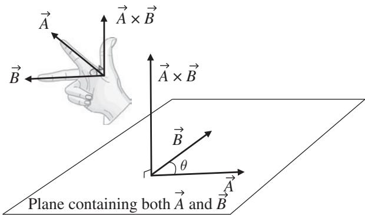
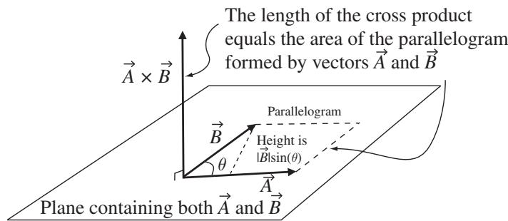

import Guide from '@/components/Guide.astro';
import Knowledge from '@/components/Knowledge.astro';
import Example from '@/components/Example.astro';
import Analysis from '@/components/Analysis.astro';
import Solution from '@/components/Solution.astro';
import Variant from '@/components/Variant.astro';
import Note from '@/components/Note.astro';
import Block from '@/components/Block.astro';
import Method from '@/components/Method.astro';
import Exercise from '@/components/Exercise.astro';

## 2.2 Cross product

Another way to multiply two vectors is to form the "cross product" between them. Unlike the dot product, which gives a scalar result, the cross prod uct results in another vector. Why bother learning this form of vecto multiplication? One reason is that the cross product is just what you need when you're trying to find the result of certain physical processes, such as applying a force at the end of a lever arm or firing a charged particle into a magnetic field

Computing the cross product between two vectors is only slightly more com plicated than finding the dot product. If you know the Cartesian components of both vectors, the cross product is given by

$$
\begin{array}{r l} \vec {A} \times \vec {B} & = (A _ {y} B _ {z} - A _ {z} B _ {y}) \hat {i} \\ & + (A _ {z} B _ {x} - A _ {x} B _ {z}) \hat {j} \\ & + (A _ {x} B _ {y} - A _ {y} B _ {x}) \hat {k}, \end{array}\tag{2.5}
$$

which can be written as

$$
\vec {A} \times \vec {B} = \left| \begin{array}{c c c} \hat {\imath} & \hat {j} & \hat {k} \\ A _ {x} & A _ {y} & A _ {z} \\ B _ {x} & B _ {y} & B _ {z} \end{array} \right|.\tag{2.6}
$$

If you haven't seen determinants before and you need some help getting from Eq. 2.6 to Eq. 2.5, you can find an explanation of how this works on the book's website.

The direction of the vector formed by the cross product of $\vec { A }$ and $\vec { B }$ is perpendicular to both $\vec { A }$ and $\vec { B }$ (that is, perpendicular to the plane containing both $\vec { A }$ and $\vec { B } )$ , as shown in Figure 2.2. Of course, there are two directions perpendicular to this plane, so how do you know which one corresponds to the direction of $\vec { A } \times \vec { B } ?$ The answer is provided by the "right-hand rule," which you can invoke by opening your right hand and making your thumb perpendicular to the direction of your fingers in the plane of your palm. Now imagine using your right palm and fingers to push the first vector $( \vec { A }$ in this case) into the direction of the second vector $( \vec { B }$ in this case) through the smallest angle. As you push, your thumb shows you the direction of the cross product.2

A very important difference between the dot product and the cross product is that the order of the vectors is irrelevant for the dot product but matters greatly for the cross product. You can see this by imagining the cross product $\vec { B } \times \vec { A }$ in Figure 2.2. In order to push vector $\vec { B }$ into vector $\vec { A }$ with your right palm, you'd have to turn your hand upside-down (that is, with your thumb pointing down). And since your thumb shows you the direction of the cross product, you can see that ${ \vec { B } } \times { \vec { A } }$ points in the opposite direction from $\vec { A } \times \vec { B }$ . That means that

$$
\vec {A} \times \vec {B} = - \vec {B} \times \vec {A},\tag{2.7}
$$

  
Figure 2.2 Direction of the cross produc $\vec { A } \times \vec { B }$

  
Figure 2.3 The cross product as area.

since the negative of a vector is just a vector of the same magnitude in the opposite direction. A quick method of computing the magnitude of the cross product is to use

$$
| \vec {A} \times \vec {B} | = | \vec {A} | | \vec {B} | \sin (\theta),\tag{2.8}
$$

where $| \vec { A } |$ is the magnitude of ${ \vec { A } } , | { \vec { B } } |$ is the magnitude of $\vec { B } .$ , and $\theta$ is the angle between A and B.3 $\vec { A }$ $\vec { B }$

One way to picture the length and direction of the cross product is illustrated in Figure 2.3. Just as the dot product involves the projection of one vector onto another, the cross product also has a geometrical interpretation. In this case, the magnitude of the cross product between two vectors is proportional to the area of the parallelogram formed with those two vectors as adjacent sides. As you may recall, the area of a parallelogram is just its base times its height, and in this case the height of the parallelogram is $| \vec { B } | \sin ( \theta )$ and the length of the base is $| \vec { A } |$ . That makes the area of the parallelogram equal to $| \vec { A } | | \vec { B } |$ sin(θ), exactly as given in Eq. 2.8.

So if the angle between two vectors $\vec { A }$ and $\vec { B }$ is zero or $1 8 0 ^ { \circ }$ (that is, if $\vec { A }$ and $\vec { B }$ are parallel or antiparallel), the cross product between them is zero. And as the angle between $\vec { A }$ and $\vec { B }$ approaches $9 0 ^ { \circ }$ or $2 7 0 ^ { \circ }$ , the magnitude of the cross product increases, reaching a maximum value of $| \vec { A } | | \vec { B } |$ when the vectors are perpendicular.

Using the definition of the cross product and the right-hand rule, you should be able to convince yourself that the following relations are true:

$$
\begin{array}{l l} \hat {\imath} \times \hat {\imath} = 0 & \qquad \hat {\imath} \times \hat {j} = \hat {k} \\ \hat {j} \times \hat {j} = 0 & \qquad \hat {j} \times \hat {k} = \hat {\imath} \\ \hat {k} \times \hat {k} = 0 & \qquad \hat {k} \times \hat {\imath} = \hat {j} \end{array} \qquad \begin{array}{l l} \hat {j} \times \hat {\imath} = - \hat {k} \\ \hat {k} \times \hat {j} = - \hat {\imath} \\ \hat {\imath} \times \hat {k} = - \hat {j}. \end{array}\tag{2.9}
$$

Applying these relations term-by-term to the product of $\vec { A } = A _ { x } \hat { \imath } + A _ { y } \hat { \jmath } + A _ { z } \hat { k }$ and $\vec { B } = B _ { x } \hat { \imath } + B _ { y } \hat { \jmath } + B _ { z } \hat { k }$ should help you understand where Eqs. 2.6 and 2.5 come from (and if you need some help making that work out, there's a problem on this at the end of this chapter, with the full solution on the book's website).

Applications of the cross product include torque problems (in which $\vec { \tau } =$ ${ \vec { r } } \times { \vec { F } } )$ and magnetic force problems (in which $\vec { F } _ { B } = q \vec { v } \times \vec { B } )$ ; you can find examples of these in the chapter-end problems.
