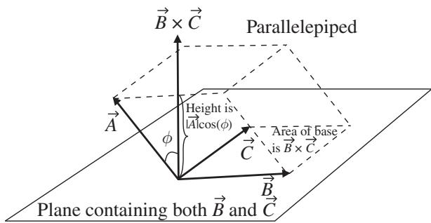

import Guide from '@/components/Guide.astro';
import Knowledge from '@/components/Knowledge.astro';
import Example from '@/components/Example.astro';
import Analysis from '@/components/Analysis.astro';
import Solution from '@/components/Solution.astro';
import Variant from '@/components/Variant.astro';
import Note from '@/components/Note.astro';
import Block from '@/components/Block.astro';
import Method from '@/components/Method.astro';
import Exercise from '@/components/Exercise.astro';

## 2.3 Triple scalar product

Once you understand the dot product and cross product described in the previ ous two sections, you may be wondering if it's possible to combine these two vector operations. Happily, it's not only possible, it's actually useful to do so. After all, you can define all the mathematical operations you'd like, but unless those operations result in something that you can apply to solve problems, you'd have to leave them in the "curiosity" file. You've seen how the dot prod uct finds employment when projections of vectors onto specified directions are needed and when work is to be calculated, and how the cross product can be called into action when torques and magnetic forces are at play. But does it make sense to combine the dot and cross product operations in a manner such as $\vec { A } \circ ( \vec { B } \times \vec { C } ) \ ?$ Yes it does.4 This is called the "triple scalar product" or "scalar triple product" and it has several useful applications.

The mathematics of this operation are straightforward; you know that

$$
\begin{array}{r l} \vec {B} \times \vec {C} & = (B _ {y} C _ {z} - B _ {z} C _ {y}) \hat {\imath} \\ & + (B _ {z} C _ {x} - B _ {x} C _ {z}) \hat {\jmath} \\ & + (B _ {x} C _ {y} - B _ {y} C _ {x}) \hat {k}, \end{array}\tag{2.10}
$$

and from Eq. 2.1 you also know that

$$
\vec {A} \circ \vec {B} = A _ {x} B _ {x} + A _ {y} B _ {y} + A _ {z} B _ {z},
$$

so combining the dot and cross product gives

$$
\begin{array}{l} \vec {A} \circ (\vec {B} \times \vec {C}) = A _ {x} (B _ {y} C _ {z} - B _ {z} C _ {y}) \\ \qquad + A _ {y} (B _ {z} C _ {x} - B _ {x} C _ {z}) \\ \qquad + A _ {z} (B _ {x} C _ {y} - B _ {y} C _ {x}). \end{array}\tag{2.11}
$$

A handy way to write this is

$$
\vec {A} \circ (\vec {B} \times \vec {C}) = \left| \begin{array}{c c c} A _ {x} & A _ {y} & A _ {z} \\ B _ {x} & B _ {y} & B _ {z} \\ C _ {x} & C _ {y} & C _ {z} \end{array} \right|.\tag{2.12}
$$

One geometrical interpretation of the triple scalar product can be under stood with the help of Figure 2.4. In this figure, vectors ${ \vec { A } } , { \vec { B } } ;$ , and $\vec { C }$ represent the sides of a parallelepiped. The area of the base of this parallelepiped is $| \vec { B } \times \vec { C } |$ , as in Figure 2.3, and its height is equal to $| \vec { A } | \cos ( \phi )$ , where $\phi$ is the angle between $\vec { A }$ and the direction of $\vec { B } \times \vec { C }$ . That means that the volume of the parallelepiped (the height times the area of the base) must be $| \vec { A } | \cos ( \phi ) ( | \vec { B } \times \vec { C } | )$ . Writing this as $\overline { { | \vec { A } | | \vec { B } } } \times \vec { C } | \cos ( \phi )$ should help you see that this has the same form as the definition of the dot product in Eq. 2.2 and is therefore just $\vec { A } \circ ( \vec { B } \times \vec { C } )$

  
Figure 2.4 The triple scalar product as volume.

Hence the triple scalar product $\vec { A } \circ ( \vec { B } \times \vec { C } )$ may be interpreted as the volume of the parallelepiped formed by vectors $\vec { A } , \vec { B }$ , and $\vec { C }$ . You should note that the triple product will give a positive result so long as the vectors $\vec { A } , \vec { B }$ , and $\vec { C }$ form a right-handed system (that is, pushing $\vec { A }$ into $\vec { B }$ with the palm of your right hand gives a direction onto which $\vec { C }$ projects in a positive sense (likewise for pushing $\vec { B }$ into $\vec { C }$ and pushing $\vec { C }$ into $\vec { A } )$

Seeing the relationship between the triple scalar product of three vectors and the volume formed by those vectors makes it easy to understand why the triple scalar product may be used as a test to determine whether three vectors are coplanar (that is, whether all three lie in the same plane). Just imagine how the parallelepiped in Figure 2.4 would look if vectors $\vec { A } , \vec { B }$ , and $\vec { C }$ were all in the same plane. In that case, the height of the parallelepiped would be zero and the projection of $\vec { A }$ onto the direction of $\vec { B } \times \vec { C }$ would be zero, which means the triple product $\vec { A } \circ ( \vec { B } \times \vec { C } )$ would have to be zero. Stated another way, if the projection of $\vec { A }$ onto the direction of $\vec { B } \times \vec { C }$ is not zero, then $\vec { A }$ cannot lie in the same plane as $\vec { B }$ and $\vec { C }$ . Thus

$$
\vec {A} \circ (\vec {B} \times \vec {C}) = 0\tag{2.13}
$$

is both a necessary and a sufficient condition for vectors $\vec { A } , \vec { B }$ , and $\vec { C }$ to be coplanar.

Equating $\vec { A } \circ ( \vec { B } \times \vec { C } )$ to the volume of the parallelepiped formed by vectors $\vec { A } , \vec { B }$ , and $\vec { C }$ should also help you see that any cyclic permutation of the vectors (such as $\vec { B } \circ ( \vec { C } \times \vec { A } )$ or $\vec { C } \circ ( \vec { A } \times \vec { B } ) )$ gives the same result for the triple scalar product, since the volume of the parallelepiped is the same in each of these cases. Some authors describe this as the ability to interchange the dot and the cross without affecting the result (since $( \vec { A } \ \times \vec { B } ) \circ \vec { C }$ is the same as $\vec { C } \circ ( \vec { A } \times \vec { B } ) )$ .

One application in which the triple scalar product finds use is the determi nation of reciprocal vectors, as explained in the sections in Chapter 4 dealing with covariant and contravariant components of vectors.
