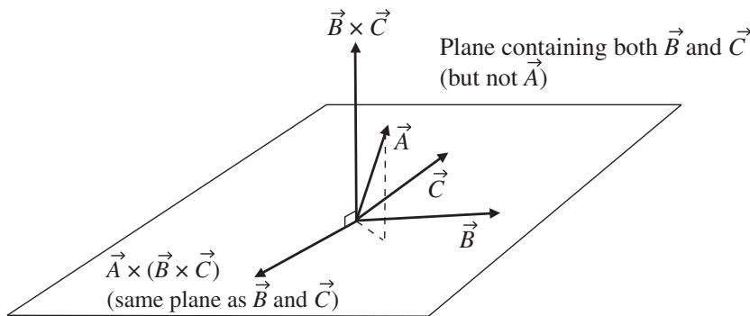

import Guide from '@/components/Guide.astro';
import Knowledge from '@/components/Knowledge.astro';
import Example from '@/components/Example.astro';
import Analysis from '@/components/Analysis.astro';
import Solution from '@/components/Solution.astro';
import Variant from '@/components/Variant.astro';
import Note from '@/components/Note.astro';
import Block from '@/components/Block.astro';
import Method from '@/components/Method.astro';
import Exercise from '@/components/Exercise.astro';

## 2.4 Triple vector product

The triple scalar product described in the previous section is not the only use ful way to multiply three vectors. An operation such as $\vec { A } \times ( \vec { B } \times \vec { C } )$ (called the "triple vector product") comes in very handy when you're dealing with certain problems involving angular momentum and centripetal acceleration. Unlike the triple scalar product, which produces a scalar result (since the sec ond operation is a dot product), the triple vector product yields a vector resul (since both operations are cross products). You should note that $\vec { A } \times ( \vec { B } \times \vec { C } )$ is not the same as $( \vec { A } \times \vec { B } ) \times \vec { C }$ ; the location of the parentheses matters greatly in the triple vector product. The triple vector product is somewhat tedious to calculate by brute force, but thankfully a simplified expression exists:

$$
\vec {A} \times (\vec {B} \times \vec {C}) = \vec {B} (\vec {A} \circ \vec {C}) - \vec {C} (\vec {A} \circ \vec {B}).\tag{2.14}
$$

After all the previous discussion of the various ways in which vectors can be multiplied, you can be forgiven for thinking that the right side of this equation looks a bit strange, with no circle or cross between $\vec { B }$ and $\vec { A } \circ \vec { C }$ or between $\vec { C }$ and $\vec { A } \circ \vec { B }$ . Just remember that $\vec { A } \circ \vec { C }$ and $\vec { A } \circ \vec { B }$ are scalars, so the expressions in parentheses in Eq. 2.14 are simply scalar multipliers of vectors $\vec { B }$ and $\vec { C }$ Does this mean that the result of the operation $\vec { A } \times \vec { ( B \times C ) }$ is a vector that is some linear combination of the second and third vectors in the triple product? That's exactly what it means, as you can see by considering Figure 2.5.

In this figure, you can see the vector $\vec { B } \times \vec { C }$ pointing straight up, perpendic ular to the plane containing vectors $\vec { B }$ and $\vec { C }$ . Now imagine forming the cross product of vector $\vec { A }$ with vector $\vec { B } \times \vec { C }$ by pushing $\vec { A }$ into the direction of $\vec { B } \times \vec { C }$ with the palm of your right hand. The result of this operation, labelled vector $\vec { A } \times ( \vec { B } \times \vec { C } )$ , is back in the plane containing vectors $\vec { B }$ and $\vec { C }$ . To understand why this is true, consider the fact that the vector that results from the operation $\vec { B } \times \vec { C }$ must be perpendicular to the plane containing $\vec { B }$ and $\vec { C }$ . If you now cross $\vec { A }$ into that vector, the resulting vector must be perpendicular to both $\vec { A }$ and to $( \vec { B } \times \vec { C } )$ , which puts it back in the plane containing vectors $\vec { B }$ and $\vec { C }$ And if the vector result of the operation $\vec { A } \times ( \vec { B } \times \vec { C } )$ is in the same plane as vectors $\vec { B }$ and $\vec { C }$ , then it must be a linear combination of those two vectors.

You can remember Eq. 2.14 as the "BAC minus $\mathbf { C A B } ^ { \prime \prime }$ rule so long as you remember to write the members of the triple product in the correct sequence $( \vec { A } , \vec { B } , \vec { C } )$ with the parentheses around the last two vectors. To see where this comes from, you can simply use the definition of the cross product (Eq. 2.6) to write

  
Figure 2.5 Vectors involved in the triple vector product $\vec { A } \times ( \vec { B } \times \vec { C } )$

$$
\vec {A} \times (\vec {B} \times \vec {C}) = \left| \begin{array}{c c c} \hat {\imath} & \hat {j} & \hat {k} \\ A _ {x} & A _ {y} & A _ {z} \\ (\vec {B} \times \vec {C}) _ {x} & (\vec {B} \times \vec {C}) _ {y} & (\vec {B} \times \vec {C}) _ {z} \end{array} \right|.\tag{2.15}
$$

And from Equation 2.5 you know that

$$
\begin{array}{r l} \vec {B} \times \vec {C} & = (B _ {y} C _ {z} - B _ {z} C _ {y}) \hat {\imath} \\ & + (B _ {z} C _ {x} - B _ {x} C _ {z}) \hat {\jmath} \\ & + (B _ {x} C _ {y} - B _ {y} C _ {x}) \hat {k}. \end{array}\tag{2.16}
$$

Substituting these terms into Eq. 2.15 gives

$$
\vec {A} \times (\vec {B} \times \vec {C}) = \left| \begin{array}{c c c} \hat {\imath} & \hat {j} & \hat {k} \\ A _ {x} & A _ {y} & A _ {z} \\ (B _ {y} C _ {z} - B _ {z} C _ {y}) & (B _ {z} C _ {x} - B _ {x} C _ {z}) & (B _ {x} C _ {y} - B _ {y} C _ {x}) \end{array} \right|.\tag{2.17}
$$

Multiplying this out looks ugly at first:

$$
\begin{array}{r l} & {\vec {A} \times (\vec {B} \times \vec {C}) = [ A _ {y} (B _ {x} C _ {y} - B _ {y} C _ {x}) - A _ {z} (B _ {z} C _ {x} - B _ {x} C _ {z}) ] \hat {\imath}} \\ & {\qquad + [ A _ {z} (B _ {y} C _ {z} - B _ {z} C _ {y}) - A _ {x} (B _ {x} C _ {y} - B _ {y} C _ {x}) ] \hat {\jmath}} \\ & {\qquad + [ A _ {x} (B _ {z} C _ {x} - B _ {x} C _ {z}) - A _ {y} (B _ {y} C _ {z} - B _ {z} C _ {y}) ] \hat {\kappa}.} \end{array}\tag{2.18}
$$

But a little rearranging gives

$$
\begin{array}{r l} \vec {A} \times (\vec {B} \times \vec {C}) & = (A _ {y} C _ {y} + A _ {z} C _ {z}) (B _ {x} \hat {\imath}) - (A _ {y} B _ {y} + A _ {z} B _ {z}) (C _ {x} \hat {\imath}) \\ & \quad + (A _ {z} C _ {z} + A _ {x} C _ {x}) (B _ {y} \hat {\jmath}) - (A _ {z} B _ {z} + A _ {x} B _ {x}) (C _ {y} \hat {\jmath}) \\ & \quad + (A _ {x} C _ {x} + A _ {y} C _ {y}) (B _ {z} \hat {k}) - (A _ {x} B _ {x} + A _ {y} B _ {y}) (C _ {z} \hat {k}), \end{array}\tag{2.19}
$$

which still isn't pretty, but it does hold some promise. That promise can be realized by adding nothing to each row of Eq. 2.19. Nothing, that is, in the following form:

$$
A _ {x} B _ {x} C _ {x} (\hat {\imath}) - A _ {x} B _ {x} C _ {x} (\hat {\imath})
$$

Add this to the top row;

$$
A _ {y} B _ {y} C _ {y} (\hat {j}) - A _ {y} B _ {y} C _ {y} (\hat {j})
$$

Add this to the middle row;

$$
A _ {z} B _ {z} C _ {z} (\hat {k}) - A _ {z} B _ {z} C _ {z} (\hat {k})
$$

Add this to the bottom row.

These additions make Eq. 2.19 a good deal more friendly:

$$
\begin{array}{l} \vec {A} \times (\vec {B} \times \vec {C}) \\ = (A _ {x} C _ {x} + A _ {y} C _ {y} + A _ {z} C _ {z}) (B _ {x} \hat {\imath}) - (A _ {x} B _ {x} + A _ {y} B _ {y} + A _ {z} B _ {z}) (C _ {x} \hat {\imath}) \\ \quad + (A _ {x} C _ {y} + A _ {y} C _ {y} + A _ {z} C _ {z}) (B _ {y} \hat {\jmath}) - (A _ {x} B _ {x} + A _ {y} B _ {y} + A _ {z} B _ {z}) (C _ {y} \hat {\jmath}) \\ \quad + (A _ {x} C _ {x} + A _ {y} C _ {y} + A _ {z} C _ {z}) (B _ {z} \hat {\kappa}) - (A _ {x} B _ {x} + A _ {y} B _ {y} + A _ {z} B _ {z}) (C _ {z} \hat {\kappa}). \end{array}
$$

Or

$$
\begin{array}{c} \vec {A} \times (\vec {B} \times \vec {C}) = (A _ {x} C _ {x} + A _ {y} C _ {y} + A _ {z} C _ {z}) (B _ {x} \hat {\imath} + B _ {y} \hat {j} + B _ {z} \hat {k}) \\ - (A _ {x} B _ {x} + A _ {y} B _ {y} + A _ {z} B _ {z}) (C _ {x} \hat {\imath} + C _ {y} \hat {j} + C _ {z} \hat {k}). \end{array}
$$

But $\boldsymbol { B _ { x } } \boldsymbol { \hat { \imath } } + \boldsymbol { B _ { y } } \boldsymbol { \hat { \jmath } } + \boldsymbol { B _ { z } } \boldsymbol { \hat { k } }$ is just the vector $\vec { B } , C _ { x } \hat { \imath } + C _ { y } \hat { \jmath } + C _ { z } \hat { k }$ is the vector $\vec { C }$ , and the other two terms fit the definition of dot products (Eq. 2.1). Thus

$$
\begin{array}{c} \vec {A} \times (\vec {B} \times \vec {C}) = (\vec {A} \circ \vec {C}) \vec {B} - (\vec {A} \circ \vec {B}) \vec {C} \\ = \vec {B} (\vec {A} \circ \vec {C}) - \vec {C} (\vec {A} \circ \vec {B}). \end{array}
$$
