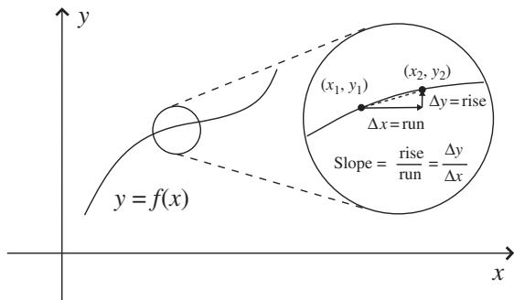
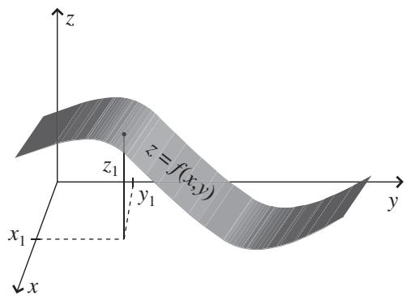
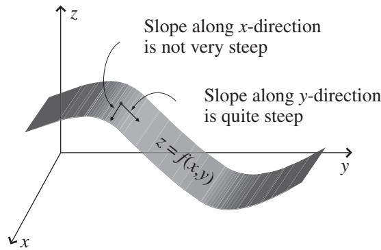
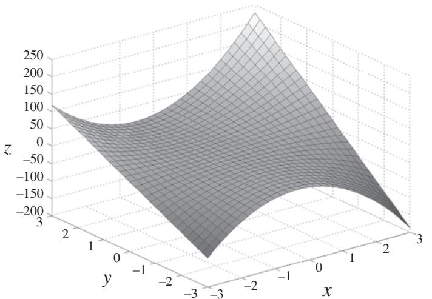

import Guide from '@/components/Guide.astro';
import Knowledge from '@/components/Knowledge.astro';
import Example from '@/components/Example.astro';
import Analysis from '@/components/Analysis.astro';
import Solution from '@/components/Solution.astro';
import Variant from '@/components/Variant.astro';
import Note from '@/components/Note.astro';
import Block from '@/components/Block.astro';
import Method from '@/components/Method.astro';
import Exercise from '@/components/Exercise.astro';

## 2.5 Partial derivatives

Once you understand the basic vector operations of dot, cross, and triple products, it's a small step to more advanced vector operations such as gradient, divergence, curl, and the Laplacian. But these are differential vector operations, so before you can make that step, it's important for you to understand the difference between ordinary derivatives and partial derivatives. This is worth your time and effort because differential vector operations have many applications in diverse areas of physics and engineering.

You probably first encountered ordinary derivatives when you learned how to find the slope of a line $\begin{array} { r } { ( m \ = \ \frac { d y } { d x } ) } \end{array}$ or how to determine the speed of an object given its position as a function of time $\begin{array} { r } { ( v _ { x } \ = \ \frac { d x } { d t } ) } \end{array}$ . Happily, partial derivatives are based on the same general concepts as ordinary derivatives, but extend those concepts to functions of multiple variables. And you should never have any doubt as to which kind of derivative you're dealing with, because ordinary derivatives are written as ${ \frac { d } { d x } } \operatorname { o r } { \frac { d } { d t } }$ and partial derivatives are written as $\frac { \partial } { \partial x } \ \mathrm { o r } \ \frac { \partial } { \partial t }$

As you may recall, ordinary derivatives come about when you're interested in the change of one variable with respect to another. For example, you may encounter a variable y which is a function of another variable x (which means that the value of y depends on the value of x). This can be written as $y = f ( x )$ where y is called the "dependent variable" and x is called the "independent variable." The ordinary derivative of y with respect to x (written as ${ \frac { d y } { d x } } )$ tells you how much the value of y changes for a small change in the variable x. If you make a graph with y on the vertical axis and x on the horizontal axis, as in Figure 2.6, then the slope of the line between any two points $( x _ { 1 } , y _ { 1 } )$ and $( x _ { 2 } , y _ { 2 } )$ on the graph is simply $\begin{array} { r } { \frac { y _ { 2 } - y _ { 1 } } { x _ { 2 } - x _ { 1 } } = \frac { \Delta y } { \Delta x } } \end{array}$ . That's because the slope is defined as "the rise over the run," and since the rise is $\Delta y$ for a run $\Delta x$ , the slope of the line between any two points must be $\frac { \Delta y } { \Delta x }$

But if you look closely at the expanded region of Figure 2.6, you'll notice that the graph of y versus x has a slight curve between points $( x _ { 1 } , y _ { 1 } )$ and $( x _ { 2 } , y _ { 2 } )$ , so the slope is actually changing in that interval. Thus the ratio $\frac { \Delta y } { \Delta x }$ can't represent the slope everywhere between those points. Instead, it rep resents the average slope over this interval, as suggested by the dashed line between points $( x _ { 1 } , y _ { 1 } )$ and $( x _ { 2 } , y _ { 2 } )$ (which by the mean value theorem does equal the slope somewhere in between these two points, but not necessarily in the middle). To represent the slope at a given point on the curve more precisely, all you have to do is to allow the "run" $\Delta x$ to become very small. As $\Delta x$ approaches zero, the difference between the dashed line and the curved line in Figure 2.6 becomes negligible. If you write the incremental run as dx and the (also incremental) rise as $d y$ , then the slope at any point on the line can be written as $\textstyle { \frac { d y } { d x } }$ . This is the reasoning that equates the derivative of a function to the slope of the graph of that function.

Now imagine that you have a variable z that depends on two other variables, say x and y, so $z = f ( x , y )$ . One way to picture such a case is to visualize a surface in three-dimensional space, as in Figure 2.7. The height of this surface above the xy plane is z, which gets higher and lower at different values of x and y. And since the height z may change at a different rate in different directions, a single derivative will not generally be sufficient to characterize the total change in height as you move from one point to another. You can see the height z changing at different rates in Figure 2.8; at the location shown in the figure, the slope of the surface is quite steep if you move in the direction of increasing y (while remaining at the same value of x), but the slope is almost zero if you move in the direction of increasing x (while holding your y-value constant).

  
Figure 2.6 Slope of the line $y = f ( x )$

  
Figure 2.7 Surface in 3-D space (z = f (x, y)).

  
Figure 2.8 Surface in 3-D space (z = f (x, y)).

This illustrates the usefulness of partial derivatives, which are derivatives formed by allowing one independent variable (such as x or y in Figure 2.8) to change while holding other independent variables constant. So the partia derivative $\textstyle { \frac { \partial z } { \partial x } }$ represents the slope of the surface at a given location if you move only along the x-direction from that location, and the partial derivative $\frac { \partial z } { \partial y }$ represents the slope if you move only along the y-direction. You may find these partial derivatives written as $\frac { \partial z } { \partial x } | _ { y }$ and ${ \frac { \partial z } { \partial y } } | _ { x } .$ , where the variables that appear in the subscript after the vertical line are held constant.

As you've probably already guessed, the change in the value of z as either x or y changes is easily found using partial derivatives. If only x changes, $\begin{array} { r } { d z = \frac { \partial z } { \partial x } d x } \end{array}$ , and if only y changes, then $\begin{array} { r } { d z \ = \ \frac { \partial z } { \partial y } d y } \end{array}$ . And if both x and y change, then

$$
d z = \frac {\partial z}{\partial x} d x + \frac {\partial z}{\partial y} d y.\tag{2.20}
$$

The process of taking a partial derivative of a given function is quite straight forward; if you know how to take ordinary derivatives, you already have the tools you'll need to take partial derivatives. Simply treat all variables (with the exception of the one variable over which the derivative is being taken) as constants, and take the derivative as you normally would. This is best explained using an example.

Consider a function such as $z = f ( x , y ) = 6 x ^ { 2 } y + 3 x + 5 x y + 1 0$ . The terms of this polynomial are sufficiently complex to make its shape less than obvious, which is where a computational tool such as Mathematica or MATLAB can be very handy. Writing a few lines of code will help you understand how this function behaves, as you can see in Figure 2.9. Even a quick look at this warped little plane makes it clear that the slope of the function is quite different in the x- and y-directions, and the slope is also highly dependent on the location on the surface. In a 3D plot such as Figure 2.9, it's always easiest to see the slope at the edges of the plotted region, so take a look at the slope along the x-direction for a y value of 3. As x varies from 3 to +3 (while y is held constant at $^ { - 3 ) }$ , the slope starts off positive and gets less steep as you move in the +x-direction from $x = - 3$ toward $x = 0$ . The slope then becomes zero somewhere near $x = 0$ , then turns negative and becomes increasingly steep as x approaches +3. Doing the same quick analysis along the y-direction while holding x constant at 3 indicates that the slope is approximately constant and positive as y varies from 3 to +3.

  
Figure 2.9 Plot of the function $z \ = \ f ( x , y ) = 6 x ^ { 2 } y + 3 x + 5 x y + 1 0$ for $- 3 \leq x \leq 3$ and $- 3 \leq y \leq 3$

Now that you have some idea of what to expect, you can take the partia derivative of $z = 6 x ^ { 2 } y + 3 x + 5 x y + 1 0$ with respect to x simply by treating the variable y as a constant:

$$
{\frac {\partial z}{\partial x}} = 1 2 x y + 3 + 5 y.\tag{2.21}
$$

Likewise, the partial derivative with respect to y is found by holding x constant:

$$
\frac {\partial z}{\partial y} = 6 x ^ {2} + 5 x.\tag{2.22}
$$

Before interpreting these derivative results, you may want to take a moment to make sure you understand why the process of taking the derivative of a function involves bringing down the exponent of the relevant variable and then subtracting one from that exponent (so ${ \frac { d ( x ^ { 2 } ) } { d x } } = 2 x$ , for example). The answer is quite straightforward. Since the derivative represents the change in the func tion z as the independent variable x changes over a very small run, the formal definition for this derivative can be written as

$$
\frac {d z}{d x} \equiv \lim _ {\Delta x \to 0} \frac {z (x + \Delta x) - z (x)}{\Delta x}.\tag{2.23}
$$

So in the case of $z = x ^ { 2 }$ , you have

$$
\frac {d (x ^ {2})}{d x} \equiv \lim _ {\Delta x \to 0} \frac {(x + \Delta x) ^ {2} - x ^ {2}}{\Delta x}.\tag{2.24}
$$

If you think about the term in the numerator, you'll see that this is $x ^ { 2 } + 2 x \Delta x +$ $( \Delta x ) ^ { 2 } - x ^ { 2 }$ , which is just $2 x \Delta x + ( \Delta x ) ^ { 2 }$ , and dividing this by $\Delta x$ gives $2 x + \Delta x$ . But as $\Delta x$ approaches zero, the 	x term becomes negligible, and this approaches 2x. So where did the 2 come from? It's just the number of cross terms (that is, terms with the product of x and $\Delta x )$ that result from rais ing $( x + \Delta x )$ to the second power. Had you been taking the derivative of $x ^ { 3 }$ with respect to x, you would have had three such cross terms. So you bring down the exponent because that's the number of cross terms that result from taking $x + \Delta x$ to that power. And why do you then subtract one from the exponent? Simply because when you take the change in the function z (that is, $( x + \Delta x ) ^ { 2 } - x ^ { 2 } )$ , the highest-power terms $( x ^ { 2 }$ in this case) cancel, leaving only terms of one lower power $( x ^ { 1 }$ in this case). It's a bit laborious, but the same analysis can be applied to show that ${ \frac { d ( x ^ { 3 } ) } { d x } } = 3 x ^ { 2 }$ and that ${ \frac { d ( x ^ { n } ) } { d x } } = n x ^ { n - 1 }$

So that's why you bring down the exponent and subtract one, but what does it mean when you take derivatives and get answers such as Eqs. 2.21 and 2.22? It simply means that the slope varies with direction and location on the sur face z. So, for example, the slope along the x-direction at location $( - 3 , 2 )$ is $1 2 x y + 3 + 5 y = 1 2 ( - 3 ) ( 2 ) + 3 + 5 ( 2 ) = - 5 9$ , while at the same location the slope along the y-direction is $6 x ^ { 2 } + 5 x = 6 [ ( - 3 ) ^ { 2 } ] + 5 ( - 3 ) = 3 9$

You can do a rough check on your calculated partial derivative in Eq. 2.21 by inserting the value of 3 for y to see that the slope of z at this value of y is $1 2 ( x ) ( - 3 ) + 3 + 5 ( - 3 ) = - 3 6 x - 1 2$ . Thus as you move in the x-direction at $y = - 3$ , the slope should vary from +96 at $x = - 3$ , to zero at $x = - 1 / 3$ and down to 120 at $x = + 3$ . This is consistent with the quick analysis of the slope after Figure 2.9.

Likewise, Eq. 2.22 tells you that the slope of z in the y-direction at $x = - 3$ is constant and positive, also consistent with the behavior expected from a quick analysis of the shape of the function z.

And just as you can take "higher order" ordinary derivatives such as $\begin{array} { r } { \frac { d } { d x } ( \frac { d z } { d x } ) = \frac { d ^ { 2 } z } { d x ^ { 2 } } } \end{array}$ and $\begin{array} { r } { \frac { d } { d y } ( \frac { d z } { d y } ) = \frac { d ^ { 2 } z } { d y ^ { 2 } } } \end{array}$ , you can also take higher-order partial derivatives. So for example $\begin{array} { r } { \frac { \partial } { \partial x } ( \frac { \partial z } { \partial x } ) = \frac { \partial ^ { 2 } z } { \partial x ^ { 2 } } } \end{array}$ tells you the change in the x-direction slope of z as you move along the x-direction, and $\begin{array} { r } { \frac { \partial } { \partial y } ( \frac { \partial z } { \partial y } ) = \frac { \partial ^ { 2 } z } { \partial y ^ { 2 } } } \end{array}$ tells you the change in the y-direction slope as you move along the y-direction.

It's important for you to realize that an expression such as $\textstyle { \frac { \partial ^ { 2 } z } { \partial x ^ { 2 } } }$ is the derivative of a derivative, which is not the same as $( \frac { \partial z } { \partial x } ) ^ { 2 }$ , which is the square of a first derivative. That's easy to verify for the example given above, in which $\begin{array} { r } { \frac { \partial z } { \partial x } = 1 2 x y + 3 + 5 y } \end{array}$ . In that case, $\begin{array} { r } { \frac { \partial _ { z } ^ { 2 } } { \partial x ^ { 2 } } \ = \ 1 2 y } \end{array}$ , whereas $\begin{array} { r l } { ( \frac { \partial z } { \partial x } ) ^ { 2 } } & { { } = } \end{array}$ $( 1 2 x y + 3 + 5 y ) ^ { 2 }$ . By convention the order of the derivative is always written between the $" d "$ or $\ddot { \mathbf { \nabla } } \partial ^ { , }$ and the function, as $d ^ { 2 } z$ or $\partial ^ { 2 } z .$ , so be sure to look carefully at the location of superscripts when you're dealing with derivatives.

You may also have occasion to use "mixed" partial derivatives such as $\begin{array} { r } { \frac { \partial } { \partial x } ( \frac { \partial z } { \partial y } ) = \frac { \partial ^ { 2 } z } { \partial x \partial y } } \end{array}$ . If you've been tracking the discussion of partial derivatives as slopes of functions in various directions, you can probably guess that $\frac { { { \partial } ^ { 2 } } z } { \partial { { x } \partial { y } } }$ represents the change in the y-direction slope as you move along the x-direction, and $\frac { \partial _ { z } ^ { 2 } } { \partial y \partial x }$ represents the change in the x-direction slope as you move along the y-direction. Thankfully, for well-behaved5 functions these expressions are interchangeable, so you can take the partial derivatives in either order. You can easily verify this for the example given above by comparing $\frac { \partial } { \partial y }$ of Eq. 2.21 with $\frac { \partial } { \partial x }$ of Eq. 2.22 (the result is $1 2 x + 5$ in both cases).

There's another widely used aspect of partial derivatives you should make sure you understand, and that's the chain rule. Up to this point, we've been dealing with functions such as $z = f ( x , y )$ without considering the fact that the variables x and y may themselves be functions of other variables. It's com mon to call these other variables u and v and to allow both x and y to depend on one or both of u and v. You may encounter situations in which you know the variation in u and v, and you want to know how much your function z will change due to those changes. In such cases, the chain rule for partial derivatives gives you the answer:

$$
{\frac {\partial z}{\partial u}} = {\frac {\partial z}{\partial x}} {\frac {\partial x}{\partial u}} + {\frac {\partial z}{\partial y}} {\frac {\partial y}{\partial u}},\tag{2.25}
$$

and

$$
{\frac {\partial z}{\partial v}} = {\frac {\partial z}{\partial x}} {\frac {\partial x}{\partial v}} + {\frac {\partial z}{\partial y}} {\frac {\partial y}{\partial v}}.\tag{2.26}
$$

The chain rule is a concise expression of the fact that z depends on both x and y, and since both x and y may change if u changes, the change in z with respect to u is the sum of two terms. The first term is the change in x due to the change in u $\textstyle { \big ( } { \frac { \partial x } { \partial u } } { \big ) }$ times the change in z due to that change in x $\textstyle { \big ( } { \frac { \partial z } { \partial x } } { \big ) }$ , and the second term is the change in y due to the change in u $\textstyle { \bigl ( } { \frac { \partial y } { \partial u } } { \bigr ) }$ times the change in z due to that change in $ { y } ( \frac { \partial z } { \partial y } )$ . Adding those two terms together gives you Eq. 2.25, and the same reasoning applied to changes in $z$ caused by changes in v leads to Eq. 2.26.
