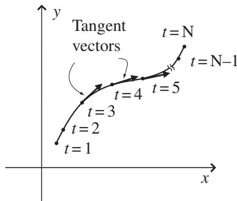

import Guide from '@/components/Guide.astro';
import Knowledge from '@/components/Knowledge.astro';
import Example from '@/components/Example.astro';
import Analysis from '@/components/Analysis.astro';
import Solution from '@/components/Solution.astro';
import Variant from '@/components/Variant.astro';
import Note from '@/components/Note.astro';
import Block from '@/components/Block.astro';
import Method from '@/components/Method.astro';
import Exercise from '@/components/Exercise.astro';

## 2.6 Vectors as derivatives

In many texts dealing with vectors and tensors, you'll find that vectors are equated to "directional derivatives" and that partial derivatives such as $\frac { \partial } { \partial x }$ and $\frac { \partial } { \partial y }$ are referred to as basis vectors along the coordinate axes.

To understand this correspondence between vectors and derivatives, con sider a path such as that shown in Figure 2.10. You can think of this as a path along which you're travelling with velocity v; for simplicity imagine that this path lies in the xy plane. Now imagine that you're keeping track of time as you move, so you assign a value (such as the t values shown in the figure) to each point on the curve. By marking the curve with values, you have "parameterized" the curve (with t as your parameter).6 Note that there need not be equal distance along the curve between your parameter values (there definitely won't be if you choose time as your parameter and then change your speed as you move; the reckless driver depicted in Figure 2.10 has apparently sped up in the turn).

  
Figure 2.10 Parameterized curve and tangent vectors.

As a final bit of visualization, imagine that this curve lies in a region in which the air temperature is different at each location. So as you move along the curve, you will experience the spatial change in air temperature as a temporal change (in other words, you'll be able to make a graph of air temperature vs. time). Of course, how fast the air temperature changes for you will depend both on the distance between measurable changes in the temperature in the direction you're heading and on your speed (how fast you're covering that distance).

With this scenario in mind, the concept of a directional derivative is easy to understand. If the function $f ( x , y )$ describes the temperature at each x, y location, the directional derivative $\textstyle { \big ( } { \frac { d f } { d t } } { \big ) }$ tells you how much the value of the function $f$ changes as you move a small distance along the curve (in time dt). But recall the chain rule:

$$
{\frac {d f}{d t}} = {\frac {d x}{d t}} {\frac {\partial f}{\partial x}} + {\frac {d y}{d t}} {\frac {\partial f}{\partial y}}.\tag{2.27}
$$

This equation says simply that the directional derivative of the function f along the curve parameterized by t (that is, $\textstyle { \frac { d f } { d t } } )$ equals the rate of change of the x-coordinate $\textstyle { \big ( } { \frac { d x } { d t } } { \big ) }$ as you move along the curve times the rate of change of the temperature function with $x \ ( \frac { \partial f } { \partial x } )$ plus the rate of change of the y-coordinate $\textstyle { \bigl ( } { \frac { d y } { d t } } { \bigr ) }$ as you move along the curve times the rate of change of the temperature function with $y \ : ( \frac { \partial f } { \partial y } )$ . But $\textstyle { \big ( } { \frac { d x } { d t } } { \big ) }$ is just $v _ { x }$ , the x-component of your velocity, and $\textstyle { \big ( } { \frac { d y } { d t } } { \big ) }$ is $v _ { y }$ , the y-component of your velocity. And since you know that your velocity is a vector that is always tangent to the path on which you're moving, you can consider the directional derivative $\textstyle { \frac { d f } { d t } }$ to be a vector with direction tangent to the curve and with length equal to the rate of change of $f$ with t (that is, the time rate of change of the air temperature).

Now here's the important concept: since $f$ can be any function, you can write Eq. 2.27 as an "operator" equation (that is, an equation waiting to be fed a function on which it can operate):

$$
\frac {d}{d t} = \frac {d x}{d t} \frac {\partial}{\partial x} + \frac {d y}{d t} \frac {\partial}{\partial y}.\tag{2.28}
$$

The trick to seeing the connection between derivatives and vectors is to view this equation as a vector equation in which

$$
\text { Vector } = x \text {-component} \cdot x \text {   basis   vector } + y \text {-component} \cdot y \text {   basis   vector. }
$$

Comparing this to Eq. 2.28, you should be able to see that the directional derivative operator $\frac { d } { d t }$ represents the tangent vector to the curve, the $\textstyle { \frac { d x } { d t } }$ and $\frac { d y } { d t }$ terms represent the x- and y-components of that vector, and the operators $\frac { \partial } { \partial x }$ and $\frac { \partial } { \partial y }$ represent the basis vectors in the direction of the x and y coordinate axes.

Of course, it's not just air temperature that can be represented by $f ( x , y )$ this function can represent anything that is spatially distributed in the region around your curve. So $f ( x , y )$ could represent the height of the road, the qual ity of the scenery, or any other quantity that varies in the vicinity of your curve. Likewise, you could have chosen to parameterize your path with markers other than time; had you assigned a value s or $\lambda$ to each point on your path, the directional derivative $\frac { d } { d s }$ or $\frac { d } { d \lambda }$ would still represent the tangent vector to the curve, $\textstyle { \frac { d x } { d s } }$ or $\frac { d x } { d \lambda }$ would still represent the x-component of that vector, and $\frac { d y } { d s }$ or $\frac { d y } { d \lambda }$ would still represent the y-component of that vector.

If you plan to proceed on to the study of tensors, you will find that understanding this relationship between basis vectors along the coordinate axes and partial derivatives is of significant value.
