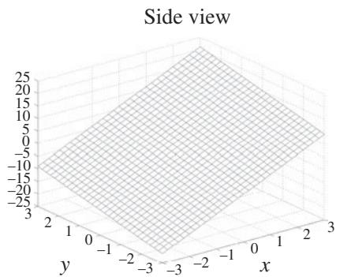
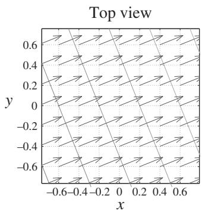

import Guide from '@/components/Guide.astro';
import Knowledge from '@/components/Knowledge.astro';
import Example from '@/components/Example.astro';
import Analysis from '@/components/Analysis.astro';
import Solution from '@/components/Solution.astro';
import Variant from '@/components/Variant.astro';
import Note from '@/components/Note.astro';
import Block from '@/components/Block.astro';
import Method from '@/components/Method.astro';
import Exercise from '@/components/Exercise.astro';

## 2.8 Gradient

When the del operator $\vec { \nabla }$ is followed by a scalar field, the result of the opera tion is called the gradient of the field. What does the gradient tell you about a scalar field? Two important things: the magnitude of the gradient indicates how quickly the field is changing over space, and the direction of the gradient indi cates the direction in which the field is increasing most quickly with distance. So although the gradient operates on a scalar field, the result of the gradien operation is a vector, with both magnitude and direction. Thus, if the scalar field represents terrain height, the magnitude of the gradient at any location tells you how steeply the ground is sloped at that location, and the direction of the gradient points uphill along the steepest slope.

The definition of the gradient of the scalar field $\psi$ in Cartesian coordinates is

$$
\operatorname{grad} (\psi) = \vec {\nabla} \psi \equiv \hat {i} \frac {\partial \psi}{\partial x} + \hat {j} \frac {\partial \psi}{\partial y} + \hat {k} \frac {\partial \psi}{\partial z} \quad (\text { Cartesian }).\tag{2.30}
$$

Thus the x-component of the gradient of $\psi$ indicates the slope of the scalar field in the x-direction and the other components indicate the slope in the other directions. The square root of the sum of the squares of these components provides the total steepness of the slope at the location at which the gradient is taken.

You can see a simple example of the result of the gradient operator by considering the tilted plane in Figure 2.11(a). This plane is defined by the sim ple equation $\psi ( x , y ) = 5 x + 2 y$ , and you can find the gradient using the two-dimensional version of Eq. 2.30:

$$
\begin{array}{c} \vec {\nabla} \psi = \hat {\imath} \frac {\partial (5 x + 2 y)}{\partial x} + \hat {j} \frac {\partial (5 x + 2 y)}{\partial y} \\ = 5 \hat {\imath} + 2 \hat {j}. \end{array}
$$

So even though $\psi$ is a scalar function, its gradient is a vector; it has a com ponent along the x-axis and a component along the y-axis. And what do these components tell you?

For one thing, the fact that the x-component is more than twice the size of the y-component tells you that the tilt of the plane is steeper in the x-direction than in the y-direction. You can also tell that the slope in each direction is constant, because the components are not functions of $x$ or $y .$ . Both of those conclusions are consistent with Figure 2.11(a).

  
(a)

  
(b)  
Figure 2.11 Function $\psi = 5 x + 2 y$ and the gradient and contours of $\psi$

And if you wish to determine the magnitude of the gradient, that's easily done. Since the x-component of the gradient is 5 and the y-component is 2, the magnitude of the gradient is simply $( 5 ^ { 2 } + 2 ^ { 2 } ) ^ { 1 / 2 } = 5 . 3 9$ over the entire plane. You can also find the angle that the gradient vectors make with the positive x-axis using arctan $( 2 / 5 ) = 2 1 . 8 ^ { \circ }$ . The gradient and contours of the centra portion of the function $\psi$ are shown in Figure 2.11(b).

In cylindrical and spherical coordinates, the gradient is:

$$
\vec {\nabla} \psi \equiv \hat {r} \frac {\partial \psi}{\partial r} + \hat {\varphi} \frac {1}{r} \frac {\partial \psi}{\partial \varphi} + \hat {z} \frac {\partial \psi}{\partial z} (\mathrm{cylindrical}),\tag{2.31}
$$

and

$$
\vec {\nabla} \psi \equiv \hat {r} \frac {\partial \psi}{\partial r} + \hat {\theta} \frac {1}{r} \frac {\partial \psi}{\partial \theta} + \hat {\varphi} \frac {1}{r \sin \theta} \frac {\partial \psi}{\partial \varphi} (\text { spherical }).\tag{2.32}
$$

You'll see more gradients in Section 2.11 covering the Laplacian operator, which represents the divergence of the gradient. You can read about the divergence in the next section.
