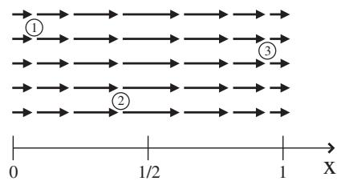
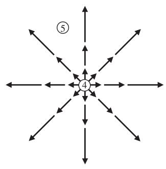
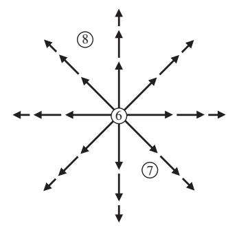

import Guide from '@/components/Guide.astro';
import Knowledge from '@/components/Knowledge.astro';
import Example from '@/components/Example.astro';
import Analysis from '@/components/Analysis.astro';
import Solution from '@/components/Solution.astro';
import Variant from '@/components/Variant.astro';
import Note from '@/components/Note.astro';
import Block from '@/components/Block.astro';
import Method from '@/components/Method.astro';
import Exercise from '@/components/Exercise.astro';

## 2.9 Divergence

When dealing with vector fields, you may encounter the del operator followed by a dot $( \vec { \nabla } \circ )$ , signifying the divergence of a vector field. The concept of divergence often arises in the areas of physics and engineering that deal with the spatial variation of vector fields, because divergence describes the tendency of vectors to "flow" into or out of a point of interest.7 Electrostatic fields, for example, may be represented by vectors that point radially away from points at which positive electric charge exists, just as the flow vectors of a fluid point away from a source (such as an underwater spring). Likewise, electrostatic field vectors point toward locations at which negative charge is present, analogous to fluid flowing toward a sink or drain. It was the brilliant Scottish mathemat ical physicist James Clerk Maxwell who coined the term "convergence" for the mathematical operation which measures the rate of vector "flow" toward a given location. In modern usage we consider the opposite behavior (vectors flowing away from a point), and outward flow is considered positive divergence. In the case of fluid flow, the divergence at any point is a measure of the tendency of the flow vectors to diverge from that point (that is, to carry more material away from it than toward it). Thus points of positive divergence mark the location of sources, while points of negative divergence show you where the sinks are located.

To understand how this works, take a look at the vector fields shown in Figures 2.12 and 2.13. To find the locations of positive divergence in each of these fields, look for points at which the flow vectors either spread out or are larger pointing away from the location and shorter pointing toward it. Some authors suggest that you imagine sprinkling sawdust on flowing water to assess the divergence; if the sawdust is dispersed, you have selected a point of positive divergence, while if it becomes more concentrated, you've picked a location of negative divergence.

Using such tests, it's clear that locations such as 1 and 2 in Figure 2.12 and locations 4 and 5 in Figure 2.13(a) are points of positive divergence (flow away from these points exceeds flow toward), while the divergence is negative at point 3 in Figure 2.12 (flow toward exceeds flow away).

The divergence at various points in Figure 2.13(b) is less obvious. Location 6 is obviously a point of positive divergence, but what about locations 7 and 8? The flow lines are clearly spreading out at those locations, as they do at location 5 in Figure 2.13(a), but they're also getting shorter pointing away. Does the spreading out compensate for the slowing down of the flow?

  
Figure 2.12 Parallel vector field with varying amplitude.

  
(a)

  
(b)  
Figure 2.13 Radial vector fields with varying amplitudes.

Answering that question requires a useful mathematical form of the diver gence as well as a description of how the vector field varies from place to place. The differential form of the mathematical operation of divergence or "del dot" $( \vec { \nabla } \circ )$ on a vector $\vec { A }$ in Cartesian coordinates is

$$
\vec {\nabla} \circ \vec {A} = \left(\hat {\imath} \frac {\partial}{\partial x} + \hat {j} \frac {\partial}{\partial y} + \hat {k} \frac {\partial}{\partial z}\right) \circ \left(\hat {\imath} \vec {A} _ {x} + \hat {j} \vec {A} _ {y} + \hat {k} \vec {A} _ {z}\right),\tag{2.33}
$$

and, since $\hat { \boldsymbol { l } } \circ \hat { \boldsymbol { l } } = \hat { \boldsymbol { J } } \circ \hat { \boldsymbol { J } } = \hat { k } \circ \hat { k } = 1$ , this is

$$
\vec {\nabla} \circ \vec {A} = \left(\frac {\partial A _ {x}}{\partial x} + \frac {\partial A _ {y}}{\partial y} + \frac {\partial A _ {z}}{\partial z}\right).\tag{2.34}
$$

Thus the divergence of $\vec { A }$ is simply the change in its x-component along the x-axis plus the change in its y-component along the y-axis plus the change in its z-component along the z-axis. Notice that the divergence of a vector field is a scalar quantity; it has magnitude but no direction.

You can now apply this to the vector field in Figure 2.12. In Figure 2.12, assume that the magnitude of the vector field varies sinusoidally along the x axis as $\vec { A } = \sin ( \pi x ) \hat { \imath }$ while remaining constant in the $y -$ and z-directions. Thus,

$$
\vec {\nabla} \circ \vec {A} = \frac {\partial A _ {x}}{\partial x} = \pi \cos (\pi x),\tag{2.35}
$$

since $A _ { y }$ and $A _ { z }$ are zero. This expression is positive for $0 < x < 1 / 2$ , 0 at $x = 1 / 2$ , and negative for $1 / 2 < x < 3 / 2$ , just as a visual inspection suggests.

Now consider Figure 2.13(a), which represents a slice through a spherically symmetric vector field with amplitude increasing as the square of the distance from the origin. Thus $\vec { A } = r ^ { 2 } \hat { r }$ . Since $r ^ { 2 } = ( x ^ { 2 } + y ^ { 2 } + z ^ { 2 } )$ and

$$
\hat {r} = \frac {x \hat {\imath} + y \hat {j} + z \hat {k}}{\sqrt {x ^ {2} + y ^ {2} + z ^ {2}}},
$$

this means

$$
\begin{array}{r l} & {\vec {A} = r ^ {2} \hat {r} = (x ^ {2} + y ^ {2} + z ^ {2}) \frac {x \hat {i} + y \hat {j} + z \hat {k}}{\sqrt {x ^ {2} + y ^ {2} + z ^ {2}}}} \\ & {\qquad = (x ^ {2} + y ^ {2} + z ^ {2}) ^ {1 / 2} (x \hat {i} + y \hat {j} + z \hat {k}),} \end{array}
$$

and

$$
\frac {\partial A _ {x}}{\partial x} = (x ^ {2} + y ^ {2} + z ^ {2}) ^ {1 / 2} + x \left(\frac {1}{2}\right) (x ^ {2} + y ^ {2} + z ^ {2}) ^ {- 1 / 2} (2 x).
$$

Doing likewise for the y- and z-components and adding yields

$$
\vec {\nabla} \circ \vec {A} = 3 (x ^ {2} + y ^ {2} + z ^ {2}) ^ {1 / 2} + \frac {(x ^ {2} + y ^ {2} + z ^ {2})}{\sqrt {x ^ {2} + y ^ {2} + z ^ {2}}} = 4 (x ^ {2} + y ^ {2} + z ^ {2}) ^ {1 / 2} = 4 r.
$$

Thus the divergence in the vector field in Figure 2.13(a) is increasing linearly with distance from the origin.

Finally, consider the vector field in Figure 2.13(b), which is similar to the previous case but with the amplitude of the vector field decreasing as the square of the distance from the origin. The flow lines are spreading out as they were in Figure 2.13(a), but in this case you might suspect that the decreasing amplitude of the vector field will affect the value of the divergence. Since $\vec { A } = ( 1 / r ^ { 2 } ) \hat { r }$

$$
\vec {A} = \frac {1}{(x ^ {2} + y ^ {2} + z ^ {2})} \frac {x \hat {\imath} + y \hat {j} + z \hat {k}}{\sqrt {x ^ {2} + y ^ {2} + z ^ {2}}} = \frac {x \hat {\imath} + y \hat {j} + z \hat {k}}{(x ^ {2} + y ^ {2} + z ^ {2}) ^ {(3 / 2)}},
$$

and

$$
\frac {\partial A _ {x}}{\partial x} = \frac {1}{(x ^ {2} + y ^ {2} + z ^ {2}) ^ {3 / 2}} - x \left(\frac {3}{2}\right) (x ^ {2} + y ^ {2} + z ^ {2}) ^ {- 5 / 2} (2 x).
$$

Adding in the y- and z-derivatives gives

$$
\vec {\nabla} \circ \vec {A} = \frac {3}{(x ^ {2} + y ^ {2} + z ^ {2}) ^ {3 / 2}} - \frac {3 (x ^ {2} + y ^ {2} + z ^ {2})}{(x ^ {2} + y ^ {2} + z ^ {2}) ^ {5 / 2}} = 0.
$$

This validates the suspicion that the reduced amplitude of the vector field with distance from the origin may compensate for the spreading out of the flow lines. Note that this is true only for the case in which the amplitude of the vector field falls off as $1 / r ^ { 2 }$ (and only for points away from the origin).8 Therefore, you must consider two key factors in determining the divergence at any point: the spacing and the relative amplitudes of the field lines at that point. These factors both contribute to the total flow of field lines into or out of an infinitesimally small volume around the point. If the outward flow exceeds the inward flow, the divergence is positive at that point. If the outward flow is less than the inward flow, the divergence is negative, and if the outward and inward flows are equal the divergence is zero at that point.

So far the divergence has been calculated for the Cartesian coordinate sys tem, but depending on the symmetries of the problem, it might be solved more easily using non-Cartesian systems. The divergence may be calculated in cylindrical and spherical coordinate systems using

$$
\vec {\nabla} \circ \vec {A} = \frac {1}{r} \frac {\partial}{\partial r} (r A _ {r}) + \frac {1}{r} \frac {\partial A _ {\phi}}{\partial \phi} + \frac {\partial A _ {z}}{\partial z}, \quad (\text { cylindrical })\tag{2.36}
$$

and

$$
\vec {\nabla} \circ \vec {A} = \frac {1}{r ^ {2}} \frac {\partial}{\partial r} (r ^ {2} A _ {r}) + \frac {1}{r \sin \theta} \frac {\partial}{\partial \theta} (A _ {\theta} \sin \theta) + \frac {1}{r \sin \theta} \frac {\partial A _ {\phi}}{\partial \phi}. \quad (\text { spherical })\tag{2.37}
$$

If you doubt the efficacy of choosing the proper coordinate system, you should re-work the last two examples in this section using spherica coordinates.
