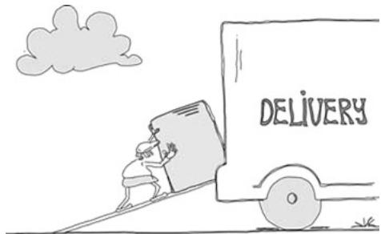
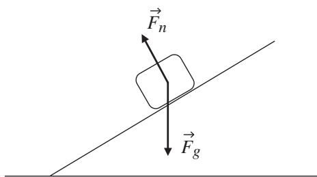
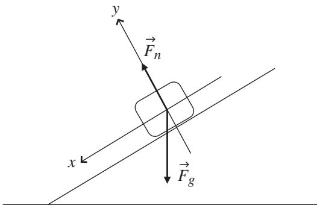
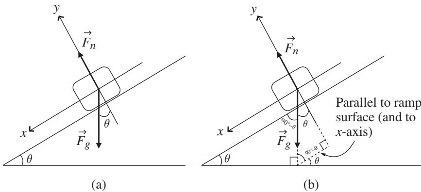
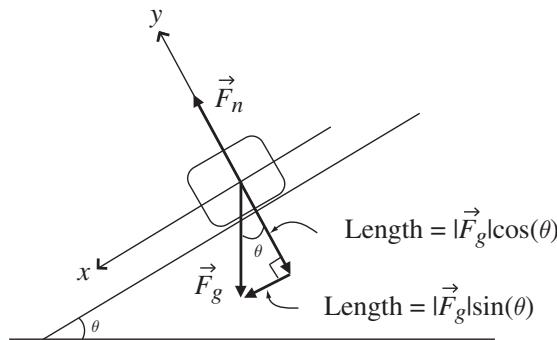
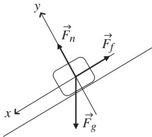

import Guide from '@/components/Guide.astro';
import Knowledge from '@/components/Knowledge.astro';
import Example from '@/components/Example.astro';
import Analysis from '@/components/Analysis.astro';
import Solution from '@/components/Solution.astro';
import Variant from '@/components/Variant.astro';
import Note from '@/components/Note.astro';
import Block from '@/components/Block.astro';
import Method from '@/components/Method.astro';
import Exercise from '@/components/Exercise.astro';

## 3.1 Mass on an inclined plane

Consider the delivery woman pushing a heavy box up the ramp to her delivery truck, as illustrated in Figure 3.1. In this situation, there are a number of forces acting on the box, so if you want to determine how the box will move, you need to know how to work with vectors. Specifically, to solve problems such as this, you can use vector addition to find the total force acting on the box, and then you can use Newton's Second Law to relate that total force to the acceleration of the box.

To understand how this works, imagine that the delivery woman slips off the side of the ramp, leaving the box free to slide down the ramp under the influence of gravity. For starters, pretend that the ramp is so slippery that friction between the bottom of the box and the ramp surface is negligible (so the coef ficient of friction is effectively zero). How fast will the box be moving when it reaches the bottom of the ramp? Perhaps more importantly, on what does that speed depend?

Whenever you approach a problem like this, it's a good idea to begin by drawing a diagram that shows all the forces acting on the box. Such a "free-body" diagram will help you determine the total force acting on the object, from which you can easily determine the object's acceleration using Newton's Second Law $( \vec { a } = \Sigma \vec { F } / m )$ .1 And once you know the acceleration, it's an easy matter to find the velocity. An example of the free-body diagram for this (frictionless) case is shown in Figure 3.2.

  
Figure 3.1 The delivery-truck problem.

  
Figure 3.2 Free-body diagram for mass on frictionless ramp.

By removing the delivery woman and friction from the problem, the only remaining forces acting on the box are the force of gravity $\vec { F } _ { g }$ , which points vertically downward,2 and the normal force ${ \vec { F } } _ { n }$ , which is perpendicular (or "normal") to the surface of the ramp. The origin of these forces is easy to understand; the gravitational force is produced by the mass of the Earth, and the normal force is produced by the ramp as a reaction to the force produced by the box on the ramp (if the ramp weren't pushing upward on the box, gravity would cause the box to accelerate straight downward).

  
Figure 3.3 Free-body diagram with coordinate axes.

Do these two forces really act only at a single point somewhere inside the box, as implied by Figure 3.2? Clearly not, since every particle in the box is being pulled downward by the Earth's gravity, and the force of the ramp on the box occurs along the entire underside of the box. But to determine the acceleration of the box in this problem, you don't need to worry about the actual point of application of the forces, because you can treat the box as a particle that exists at a single location. That's not always the case; in problems involving torque and angular acceleration, for example, the point of application of the force may be critically important. But the box in this problem is sliding, not rolling, down the ramp, and you're perfectly justified in treating the box as a single particle and drawing the forces as though they all act at the same point. Furthermore, you're less likely to make a mistake about the angles of the forces if you draw them as in Figure 3.2. This approach can be justified using the concept of center of mass (CM), since for a rigid object of mass m you can consider the entire object as a single point and write $\vec { a } _ { C M } = \vec { F } _ { C M } / m$

Before doing the vector addition of the two forces acting on the box to deter mine the total force, it's a good idea to draw a set of coordinate axes onto your free-body diagram, as in Figure 3.3. Of course, you're free to draw the axes in any direction you choose, but when you're faced with a problem of a mass on an inclined plane, there are certain benefits to drawing the x-axis pointing down the ramp (and parallel to the ramp surface) and the y-axis pointing upward (and perpendicular to the ramp surface). This approach has the advan tage that the normal force lies entirely along the positive y-axis, and the motion of the block sliding down the ramp is entirely in the positive x-direction (as long as the box stays on the ramp). To pay for that advantage, you'll have to use a bit of geometry to find the x- and y-components of the gravitationa force, since the vector $\vec { F } _ { g }$ points straight downward and is therefore aligned with neither the down-plane (x-) nor the perpendicular-to-plane (y-) axis.3

  
Figure 3.4 Geometry to find the angle of $\vec { F } _ { g }$ .

The key to finding the x-component $( \vec { F } _ { g , x } )$ and the y-component $( \vec { F } _ { g , y } )$ of the gravitational force $( { \vec { F } } _ { g } )$ is to realize that the angle θ between the ramp surface and the horizontal is also the angle between $\vec { F } _ { g }$ and the negative y-axis, as shown in Figure 3.4(a).

If you're uncertain why the two angles shown as θ in Figure 3.4(a) must be the same, take a look at Figure 3.4(b). Completing the two triangles shown in Figure 3.4(b) should help you see that the angle between $\vec { F } _ { g }$ and the negative y-axis is indeed θ (you may also be able to see this by imagining the case in which $\theta = 0 ^ { \circ }$ or $\theta = 9 0 ^ { \circ } )$ ).

Once you're convinced that the angle between $\vec { F } _ { g }$ and the negative y axis is θ, it's quite straightforward to determine $\vec { F } _ { g , x }$ and $\vec { F } _ { g , y }$ , the x- and y-components of the gravitational force vector $\vec { F } _ { g }$ . As you can see in Figure 3.5, the components of $\vec { F } _ { g }$ are given by

$$
\begin{array}{r l} & {\vec {F} _ {g, x} = | \vec {F} _ {g} | s i n \theta (\hat {\imath}),} \\ & {\vec {F} _ {g, y} = | \vec {F} _ {g} | c o s \theta (- \hat {j}),} \end{array}\tag{3.1}
$$

where the minus sign before the $\hat { \jmath }$ accounts for the fact that this component points in the negative y-direction.

  
Figure 3.5 x- and y-components of $\vec { F } _ { g }$ .

A note about notation: as mentioned in Chapter 1, it's customary to write Eqs. 3.1 as

$$
\begin{array}{l} {F _ {g, x} = | \vec {F} _ {g} | s i n \theta ,} \\ {F _ {g, y} = - | \vec {F} _ {g} | c o s \theta ,} \end{array}\tag{3.2}
$$

that is, as scalars rather than vectors. That's because the direction of vector components should be clear from the subscript: the x-component is always in the ı direction (or ı direction if it's negative), and the y-component is always in the j direction (or j direction if it's negative). So you can write the components of a vector as scalars or vectors, as long as you remember that each component points in a specific direction, which means you cannot simply add the x- and y-components algebraically, even if they're written as scalars. You must add them as vectors.

Whether you write the components as vectors or scalars, having the x- and y-components of $\vec { F } _ { g }$ in hand and knowing that the normal force of the plane on the box is entirely in the positive y-direction, you're now in a position to use vector addition to find the total force acting on the box. Writing the magnitude of the sum of the forces in the x-direction, you have

$$
| \Sigma \vec {F} _ {x} | = | \vec {F} _ {g} | s i n \theta ,\tag{3.3}
$$

and in the y-direction

$$
| \Sigma \vec {F} _ {y} | = (| \vec {F} _ {n} | - | \vec {F} _ {g} | c o s \theta).\tag{3.4}
$$

Alternatively, instead of writing separate equations for the x- and y-components of the total force, you can write a vector equation incorporating both:

$$
\Sigma \vec {F} = (| \vec {F} _ {g} | s i n \theta) \hat {i} + (| \vec {F} _ {n} | - | \vec {F} _ {g} | c o s \theta) \hat {j},\tag{3.5}
$$

which contains exactly the same information as Eqs. 3.3 and 3.4.

Getting from the total force to the acceleration of the box is a simple step thanks to Isaac Newton, whose Second Law tells you that the magnitudes of the x- and y-components of the acceleration are

$$
a _ {x} = | \Sigma \vec {F} _ {x} | / m = (| \vec {F} _ {g} | s i n \theta / m),\tag{3.6}
$$

and

$$
a _ {y} = | \Sigma \vec {F} _ {y} | / m = [ (| \vec {F} _ {n} | - | \vec {F} _ {g} | c o s \theta) / m ],\tag{3.7}
$$

or, in full vector form,

$$
\vec {a} = \Sigma \vec {F} / m = (| \vec {F} _ {g} | s i n \theta / m) \hat {i} + [ (| \vec {F} _ {n} | - | \vec {F} _ {g} | c o s \theta) / m ] \hat {j}.\tag{3.8}
$$

Whether you realize it or not, you almost certainly know two facts that will allow you to simplify these equations considerably. The first is that the magnitude of the force of gravity $( | \vec { F } _ { g } | )$ on an object of mass "m" is simply equal to mg, where $" g '$ is the magnitude of the acceleration of gravity $( 9 . 8 \mathrm { m } / \mathrm { s } ^ { 2 }$ at the Earth's surface).4 So wherever you have the factor $\vert \vec { F } _ { g } \vert .$ , you can substitute the expression mg.

The second simplification is produced by the realization that as long as the box stays on the ramp and doesn't fly off into the air or break through to the ground, the y-component of the acceleration $( a _ { y } )$ must remain zero (remember that the y-axis is perpendicular to the surface of the ramp). Using the fact that $| \vec { F } _ { g } | = m g$ and that $a _ { y } = 0$ turns Eqs. 3.6 and 3.7 into the following:

$$
a _ {x} = m g \sin \theta / m = g \sin \theta\tag{3.9}
$$

and

$$
a _ {y} = (| \vec {F} _ {n} | - m g \cos \theta) / m = 0.\tag{3.10}
$$

When you're working a physics problem, it's a good idea to step back from your calculations once in a while to look at your intermediate results to see if they're trying to tell you something – and that's certainly the case at this point. Equation 3.9 already has an important result for you: in the absence of the upward-pushing delivery woman and with no friction, the box will accel erate down the ramp (that is, in the x-direction) with an acceleration that depends on only two things: which planet the delivery truck is on (that is, the value of $^ { \ast } g ^ { \prime \prime } )$ ) and the angle that the ramp makes with the horizontal (θ). In this case, just as for a freely falling object, the mass of the box does not affect its acceleration.5

Since the sine of the ramp angle can never be greater than one, Eq. 3.9 also tells you that the magnitude of the acceleration of the object (g sin θ) can never be greater than $^ { g , }$ , the accleration of gravity. It can, of course, be equal to $g$ if sin $\theta = 1$ . But this would mean that $\theta$ would have to be $9 0 ^ { \circ }$ (since sin $9 0 ^ { \circ } = 1 )$ , in which case the ramp would be exactly vertical. In such cases, you no longe have an object sliding down a ramp, you have an object falling next to a wall.

There's also good information lurking in Eq. 3.10, but you have to think a bit to see it. According to this equation, the y-component of the box's acceleration is equal to the difference between the magnitude of the normal force $( | \vec { F } _ { n } | )$ and the y-component of the gravitational force $( m g \cos \theta )$ . But since you know that in this problem the box remains on the ramp and the y-acceleration is therefore zero, you can use Eq. 3.10 to determine the magnitude of the normal force. Since

$$
a _ {y} = (| \vec {F} _ {n} | - m g \cos \theta) / m = 0,
$$

then

$$
| \vec {F} _ {n} | = m g \cos \theta .\tag{3.11}
$$

So the normal force depends on the weight of the object $( m g )$ and the cosine of the ramp angle (θ). Understanding this will help you avoid a common pit fall for students who know that the normal force is the reaction force produced on the object by the ramp, and who then mistakenly conclude that the normal force must always equal the weight of the object $( m g )$ ). That line of reasoning only works for horizontal surfaces, because for any inclined surface, it's only the component of the object's weight that's perpendicular to the surface that produces the reaction force we call the normal force. That perpendicu lar component of the object's weight is shown in Figure 3.5 to be mg cos $\theta$ , which spans the range from $m g$ (when $\theta = 0 ^ { \circ }$ , meaning the ramp is horizontal and bears the full weight of the object) to zero (when $\theta = 9 0 ^ { \circ }$ , meaning the ramp is vertical and bears none of the object's weight). In all other cases, the magnitude of the normal force will have a value between 0 and mg.

If you're wondering why you should bother finding ${ \vec { F } } _ { n }$ if you're only interested in the x-component of the acceleration, the answer is that you may not care about ${ \vec { F } } _ { n }$ for the frictionless case (unless you're worried about your ramp breaking), but you'll definitely need ${ \vec { F } } _ { n }$ when friction exists between the ramp surface and the bottom of the box.

With the magnitude of the down-ramp component of the acceleration $( a _ { x } )$ available from Eq. 3.9, all that remains is for you to find the speed of the box at the bottom of the ramp. Finding speed from acceleration turns out to be quite straightforward, especially when the acceleration is constant (as it is in this case), provided that you're in possession of either one of two pieces of information: the time the box takes to reach the bottom of the ramp, or (more likely), the distance from the box's starting point to the bottom of the ramp. You'll also need the initial speed, which you can generally discern from the initial conditions, and which you can take to be zero in this case. As you may remember from kinematics, the final speed of an object moving in the x-direction with initial speed $v _ { x , i n i t i a l }$ undergoing constant accleration $a _ { x }$ over time t is given by

$$
v _ {x, f i n a l} = v _ {x, i n i t i a l} + a _ {x} t,\tag{3.12}
$$

or, if you know $d ,$ , the distance in the positive x-direction over which the acceleration occurs,

$$
(v _ {x, f i n a l}) ^ {2} = (v _ {x, i n i t i a l}) ^ {2} + 2 a _ {x} d.\tag{3.13}
$$

Using the expression for acceleration from Eq. 3.9, this becomes

$$
(v _ {x, f i n a l}) ^ {2} = (0) ^ {2} + 2 (g \sin \theta) d
$$

or

$$
v _ {x, f i n a l} = \sqrt {2 (g \sin \theta) d}.\tag{3.14}
$$

So, for example, a box sliding down a 2 m ramp with an angle of $3 0 ^ { \circ }$ to the horizontal on the surface of the Earth will be moving at a speed of

$$
v _ {x, f i n a l} = \sqrt {2 \left[ (9 . 8 \mathrm{m} / \mathrm{s} ^ {2}) \sin 3 0 ^ {\circ} \right] 2 \mathrm{m}} = 4. 4 \mathrm{m} / \mathrm{s}\tag{3.15}
$$

when it reaches the bottom of the ramp. If you're curious about how long it takes the box to travel the 2 m down the ramp under these conditions, you can plug this value for the final speed into Eq. 3.12 and solve for t, which turns out to be about 0.9 s in this case.

Stripping away effects such as friction is often a good way to learn the fun damentals of a problem, but if you've ever encountered a ramp outside of physics texts, there's a good chance you had to deal with friction. Happily, once you understand how to use vectors, including friction in the "box on a ramp" problem becomes a simple matter of adding another force into the mix before solving for the acceleration.

As you may recall, friction operates in two regimes: "static" friction determines how hard you have to push on a stationary object to get it moving, but once the object is moving, the frictional force that opposes the motion is produced by "kinetic" friction. So although both types of friction oppose motion, the magnitude of the force produced by static friction depends on the applied force (the harder you push, the stronger the opposing force of static friction, until the object "breaks free" and begins moving), while the magnitude of the kinetic-friction force depends only on the normal force and the coefficient of kinetic friction between the object and the surface.6 To determine the effect of kinetic friction on the speed of the box at the bottom of the ramp, you can modify your free-body diagram to include the frictional force $( \vec { F } _ { f } )$ , as shown in Figure 3.6.

Notice that the direction of the frictional force is chosen so as to oppose the motion, and since the box is moving down the ramp in this case, the force of kinetic friction points up the ramp (in the negative x-direction).

To determine the effect of friction on the acceleration of the box sliding down the ramp, you simply have to include the frictional force $( \vec { F } _ { f } )$ in your equation for the sum of the forces in the x-direction (Eq. 3.3), which becomes

$$
| \Sigma \vec {F} _ {x} | = | \vec {F} _ {g} | s i n \theta - | \vec {F} _ {f} |.\tag{3.16}
$$

This makes the acceleration

$$
a _ {x} = \Sigma F _ {x} / m = \left(| \vec {F} _ {g} | s i n \theta - | \vec {F} _ {f} |\right) / m.\tag{3.17}
$$

Clearly, to determine the magnitude of the acceleration $( a _ { x } )$ , you'll need to find an expression for $| \vec { F } _ { f } |$ , just as you used mg sin θ for $\vert F _ { g , x } \vert$ in Eq. 3.9.

  
Figure 3.6 Free-body diagram for object on ramp with friction.

Fortunately, that's easy to do, because the magnitude of the force of kinetic friction is simply the product of the magnitude of the normal force $( | \vec { F } _ { n } | )$ and the coefficient of kinetic friction $( \mu _ { k } )$

$$
| \vec {F} _ {f} | = \mu_ {k} | \vec {F} _ {n} |.\tag{3.18}
$$

You also know from Eq. 3.11 that $| \vec { F } _ { n } | = m g \cos \theta$ , so

$$
\begin{array}{c} a _ {x} = (m g \sin \theta - \mu_ {k} m g \cos \theta) / m \\ = (g \sin \theta - \mu_ {k} g \cos \theta). \end{array}\tag{3.19}
$$

Comparing this expression for the acceleration of the box to the acceleration in the frictionless case (Eq. 3.9), you'll be happy to note that the term due to gravity (g sin θ) is exactly the same in both cases, and the term due to friction $( \mu _ { k } g \cos \theta )$ is subtracted from the gravity term. This means that the acceleration of the box will be made smaller by the frictional force. So in the case considered previously of a box sliding down a 2 m ramp that makes an angle of $3 0 ^ { \circ }$ with the horizontal, if the coefficient of kinetic friction between the box and the ramp is 0.4, the speed of the box at the bottom of the ramp will be reduced to

$$
\begin{array}{r l} v _ {x, f i n a l} & = \sqrt {2 \left[ (9 . 8 \mathrm{m} / \mathrm{s} ^ {2}) \sin 3 0 ^ {\circ} - (0 . 4) (9 . 8 \mathrm{m} / \mathrm{s} ^ {2}) \cos 3 0 ^ {\circ} \right] 2 \mathrm{m}} \\ & = 2. 5 \mathrm{m} / \mathrm{s}. \end{array}\tag{3.20}
$$

There is one aspect of Eq. 3.19 that may worry you: what if the second term is larger than the first? For any angle between $0 ^ { \circ }$ and $4 5 ^ { \circ }$ , the cosine is bigger than the sine, so if the coefficient of kinetic friction $( \mu _ { k } )$ is sufficiently large, this equation predicts that the acceleration will be in the negative x-direction, meaning the box will acclerate up the ramp even if no one is pushing on it. As physicists like to say, "That's not physical," meaning that this result contradicts other well-established laws of physics (conservation of energy comes to mind in this case). So where have we gone wrong in our analysis? We haven't, really, you just need to think carefully about the initial assumptions. One of those assumptions was that the box is travelling down the ramp, which is why we drew the frictional force pointing up the ramp in our free-body diagram (Figure 3.6). But if the ramp isn't very steep and the coefficient of friction between the box and the ramp is sufficiently large, the down-ramp component of the force of gravity will not be strong enough to overcome the frictional force, and the box will not slide down the ramp.7 So there's nothing wrong with Eq. 3.19, it's just that it only applies to the situation in which the box is moving down the ramp under the influence of gravity, in which case the force of kinetic friction points up the ramp.

So there you have it. You've used vectors to represent the forces of gravity and friction, and knowing how to find vector components and how to perform vector addition has allowed you to find the acceleration and speed of the box under various conditions. And if a box sliding straight down a ramp is a bit too mundane for your taste, you may want to take a look at the next three application examples. In them, you'll see how vectors can be helpful in analyzing motion on a curved path and how vector operations can be used to understand the behavior of electric and magnetic fields.
