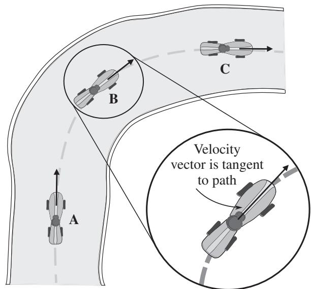
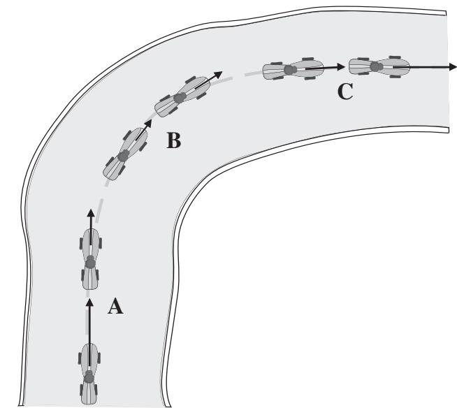
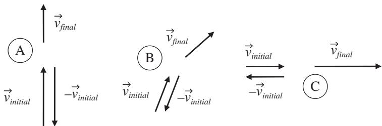
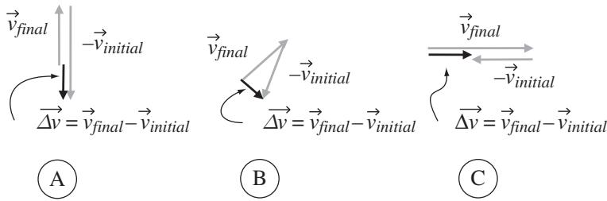
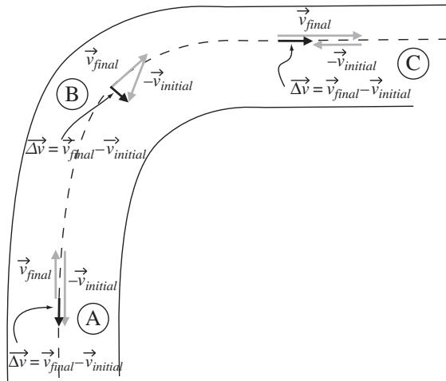
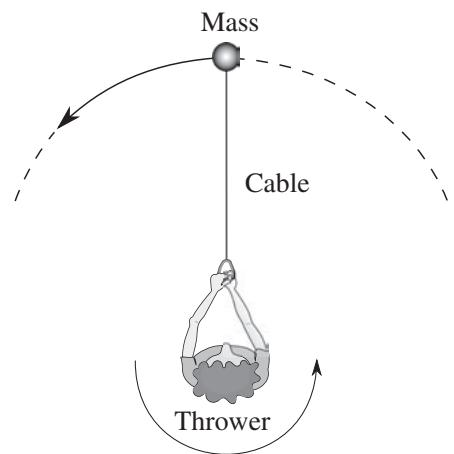
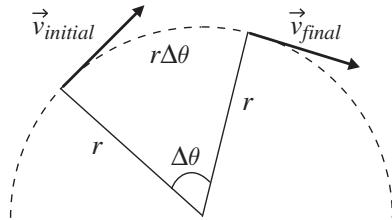
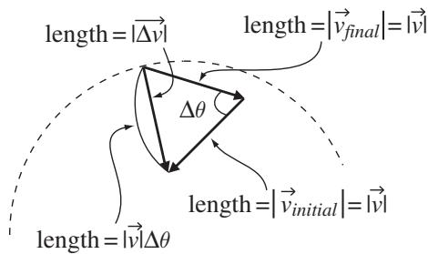
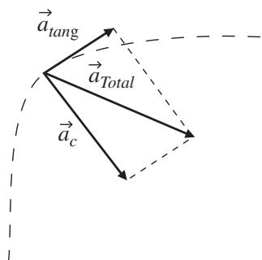

import Guide from '@/components/Guide.astro';
import Knowledge from '@/components/Knowledge.astro';
import Example from '@/components/Example.astro';
import Analysis from '@/components/Analysis.astro';
import Solution from '@/components/Solution.astro';
import Variant from '@/components/Variant.astro';
import Note from '@/components/Note.astro';
import Block from '@/components/Block.astro';
import Method from '@/components/Method.astro';
import Exercise from '@/components/Exercise.astro';

## 3.2 Curvilinear motion

In everyday language, the word "acceleration" is used as a synonym for "increasing speed." Hence the "accelerator" in an automobile usually refers to the gas pedal. But in physics and engineering, acceleration is defined as any change in velocity, and velocity is a vector quantity with both magnitude and direction. So changing the direction of the velocity is also a form of accelera tion, meaning that most cars have three accelerators: the gas pedal, the brake, and the steering wheel. "Stepping on the gas" produces an acceleration in the same direction as the velocity vector (causing the speed to increase), pressing on the brake produces an acceleration directly opposite to the direction of the velocity vector (causing the speed to decrease), and turning the steering wheel produces an acceleration perpendicular to the velocity vector (causing the car's direction to change but not affecting the speed).8 Acceleration in the direction parallel (or antiparallel) to the velocity vector is called "tangential" and acceleration perpendicular to the velocity is called "radial." Any time an object experiences radial acceleration, it does not move in a straight line, and its motion is called "curvilinear." An example of curvilinear motion is shown in Figure 3.7, in which a car is going around a curve.

Note that at any instant, the velocity vector points directly along the path the car is following. For a curving path, that means the instantaneous veloc ity vector is tangent to the path, as you can see when the car is at position B in Figure 3.7. If you wish to determine the acceleration at points such as A, B, and C along the car's path, it's not enough to know the velocity at those points; you have to know how the velocity is changing with time at those locations.

  
Figure 3.7 Velocity vectors for a car following a curved path.

A good way to visualize the acceleration vector is to graphically represent the velocity vector at the instants of time just before and just after the car is at positions A, B, and C. This is illustrated in Figure 3.8 for the following case: the car is slowing down at Position A as it approaches the turn, maintaining constant speed while turning at Position B, and then speeding up as it exits the turn at Position C.

You can get a sense of the acceleration just by examining the change in the velocity vectors at each position. Comparing the velocity vectors just before and just after Position A, you can see that the magnitude (length) of the vector is getting smaller but the direction remains the same. This means that the speed of the car is decreasing but the car is not yet turning. Now look at the velocity vectors just before and after Position B: the direction of the vector is changing but its length is not, so the car is turning while maintaining constant speed. Finally, by examining the velocity vectors before and after Position C, you can see that the length is increasing, meaning the car is speeding up after leaving the turn.

The direction of the acceleration is easily found by remembering that the average acceleration is given by the equation $\vec { a } = \Delta \vec { v } / \Delta t$ , where $\Delta \vec { v }$ is the change in velocity over time 	t. That change in velocity is jus $\vec { v } _ { f i n a l } - \vec { v } _ { i n i t i a l }$ which you can determine by subtracting the earlier velocity vector from the later one at each position in Figure 3.8. To make that easier, the vectors are reproduced in Figure 3.9.

  
Figure 3.8 Change in car's velocity vectors at Positions A, B, and C.

  
Figure 3.9 Velocity vectors before and after Positions A, B, and C

Note that the vectors shown in Figure 3.9 include not only $\vec { v } _ { f i n a l }$ and $\vec { v } _ { i n i t i a l }$ but also the negative of $\vec { v } _ { i n i t i a l }$ . That's because you'll need to know $- { \vec { v } } _ { i n i t i a l }$ to compute the change in velocity, since $\Delta \vec { v } = \vec { v } _ { f i n a l } - \vec { v } _ { i n i t i a l }$ , which is the same as $\vec { v } _ { f i n a l } + ( - \vec { v } _ { i n i t i a l } )$ . Remember that to add two vectors graphically you simply move the tail of one to the head of the other and then draw the resultant from the start of the first to the end of the second vector. The results of adding vectors $\vec { v } _ { f i n a l }$ and $- { \vec { v } } _ { i n i t i a l }$ are shown in Figure 3.10.

In Figure 3.10, the velocity vectors $- { \vec { v } } _ { i n i t i a l }$ and $\vec { v } _ { f i n a l }$ for Positions A and C are shown slightly offset since they would overlay one another if they were drawn truly head-to-tail. If you look at the direction of the vector representing the change in velocity $( \Delta \vec { v } )$ at each position, you'll see that while the car is slowing down at Position A, the change in velocity is in the opposite direction from the velocity at this point. Since the acceleration $( \vec { a } )$ is defined as the vector change in velocity $( \Delta \vec { v } )$ divided by the scalar time period $( \Delta t )$ over which that change occurs, the direction of $\vec { a }$ must be the same as the direction of $\Delta \vec { v }$ Hence the acceleration direction at Position A is opposite to the direction of the velocity vector, as you'd expect when the car is slowing down. This is an example of negative tangential acceleration.

  
Figure 3.10 Change in velocity vectors at Positions A, B, and C

Now consider the direction of the vector change in velocity $\Delta \vec { v }$ at Position B, where the car is going around the turn at constant speed. In this case, subtracting $\vec { v } _ { i n i t i a l }$ from $\vec { v } _ { f i n a l }$ gives a vector $\Delta \vec { v }$ that is perpendicular to the velocity vector. This shows that the acceleration vector for an object moving along a curve at constant speed points toward the center of curvature (to help you visualize this direction, the $\Delta \vec { v }$ vectors are shown on the car's path in Figure 3.11). At position B, this is an example of radial acceleration.9

Finally, as the car speeds up at Position C, you can see that the direction of the vector change in velocity $\Delta \vec { v }$ is the same as the direction of the veloc ity vector, meaning that the accleration in this case is parallel to the velocity. Hence this is an example of positive tangential acceleration.

For Position B, a careful analysis of the length of the vector change in veloc ity reveals that the magnitude of the radial acceleration depends on the square of the speed and on the radius of curvature of the path. Before getting into that, it's worth a few minutes of your time to make sure you understand the terminology commonly used to describe acceleration and force in curvilinear motion. Acceleration toward the center of curvature (such as the acceleration at Position B in Figure 3.11) is called "centripetal" (for "center-seeking") acceleration, and the force producing that acceleration is often called centripeta force. It's important for you to understand that a centripetal force is not a new kind of force that is somehow different from mechanical, electrical, magnetic, or other kinds of force. The word "centripetal" simply describes the direction of the force, but the force itself is provided by the same old kinds of forces to which you're accustomed. So for a car going around a curve, the centripetal force is simply the frictional force of the tires on the ground. If you tie a rock to a rope and twirl the rope in a circle, the centripetal force on the rock is produced by the tension of the rope. And if you fill a bucket with water and swing it over your head, the centripetal force on the bucket (and via the bucket on the water) comes from the muscles in your arm. So the centripetal force is whatever force is producing the centripetal acceleration that causes the object to follow a curved path.

  
Figure 3.11 Acceleration vectors at Positions A, B, and C.

As footnoted earlier, it's conventional to consider radial acceleration $( \vec { a } _ { r } )$ as positive outward (away from the center of curvature), and since centripetal acceleration $( \vec { a } _ { c } )$ is defined as positive toward the center of curvature, you may run across an equation such as $\vec { a } _ { r } = - \vec { a } _ { c }$ . This is simply a statement that the radial acceleration and centripetal acceleration are commonly defined to have the same magnitude but opposite directions.

You should note that in the case of the car on the curving road, the rock being twirled in a circle on a rope, and the bucket of water being swung over your head, the centripetal acceleration (and hence the centripetal force) is toward the center of curvature, and there is no acceleration (and no force) pointing radially outward. But what about the "centrifugal" force that the occupants of the car feel toward the outside of the curve (that is, toward the left door if the car is turning to the right)? What they're feeling is the force of the left door on thei

## 3.2 Curvilinear motion

bodies as they attempt to obey Newton's First Law and continue moving in a straight line while the car is accelerating to the right. So centrifugal force is the apparent force experienced by observers in the reference frame that is rotating with the object (physicists refer to acclerating reference frames such as this as "non-inertial"). Hence if you're riding in a right-turning car, as you slide across the seat and up against the left door, in your (rotating) reference frame you're accelerating to your left, which causes you to conclude that there's a force in that direction (outward from the center of curvature). But for those of us not riding in the car, we don't see any such force; we simply observe the centripetal acceleration of the car as the friction of the tires on the road provides a centripetal (rightward) force.

The concept of centripetal and centrifugal force can be understood by con sidering an Olympic hammer-thrower as she spins a heavy mass on the end of cable, as illustrated from above in Figure 3.12. For the thrower, it feels like the object is pulling directly outward (away from her). Once again, in the non-rotating reference frame of the stadium, that's just because the object is attempting to obey Newton's First Law and continue moving in a straight line. So from our vantage point in the viewing stand, we see that the hammerthrower is having to produce a centripetal (radially inward) force to make the object follow a curved path.

So is the hammer-thrower wrong in her assessment? Absolutely not. In her reference frame, which is rotating along with the mass, her conclusion tha a radially outward (centrifugal) force exists is perfectly valid. After all, she knows that she has to exert a very strong inward force on the cable to keep the mass at the same distance from her (because in her reference frame the mass has zero acceleration until she releases it). Hence she is correct in concluding that in her reference frame there must be a force in the radially outward direc tion to balance her inward pull. So if you hear someone say that the centrifuga force is "fictitious," they generally mean that centrifugal force is an apparent force to an observer in a rotating (non-inertial) reference frame.

  
Figure 3.12 Top view of hammer-thrower.

Once you understand the concepts of centripetal acceleration and force, it's reasonable to ask how strong the centripetal force must be to cause an object to follow a given path. It's simple to determine the centripetal force using New ton's Second Law $( { \vec { F } } = m { \vec { a } } )$ if you know the object's mass and have some way of finding the centripetal acceleration. Happily, the centripetal acceleration turns out to depend only on the object's speed and the radius of curvature of the path, as you can see by considering Figures 3.13 and 3.14.

In Figure 3.13 you can see the velocity vectors at two locations for an object in uniform circular motion (meaning that the object's speed and the radius of curvature are both constant over the time period under consideration). Note that the two positions are separated by angle $\Delta \theta$ at the center of curvature, which makes the arc length between the initial and final positions equal to $r \Delta \theta$ , where r is the radius of curvature and $\Delta \theta$ is in radians. Since the speed of the object is constant over this distance, you know that $| \vec { v } _ { i n i t i a l } |$ must equal $| \vec { v } _ { f i n a l } |$ (in other words, the direction but not the length of the velocity vecto has changed). You can therefore set $| \vec { v } _ { i n i t i a l } | = | \vec { v } _ { f i n a l } | = | \vec { v } |$ , where $| \vec { v } |$ is the speed of the object at both positions. Since the average speed of the object is defined as the distance covered divided by the time taken to cover that distance, you can write

  
Figure 3.13 Geometry of changing direction of velocity.

  
Figure 3.14 Geometry for determining length of $\Delta \vec { v } .$

$$
| \vec {v} | = \frac {r \Delta \theta}{\Delta t},\tag{3.21}
$$

which means that

$$
\Delta \theta = \frac {| \vec {v} | \Delta t}{r}.\tag{3.22}
$$

The reason that an expression such as Eq. 3.22 for $\Delta \theta$ is valuable is that this angle change is directly related to the magnitude of the vector change in veloc ity, which you need to know if you want to find the centripetal acceleration. To see that, consider what happens if you form the vector $\Delta \vec { v }$ by adding $\vec { v } _ { f i n a l }$ to $- { \vec { v } } _ { i n i t i a l }$ , as in Figure 3.14. The first thing you should note is that the angle between the vectors $\vec { v } _ { f i n a l }$ and $- { \vec { v } } _ { i n i t i a l }$ is equal to $\Delta \theta$ (if you don't see why that's true, go back to Figure 3.13 and imagine extending both vectors $\vec { v } _ { f i n a l }$ and $- { \vec { v } } _ { i n i t i a l }$ until they cross). Also note that the vector $\Delta \vec { v }$ is drawn at the location mid-way between the original location of $\vec { v } _ { i n i t i a l }$ and the origina location of $\vec { v } _ { f i n a l }$ , since that's the location at which you're finding the cen tripetal acceleration. The final thing to note in this figure is that both $\vec { v } _ { f i n a l }$ and $- { \vec { v } } _ { i n i t i a l }$ have length equal to $| \vec { v } |$ , which makes the arc length shown in the figure equal to $| \vec { v } | \Delta \theta$

Now imagine what will happen if you allow the angle $\Delta \theta$ to shrink toward zero. As the angle decreases, the arc length $| \vec { v } | \Delta \theta$ will get closer and closer to the length of $\Delta \vec { v } .$ . Plugging in the value for $\Delta \theta$ from Eq. 3.22, you have in the small-angle limit

$$
\begin{array}{r} {| \Delta \vec {v} | \approx | \vec {v} | \Delta \theta = | \vec {v} | \frac {| \vec {v} | \Delta t}{r}} \\ {= \frac {| \vec {v} | ^ {2} \Delta t}{r},} \end{array}\tag{3.23}
$$

which means that the magnitude of the instantaneous centripetal acceleration is

$$
\begin{array}{c} {| \vec {a} _ {c} | = \frac {| \Delta \vec {v} |}{\Delta t} = \frac {| \vec {v} | ^ {2} \Delta t}{r \Delta t}} \\ {= \frac {| \vec {v} | ^ {2}}{r}.} \end{array}\tag{3.24}
$$

So there you have it: the centripetal acceleration at any given point is simpl the square of the speed divided by the radius of curvature of the path at that point. Hence doubling your speed means that your centripetal acceleration is four times larger, which means that the centripetal force must be four times stronger.

If you're concerned that Eq. 3.24 may apply only in the case of uniform circular motion, remember that by allowing $\Delta \theta$ to become arbitrarily smal you've ensured that neither the speed nor the radius of curvature has changed during the time period under consideration.

What does Eq. 3.24 tell you about the amount of force needed to cause an object to follow a specified curving path? Consider the hammer-thrower discussed above and shown in Figure 3.12, and assume that she intends to launch a 4 kg mass at the end of a 1.2 m cable with a speed of 20 m/s. Assuming she achieves her maximum speed just before letting go of the cable, at that point the centripetal accleration will be

$$
\begin{array}{c} {| \vec {a} _ {c} | = \frac {| \vec {v} | ^ {2}}{r} = \frac {(2 0 \mathrm{m/s}) ^ {2}}{1 . 2 \mathrm{m}}} \\ {= 3 3 3. 3 \mathrm{m/s} ^ {2},} \end{array}
$$

which means that the thrower must provide a centripetal force of

$$
\begin{array}{r l} & {| \vec {F} _ {c} | = m | \vec {a} _ {c} | = 4 \mathrm{kg} (3 3 3. 3 \mathrm{m} / \mathrm{s} ^ {2})} \\ & {\qquad = 1 3 3 3. 3 \mathrm{N}} \end{array}
$$

which is almost 300 pounds of force (and this doesn't include the mass of the cable).

With Eq. 3.24 to help you find the magnitude of the centripetal accelera tion, and knowing that the tangential acceleration is just the change in speed over time $( \vec { a } _ { t a n g } ~ = ~ \Delta \vec { v } / \Delta t )$ , the total acceleration can be found through vector addition, as shown in Figure 3.15. Thus the magnitude of the total acceleration is

  
Figure 3.15 Total acceleration as the vector sum of centripetal and tangential acceleration.

$$
\begin{array}{c} | \vec {a} _ {T o t a l} | = \sqrt {(| \vec {a} _ {c} |) ^ {2} + (| \vec {a} _ {t a n g} |) ^ {2}} \\ = \sqrt {\left(\frac {v ^ {2}}{r}\right) ^ {2} + \left(\frac {| \Delta \vec {v} |}{\Delta t}\right) ^ {2}}. \end{array}\tag{3.25}
$$

You'll find an example of combined tangential and centripetal acceleration in the problems at the end of this chapter.
