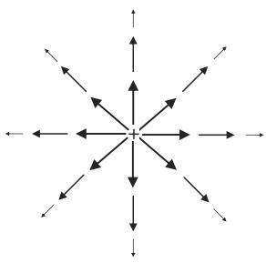
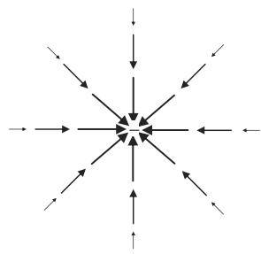
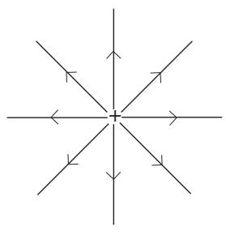
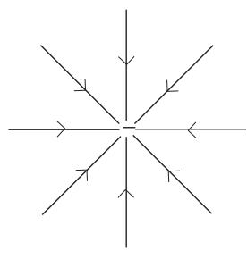
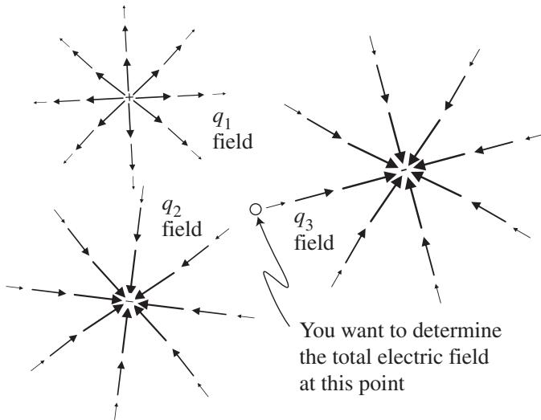

import Guide from '@/components/Guide.astro';
import Knowledge from '@/components/Knowledge.astro';
import Example from '@/components/Example.astro';
import Analysis from '@/components/Analysis.astro';
import Solution from '@/components/Solution.astro';
import Variant from '@/components/Variant.astro';
import Note from '@/components/Note.astro';
import Block from '@/components/Block.astro';
import Method from '@/components/Method.astro';
import Exercise from '@/components/Exercise.astro';

## 3.3 The electric field

If the previous two sections convinced you that vectors are very helpful in solving mechanics problems, the next two sections should help you understand why vectors are absolutely essential in problems involving electric and magnetic fields and their effect on charged particles. You'll also see how the vector operations of divergence, curl, gradient, and Laplacian are used in elec trostatics. Even if you've never taken an E&M course (and never hope to), the examples in these sections should be sufficiently self-contained to allow you to understand how vectors and vector operations can be used in E&M.

The natural way to begin a discussion of electric and magnetic fields is to provide a clear, concise definition that states exactly what an electric or magnetic field is. Such a definition would appear right here if I had one. But almost two centuries after Michael Faraday first used the words "field of force" to describe the region around electric charges, we still don't have a standard way of saying what such a field is. The Oxford English Dictionary provides definitions for "field" that include an "area or space" under the influence of an agent, a "state or situation" in which force is exerted, and the "action" of a force. According to James Clerk Maxwell, "The electric field is the portion of space in the neighbourhood of electrified bodies." In Halliday, Resnick, and Walker you can learn to define the electric field by placing a small positive test charge $q _ { 0 }$ at some point and measuring the electrostatic force $\vec { F } _ { E }$ on that test charge;10 the electric field $\vec { E }$ is then defined as $\vec { E } = \vec { F } _ { E } / q _ { 0 }$ . In Griffiths' Introduction to Electrodynamics, he states that ". . . physically, $\vec { E } ( P )$ is the force per unit charge that would be exerted on a test charge placed at $P .$ The words "would be" in that definition are important, because it is not necessary for the test charge to be present in order for the field to exist.

The common thread running through all these definitions is this: fields and forces are closely related. So we'll take the following as our definition of the electric field $\vec { E }$ :

$$
\vec {E} \equiv \frac {\vec {F} _ {E}}{q _ {0}},\tag{3.26}
$$

where $\vec { E }$ is the vector electric field, $q _ { 0 }$ is a small test charge, and $\vec { F } _ { E }$ is the electric force produced on the test charge by the electric field. Defining the electric field through this equation should help you remember that $\vec { E }$ is a vector quantity with magnitude directly proportional to force and with direc tion given by the direction of the force on a positive test charge (because if $q _ { 0 }$ is negative, there would be a minus sign on one side of the equation, which would mean that vector $\vec { E }$ would be in the opposite direction from vector $\vec { F } _ { E } )$

This definition should also help you see that $\vec { E }$ has dimensions of force divided by charge, for which the standard (SI) units are newtons per coulomb (N/C). These units are equivalent to volts per meter (V/m), since volts have dimensions of force times distance divided by charge (units of newtons times meters/coulombs). So you'll find the units of electric field given as N/C in some texts and V/m in others, and you can rest assured that these mean exactly the same thing.

There is, however, something important to be noticed in the units of the electric field vector: the dimension of length (units of meters in this case) appears in the denominator of the dimensions of the electric field. And that means that the vector that represents an electric field has a fundamental difference from the vectors that represent quantities such as position (which has dimension of length), velocity (dimension of length over time), or acceleration (dimension of length over time squared). As you can read in Chapter 4, that's because vectors whose dimensions contain length in the numerator transform oppositely to vectors whose dimensions have length in the denominator when you perform certain coordinate-system changes. If this seems unclear and you don't plan to venture into the tensor portion of this book, do not panic; none of this will pre vent you from using the concepts and operations described in Chapters 1 and 2 to solve problems involving vectors of this kind, exactly as you're about to do in the remainder of this section. But if you've run across objects called "one forms" or "covectors" (of which the electric field is an example) and you're wondering how those objects are different from the things you've been calling vectors, the appearance of length in the denominator of the dimension is the beginning of the answer (you'll find the rest of the answer in Chapter 4 if you're interested).

You should also make sure you understand that if you know the electric field $\vec { E }$ at a given location, placing any amount of charge $q$ at that location will result in an electric force $\vec { F } _ { E }$ given by

$$
\vec {F} _ {E} = q \vec {E}.\tag{3.27}
$$

So while Eq. 3.26 uses the electric force on a positive test charge to define the electric field, Eq. 3.27 is a generally useful expression for finding the electric force on any amount of charge at the location for which the electric field is known.

Defining an electric field is useful, but exactly how would you go about producing an electric field? One way is to gather up some electric charge, because every bit of charge produces an electric field, just as every bit of mass produces a gravitational field. Electric fields can also be produced by changing magnetic fields, but it is the "electrostatic" field produced by stationary electric charge that will be used to demonstrate the application of vectors in this section.

It's often helpful to be able to visualize the electric field in the vicinity of a charged object. The most common approaches to constructing a visual rep resentation of an electric field are to use either arrows or "field lines" which point in the direction of the field at each point in space. In the arrow approach, the strength of the field is indicated by the length of the arrow, while in the field-line approach, it's the density of the lines that tells you the field strength, with closer lines signifying a stronger field. When you look at a drawing of electric field lines or arrows, be sure to remember that the field exists between the lines as well.

The electric fields produced by positive and negative point charges are shown using the arrow approach in Figure 3.16 and using the field-line approach in Figure 3.17. When you look at electric field lines such as these, don't forget that the field arrows and lines always point in the direction of the electric force on a positive test charge, and that electrostatic field lines always begin on positive charge and end on negative charge. And since the field lines show the direction of the electric field at any given point, it's impossible for two fields lines to cross, since that would indicate that the electric field is pointing in more than one direction at the point of intersection (if two electric fields are superimposed at a given point, they simply add as vectors to give the total electric field at that point, and that total field can only point in a single direction).

  
(a)

  
(b)  
Figure 3.16 The electric field of positive and negative point charges drawn using arrows.

  
(a)

  
(b)  
Figure 3.17 The electric field of positive and negative point charges drawn using field lines.

At this point, you should make sure that you understand that electric fields can both be produced by electric charge as well as produce a force on another electric charge. So you're likely to face problems in which you first have to determine the total electric field produced by charge at a certain location and then figure out the effect of that field on a completely different charge (not one of the charges producing the field). But doesn't the charge that's being affected (let's call that one the "subject charge") also produce its own electric field? Yes it does, but as long as the electric field produced by the subject charge isn't strong enough to cause the other charges to move around, you can approach problems like this by finding the total electric field produced by all the other charges and then using that field to determine the force on the subject charge. This approach is very much like finding the Earth's gravitational field at some point in space and then using that field to figure out the gravitational force on an object of known mass at that location, without considering what effect the mass of the object might have on the Earth.

Problems like this are especially straightforward if the electric field is being produced by one or more discrete point charges. That's because the electric field $\vec { E }$ of a point charge $q$ is simply

$$
\vec {E} = k _ {e} \frac {q}{r ^ {2}} \hat {r},\tag{3.28}
$$

where $k _ { e }$ is the Coulomb constant $( 8 . 9 9 \times 1 0 ^ { 9 } \mathrm { N m } ^ { 2 } / \mathrm { C } ^ { 2 } )$ , r is the distance in meters from the point charge to the location at which the electric field is being determined, and $\hat { r }$ is a unit vector pointing radially outward from the poin charge.

Thus a single proton (electric charge of $1 . 6 \times 1 0 ^ { - 1 9 } \mathrm { C } )$ ) at a distance of one meter produces an electric field given by

$$
\begin{array}{l} \vec {E} = (8. 9 9 \times 1 0 ^ {9} \mathrm{Nm} ^ {2} / \mathrm{C} ^ {2}) \left(\frac {1 . 6 \times 1 0 ^ {- 1 9} C}{(1 \mathrm{m}) ^ {2}}\right) \hat {r} \\ = 1. 4 5 \times 1 0 ^ {- 9} (\mathrm{N/C}) \hat {r}. \end{array}
$$

Note that the direction of that field is radially away from the proton, since the unit vector $\hat { r }$ always points radially outward from the origin. An electron, having negative charge, produces an electric field of the same magnitude as that of the proton, but the electron's electric field points toward the electron. To see that, note that when you plug in a negative charge for $q$ in Eq. 3.28, you have

$$
\begin{array}{r l} & {\vec {E} = (8. 9 9 \times 1 0 ^ {9} \mathrm {Nm^ {2} / C^ {2}}) \left(\frac {- 1 . 6 \times 1 0 ^ {- 1 9} \mathrm{C}}{(1 \mathrm{m}) ^ {2}}\right) \hat {r}} \\ & {\quad = - 1. 4 5 \times 1 0 ^ {- 9} (\mathrm{N/C}) \hat {r} = 1. 4 5 \times 1 0 ^ {- 9} (\mathrm{N/C}) (- \hat {r}),} \end{array}
$$

where the minus sign tells you that the direction of the electron's electric field is in the negative $\hat { r }$ direction, which is toward the source charge (since $\hat { r }$ is always radially outward, minus $\hat { r }$ is always radially inward). This is consistent with electric field lines beginning on positive charge and ending on negative charge.

To understand how to add the vector electric fields, consider the situation shown in Figure 3.18. Note that $q _ { 1 }$ is positive, so its electric field must point radially outward from the location of $q _ { 1 }$ , while $q _ { 2 }$ and $q _ { 3 }$ are negative, so their

$$
\begin{array}{c c} q _ {1} = + 5 \mathrm{nC} & q _ {3} = - 8 \mathrm{nC} \\ (- 5, + 4) \mathrm{cm} & \text {electron} \\ \circ (0, 0) \mathrm{cm} & (+ 7, + 2) \mathrm{cm} \\ q _ {2} = - 6 \mathrm{nC} \\ (- 5, - 4) \mathrm{cm} & \end{array}
$$

Figure 3.18 Example values for charges near an electron.

  
Figure 3.19 The electric fields produced by charges $q _ { 1 } , q _ { 2 }$ , and $q _ { 3 }$ .

electric fields must point radially inward toward their locations. To find the total electric field at the position of the electron, it may help you to picture the fields produced by $q _ { 1 } , q _ { 2 }$ , and $q _ { 3 }$ as shown in Figure 3.19.

If you read the discussion of field lines earlier in this section, you should realize that the electric field exists between the lines as well as at the locations of the lines themselves. But just to help you visualize the direction of the fields from each of the three charges, the field lines in Figure 3.19 have been drawn on a tilt so that they are directly in line with the location at which you're trying to find the total field (the origin in this case). You should also remember that just because the lines have grown too small to see does not mean that the field has gone to zero. Hence the electric field produced by $q _ { 1 }$ points down and to the right at the location of the electron, the field from $q _ { 2 }$ points down and to the left, and the field from $q _ { 3 }$ points up and to the right. It is these three vector fields that you will have to add together to determine the total electric field at the point of interest.

Using Eq. 3.28, the electric fields due to the three point charges $q _ { 1 } , q _ { 2 }$ , and $q _ { 3 }$ may be written as

$$
\begin{array}{r l} & {\vec {E} _ {1} = k _ {e} \frac {q _ {1}}{r _ {1} ^ {2}} \hat {r} _ {1},} \\ & {\vec {E} _ {2} = k _ {e} \frac {q _ {2}}{r _ {2} ^ {2}} \hat {r} _ {2},} \\ & {\vec {E} _ {3} = k _ {e} \frac {q _ {3}}{r _ {3} ^ {2}} \hat {r} _ {3}.} \end{array}\tag{3.29}
$$

Of course, you know from Figure 3.19 that these three electric fields do not point in the same direction. That's because the unit vector $\hat { r } _ { 1 }$ points radially outward from the location of charge $q _ { 1 }$ , and $\hat { r } _ { 2 }$ and $\hat { r } _ { 3 }$ point radially outward from $q _ { 2 }$ and $q _ { 3 }$ , respectively. This means you can't add the three electric fields algebraically; to find the total field you must use vector addition. You'll find an example of the vector addition of electric fields in the problems at the end of this chapter and the on-line solutions.

As you might suspect, it's not just the simple operations of vector addition and multiplication by a scalar that find use in electrostatics. If you followed the discussion of the divergence operation in Chapter 2, you may be wondering about the divergence of the electrostatic fields produced by a point charge (Figures 3.16 and 3.17). In fact, one of the fundamental laws of electrostatics is Gauss's Law for electric fields, the differential form of which is

$$
\vec {\nabla} \circ \vec {E} = \rho / \epsilon_ {0},\tag{3.30}
$$

where $\rho$ represents the volume electric charge density (coulombs per cubic meter) and $\epsilon _ { 0 }$ is the vacuum permittivity of free space $( 8 . 8 5 \times 1 0 ^ { - 1 2 } \mathrm { N m } ^ { 2 } / \mathrm { C } ^ { 2 } )$ .

Gauss's Law for electric fields tells you that electric field lines diverge from any location at which positive charge exists (positive $\rho )$ and converge upon any location at which negative charge is present (negative $\rho )$ ). This explains the analogy between the "flow" of electrostatic field lines and the flow of a fluid. In this analogy, positive charge acts as the "source" of electrostatic field lines in the same sense as a faucet acts as the source of fluid, and negative charge acts as a "sink" of electrostatic field lines just as a drain does for fluid.

Note what happens when you take the divergence of the electric field of a point charge (this is most easily done in spherical coordinates):

$$
\begin{array}{r} \vec {\nabla} \circ \vec {E} = \frac {1}{r ^ {2}} \frac {\partial}{\partial r} (r ^ {2} E _ {r}) = \frac {1}{r ^ {2}} \frac {\partial}{\partial r} \left(r ^ {2} k _ {e} \frac {q}{r ^ {2}}\right) \\ = \frac {1}{r ^ {2}} \frac {\partial}{\partial r} (k _ {e} q) = 0. \end{array}
$$

This is consistent with the worked example in Chapter 2 showing that the divergence of any radial vector field is zero if the amplitude of the field falls off as $1 / r ^ { 2 }$ . Zero, that is, at all locations except where $r = 0 .$ , the location of the source of the field. Thus Gauss's Law tells you that electrostatic field lines diverge only from those locations at which positive electric charge exists, and converge only on those locations at which negative charge exists.

You can gain additional understanding of the behavior of the electrostatic field by considering the curl of $\vec { E }$ for a point charge. Since $E _ { \theta }$ and $E _ { \phi }$ are both zero, the curl in spherical coordinates becomes

$$
\begin{array}{r l} & {\vec {\nabla} \times \vec {E} = \frac {1}{r} \frac {1}{\sin \theta} \frac {\partial E _ {r}}{\partial \phi} \hat {\theta} + \frac {1}{r} \left(- \frac {\partial E _ {r}}{\partial \theta}\right) \hat {\phi}} \\ & {\qquad = \frac {1}{r} \frac {1}{\sin \theta} \frac {\partial}{\partial \phi} \left(\frac {k _ {e} q}{r}\right) \hat {\theta} + \frac {1}{r} \left[ - \frac {\partial}{\partial \theta} \left(\frac {k _ {e} q}{r}\right) \right] \hat {\phi}} \\ & {\qquad = 0.} \end{array}
$$

This is not a surprising result in light of the radial nature of the electrostatic field of a point charge.

As mentioned in Chapter 2, vector fields with zero curl are called irro tational, and such fields have several important properties. One of those properties arises from the fact that the curl of a gradient is always zero: an irrotational vector field may always be written as the gradient of a scalar field.

In the case of electrostatic fields, the electric field may be written as the gra dient of the scalar electric potential (usually written as φ or V). By convention, the electric field is written as the negative gradient of the scalar potential, so you're likely to see this relationship written as

$$
\vec {E} = - \vec {\nabla} V,\tag{3.31}
$$

where V is the scalar electric potential with units of Nm/C (equivalent to joules per coulomb or volts).

Since the electric field is the negative of the change in electric potential with distance, moving along an electric field line in the direction it's pointing means that you're moving toward a region of lower electric potential. Likewise, moving in the opposite direction (opposite to the direction of the field) takes you into a region of higher potential, and moving perpendicular to the field lines results in no change in potential. Hence the "equipotential" surfaces are always perpendicular to the electric field lines.

Another differential vector operation useful in electrostatics is the Laplacian $( \nabla ^ { 2 } )$ . Recall that the Laplacian involves the second spatial derivative, specif ically the divergence of the gradient. Since the electrostatic field $\vec { E }$ may be written as the negative of the gradient of the scalar potential V, taking the divergence of the electric field gives:

$$
\vec {\nabla} \circ \vec {E} = \vec {\nabla} \circ (- \vec {\nabla} V) = - \nabla^ {2} V.\tag{3.32}
$$

Since Gauss's Law says that the divergence of the electrostatic field must equal $\rho / \epsilon _ { 0 }$ , this means

$$
\nabla^ {2} V = - \rho / \epsilon_ {0}.\tag{3.33}
$$

This is known as Poisson's Equation. Since the Laplacian finds peaks and valleys of a function (locations at which the value of the function differs from the average value at surrounding locations), Poisson's Equation tells you that the electric potential can have local maxima and minima only at locations at which charge is present (that is, where $\rho \neq 0 )$ . And if you recall that the Laplacian is negative at peaks and positive at valleys, you can see that positive charge produces a peak in electric potential while negative charge produces a valley. This is one reason that the electric field is taken as the negative gradient of the electric potential.

In regions in which the electric charge density $( \rho )$ is zero, Poisson's Equation becomes Laplace's Equation:

$$
\nabla^ {2} V = 0,\tag{3.34}
$$

so there are no maxima or minima in electric potential for locations with zero charge density.
