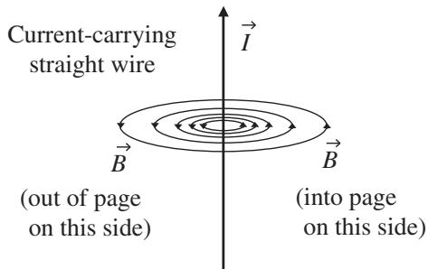
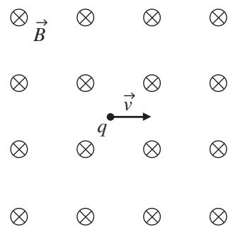
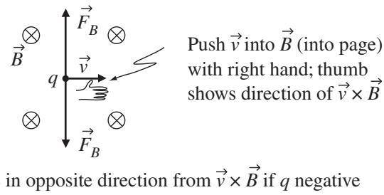
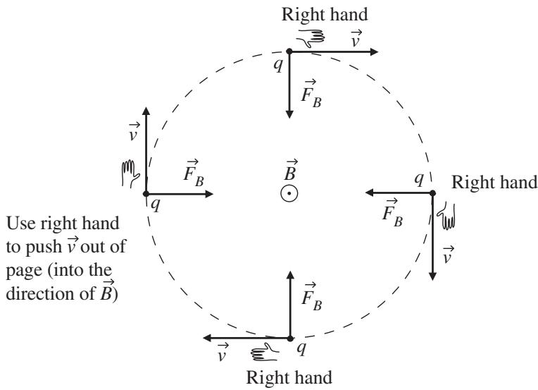

import Guide from '@/components/Guide.astro';
import Knowledge from '@/components/Knowledge.astro';
import Example from '@/components/Example.astro';
import Analysis from '@/components/Analysis.astro';
import Solution from '@/components/Solution.astro';
import Variant from '@/components/Variant.astro';
import Note from '@/components/Note.astro';
import Block from '@/components/Block.astro';
import Method from '@/components/Method.astro';
import Exercise from '@/components/Exercise.astro';

## 3.4 The magnetic field

In this section, you can read about the behavior of the magnetic field $( { \vec { B } } )$ and the magnetic force on a moving charged particle. You'll also find a discus sion of the application of the vector operations of divergence and curl to the magnetostatic field.

Unlike electrostatic field lines, which diverge from positive charge and con verge on negative charge, magnetic field lines form circles around the electric current (flowing charge) that is producing the magnetic field. And just as stationary source charges produce electrostatic fields, stationary currents (in which the charge flow is constant) produce magnetic fields that are called "magnetostatic." An example of such a field is shown in Figure 3.20. The direction of those field lines is determined using the right-hand rule: if you put the thumb of your right hand along the direction of current flow and curl your fingers (like you're grabbing the current), the magnetic field points in the direction of your curled fingers. So if you were to reverse the direction of tha current flow, the magnetic field lines would still form circles around the cur rent, but the magnetic field lines would point in the opposite direction (as you can tell by observing the direction of your curled fingers when your thumb points in the opposite direction).

  
Figure 3.20 Magnetic field of a long, straight wire.

You can tell by the spacing of the field lines in Figure 3.20 that the strength of the magnetic field is decreasing as the distance from the current increases. For a thin wire of infinite length carrying current I, the vector magnetic field is given by the equation

$$
\vec {B} = \frac {\mu_ {0} I}{2 \pi r} \hat {\phi},\tag{3.35}
$$

where $\mu _ { 0 }$ is a constant called the magnetic permeability of free space, r is the distance from the wire to the point at which the magnetic field is being determined, and $\hat { \phi }$ is the cylindrical-coordinate unit vector that points in the direction circulating around the wire. The standard (SI) unit of magnetic field is the tesla (T).

Comparing the magnetic field lines around an electric current to the vector fields with various values of divergence and curl discussed in Chapter 2, you may have already guessed that magnetic fields fit into the "low divergence, high curl" category. Recall that electric field lines originate on positive charge and terminate on negative charge, and it is only at the location of those charges that the divergence of the electrostatic field is non-zero. And since magnetic field lines circulate back onto themselves rather than diverging from and converging upon specific locations, it's reasonable to expect small values for the divergence of the magnetic field. In fact, the divergence of the magnetic field $( { \vec { B } } )$ is exactly zero, as indicated by Gauss's Law for magnetic fields:

$$
\vec {\nabla} \circ \vec {B} = 0.\tag{3.36}
$$

You can verify this for the magnetic field of a long, straight wire by taking the divergence of the field in Eq. 3.35:

$$
\begin{array}{c} \vec {\nabla} \circ \vec {B} = \frac {1}{r \sin \theta} \frac {\partial B _ {\phi}}{\partial \phi} = \frac {1}{r \sin \theta} \frac {\partial}{\partial \phi} \left(\frac {\mu_ {0} I}{2 \pi r}\right) \\ = 0. \end{array}
$$

As you might expect from the discussion of curl in Chapter 2, the magnetic field around a current-carrying wire has zero curl:

$$
\begin{array}{r l} & {\vec {\nabla} \times \vec {B} = \left(- \frac {\partial B _ {\phi}}{\partial z}\right) \hat {r} + \frac {1}{r} \left(\frac {\partial (r B _ {\phi})}{\partial r}\right) \hat {z}} \\ & {\qquad = \left[ - \frac {\partial}{\partial z} \left(\frac {\mu_ {0} I}{2 \pi r}\right) \right] \hat {r} + \frac {1}{r} \left[ \frac {\partial}{\partial r} \left(r \frac {\mu_ {0} I}{2 \pi r}\right) \right] \hat {z}} \\ & {\qquad = 0.} \end{array}
$$

As in the case of the divergence of the electric field, which has a non-zero value only at locations at which charge exists, the only locations at which the curl of the magnetic field is non-zero are locations at which current exists (that is, at the singularity point $r = 0 )$ ).

Other uses of vectors and vector operations come about when you consider the force $( { \vec { F } } _ { B } )$ produced by a magnetic field $( { \vec { B } } )$ on a moving electric charge $( q )$ . This force is given by the vector equation

$$
\vec {F} _ {B} = q \vec {v} \times \vec {B},\tag{3.37}
$$

where $\vec { v }$ is the velocity of the charged particle with respect to the magnetic field. The magnitude of the force is readily found using the definition of the magnitude of the vector cross product $( | \vec { A } \times \vec { B } | = | \vec { A } | | \vec { B } |$ sin θ ):

$$
| \vec {F} _ {B} | = q | \vec {v} | | \vec {B} | \sin \theta ,\tag{3.38}
$$

where $\theta$ is the angle between vector $\vec { v }$ and vector $\vec { B }$

Examined carefully, Eqs. 3.37 and 3.38 can tell you a great deal about how magnetic fields affect charged particles. Compare these equations to Eq. 3.27 $( \vec { F } _ { E } ~ = ~ q \vec { E } )$ , and note that there are similarities and differences between electric and magnetic forces:

Similarity: Both are directly proportional to the amount of charge $( q ) ;$

Similarity: Both are directly proportional to the field strength $( \vec { E } \ \mathrm { o r } \ \vec { B } )$ ;

Difference: The velocity (v) of the particle appears in the magnetic equation;

Difference: The magnetic force depends on the angle between the velocity and the magnetic field;

Difference: The magnetic force is perpendicular to both the velocity and the magnetic field.

The similarities seem reasonable: both electric and magnetic forces are stronger if the fields are stronger and if the amount of charge is greater. Also, charges with opposite signs feel forces in opposite directions. The first listed difference (the fact that the magnetic force depends on the velocity of the parti cle) has the interesting consequence that a charged particle at rest with respect to the magnetic field $( \vec { v } = 0 )$ feels no force whatsoever from that field. And for particles moving with respect to the magnetic field, the faster the particle moves, the stronger the magnetic force becomes.

The presence of the vector cross product in the magnetic force equation also has some important consequences. One of those consequences is that charged particles moving in a direction parallel or antiparallel to the magnetic field feel zero magnetic force. That's because in both the parallel $( \theta \ : = \ : 0 ^ { \circ } )$ and antiparallel $( \theta ~ = ~ 1 8 0 ^ { \circ } )$ cases, the sine term in Eq. 3.38 is zero. So the closer the angle θ between $\vec { v }$ and $\vec { B }$ is to $9 0 ^ { \circ }$ , the stronger the magnetic force.

Another consequence of the vector cross product in Eq. 3.37 is that the magnetic force $( { \vec { F } } _ { B } )$ can never point in the direction of the magnetic field, since the vector result of the cross product is by definition perpendicular to both vectors forming the product $( \vec { v }$ and $\vec { B }$ in this case). For this same reason, the magnetic force can never point in the direction of the particle's velocity vector, and must in fact be perpendicular to that vector. So if you imagine the flat plane formed by the velocity vector and the magnetic field, you can be sure that the magnetic force (if any) must be perpendicular to that plane.

If you've read the discussion of radial and tangential acceleration in Section 3.2, you should understand that this means that magnetic fields can provide radial but never tangential acceleration to a charged particle (since tangential acceleration requires a component of force that's either parallel or antiparallel to the velocity vector). And since $\vec { v } \times \vec { B }$ always points perpendicular to $\vec { v } ,$ , magnetic fields can provide only radial acceleration. Thus magnetic fields may change the direction but never the speed of charged particles.

An example of the geometry involved in magnetic force is shown in Figure 3.21. In this figure, the direction of the magnetic field is into the page, as

  
Figure 3.21 Charged particle moving to right; magnetic field into page

Force in same direction as ${ \vec { \nu } } \times { \vec { B } }$ if q positive

  
Figure 3.22 Magnetic force for positive and negative charges.

indicated by the crosses inside circles,11 and the charged particle (q) is moving to the right.

To determine the direction of the magnetic force in this case, you simply have to imagine forming the vector cross product $\vec { v } \times \vec { B }$ using the right-hand rule, as shown in Figure 3.22. Once you know the direction of $\vec { v } \times \vec { B }$ , it's very important to remember (but easy to forget) that you must then reverse the direction if the charge q is negative (since by Eq. 3.37, ${ \vec { F } } _ { B } = q { \vec { v } } \times { \vec { B } }$ , meaning that the magnetic force is opposite to the direction of $\vec { v } \times \vec { B }$ if q is negative). This explains why two directions for the magnetic force ${ \vec { F } } _ { B }$ are shown in Figure 3.22: upward if q is positive and downward if q is negative.

Once you understand the direction of the magnetic force relative to the velocity of the charged particle, it should help explain why you may have heard or read about charged particles "circling around magnetic field lines" or perhaps "spiralling along the magnetic field." Consider the positively charged particle q in Figure 3.23. If this particle is initially at the leftmost position in the figure, travelling with velocity v straight up the page, and the magnetic field $\vec { B }$ points directly out of the page, the direction of the magnetic force $q { \vec { v } } \times { \vec { B } }$ is initally to the right (as you can determine using the right-hand rule). This force causes the particle to travel on the dashed path to the topmost position in the figure. At that point, the magnetic force ${ \vec { F } } _ { B }$ points straight down the page. Just as at the previous position, since q is positively charged, the magnetic force points in the same direction as $\vec { v } \times \vec { B }$ . This now-downward force causes the particle to travel to the rightmost position, at which point the velocity is straight down the page and the magnetic force ${ \vec { F } } _ { B }$ points directly to the left. This force causes the particle to reach the bottom position in Figure 3.23, at which point the velocity is to the left and the magnetic force points straight up the page. Under the influence of this force, the particle will travel back to the starting (leftmost) position, and the entire cycle will repeat. So this positively charged particle makes a clockwise circle around the outward-pointing magnetic field.

  
Figure 3.23 Magnetic force on positive charge.

Applying the same reasoning to a negatively charged particle, you should be able to determine that it will make counter-clockwise circles around the same outward-pointing magnetic field. And if the field direction is reversed, so that $\vec { B }$ points into the page rather than outward, the sense of the particle's rotation will be reversed (so that a positively charged particle will circle counter-clockwise and a negatively charged particle will circle in the clockwise direction).

The particles in these examples retrace the same path over and over, so what makes some particles "spiral around" the lines of the magnetic field? Simply this: the particle's velocity must have a component parallel (or antiparallel) to the direction of the magnetic field. Note that the particle shown in Figure 3.23 is moving entirely in the plane of the page, and the magnetic field is perpen dicular to the page. Hence the particle's velocity vector has no componen along the magnetic field (into or out of the page). If such a component were present, the particle would have a component of its motion along the field lines while also circling around them. In that case, the circular path shown in Figure 3.23 would move into or out of the paper over time, and the circle would become a spiral. The magnetic field has no effect on the velocity componen $( v _ { | | } )$ parallel or antiparallel to the field (since there's no magnetic force in that direction), so the speed with which the particle moves along the field line is constant as long as no other forces are acting.
