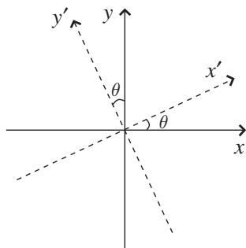
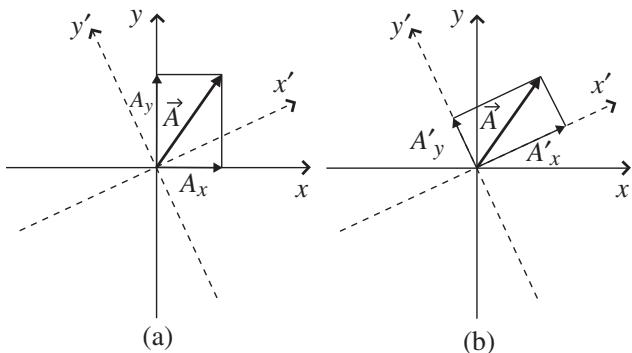
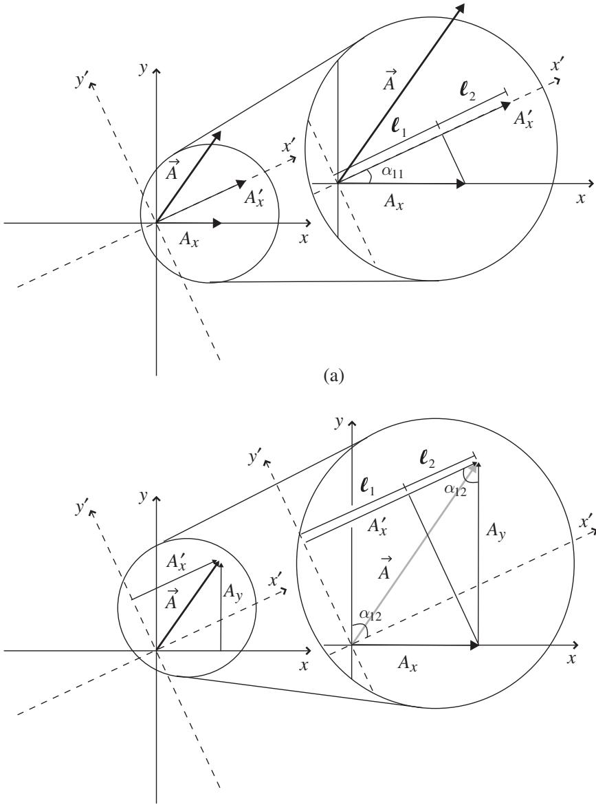
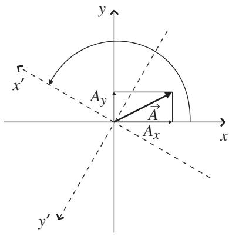
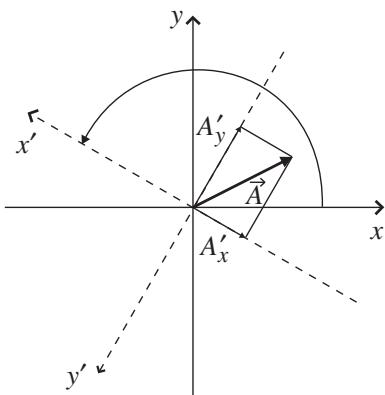
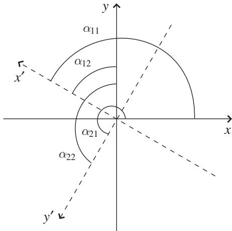
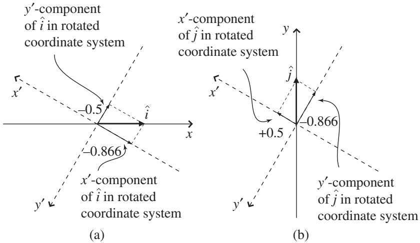

import Guide from '@/components/Guide.astro';
import Knowledge from '@/components/Knowledge.astro';
import Example from '@/components/Example.astro';
import Analysis from '@/components/Analysis.astro';
import Solution from '@/components/Solution.astro';
import Variant from '@/components/Variant.astro';
import Note from '@/components/Note.astro';
import Block from '@/components/Block.astro';
import Method from '@/components/Method.astro';
import Exercise from '@/components/Exercise.astro';

## 4.1 Coordinate-system transformations

In taking the step from vectors to tensors, a good place to begin is to con sider this question: "What happens to a vector when you change the coordinate system in which you're representing that vector?" The short answer is that nothing at all happens to the vector itself, but the vector's components may be different in the new coordinate system. The purpose of this section is to help you understand how those components change.

Before getting to that, you should spend a few minutes considering the statement that the vector itself doesn't change if you change the coordinate system. This may seem obvious in the case of scalars – after all, whether you measure temperature in Celsius or Fahrenheit doesn't make a room feel hotter or colder. Now remember that vectors are mathematical representations of physical entities, and those entities don't change just because you change the coordinate system in which you're representing them. Think about it: does the size of a room change if you tilt your head to one side? Clearly not. But if you use your tilted head to define up and down, then the points you designate as the top and bottom of the room may change, and this will change what you call the "height" and "width" of the room. The important idea is that the room itself doesn't change (it "remains invariant") under such a change of coordinate system. And if you define the center of your head to be the origin of your coor dinate system, then walking toward one wall will "offset" the room (that is, the x, y, and z values of locations within the room may change), but once again the room itself is unchanged. Likewise, specifying dimensions of the room in inches rather than meters will allow you to put larger numbers in the real-estate ad, but that doesn't mean your room will hold a bigger sofa.

So if coordinate-system transformations such as rotation, translation, and scaling leave physical quantities unchanged, what exactly does happen to a vector when you transform coordinates? To understand that, consider the simple rotation of the two-dimensional Cartesian coordinate system shown in Figure 4.1. In this transformation, the location of the origin has not changed, but both the x- and y-axis have been tilted counter-clockwise by an angle $\theta$ . The rotated axes are labeled $x ^ { \prime }$ and $y ^ { \prime }$ and are drawn using dashed lines to distinguish them from the original axes.

What impact does this rotation have on a vector in this space? Take a look at vector $\vec { A }$ and its components in Figure 4.2(a) and (b). Note that the rotation has no effect on the length or direction of $\vec { A }$ (at first glance, $\vec { A }$ may look a bit different in Figure 4.2(a) and 4.2(b), but you can verify using a ruler and protractor that the vector itself is exactly the same). But the rotation has clearly caused the components of $\vec { A }$ to change: $A _ { x } ^ { \prime }$ (the $x ^ { \prime } .$ -component of A in the tilted coordinate system) is longer than $A _ { x }$ , and $A _ { y } ^ { \prime }$ is shorter than $A _ { y }$ . If you were to continue rotating your axes in the same direction, you'd eventuall reach an angle at which $\vec { A }$ lies entirely along the $\boldsymbol { x } ^ { \prime } \mathrm { - } \mathrm { a x i s . }$ , at which point the y-component of $\vec { A }$ would vanish (that is, $A _ { y } ^ { \prime } = 0 )$ and the $x ^ { \prime } .$ -component would equal the length of $\vec { A } ( A _ { x } ^ { \prime } = | \vec { A } | )$ .

  
Figure 4.1 Rotation of 2-D coordinate system.

  
Figure 4.2 Change in vector components due to rotation of coordinate system.

Finding the change in the components of a vector due to rotation of the coordinate axes can be done both graphically using simple geometry and analytically using the dot product. You'll find the graphical approach in this section; the analytical approach is the subject of one of the problems at the end of this chapter.

If you think about the changes to $A _ { x }$ and $A _ { y }$ in Figure 4.2, you might come to realize that the vector component $A _ { x } ^ { \prime }$ in the rotated coordinate system cannot depend entirely on the component $A _ { x }$ in the original system. After all, $A _ { x }$ contains some but not all of the information about vector ${ \vec { A } } ;$ ; the rest is in $A _ { y }$ And as the axes rotate, the axis that had pointed exclusively in the x-direction now points partially in the (former) y-direction. So it seems reasonable that the portion of $\vec { A }$ that had previously pointed in the original y-direction (and so contributed only to $A _ { y } )$ now points partially in the $x ^ { \prime } .$ -direction, and hence contributes to the $x ^ { \prime } .$ -component as well as the $y ^ { \prime } .$ -component.

You can see how this works in Figure 4.3. The (a) portion of this figure shows how the vector component $A _ { x }$ in the original (non-rotated) coordinate system contributes to $A _ { x } ^ { \prime }$ in the rotated system, and the (b) portion shows how the vector component $A _ { y }$ in the original system contributes to $A _ { x } ^ { \prime }$ in the rotated system.

As you can see in both portions of the figure, $A _ { x } ^ { \prime }$ can be considered to be made up of two segments, labeled $\ell _ { 1 }$ and $\ell _ { 2 }$ . So

$$
A _ {x} ^ {\prime} = \ell_ {1} + \ell_ {2},\tag{4.1}
$$

  
(b)  
Figure 4.3 Dependence of $A _ { x } ^ { \prime }$ on $A _ { x }$ and $A _ { y }$

and to determine how these segments depend on $A _ { x }$ and $A _ { y }$ , consider the righ triangles shown in Figure 4.3. In the (a) portion of the figure, you can see that $A _ { x }$ is the hypotenuse of a right triangle formed by drawing a perpendicular from the end of $A _ { x }$ to the $x ^ { \prime } { \mathrm { - } } { \mathrm { a x i s } }$ . Call the angle between the x-axis and the $x ^ { \prime } \mathrm { - a x }$ is $\alpha _ { 1 1 }$ (the reason for using double subscripts will become clear when rotations are written in matrix notation). Then the length of $\ell _ { 1 }$ (the projection of $A _ { x }$ onto the $x ^ { \prime } { \mathrm { - a x i s ) } }$ is $A _ { x } \cos ( \alpha _ { 1 1 } )$ . Hence

$$
\ell_ {1} = A _ {x} \cos (\alpha_ {1 1}).\tag{4.2}
$$

To find the length of $\ell _ { 2 }$ , consider the right triangle shown in Figure 4.3(b). In this case, the triangle is formed by sliding $A _ { x } ^ { \prime }$ upward along the y-axis and then drawing a perpendicular from the tip of $A _ { x } ^ { \prime }$ to the x-axis. From this triangle, you should be able to see that

$$
\ell_ {2} = A _ {y} \cos (\alpha_ {1 2}),\tag{4.3}
$$

where $\alpha _ { 1 2 }$ is the angle formed by the tips of $A _ { x } ^ { \prime }$ and $A _ { y }$ (which is also the angle between the $x ^ { \prime } { \mathrm { - } } { \mathrm { a x i s } }$ and the y-axis, as you can see from the parallelogram in Figure 4.3(b).

Adding the expressions for $\ell _ { 1 }$ and $\ell _ { 2 }$ , you can write $A _ { x } ^ { \prime }$ as

$$
A _ {x} ^ {\prime} = A _ {x} \cos (\alpha_ {1 1}) + A _ {y} \cos (\alpha_ {1 2}),\tag{4.4}
$$

where $A _ { x }$ and $A _ { y }$ are the components of vector $\vec { A }$ in the non-rotated coordinate system, $\alpha _ { 1 1 }$ is the angle between the $x ^ { \prime } .$ -axis and the x-axis, and $\alpha _ { 1 2 }$ is the angle between the $x ^ { \prime } .$ -axis and the y-axis. You should note that the new component $( A _ { x } ^ { \prime } )$ is a weighted linear combination of the original components $( A _ { x }$ and $A _ { y } )$ . "Weighted" because the cosine factors determine how heavily each of the original components contributes to the new one, "linear" because the original components appear to the first power only, and "combination" because both $A _ { x }$ and $A _ { y }$ contribute to $A _ { x } ^ { \prime }$

A similar analysis for $A _ { y } ^ { \prime }$ , the y-component of vector $\vec { A }$ in the rotated coordinate system, gives

$$
A _ {y} ^ {\prime} = A _ {x} \cos (\alpha_ {2 1}) + A _ {y} \cos (\alpha_ {2 2}),\tag{4.5}
$$

where $\alpha _ { 2 1 }$ is the angle between the $y ^ { \prime } { \mathrm { - a x i } }$ s and the x-axis, and $\alpha _ { 2 2 }$ is the angle between the $y ^ { \prime } .$ -axis and the y-axis.

The relationship between the components of vector $\vec { A }$ in the rotated and non-rotated systems is conveniently expressed using vector/matrix notation1 as

$$
\binom{A _ {x} ^ {\prime}}{A _ {y} ^ {\prime}} = \left( \begin{array}{c c} \cos (\alpha_ {1 1}) & \cos (\alpha_ {1 2}) \\ \cos (\alpha_ {2 1}) & \cos (\alpha_ {2 2}) \end{array} \right) \binom{A _ {x}}{A _ {y}}.\tag{4.6}
$$

This is called a "transformation equation" for the components of vector ${ \vec { A } } ,$ and the two-column matrix is called a "transformation matrix." The elements of that matrix are called the "direction cosines." Note that for a rigid rotation of the Cartesian axes through angle θ, the angles $\alpha _ { 1 1 }$ and $\alpha _ { 2 2 }$ are both equal to $\theta _ { ; }$ , while $\alpha _ { 1 2 } = 9 0 ^ { \circ } - \theta$ and $\alpha _ { 2 1 } = 9 0 ^ { \circ } + \theta$ . The transformation matrix in this case is

$$
\left( \begin{array}{c c} \cos (\theta) & \cos (9 0 ^ {\circ} - \theta) \\ \cos (9 0 ^ {\circ} + \theta) & \cos (\theta) \end{array} \right) = \left( \begin{array}{c c} \cos (\theta) & \sin (\theta) \\ - \sin (\theta) & \cos (\theta) \end{array} \right),\tag{4.7}
$$

since $\cos ( 9 0 ^ { \circ } - \theta ) = \sin ( \theta )$ and $\cos ( 9 0 ^ { \circ } + \theta ) = - \sin ( \theta )$

To understand how this works in practice, consider vector $\vec { A }$ given as

$$
\vec {A} = 5 \hat {\imath} + 3 \hat {j}\tag{4.8}
$$

in a two-dimensional Cartesian coordinate system. Now imagine that the x- and y-axes of that coordinate system are rotated counter-clockwise by $1 5 0 ^ { \circ }$ as shown in Figure 4.4.

Before jumping to the equations to find the components $A _ { x } ^ { \prime }$ and $A _ { \nu } ^ { \prime }$ in the rotated coordinate system, it's worth a few minutes to take a look at the diagram to estimate what the effect of the rotation on the components will be. From Figure 4.4(b), it's pretty clear that both the $A _ { x } ^ { \prime }$ and $A _ { y } ^ { \prime }$ components will be negative, and the $A _ { y } ^ { \prime }$ component appears to be somewhat larger than the $A _ { x } ^ { \prime }$ component.

  
(a)

  
(b)  
Figure 4.4 2-D Cartesian axes rotated by $1 5 0 ^ { \circ }$

  
Figure 4.5 Angles between original and rotated axes.

Now that you have an idea of what to expect, you can insert the relevant values into Eq. 4.6. You know that $A _ { x } = 5$ and $A _ { y } = 3$ , and using the angles shown in Figure 4.5, you should be able to see that $\alpha _ { 1 1 } = 1 5 0 ^ { \circ } , \alpha _ { 1 2 } = 6 0 ^ { \circ }$ $\alpha _ { 2 1 } = 2 4 0 ^ { \circ }$ , and $\alpha _ { 2 2 } = 1 5 0 ^ { \circ }$

So you have

$$
\binom{A _ {x} ^ {\prime}}{A _ {y} ^ {\prime}} = \left( \begin{array}{c c} \cos (1 5 0 ^ {\circ}) & \cos (6 0 ^ {\circ}) \\ \cos (2 4 0 ^ {\circ}) & \cos (1 5 0 ^ {\circ}) \end{array} \right) \binom{A _ {x}}{A _ {y}},\tag{4.9}
$$

or

$$
A _ {x} ^ {\prime} = 5 \cos (1 5 0 ^ {\circ}) + 3 \cos (6 0 ^ {\circ}) = - 2. 8,\tag{4.10}
$$

and

$$
A _ {y} ^ {\prime} = 5 \cos (2 4 0 ^ {\circ}) + 3 \cos (1 5 0 ^ {\circ}) = - 5. 1.\tag{4.11}
$$

As a quick visual analysis suggested, both components are negative and the $y ^ { \prime } .$ -component is larger than the x-component in the rotated system.

It is very important for you to understand that the transformation equation (4.6) does not rotate or change the vector $\vec { A }$ in any way; it determines the values of the components of vector $\vec { A }$ in a new coordinate system. This distinction is important because you may be tempted to apply this transformation matrix to basis vectors such as $\hat { \iota } \left( 1 , 0 \right)$ and ${ \hat { \jmath } } \left( 0 , 1 \right)$ ), which for a counter-clockwise $1 5 0 ^ { \circ }$ rotation gives for $\hat { \imath }$

$$
\begin{array}{r l} \left( \begin{array}{l l} \cos (1 5 0 ^ {\circ}) & \cos (6 0 ^ {\circ}) \\ \cos (2 4 0 ^ {\circ}) & \cos (1 5 0 ^ {\circ}) \end{array} \right) \left( \begin{array}{l} 1 \\ 0 \end{array} \right) & = \left( \begin{array}{l} 1 \cos (1 5 0 ^ {\circ}) + 0 \cos (6 0 ^ {\circ}) \\ 1 \cos (2 4 0 ^ {\circ}) + 0 \cos (1 5 0 ^ {\circ}) \end{array} \right) \\ & = \binom {- 0. 8 6 6} {- 0. 5}, \end{array}           \tag{4.12}
$$

and for $\hat { \jmath }$

$$
\begin{array}{r l} \left( \begin{array}{l l} \cos (1 5 0 ^ {\circ}) & \cos (6 0 ^ {\circ}) \\ \cos (2 4 0 ^ {\circ}) & \cos (1 5 0 ^ {\circ}) \end{array} \right) \left( \begin{array}{l} 0 \\ 1 \end{array} \right) & = \left( \begin{array}{l} 0 \cos (1 5 0 ^ {\circ}) + 1 \cos (6 0 ^ {\circ}) \\ 0 \cos (2 4 0 ^ {\circ}) + 1 \cos (1 5 0 ^ {\circ}) \end{array} \right) \\ & = \binom {0. 5} {- 0. 8 6 6}. \end{array}           \tag{4.13}
$$

There's nothing inherently wrong with doing this, as long as you remember what the results mean: these are the components of the original unit vectors ı and $\hat { \jmath }$ (that is, the ones in the non-rotated coordinate system) expressed in terms of the rotated coordinate axes, as you can see in Figure 4.6. These are not the unit vectors $\hat { \imath } ^ { \prime }$ and $\hat { \jmath } ^ { \prime }$ which point in the direction of the $x ^ { \prime }$ and $y ^ { \prime } .$ -axes (remember that in the primed coordinate system, the unit vectors $\hat { \imath } ^ { \prime }$ and $\hat { \jmath } ^ { \prime }$ pointing along the rotated coordinate axes, must have components (1, 0) and (0, 1), respectively).

Rigid rotation of Cartesian axes is only one type of the myriad coordinate transformations that can change the components of a vector. But as long as the new components can be written as weighted sums of the original components, the transformation is linear and can be represented by a matrix equation. Fo reasons that will become clear when you read Section 4.3 of this chapter, such transformations of vector components are called "inverse" or "passive" transformations, which means the matrix equation of such a transformation wil look like this:

  
Figure 4.6 Components of $\hat { \imath }$ and $\hat { \jmath }$ in rotated coordinate system.

$$
\left( \begin{array}{c} \text {Components of} \\ \text {same vector} \\ \text {in new system} \end{array} \right) = \left( \begin{array}{c} \text {Inverse} \\ \text {transformation} \\ \text {matrix} \end{array} \right) \left( \begin{array}{c} \text {Components of} \\ \text {vector in} \\ \text {original system} \end{array} \right).\tag{4.14}
$$

At this point, you may be wondering how you might go about transform ing the unit vectors of the original (non-rotated) system (that is, ı and $\hat { \jmath } )$ into the unit vectors of the primed (rotated) system $( \hat { \imath } ^ { \prime }$ and $\hat { \jmath } ^ { \prime } )$ . That's a different question, because you're no longer asking, "Given the components of a vector in one coordinate system, how do I find the components of that same vector in a different coordinate system $\varTheta ^ { \ast }$ Instead, you're asking, "How do I change a given vector (in this case, a unit vector in one coordinate system) into a differ ent vector (the unit vector in a different coordinate system)?" That question is addressed in the next section.
