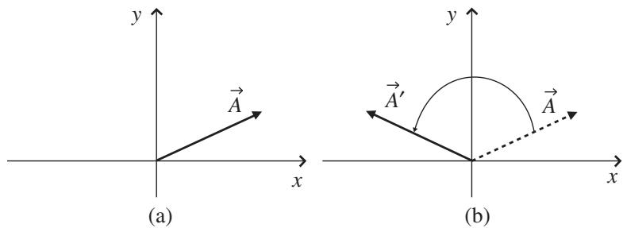
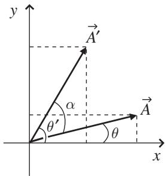
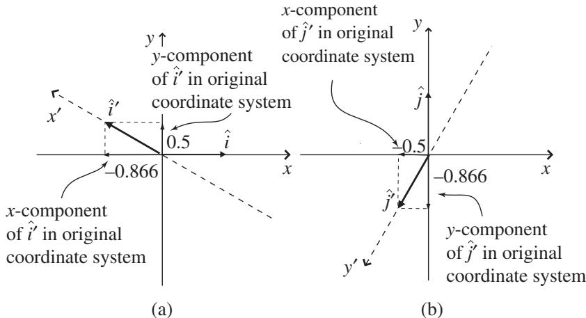

import Guide from '@/components/Guide.astro';
import Knowledge from '@/components/Knowledge.astro';
import Example from '@/components/Example.astro';
import Analysis from '@/components/Analysis.astro';
import Solution from '@/components/Solution.astro';
import Variant from '@/components/Variant.astro';
import Note from '@/components/Note.astro';
import Block from '@/components/Block.astro';
import Method from '@/components/Method.astro';
import Exercise from '@/components/Exercise.astro';

## 4.2 Basis-vector transformations

The previous section illustrated what happens to the components of a vector when the two-dimensional Cartesian axes are rotated, and the results are not surprising: the components of the vector referenced to the new (rotated) axes are different from the components referenced to the original (non-rotated) axes. More specifically, the new components are weighted linear combinations of the original components.

Now here's a very important point: as your studies carry you along the path from vectors to tensors, you will undoubtedly run across discussions of "covariant" and "contravariant" vector components.2 In those discussions, you may see words to the effect that covariant components transform in the same way as basis vectors $( { } ^ { 6 6 } \mathrm { c o } ^ { 3 9 } \approx { } ^ { 6 6 } \mathrm { w i t h } ^ { 3 9 } )$ , and contravariant components transform in the opposite way to basis vectors $( ^ { \mathrm { * } } \mathrm { c o n t r a ^ { \mathrm { * } } } \approx \mathrm { ^ { \mathrm { * } } a g a i n s t ^ { \mathrm { * } } } )$ . As you'll see later in this chapter, there's plenty of truth in that description, but there's also a major pitfall. That's because the "transformation" of basis vectors usually refers to the conversion of the basis vectors in the original (non-rotated) coordinate system to the different basis vectors which point along the coordi nate axes in the new (rotated) system, whereas the "transformation" of vector components refers to the change in the components of the same vector referred to two different sets of coordinate axes. The potential for confusion here is suf ficiently great to cause Schutz to write that "the reason that 'co' and 'contra have been abandoned is that they mix up two very different things."3 Schutz wrote that in 1983, and for better or worse, the "covariant/contravariant" terminology is still with us – that's why in this book you'll find those words as well as more modern terminology.

Why did the "covariant/contravariant" terminology take hold in the first place? Probably because the process of changing a vector into a different vector has much in common with the process of transforming the components of a vector from one coordinate system to another. This section shows you how to make a new vector using rotation (specifically, how to rotate basis vectors).

To understand the process of rotating a vector, consider vector $\vec { A }$ in Figure 4.7(a). The rotation shown in Figure 4.7(b) causes vector $\vec { A }$ to point in a different direction, which means it is no longer the same vector (which is why it's labeled ${ \vec { A } } ^ { \prime }$ after the rotation). The relationship between the com ponents of the original (non-rotated) vector and the new (rotated) vector can be found rather easily through geometric constructions such as those shown in Figure 4.8. In this example, the rotation angle is α. The x- and y-components of vectors $\vec { A }$ and ${ \vec { A } } ^ { \prime }$ are

$$
\begin{array}{l l} A _ {x} = | \vec {A} | \cos (\theta), & A _ {x} ^ {\prime} = | \vec {A} ^ {\prime} | \cos (\theta^ {\prime}), \\ A _ {y} = | \vec {A} | \sin (\theta), & A _ {y} ^ {\prime} = | \vec {A} ^ {\prime} | \sin (\theta^ {\prime}). \end{array}
$$

But $\theta ^ { \prime } = \alpha + \theta$ , so the components $A _ { x } ^ { \prime }$ and $A _ { y } ^ { \prime }$ are

$$
\begin{array}{l} A _ {x} ^ {\prime} = | \vec {A} ^ {\prime} | \cos (\alpha + \theta) = | \vec {A} ^ {\prime} | [ \cos (\alpha) \cos (\theta) - \sin (\alpha) \sin (\theta) ]  , \\ A _ {y} ^ {\prime} = | \vec {A} ^ {\prime} | \sin (\alpha + \theta) = | \vec {A} ^ {\prime} | [ \sin (\alpha) \cos (\theta) + \cos (\alpha) \sin (\theta) ]. \end{array}
$$

Since the length of $\vec { A }$ must be the same as the length of ${ \vec { A } } ^ { \prime }$ (the vector rotated but did not change length), you can write $| \vec { A } | = | \vec { A } ^ { \prime } |$ , which means tha

  
Figure 4.7 Rotation of a vector.

  
Figure 4.8 Angles involved in the rotation of a vector.

$$
\begin{array}{r l} & A _ {x} ^ {\prime} = | \vec {A} ^ {\prime} | [ \cos (\alpha) \cos (\theta) - \sin (\alpha) \sin (\theta) ] \\ & \qquad = | \vec {A} | \cos (\alpha) \cos (\theta) - | \vec {A} | \sin (\alpha) \sin (\theta), \\ & A _ {y} ^ {\prime} = | \vec {A} ^ {\prime} | [ \sin (\alpha) \cos (\theta) + \cos (\alpha) \sin (\theta) ] \\ & \qquad = | \vec {A} | \sin (\alpha) \cos (\theta) + | \vec {A} | \cos (\alpha) \sin (\theta). \end{array}
$$

But $| \vec { A } | \cos ( \theta )$ is just $A _ { x }$ and $| \vec { A } | \sin ( \theta )$ is $A _ { y }$ , so you can write

$$
\begin{array}{l} A _ {x} ^ {\prime} = A _ {x} \cos (\alpha) - A _ {y} \sin (\alpha), \\ A _ {y} ^ {\prime} = A _ {x} \sin (\alpha) + A _ {y} \cos (\alpha), \end{array}
$$

or, as a matrix equation,

$$
\binom{A _ {x} ^ {\prime}}{A _ {y} ^ {\prime}} = \left( \begin{array}{c c} \cos (\alpha) & - \sin (\alpha) \\ \sin (\alpha) & \cos (\alpha) \end{array} \right) \binom{A _ {x}}{A _ {y}},\tag{4.15}
$$

which tells you how to find the components $A _ { x } ^ { \prime }$ and $A _ { y } ^ { \prime }$ of the new vector $( \vec { A } ^ { \prime } )$ in the original coordinate system.

To see how this works in practice, consider a rotation such as the one shown in Figure 4.7, but through a larger rotation angle of $\alpha = 1 5 0 ^ { \circ }$ . If the original vector is given by $\vec { A } = A _ { x } \hat { \imath } + A _ { y } \hat { \jmath } = 5 \hat { \imath } + 3 \hat { \jmath }$ , then

$$
\binom{A _ {x} ^ {\prime}}{A _ {y} ^ {\prime}} = \left( \begin{array}{c c} \cos (1 5 0 ^ {\circ}) & - \sin (1 5 0 ^ {\circ}) \\ \sin (1 5 0 ^ {\circ}) & \cos (1 5 0 ^ {\circ}) \end{array} \right) \binom{5}{3} = \binom{- 5. 8 3}{- 0. 1 0},\tag{4.16}
$$

so the new vector $\vec { A } ^ { \prime } = - 5 . 8 3 \hat { \imath } - 0 . 1 0 \hat { \jmath }$ . This means that by rotating vector $\vec { A }$ through 150◦, you've produced a new vector that lies almost entirely along the negative x-axis (you can see this by noting that the x-component is neg ative and much larger than the y-component). Remember that this is a new vector expressed using the same basis $( \hat { \boldsymbol { \imath } }$ and $\hat { \jmath } )$ and is not the same vecto expressed using a new basis (because in this case you rotated the vector, not the coordinate system).

  
Figure 4.9 Components o $\hat { \mathbf { \chi } } _ { l } ^ { \prime }$ and $\hat { \jmath } ^ { \prime }$ in original (unrotated) coordinate system.

You can, of course, rotate the basis vectors $\hat { \imath }$ and $\hat { \jmath }$ using this same approach. This can be helpful if you're faced with a problem involving a rotated coordi nate system and you wish to express the basis vectors pointing along the axes of the rotated system in terms of the basis vectors in the original (non-rotated) system. For example, to rotate the $\hat { \imath }$ unit vector by $1 5 0 ^ { \circ }$ counter-clockwise, you can use

$$
\binom{\hat {i} _ {x} ^ {\prime}}{\hat {i} _ {y} ^ {\prime}} = \left( \begin{array}{c c} \cos (1 5 0 ^ {\circ}) & - \sin (1 5 0 ^ {\circ}) \\ \sin (1 5 0 ^ {\circ}) & \cos (1 5 0 ^ {\circ}) \end{array} \right) \binom{1}{0} = \binom{- 0. 8 6 6}{0. 5},\tag{4.17}
$$

where $\hat { \imath } _ { x } ^ { \prime }$ represents the x-component of the $1 5 0 ^ { \circ }$ -rotated $\hat { \imath }$ vector and $\hat { l } _ { y } ^ { \prime }$ repre sents the y-component of the rotated $\hat { \imath }$ vector, as shown in Figure 4.9(a). You can also rotate the $\hat { \jmath }$ unit vector by the same angle using

$$
\binom{\hat {j} _ {x} ^ {\prime}}{\hat {j} _ {y} ^ {\prime}} = \left( \begin{array}{c c} \cos (1 5 0 ^ {\circ}) & - \sin (1 5 0 ^ {\circ}) \\ \sin (1 5 0 ^ {\circ}) & \cos (1 5 0 ^ {\circ}) \end{array} \right) \binom{0}{1} = \binom{- 0. 5}{- 0. 8 6 6},\tag{4.18}
$$

where $\hat { J } _ { x } ^ { \prime }$ represents the x-component of the $1 5 0 ^ { \circ }$ -rotated $\hat { \jmath }$ vector and $\hat { J } _ { y } ^ { \prime }$ represents the y-component of the rotated $\hat { \jmath }$ vector, as shown in Figure 4.9(b).

Just as in Eq. 4.15, the new components of the $\hat { \imath } ^ { \prime }$ and $\hat { \jmath } ^ { \prime }$ vectors are expressed in the same coordinate system as the original $\hat { \imath }$ and $\hat { \jmath }$ . As pointed out in the previous section, the components of $\hat { \imath } ^ { \prime }$ and $\hat { \jmath } ^ { \prime }$ in the rotated coordinate system must be (1, 0) and (0, 1).

So if you wish to transform a set of basis vectors into new basis vec tors (pointing along different coordinate axes), you use a "direct" or "active" transformation matrix, and the matrix equation looks like this:

$$
\binom{\text {New basis}}{\text {vectors}} = \left( \begin{array}{c} \text {Direct} \\ \text {transformation} \\ \text {matrix} \end{array} \right) \binom{\text {Original basis}}{\text {vectors}}.\tag{4.19}
$$

Comparing this to Eq. 4.14 should help you understand that transformation matrices can be used for two different but related operations: finding the components of the same vector in a new coordinate system or finding the components of a different vector (such as a new basis vector) in the original coordinate system. The next section presents a comparison of these two types of transformation matrix.
