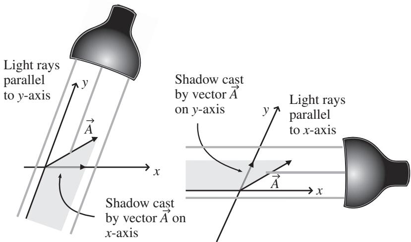
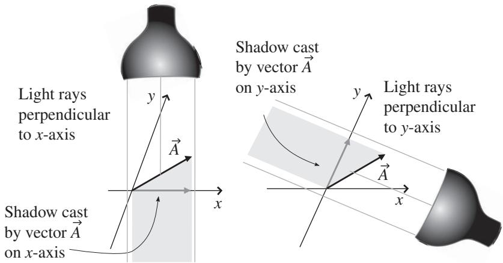
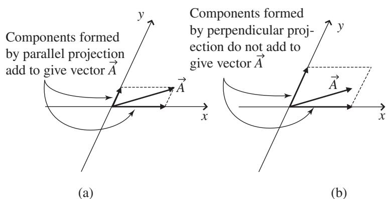

import Guide from '@/components/Guide.astro';
import Knowledge from '@/components/Knowledge.astro';
import Example from '@/components/Example.astro';
import Analysis from '@/components/Analysis.astro';
import Solution from '@/components/Solution.astro';
import Variant from '@/components/Variant.astro';
import Note from '@/components/Note.astro';
import Block from '@/components/Block.astro';
import Method from '@/components/Method.astro';
import Exercise from '@/components/Exercise.astro';

## 4.4 Non-orthogonal coordinate systems

In Cartesian coordinate systems, there's no chance for ambiguity when you consider the process of "projection" of a vector onto a coordinate axis. Using the light source and shadow approach described in Chapter 1, you simply imagine a source of light shining on the vector and the shadow produced by that vector on one of the coordinate axes, as in Figure 1.6. In two-dimensional Cartesian coordinates, the direction of the light may be specified in one of two equivalent ways: parallel to one of the axes (actually antiparallel since the light shines back toward the origin), or perpendicular to the other axis. For example in Figure 1.6(a), you're saying exactly the same thing if you describe the ligh as shining "antiparallel to the y-axis" or "perpendicular to the x-axis."

  
Figure 4.10 Projections using light sources parallel to x- and y-axes.

Now imagine a two-dimensional coordinate system in which the x- and y-axes are not perpendicular to one another.4 In such cases, the process of projecting a vector onto one of the coordinate axes takes on an additional complication. Should the light sources shine (anti-) parallel to the coordinate axes, as in Figure 4.10, or perpendicular to the axes, as in Figure 4.11?

In each case, a "projection" of the vector is formed onto one of the coordi nate axes, but those projections may have quite different lengths, as you can see by comparing the lengths of the "shadows" cast in Figure 4.10 to those in Figure 4.11.

You may certainly be forgiven for thinking "So what?" when confronted with these differing projections. Does it really matter that there are two ways to project a vector onto an axis in non-orthogonal coordinate systems?

One indication that the type of projection does matter comes about if you attempt to use vector addition to form vector A from the projection components using the rules of vector addition. As you can see in Figure 4.12, that process works perfectly if you use the parallel-projection components but fails miserably when you attempt to use the perpendicular-projection components.

  
Figure 4.11 Projections using light sources perpendicular to x- and y-axes.

  
Figure 4.12 Vector addition of components formed by parallel and perpen dicular projection.

This may cause you to wonder why the perpendicular-projection components are called "components" at all.

Another way to appreciate the significance of the difference between parallel and perpendicular projections is to consider how the components formed by these two types of projection transform between coordinate systems. As you'll see later in this chapter, the components formed by projections perpendicular to the coordinate axes transform between coordinate systems using the direct transformation matrix that is also used to form the new basis vectors in the new coordinate system, while the components formed by projections parallel to the coordinate axes transform between coordinate systems using the inverse transformation matrix. This behavior has caused the perpendicular-projection components to traditionally be called the "covariant" components of the vector, while the parallel-projection components are called the "contravariant" components of the vector. Of course, for orthogonal coordinate systems, the direction parallel to one of the coordinate axes is exactly the same as the direction perpendicular to other axes, so in that case the covariant and contravariant components of a vector are identical, and no distinction is needed.

To learn why the covariant values are called "components," and, much more importantly, to understand why covariant and contravariant components are meaningful quantities and how they may be used to write physical laws that do not depend on the reference frame of the observer, you should first understand the concept of dual basis vectors. You can read about such basis vectors in the next section.
