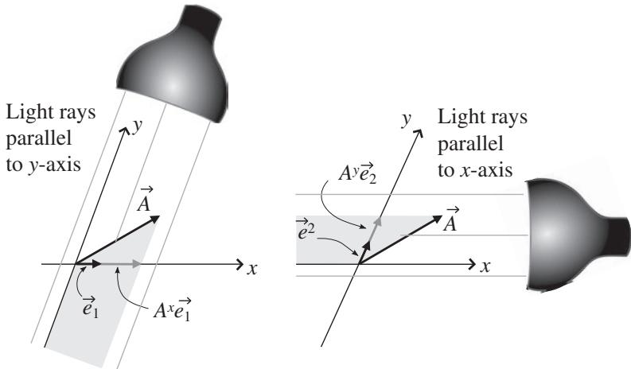
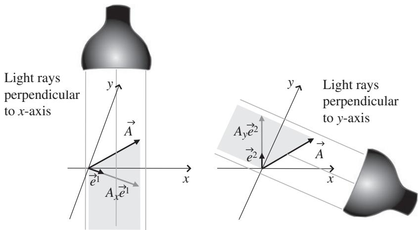

import Guide from '@/components/Guide.astro';
import Knowledge from '@/components/Knowledge.astro';
import Example from '@/components/Example.astro';
import Analysis from '@/components/Analysis.astro';
import Solution from '@/components/Solution.astro';
import Variant from '@/components/Variant.astro';
import Note from '@/components/Note.astro';
import Block from '@/components/Block.astro';
import Method from '@/components/Method.astro';
import Exercise from '@/components/Exercise.astro';

## 4.5 Dual basis vectors

For non-orthogonal coordinate systems, it's clear from geometric considera tions such as those illustrated in Figure 4.12 that the perpendicular projections of a vector onto the coordinate axes do not form "components" in the way that parallel projections do; the perpendicular projections simply don't add up as vectors to give the original vector. But to truly understand the process of "adding $\mathrm { u p } ^ { \mathrm { , , } }$ components as vectors, you have to think about the role of the basis vectors in that addition. To see how that works for parallel projections, take a look at the basis vectors $\vec { e } _ { 1 }$ and $\vec { e } _ { 2 }$ pointing along the (non-orthogonal) coordinate axes in Figure 4.13 and the projections of vector $\vec { A }$ onto those directions. In this case, vector $\vec { A }$ may be written as

$$
\vec {A} = A ^ {x} \vec {e} _ {1} + A ^ {y} \vec {e} _ {2},\tag{4.20}
$$

where $A ^ { x }$ and $A ^ { y }$ represent the parallel-projection (contravariant) components of $\vec { A } . ^ { 5 }$

The same approach doesn't work for the perpendicular-projection (covariant) components $A _ { x }$ and $A _ { y }$ , as you can tell by looking at the lengths of the projections in Figure 4.12(b); it's clear that those two "components" multiplied by the basis vectors $\vec { e } _ { 1 }$ and $\vec { e } _ { 2 }$ do not add up to give $\vec { A } .$ . So it's reasonable to wonder if there are alternative basis vectors that would allow the perpendicular-projection components to form a vector in a manner analogous to Eq. 4.20. Happily, there are, and those alternative basis vectors are called "reciprocal" or "dual" basis vectors.

  
Figure 4.13 Parallel-projection components and basis vectors.

Dual basis vectors have two defining characteristics. The first is that each one must be perpendicular to all original basis vectors with different indices. So if you call the dual basis vectors $\vec { e } ^ { 1 }$ and $\vec { e } ^ { 2 }$ to distinguish them from the original basis vectors $\vec { e } _ { 1 }$ and $\vec { e } _ { 2 }$ , you can be sure that $\vec { e } ^ { 1 }$ is perpendicular to $\vec { e } _ { 2 }$ (and thus perpendicular to the y-axis in this case). Likewise, $\vec { e } ^ { 2 }$ must be perpendicular to $\vec { e } _ { 1 }$ (and thus perpendicular to the x-axis in this case). The directions of the dual basis vectors $\vec { e } ^ { 1 }$ and $\vec { e } ^ { 2 }$ are shown in Figure 4.14.

The second defining characteristic for dual basis vectors is that the dot prod uct between each dual basis vector and the original basis vector with the same index must equal one (so $\vec { e } ^ { 1 } \circ \vec { e } _ { 1 } = 1$ and $\vec { e } ^ { 2 } \circ \vec { e } _ { 2 } = 1 )$ ). This means that you can find the lengths of the dual basis vectors as long as you know the lengths of the original basis vectors and the angle between each dual basis vector and the corresponding original basis vector.6 So to find the length of $\vec { e } ^ { 1 }$ , you simply have to multiply the length of the original basis vector $\vec { e } _ { 1 }$ by the cosine of the angle between $\vec { e } ^ { 1 }$ and $\vec { e } _ { 1 }$ and then take the inverse of the result. Likewise, to find the length of $\vec { e } ^ { 2 }$ , multiply the length of the original basis vector $\vec { e } _ { 2 }$ by the cosine of the angle between $\vec { e } ^ { 2 }$ and $\vec { e } _ { 2 }$ and take the inverse of that result. Thus:

$$
| \vec {e} ^ {1} | = \frac {1}{| \vec {e} _ {1} | \cos (\theta_ {1})},\tag{4.21}
$$

  
Figure 4.14 Perpendicular-projection components and dual basis vectors.

and

$$
| \vec {e} ^ {2} | = \frac {1}{| \vec {e} _ {2} | \cos (\theta_ {2})},\tag{4.22}
$$

where $\theta _ { 1 }$ is the angle between $\vec { e } ^ { 1 }$ and $\vec { e } _ { 1 }$ and $\theta _ { 2 }$ is the angle between $\vec { e } ^ { 2 }$ and $\vec { e } _ { 2 }$ .

With the concept of dual basis vectors in hand, you're in a position to understand why the perpendicular-projection (covariant) components $A _ { x }$ and $A _ { y }$ may rightfully be called "components." The key is that the projections must be made onto the direction of the dual basis vectors rather than onto the direc tions of the original basis vectors. If you do that, then the covariant components $A _ { x }$ and $A _ { y }$ can be multiplied by the relevant basis vectors and added to give the original vector $\vec { A }$ in the same way as can be done using the parallel-projection (contravariant) components $A ^ { x }$ and $A ^ { y }$ . The covariant-component equivalent to Eq. 4.20 is thus

$$
\vec {A} = A _ {x} \vec {e} ^ {1} + A _ {y} \vec {e} ^ {2}.\tag{4.23}
$$

As you may have guessed, the use of superscripts to denote the dual basis vectors $\vec { e } ^ { 1 }$ and $\vec { e } ^ { 2 }$ is not accidental; when these basis vectors are transformed to a new coordinate system, the inverse transformation matrix is used, as it is for the contravariant vector components $A ^ { x }$ and $A ^ { y }$

Note that in a two-dimensional coordinate system with orthonormal basis vectors such as $\hat { \imath }$ and $\hat { \jmath }$ , the dual basis vectors are identical to the original basis vectors along the coordinate axes. That's easily understood, because the direc tion of each of the dual basis vectors must be perpendicular to the direction of one of the original basis vectors (and hence must point along the $x -$ and y-axes). And since the length of the dual basis vectors must equal the inverse of the length of the original basis vectors times cos(θ) (which is $1 / [ 1 \cos ( 0 ^ { \circ } ) ]$ in this case), the dual basis vectors have the same length as well as the same direction as $\hat { \imath }$ and $\hat { \jmath } .$ So the differences between original and dual basis vectors disappear for orthonormal coordinate systems, just as the distinctions between covariant and contravariant components disappear for such systems.

The concept of dual basis vectors can be readily extended to three dimensions, and in that case determination of the length and direction of the dual basis vectors is most easily done using the dot and cross product between vec tors. Specifically, the three-dimensional dual basis vectors $\vec { e } ^ { 1 } , \vec { e } ^ { 2 }$ and $\vec { e } ^ { 3 }$ can be found from the original basis vectors $\vec { e } _ { 1 } , \vec { e } _ { 2 }$ , and $\vec { e } _ { 3 }$ using the following relations:

$$
\begin{array}{l} \vec {e} ^ {1} = \frac {\vec {e} _ {2} \times \vec {e} _ {3}}{\vec {e} _ {1} \circ (\vec {e} _ {2} \times \vec {e} _ {3})}, \\ \vec {e} ^ {2} = \frac {\vec {e} _ {3} \times \vec {e} _ {1}}{\vec {e} _ {1} \circ (\vec {e} _ {2} \times \vec {e} _ {3})}, \\ \vec {e} ^ {3} = \frac {\vec {e} _ {1} \times \vec {e} _ {2}}{\vec {e} _ {1} \circ (\vec {e} _ {2} \times \vec {e} _ {3})}. \end{array}\tag{4.24}
$$

Each denominator is the triple scalar product of the original basis vectors, which you may recall from Section 2.3 is the volume of the parallelepiped formed by those vectors.

In these equations, the cross products in the numerators ensure that the first characteristic of dual basis vectors is met (for example, that $\vec { e } ^ { 1 }$ is perpendicular to $\vec { e } _ { 2 }$ and to $\vec { e } _ { 3 } )$ . The triple scalar products in the denominators ensure that the second characteristic is met (for example, that $\vec { e } ^ { 1 } \circ \vec { e } _ { 1 } = 1 )$

The computation of dual basis vectors may seem like a long trek to make simply to have an alternative way of writing vectors, but there's a great truth to be found by comparing Eqs. 4.20 and 4.23. Since these equations describe the same vector, you may combine them to write

$$
\vec {A} = A ^ {x} \vec {e} _ {1} + A ^ {y} \vec {e} _ {2} = A _ {x} \vec {e} ^ {1} + A _ {y} \vec {e} ^ {2},\tag{4.25}
$$

which serves to emphasize an important fact. If you seek to define a quantity (such as vector $\vec { A } )$ that remains invariant under a transformation of coordinates, you have a choice: you can combine superscripted (contravariant) components with subscripted (covariant) basis vectors, or you can combine subscripted (covariant) components with superscripted (contravariant) basis vectors. That should seem reasonable to you, because covariant quantities transform using a direct transformation matrix, while contravariant quantities use an inverse transformation matrix. Multiplying such quantities guarantees that the result is unaffected by the transformation.

You can see an example of how dual basis vectors and covariant and contravariant components are determined in the next section.
