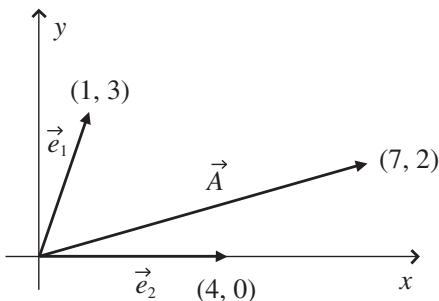
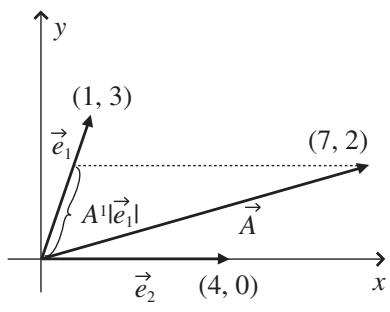
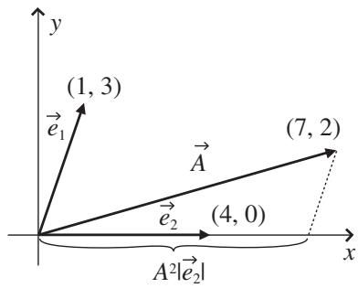
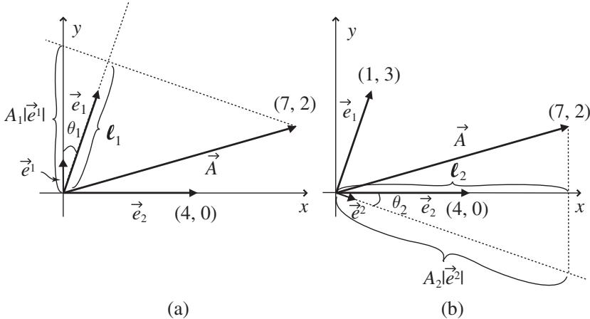

import Guide from '@/components/Guide.astro';
import Knowledge from '@/components/Knowledge.astro';
import Example from '@/components/Example.astro';
import Analysis from '@/components/Analysis.astro';
import Solution from '@/components/Solution.astro';
import Variant from '@/components/Variant.astro';
import Note from '@/components/Note.astro';
import Block from '@/components/Block.astro';
import Method from '@/components/Method.astro';
import Exercise from '@/components/Exercise.astro';

## 4.6 Finding covariant and contravariant components

Once you grasp the concept of dual basis vectors in non-orthonormal coordi nate systems, finding the covariant and contravariant components of a vector is straightforward. As an example, take a look at vector $\vec { A }$ in Figure 4.15, with non-orthogonal basis vectors $\vec { e } _ { 1 }$ and $\vec { e } _ { 2 }$ .

Finding the contravariant components $A ^ { 1 }$ and $A ^ { 2 }$ is simply a matter of parallel-projecting vector $\vec { A }$ onto the directions of the original basis vectors $\vec { e } _ { 1 }$ and $\vec { e } _ { 2 }$ , as shown in Figure 4.16. A quick visual inspection suggests that component $A ^ { 1 } | \vec { e } _ { 1 } |$ should be about 2/3 the length of original basis vector $\vec { e } _ { 1 }$ and component $A ^ { 2 } | \vec { e } _ { 2 } |$ should be about 1.5 times the length of original basis vector $\vec { e } _ { 2 }$ . The values of $A ^ { 1 }$ and $A ^ { 2 }$ can be found by writing the vector equation

  
Figure 4.15 Non-orthogonal basis vectors.

  
(a)

  
(b)  
Figure 4.16 Parallel projections onto original basis vectors.

$$
\vec {A} = A ^ {1} \vec {e} _ {1} + A ^ {2} \vec {e} _ {2},\tag{4.26}
$$

which can be written as two equations for the components of $\vec { A }$

$$
\begin{array}{l} {A _ {x} = A ^ {1} e _ {1, x} + A ^ {2} e _ {2, x},} \\ {A _ {y} = A ^ {1} e _ {1, y} + A ^ {2} e _ {2, y}.} \end{array}
$$

These two simultaneous equations may readily be solved for $A ^ { 1 }$ and $A ^ { 2 }$ using the elimination or substitution method (both of which are demonstrated in the on-line solutions to the problems at the end of this chapter). Another approach is the matrix method and Cramer's Rule (described in the matrix-algebra review on the book's website). Using this approach, you begin by substituting the known values for vector $\vec { A }$ as well as $\vec { e } _ { 1 }$ and $\vec { e } _ { 2 }$ :

$$
\binom{7}{2} = A ^ {1} \binom{1}{3} + A ^ {2} \binom{4}{0},\tag{4.27}
$$

which may also be written as

$$
\binom{7}{2} = \left( \begin{array}{c c} 1 & 4 \\ 3 & 0 \end{array} \right) \binom{A ^ {1}}{A ^ {2}}.\tag{4.28}
$$

Now use Cramer's Rule to find $A ^ { 1 }$ and $A ^ { 2 }$ :

$$
A ^ {1} = \frac {\left| \begin{array}{l l} 7 & 4 \\ 2 & 0 \end{array} \right|}{\left| \begin{array}{l l} 1 & 4 \\ 3 & 0 \end{array} \right|} = \frac {- 8}{- 1 2} = 0. 6 6 7, \quad A ^ {2} = \frac {\left| \begin{array}{l l} 1 & 7 \\ 3 & 2 \end{array} \right|}{\left| \begin{array}{l l} 1 & 4 \\ 3 & 0 \end{array} \right|} = \frac {- 1 9}{- 1 2} = 1. 5 8 3.\tag{4.29}
$$

These values are consistent with the visual estimates from Figure 4.16.

To use the same process to find the perpendicular-projection (covariant) components $A _ { 1 }$ and $A _ { 2 }$ , you must first determine the length and direction of the dual basis vectors. You know that the direction of $\vec { e } ^ { 1 }$ must be perpendicular to that of $\vec { e } _ { 2 }$ , and the direction of $\vec { e } ^ { 2 }$ must be perpendicular to that of $\vec { e } _ { 1 }$ . As for the lengths, first find the lengths of $\vec { e } _ { 1 }$ and $\vec { e } _ { 2 }$ :

$$
| \vec {e} _ {1} | = \sqrt {(1) ^ {2} + (3) ^ {2}} = 3. 1 6, | \vec {e} _ {2} | = \sqrt {(4) ^ {2} + (0) ^ {2}} = 4. 0 0.\tag{4.30}
$$

Then you can use Eqs. 4.21 and 4.22 to find $| \vec { e } ^ { 1 } |$ and $| \vec { e } ^ { 2 } |$ , but first you have to figure out the angle between $\vec { e } _ { 1 }$ and $\vec { e } ^ { 1 }$ (which is $\theta _ { 1 } )$ and the angle between $\vec { e } _ { 2 }$ and $\vec { e } ^ { 2 }$ (which is $\theta _ { 2 } )$ . If you look at Figure 4.17, you should be able to determine that $\theta _ { 1 } = \theta _ { 2 } = \arctan ( 1 / 3 ) = 1 8 . 4 3 ^ { \circ }$ , so you have

  
Figure 4.17 Perpendicular projections onto dual basis vectors.

$$
\begin{array}{l} | \vec {e} ^ {1} | = \frac {1}{| \vec {e} _ {1} | \cos (\theta_ {1})} = \frac {1}{3 . 1 6 \cos (1 8 . 4 3 ^ {\circ})} = 0. 3 3 3, \\ | \vec {e} ^ {2} | = \frac {1}{| \vec {e} _ {2} | \cos (\theta_ {2})} = \frac {1}{4 . 0 0 \cos (1 8 . 4 3 ^ {\circ})} = 0. 2 6 4. \end{array}\tag{4.31}
$$

You can see the (very short) dual basis vectors $\vec { e } ^ { 1 }$ and $\vec { e } ^ { 2 }$ in Figure 4.17. Note that $\vec { e } ^ { 1 }$ is perpendicular to $\vec { e } _ { 2 }$ and that $\vec { e } ^ { 2 }$ is perpendicular to $\vec { e } _ { 1 }$ , and their lengths are given by Eq. 4.31.

Once you have the dual basis vectors in hand, you're in a position to find the perpendicular-projection (covariant) components $A _ { 1 }$ and $A _ { 2 }$ . You can do this geometrically by continuing the perpendicular-projection lines beyond the direction lines of $\vec { e } _ { 1 }$ and $\vec { e } _ { 2 }$ and onto the direction lines of $\vec { e } ^ { 1 }$ and $\vec { e } ^ { 2 }$ , as shown in Figure 4.17. The magnitude of vector $\vec { A }$ is

$$
| \vec {A} | = \sqrt {(7) ^ {2} + (2) ^ {2}} = 7. 2 8,\tag{4.32}
$$

and the angle between $\vec { A }$ and the x-axis is $\arctan ( { \frac { 2 } { 7 } } ) = 1 5 . 9 4 ^ { \circ }$ . Using this value and $\theta _ { 1 }$ from above, you can determine that the angle between $\vec { A }$ and $\vec { e } _ { 1 }$ is $5 5 . 6 2 ^ { \circ }$ and the angle between $\vec { A }$ and $\vec { e } _ { 2 }$ is 15.94◦. So the length of $\ell _ { 1 }$ in Figure 4.17(a) is

$$
\ell_ {1} = | \vec {A} | \cos (5 5. 6 2 ^ {\circ}) = 4. 1 1,\tag{4.33}
$$

and

$$
A _ {1} | \vec {e} ^ {1} | = \frac {\ell_ {1}}{\cos (1 8 . 4 3 ^ {\circ})} = 4. 3 3,\tag{4.34}
$$

so $A _ { 1 } = 4 . 3 3 / 0 . 3 3 3 = 1 3 . 0 .$

Using the same approach to find $A _ { 2 }$ from Figure 4.17(b) gives

$$
\ell_ {2} = | \vec {A} | \cos (1 5. 9 4 ^ {\circ}) = 7. 0 0,\tag{4.35}
$$

and

$$
A _ {2} | \vec {e} ^ {2} | = \frac {\ell_ {2}}{\cos (1 8 . 4 3 ^ {\circ})} = 7. 3 8,\tag{4.36}
$$

so $A _ { 2 } = 7 . 3 8 / 0 . 2 6 4 = 2 8 . 0 .$

These results serve as a reminder that when you use non-normalized basis vectors (that is, basis vectors with magnitude not equal to one), you cannot equate the lengths of the projections onto the coordinate axes with the value of a vector's components. That's because those projections are the products of the components with the magnitudes of the basis vectors.

If you prefer the algebraic approach to finding $A _ { 1 }$ and $A _ { 2 }$ , you can do tha by proceeding as you did for $A ^ { 1 }$ and $A ^ { 2 }$ , although in this case you begin with

$$
\vec {A} = A _ {1} \vec {e} ^ {1} + A _ {2} \vec {e} ^ {2},\tag{4.37}
$$

and then substitute the known values for vector $\vec { A }$ as well as the x- and $y -$ components of the dual basis vectors $\vec { e } ^ { 1 }$ and $\vec { e } ^ { 2 }$ :

$$
\begin{array}{l l} e _ {x} ^ {1} = | \vec {e} ^ {1} | \cos (9 0 ^ {\circ}) = 0. 0 0 0, & e _ {x} ^ {2} = | \vec {e} ^ {2} | \cos (3 6 0 ^ {\circ} - 1 8. 4 3 ^ {\circ}) = 0. 2 5 0, \\ e _ {y} ^ {1} = | \vec {e} ^ {1} | \sin (9 0 ^ {\circ}) = 0. 3 3 3, & e _ {y} ^ {2} = | \vec {e} ^ {2} | \sin (3 6 0 ^ {\circ} - 1 8. 4 3 ^ {\circ}) = - 0. 0 8 3. \end{array}
$$

So

$$
\binom{7}{2} = A _ {1} \binom{0}{0. 3 3 3} + A _ {2} \binom{0. 2 5}{- 0. 0 8 3}.\tag{4.38}
$$

As before, this may be written as

$$
\binom{7}{2} = \left( \begin{array}{c c} 0 & 0. 2 5 \\ 0. 3 3 3 & - 0. 0 8 3 \end{array} \right) \binom{A _ {1}}{A _ {2}}.\tag{4.39}
$$

Again using Cramer's Rule to solve for $A _ { 1 }$ and $A _ { 2 }$ gives

$$
A _ {1} = \frac {\left| \begin{array}{c c} 7 & 0 . 2 5 \\ 2 & - 0 . 0 8 3 \end{array} \right|}{\left| \begin{array}{c c} 0 & 0 . 2 5 \\ 0 . 3 3 3 & - 0 . 0 8 3 \end{array} \right|} = \frac {- 1 . 0 8 1}{- 0 . 0 8 3} = 1 3. 0,
$$

$$
A _ {2} = \frac {\left| \begin{array}{c c} 0 & 7 \\ 0 . 3 3 3 & 2 \end{array} \right|}{\left| \begin{array}{c c} 0 & 0 . 2 5 \\ 0 . 3 3 3 & - 0 . 0 8 3 \end{array} \right|} = \frac {- 2 . 3 3 1}{- 0 . 0 8 3} = 2 8. 0,\tag{4.40}
$$

as expected from the geometric approach.

A simpler approach to finding the contravariant and covariant components of a vector once you have both the original and dual basis vectors in hand is to use these relations:

$$
A _ {1} = \vec {A} \circ \vec {e} _ {1} = A _ {x} e _ {1, x} + A _ {y} e _ {1, y} \quad A _ {2} = \vec {A} \circ \vec {e} _ {2} = A _ {x} e _ {2, x} + A _ {y} e _ {2, y},\tag{4.41}
$$

and

$$
A ^ {1} = \vec {A} \circ \vec {e} ^ {1} = A _ {x} e _ {x} ^ {1} + A _ {y} e _ {y} ^ {1} \quad A ^ {2} = \vec {A} \circ \vec {e} ^ {2} = A _ {x} e _ {x} ^ {2} + A _ {y} e _ {y} ^ {2}.\tag{4.42}
$$

In the current example, this approach gives the covariant components as

$$
\begin{array}{l} A _ {1} = (7, 2) \circ (1, 3) = (7) (1) + (2) (3) = 1 3, \\ A _ {2} = (7, 2) \circ (4, 0) = (7) (4) + (2) (0) = 2 8, \end{array}
$$

and

$$
A ^ {1} = (7, 2) \circ (0, 0. 3 3 3) = (7) (0) + (2) (0. 3 3 3) = 0. 6 6 6,
$$

$$
A ^ {2} = (7, 2) \circ (0. 2 5 0, - 0. 0 8 3) = (7) (0. 2 5 0) + (2) (- 0. 0 8 3) = 1. 5 8,
$$

in agreement with the geometric and matrix-algebra approaches taken above.

It's important for you to realize that what you've just found are the parallel projection (contravariant) and perpendicular-projection (covariant) components of vector $\vec { A }$ with respect to the original basis vectors $\vec { e } _ { 1 }$ and $\vec { e } _ { 2 }$ and the dual basis vectors $\vec { e } ^ { 1 }$ and $\vec { e } ^ { 2 }$ . So does that mean that $\vec { A }$ is a covariant vector or a contravariant vector?

The answer is neither (or both, if you prefer); it's not the vector itself that is contravariant or covariant, it's the set of components that you form through its parallel or perpendicular projections. As you read the literature on tensors, you're very likely to run into expressions such as "the contravariant vector ${ \vec { A } } ^ { , , }$ or "the covariant vector $\vec { B } , ^ { \prime }$ and what the author generally means is that the contravariant components of vector $\vec { A }$ and the covariant components of vector $\vec { B }$ are being used for the problem (perhaps because they're simpler). But you can be sure that like all vectors, $\vec { A }$ and $\vec { B }$ both have contravariant and covariant components, and you can find them using the techniques described in this section.7

And if you're wondering why you might want to go through the effort of finding those components, rest assured that the payoff is worth the effort. To appreciate the value of that payoff, you'll have to begin thinking of vectors not just as arrows with a certain length and pointing in a specified direction, but rather as members of a class of objects called tensors that have very predictable (and useful) properties under transformation of coordinates. In that view, the vectors you've been dealing with up to this point have all been tensors of rank one. Seeing them as such, and understanding what that means, will be made a great deal easier through the use of a notation called "index notation" and a convention known as the "Einstein summation convention." You can read about index notation and the summation convention in the next section.
