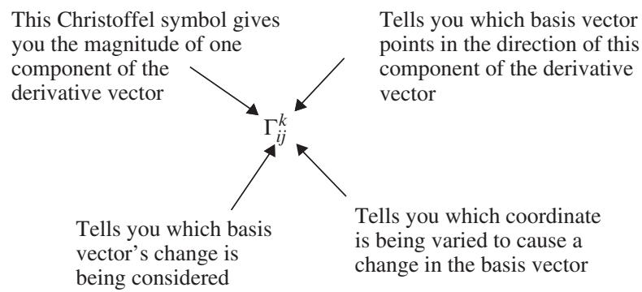
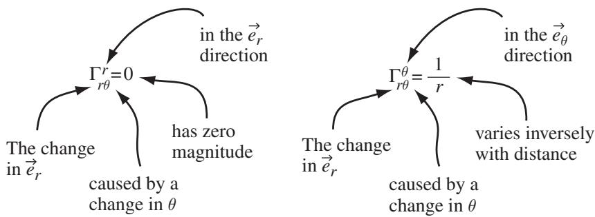

import Guide from '@/components/Guide.astro';
import Knowledge from '@/components/Knowledge.astro';
import Example from '@/components/Example.astro';
import Analysis from '@/components/Analysis.astro';
import Solution from '@/components/Solution.astro';
import Variant from '@/components/Variant.astro';
import Note from '@/components/Note.astro';
import Block from '@/components/Block.astro';
import Method from '@/components/Method.astro';
import Exercise from '@/components/Exercise.astro';

## 5.7 Tensor derivatives and Christoffel symbols

In many applications, it's important to know how a vector field changes as you move from one location to another. For vectors expressed using Cartesian coordinates, taking the derivative of a vector is quite straightforward: you simply take the derivative of each of the vector's components. You can do that because the Cartesian basis vectors $( \hat { \imath } , \hat { \jmath } )$ , and $\hat { k } )$ are everywhere constant in both magnitude and direction. That means you don't need to worry about the derivatives of the basis vectors. But as you've seen for spherical polar coordi nates, the basis vectors $( \hat { r } , \hat { \theta }$ , and $\hat { \phi } )$ point in different directions as you move around the space, which means that when you take a spatial derivative of a vector expressed in these coordinates, you must also consider the derivatives of the basis vectors.

Thus if you have a vector $\vec { A }$ expressed in general coordinates $x ^ { 1 } , x ^ { 2 } , x ^ { 3 }$ with covariant basis vectors $\vec { e _ { 1 } } , \vec { e _ { 2 } }$ , and $\vec { e _ { 3 } }$ as

$$
\vec {A} = A ^ {1} \vec {e _ {1}} + A ^ {2} \vec {e _ {2}} + A ^ {3} \vec {e _ {3}},
$$

the derivative of $\vec { A }$ with respect to coordinate $x ^ { 1 }$ is

$$
\begin{array}{c} \frac {\partial \vec {A}}{\partial x ^ {1}} = \frac {\partial (A ^ {1} \vec {e _ {1}} + A ^ {2} \vec {e _ {2}} + A ^ {3} \vec {e _ {3}})}{\partial x ^ {1}} \\ = \frac {\partial (A ^ {i} \vec {e _ {i}})}{\partial x ^ {1}} \\ = \frac {\partial A ^ {i}}{\partial x ^ {1}} \vec {e _ {1}} + A ^ {i} \frac {\partial \vec {e _ {i}}}{\partial x ^ {1}}. \end{array}
$$

It's the second term in this equation that complicates the process of taking a derivative in coordinate systems in which the magnitude and/or direction of the basis vectors change as you move around the space. And as you might expect, similar terms appear when you take the derivatives of $\vec { A }$ with respect to the other coordinates. So if you want to evaluate the changes in vector fields expressed in non-orthonormal coordinates, you have to account for possible changes in the basis vectors. Properly accounting for those changes means that the result of the defferentiation process will retain the tensor characteristics of the original object.

Fortunately, there's a way to account for any change in the basis vectors and to ensure that the derivative of a tensor is another tensor. That process, called the "covariant derivative," is described in the next section of this chapter. But the process of covariant differentiation will make a lot more sense to you if you've first learned the meaning of the Christoffel symbols described in this section.

To understand Christoffel symbols, you should begin by realizing that the derivative of a basis vector will be another vector. Like any vector, that vector can be described as the weighted combination of the basis vectors at the poin under consideration. Each Christoffel symbol, written as an uppercase Greek gamma (), simply represents the weighting coefficient for one of the basis vectors. Hence the defining relationship for Christoffel symbols5 is

$$
\Gamma_ {i j} ^ {k} \vec {e} _ {k} = \frac {\partial \vec {e} _ {i}}{\partial x ^ {j}},\tag{5.22}
$$

in which the index i specifies the basis vector for which the derivative is being taken, the index j denotes the coordinate being varied to induce this change in the ith basis vector, and the index k identifies the direction in which this component of the derivative points, as shown in Figure 5.1.

  
Figure 5.1 Explanation of Christoffel symbol indices.

  
Figure 5.2 Example of Christoffel symbol indices.

Hence if you find two Christoffel symbols such as $\Gamma _ { r \theta } ^ { r } = 0$ and $\begin{array} { r } { \Gamma _ { r \theta } ^ { \theta } = { \frac { 1 } { r } } } \end{array}$ , you know that

$$
\frac {\partial \vec {e} _ {r}}{\partial \theta} = 0 \vec {e} _ {r} + \frac {1}{r} \vec {e} _ {\theta},
$$

which is further explained in Figure 5.2.

As this example illustrates, Christoffel symbols are really quite simple to understand once you know the code of their indices. Best of all, the values of these useful symbols are easy to determine if you know the elements of the metric tensor for the coordinate system in which you're working. It will take a bit of algebra to get to the relationship between Christoffel symbols and the metric tensor, but the result makes the trip worthwhile.

A good way to start is to form the dot product of the basis vector $\vec { e } ^ { l }$ with both sides of Eq. 5.22:

$$
\Gamma_ {i j} ^ {k} \vec {e} _ {k} \circ \vec {e} ^ {l} = \vec {e} ^ {l} \circ \frac {\partial \vec {e} _ {i}}{\partial x ^ {j}}.
$$

Remembering that $\vec { e } _ { k } \circ \vec { e } ^ { l } = \delta _ { k } ^ { l }$ , this becomes

$$
\begin{array}{r} \Gamma_ {i j} ^ {k} \delta_ {k} ^ {l} = \vec {e} ^ {l} \circ \frac {\partial \vec {e} _ {i}}{\partial x ^ {j}}, \\ \Gamma_ {i j} ^ {l} = \vec {e} ^ {l} \circ \frac {\partial \vec {e} _ {i}}{\partial x ^ {j}}. \end{array}
$$

Since the term $\frac { \partial { \vec { e } } _ { i } } { \partial x ^ { j } }$ is the same as $\frac { \partial { \vec { e } } _ { j } } { \partial x ^ { i } }$ , this may be written as

$$
\Gamma_ {i j} ^ {l} = \frac {1}{2} \vec {e} ^ {l} \circ \frac {\partial \vec {e} _ {i}}{\partial x ^ {j}} + \frac {1}{2} \vec {e} ^ {l} \circ \frac {\partial \vec {e} _ {j}}{\partial x ^ {i}},
$$

which seems rather pointless until you add nothing to it. Nothing, that is, in the following form:

$$
\begin{array}{c} \Gamma_ {i j} ^ {l} = \frac {1}{2} \vec {e} ^ {l} \circ \frac {\partial \vec {e} _ {i}}{\partial x ^ {j}} + \left(\frac {1}{2} g ^ {k l} \frac {\partial \vec {e} _ {k}}{\partial x ^ {j}} \circ \vec {e} _ {i} - \frac {1}{2} g ^ {k l} \frac {\partial \vec {e} _ {j}}{\partial x ^ {k}} \circ \vec {e} _ {i}\right) \\ + \frac {1}{2} \vec {e} ^ {l} \circ \frac {\partial \vec {e} _ {j}}{\partial x ^ {i}} + \left(\frac {1}{2} g ^ {k l} \frac {\partial \vec {e} _ {k}}{\partial x ^ {i}} \circ \vec {e} _ {j} - \frac {1}{2} g ^ {k l} \frac {\partial \vec {e} _ {i}}{\partial x ^ {k}} \circ \vec {e} _ {j}\right). \end{array}
$$

Note that the terms in parentheses on each line add to zero, so you haven't changed the quantity on the right side of the equation by adding these terms. It may look like things are getting worse, but the situation will become more clear once you've accomplished a few more bits of manipulation. The first bit is to realize that $\vec { e } ^ { l } = g ^ { k l } \vec { e } _ { k }$ , so the Christoffel symbol becomes

$$
\begin{array}{c} \Gamma_ {i j} ^ {l} = \frac {1}{2} g ^ {k l} \vec {e} _ {k} \circ \frac {\partial \vec {e} _ {i}}{\partial x ^ {j}} + \left(\frac {1}{2} g ^ {k l} \frac {\partial \vec {e} _ {k}}{\partial x ^ {j}} \circ \vec {e} _ {i} - \frac {1}{2} g ^ {k l} \frac {\partial \vec {e} _ {j}}{\partial x ^ {k}} \circ \vec {e} _ {i}\right) \\ + \frac {1}{2} g ^ {k l} \vec {e} _ {k} \circ \frac {\partial \vec {e} _ {j}}{\partial x ^ {i}} + \left(\frac {1}{2} g ^ {k l} \frac {\partial \vec {e} _ {k}}{\partial x ^ {i}} \circ \vec {e} _ {j} - \frac {1}{2} g ^ {k l} \frac {\partial \vec {e} _ {i}}{\partial x ^ {k}} \circ \vec {e} _ {j}\right). \end{array}
$$

Now it's just a matter pulling out the common factor of $\scriptstyle { \frac { 1 } { 2 } } g ^ { k l }$ and grouping the terms by their sign:

$$
\begin{array}{c} \Gamma_ {i j} ^ {l} = \frac {1}{2} g ^ {k l} \left[ \left(\vec {e} _ {k} \circ \frac {\partial \vec {e} _ {i}}{\partial x ^ {j}} + \frac {\partial \vec {e} _ {k}}{\partial x ^ {j}} \circ \vec {e} _ {i}\right) + \left(\vec {e} _ {k} \circ \frac {\partial \vec {e} _ {j}}{\partial x ^ {i}} + \frac {\partial \vec {e} _ {k}}{\partial x ^ {i}} \circ \vec {e} _ {j}\right) \right. \\ \left. - \left(\frac {\partial \vec {e} _ {j}}{\partial x ^ {k}} \circ \vec {e} _ {i} + \frac {\partial \vec {e} _ {i}}{\partial x ^ {k}} \circ \vec {e} _ {j}\right) \right], \end{array}
$$

which may be further simplified if you recognize that

$$
\begin{array}{r l} & {\vec {e} _ {k} \circ \frac {\partial \vec {e} _ {i}}{\partial x ^ {j}} + \frac {\partial \vec {e} _ {k}}{\partial x ^ {j}} \circ \vec {e} _ {i} = \frac {\partial (\vec {e} _ {k} \circ \vec {e} _ {i})}{\partial x ^ {j}},} \\ & {\vec {e} _ {k} \circ \frac {\partial \vec {e} _ {j}}{\partial x ^ {i}} + \frac {\partial \vec {e} _ {k}}{\partial x ^ {i}} \circ \vec {e} _ {j} = \frac {\partial (\vec {e} _ {j} \circ \vec {e} _ {k})}{\partial x ^ {i}},} \\ & {\vec {e} _ {i} \circ \frac {\partial \vec {e} _ {j}}{\partial x ^ {k}} + \frac {\partial \vec {e} _ {i}}{\partial x ^ {k}} \circ \vec {e} _ {j} = \frac {\partial (\vec {e} _ {i} \circ \vec {e} _ {j})}{\partial x ^ {k}}.} \end{array}
$$

So

$$
\Gamma_ {i j} ^ {l} = \frac {1}{2} g ^ {k l} \left[ \frac {\partial (\vec {e} _ {k} \circ \vec {e} _ {i})}{\partial x ^ {j}} + \frac {\partial (\vec {e} _ {j} \circ \vec {e} _ {k})}{\partial x ^ {i}} - \frac {\partial (\vec {e} _ {i} \circ \vec {e} _ {j})}{\partial x ^ {k}} \right].
$$

But vou know from the definition of the elements of the metric tensor that ${ \vec { e } } _ { i } \circ { \vec { e } } _ { k } = g _ { i k }$ and that $\vec { e } _ { i } \circ \vec { e } _ { j } = g _ { i j }$ , which means you can write

$$
\Gamma_ {i j} ^ {l} = \frac {1}{2} g ^ {k l} \left[ \frac {\partial g _ {i k}}{\partial x ^ {j}} + \frac {\partial g _ {j k}}{\partial x ^ {i}} - \frac {\partial g _ {i j}}{\partial x ^ {k}} \right].\tag{5.23}
$$

With this expression, finding the Christoffel symbols for any coordinate system for which you know the metric tensor is quite straightforward. And why is that worth doing? Simply because using the Christoffel symbols, you can take a derivative of vectors and tensors that accounts for changes in the basis vectors as well as changes in the components. This preserves the most important property of a tensor: invariance across coordinate systems. Such covariant derivatives are the subject of the next section, but before getting to that, you might want to consider an example of the Christoffel symbols for a familiar coordinate system.

Consider the cylindrical coordinates $( r , \phi$ , and z) described in Section 1.5. In this system, the square of the differential length element is related to the coordinate differentials by $d s ^ { 2 } = d r ^ { 2 } + r ^ { 2 } d \phi ^ { 2 } + d z ^ { 2 }$ . Hence the covariant metric tensor may be represented by

$$
g _ {i j} = \left[ \begin{array}{c c c} g _ {1 1} & g _ {1 2} & g _ {1 3} \\ g _ {2 1} & g _ {2 2} & g _ {2 3} \\ g _ {3 1} & g _ {3 2} & g _ {3 3} \end{array} \right] = \left[ \begin{array}{c c c} 1 & 0 & 0 \\ 0 & r ^ {2} & 0 \\ 0 & 0 & 1 \end{array} \right],
$$

which suggests that most of the Christoffel symbols will be zero in this case. You can verify that by taking the derivatives indicated in Eq. 5.23, beginning with $l = 1 , i = 1$ , and $j = 1$ (and don't forget that the summation convention means that you must sum over k):

$$
\begin{array}{l} \Gamma_ {1 1} ^ {1} = \frac {1}{2} g ^ {1 1} \left[ \frac {\partial g _ {1 1}}{\partial x ^ {1}} + \frac {\partial g _ {1 1}}{\partial x ^ {1}} - \frac {\partial g _ {1 1}}{\partial x ^ {1}} \right] \\ \qquad + \frac {1}{2} g ^ {2 1} \left[ \frac {\partial g _ {1 2}}{\partial x ^ {1}} + \frac {\partial g _ {1 2}}{\partial x ^ {1}} - \frac {\partial g _ {1 1}}{\partial x ^ {2}} \right] \\ \qquad + \frac {1}{2} g ^ {3 1} \left[ \frac {\partial g _ {1 3}}{\partial x ^ {1}} + \frac {\partial g _ {1 3}}{\partial x ^ {1}} - \frac {\partial g _ {1 1}}{\partial x ^ {3}} \right], \end{array}
$$

and then using the relations $x ^ { 1 } = r , x ^ { 2 } = \phi$ , and $x ^ { 3 } = z { \mathrm { : } }$

$$
\begin{array}{l} \Gamma_ {1 1} ^ {1} = \frac {1}{2} (1) \left[ \frac {\partial (1)}{\partial r} + \frac {\partial (1)}{\partial r} - \frac {\partial (1)}{\partial r} \right] \\ \qquad + \frac {1}{2} (0) \left[ \frac {\partial (0)}{\partial r} + \frac {\partial (0)}{\partial r} - \frac {\partial (1)}{\partial \phi} \right] \\ \qquad + \frac {1}{2} (0) \left[ \frac {\partial (0)}{\partial r} + \frac {\partial (0)}{\partial r} - \frac {\partial (1)}{\partial z} \right] = 0. \end{array}
$$

OK, that one was pretty boring, as are most of the others in this case. But have a go at the Christoffel symbol for $l = 1 , i = 2$ , and $j = 2$ :

$$
\begin{array}{l} \Gamma_ {2 2} ^ {1} = \frac {1}{2} g ^ {1 1} \left[ \frac {\partial g _ {2 1}}{\partial x ^ {2}} + \frac {\partial g _ {2 1}}{\partial x ^ {2}} - \frac {\partial g _ {2 2}}{\partial x ^ {1}} \right] \\ \qquad + \frac {1}{2} g ^ {2 1} \left[ \frac {\partial g _ {2 2}}{\partial x ^ {2}} + \frac {\partial g _ {2 2}}{\partial x ^ {2}} - \frac {\partial g _ {2 2}}{\partial x ^ {2}} \right] \\ \qquad + \frac {1}{2} g ^ {3 2} \left[ \frac {\partial g _ {2 3}}{\partial x ^ {2}} + \frac {\partial g _ {2 3}}{\partial x ^ {2}} - \frac {\partial g _ {2 2}}{\partial x ^ {3}} \right], \end{array}
$$

which is:

$$
\begin{array}{l} \Gamma_ {2 2} ^ {1} = \frac {1}{2} (1) \left[ \frac {\partial (0)}{\partial \phi} + \frac {\partial (0)}{\partial \phi} - \frac {\partial r ^ {2}}{\partial r} \right] \\ \qquad + \frac {1}{2} (0) \left[ \frac {\partial r ^ {2}}{\partial \phi} + \frac {\partial r ^ {2}}{\partial \phi} - \frac {\partial r ^ {2}}{\partial \phi} \right] \\ \qquad + \frac {1}{2} (0) \left[ \frac {\partial (0)}{\partial \phi} + \frac {\partial (0)}{\partial \phi} - \frac {\partial r ^ {2}}{\partial z} \right], \end{array}
$$

or

$$
\Gamma_ {2 2} ^ {1} = \frac {1}{2} (1) [ 0 + 0 - 2 r ] + 0 + 0 = - r.
$$

Now you're getting somewhere. And exactly where is that? Just remember the meaning of a Christoffel symbol, and you'll see that this result means tha the change in the covariant $\vec { \phi }$ basis vector as you move in the $\phi$ direction has a component in the $- \vec { r }$ direction that increases directly with distance from the origin.

A similar analysis shows that $\Gamma _ { 1 2 } ^ { 2 } = \Gamma _ { 2 1 } ^ { 2 } = 1 / r$ , which are the only other non-zero Christoffel symbols for the cylindrical coordinate system.6 If you don't see how to get that result, take a look at the problems at the end of this chapter and the on-line solutions.
