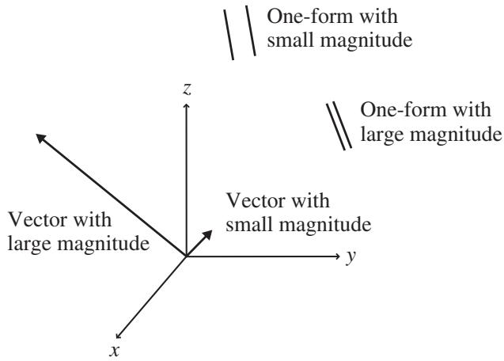

import Guide from '@/components/Guide.astro';
import Knowledge from '@/components/Knowledge.astro';
import Example from '@/components/Example.astro';
import Analysis from '@/components/Analysis.astro';
import Solution from '@/components/Solution.astro';
import Variant from '@/components/Variant.astro';
import Note from '@/components/Note.astro';
import Block from '@/components/Block.astro';
import Method from '@/components/Method.astro';
import Exercise from '@/components/Exercise.astro';

## 5.9 Vectors and one-forms

If you look up the subject of tensors in recently published physics texts, espe cially those dealing with General Relativity, you may be surprised to find little mention of contravariant and covariant components in favor of terms such as "covectors" and "one-forms." Have you wasted your time struggling to understand complicated concepts and terminology that have now become obsolete? I obviously don't think so, or I wouldn't have devoted so many pages to the developments of the last two chapters. Instead, I believe there's value in seeing the "traditional" presentation as well as the "modern" approach, because the differences arise from perspective rather than from the core concepts. But those different perspectives do lead to very different terminology, and the purpose of this section is to provide a short introduction to that terminology.

The first thing to understand is that the traditional approach tends to treat contravariant and covariant components as representations of the same object, whereas in the modern approach objects are classified either as "vectors" or as "one-forms" (also called "covectors"). In the modern terminology, vectors transform as contravariant quantities, and one-forms transform as covariant quantities. Quantities with dimension of length in the numerator (such as velocity, with units that include "meters per") fit naturally into the vector category; quantities with dimension of length in denominator (such as the gradient of a scalar field, with units that include "per meter") fit naturally into the one-form category.

In illustrations involving vectors and one-forms, vectors are represented as arrows and one-forms are represented as small sections of surfaces, as shown in Figure 5.3. As indicated in the figure, for vectors the angle of the arrow shows direction and the length of the arrow shows the magnitude. For one forms, surfaces are aligned normal to the direction and the spacing between surfaces is inversely proportional to the magnitude. This means that vectors with greater magnitude are represented by longer arrows, while one-forms of greater magnitude are represented by closer spacing.

  
Figure 5.3 Representation of vectors as arrows and one-forms as surfaces.

As in the traditional approach, vectors (which utilize contravariant com ponents) expand using original basis vectors, while one-forms (which utilize covariant components) expand using basis one-forms, which are equivalent to dual basis vectors in the traditional approach. That correspondence means that the product of a vector and a one-form is an invariant (a scalar), just as the multiplication of a contravariant and a covariant quantity produces a scalar without requiring the metric tensor. One very nice graphical interpretation of such products is that the resulting scalar is represented by the number of one-form surfaces through which the arrow of a vector passes.

Authors using the modern approach often place strong emphasis on vectors and one-forms as operators (or rules), so you're likely to encounter statements that vectors "take" one-forms and produce scalars, just as one-forms "take" vectors and produce scalars. Likewise, a higher-order tensor takes multiple vectors and/or one-forms and produces a scalar. From this perspective, the metric tensor is an operator that takes two vectors or two one-forms and produces their dot product, and the components of the metric tensor may be found by feeding it basis vectors or one-forms.
