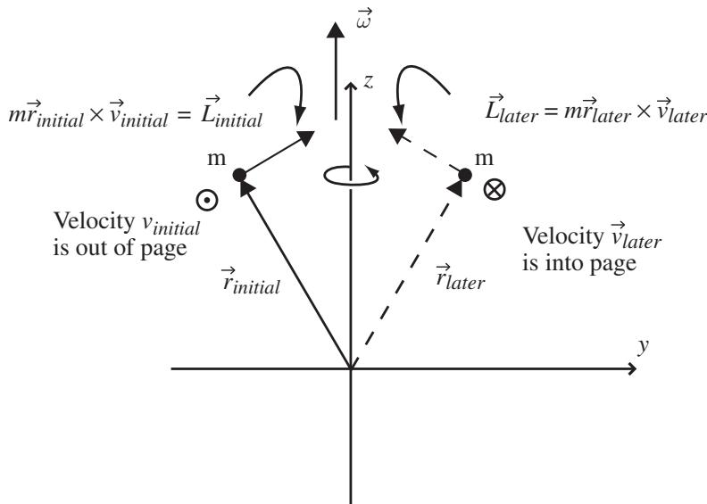
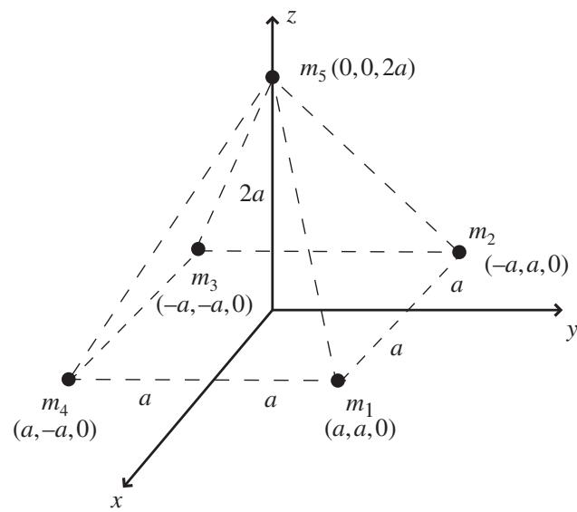
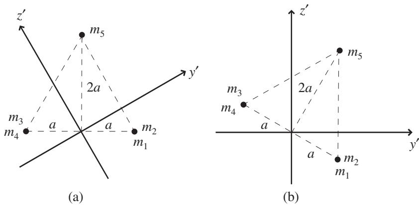
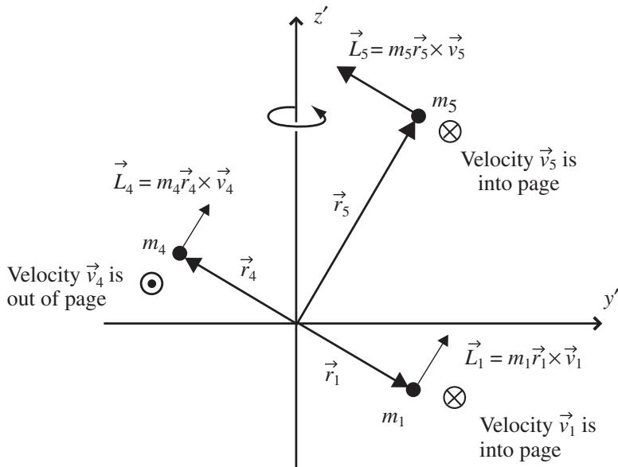

import Guide from '@/components/Guide.astro';
import Knowledge from '@/components/Knowledge.astro';
import Example from '@/components/Example.astro';
import Analysis from '@/components/Analysis.astro';
import Solution from '@/components/Solution.astro';
import Variant from '@/components/Variant.astro';
import Note from '@/components/Note.astro';
import Block from '@/components/Block.astro';
import Method from '@/components/Method.astro';
import Exercise from '@/components/Exercise.astro';

## 6.1 The inertia tensor

A very useful way to think of mass is this: mass is the characteristic of matter that resists acceleration. This means that it takes a force to change the velocity of any object with mass. You may find it helpful to think of moment of inertia as the rotational analog of mass. That is, moment of inertia is the characteristic of matter that resists angular acceleration, so it takes a torque to change the angular velocity of an object.

Many students find that rotational motion is easier to understand by keeping the relationships between translational and rotational quantities in mind. So where translational motion dealt with position (x), velocity (v), and accelera tion $( \vec { a } )$ , rotational motion has the analogous quantities of angle (θ), angular velocity $( \vec { \omega } )$ , and angular acceleration $( \vec { \alpha } )$ . There are rotational analogs for many other quantities; the translational quantities of force $( { \vec { F } } )$ , mass (m), and momentum $( \vec { p } )$ have the rotational equivalents of torque $( \vec { \tau } )$ , moment of inertia (I), and angular momentum $( \vec { L } )$

As you may also recall, several of the equations relating various translational quantities have direct parallels in rotational motion. So the rotational equivalent of Newton's Second Law $( \vec { F } = m \vec { a } ) \mathrm { i s } \vec { \tau } = I \vec { \alpha } . ^ { 1 }$ And whereas translationa momentum is related to mass and velocity by ${ \vec { p } } = m { \vec { v } }$ , you probably learned that angular momentum is related to moment of inertia and angular velocity by $L _ { z } = I \omega$

When first presenting these relationships, most texts restrict the motion to planar rotation of a single particle to keep things simple. So when you think of the relationship between linear and angular velocity, you may think of something like $v = \omega r$ . And if $L _ { z } = m v r$ , then $L _ { z } = m r ^ { 2 } \omega$ . Taking $m r ^ { 2 }$ as the moment of inertia (I) of a single particle, this becomes $L _ { z } = I \omega$ . But the v and the $\omega$ in those equations can't really be velocities, since they're written as scalars rather than vectors, and that z subscript on the angular momentum seems to be trying to tell you something.

It is. It's telling you that you're using an equation for one component of the angular momentum (the z-component in this case), and this pertains to a single particle moving about the origin in the xy plane. So these equations aren't wrong, they just have limited application. Specifically, they apply to cases of planar motion about the z-axis.

The more-general relationship between the vectors that represent velocity, angular velocity, and position is this:

$$
\vec {v} = \vec {\omega} \times \vec {r},\tag{6.1}
$$

in which the cross represents the vector cross product described in Chapter 2. And the equations relating angular momentum to linear momentum, linea velocity, and mass are

$$
\begin{array}{r l} & {\vec {L} = \vec {r} \times \vec {p}} \\ & {\quad = \vec {r} \times (m \vec {v})} \\ & {\quad = m \vec {r} \times \vec {v}.} \end{array}\tag{6.2}
$$

Before delving more deeply into these equations, you should consider the implications of the (planar-motion) equation that says that the moment of inertia of a single particle is $I _ { p a r t i c l e } ~ = ~ m r ^ { 2 }$ . One important idea in this equation is that the moment of inertia of a particle depends not only on its mass, but also on the location of that mass – specifically, the distance (r) of the mass from the axis of rotation. Thus the moment of inertia of an extended object made up of many particles must depend not only on the object's mass, but on the distribution of that mass. That's true in the case of general motion as well as planar rotation.

If you think of the rotational analog to the translational equation ${ \vec { p } } = m { \vec { v } } ;$ you may be tempted to write an equation such as $\vec { L } = I \vec { \omega }$ . But that equation would indicate that the angular momentum $\vec { L }$ must be in the same direction as the angular velocity ${ \vec { \omega } } ,$ since multiplication by a scalar can change the length but not the direction of a vector (unless the scalar is negative, in which case the direction of the vector is reversed). For general motion, the situation is more complex, as you can see by applying Eq. 6.2 to a single particle cir cling about the axis shown in Figure 6.1. In this figure, the particle "m" is circling around the z-axis, so the angular velocity (ω) points straight up, paral lel to the z-axis. In this view, you're looking down the x-axis toward the origin of the coordinate system, which is well below the plane of the particle's path. The particle is initially at the position shown on the left side of the figure, and its velocity vector is coming out of the page. Since the vector angular momentum is given by ${ \vec { L } } = m { \vec { r } } \times { \vec { v } }$ , you can find the direction of the angular momentum at this initial instant by using your right hand to form the cross product between $\vec { r }$ and $\vec { v } ,$ as described in Section 2.2. If you do this properly, you should see that $\vec { L }$ initially points up and to the right, as shown by $\vec { L } _ { i n i t i a l }$ in the figure. At a later time, after the particle has completed one-half revolu tion about the z-axis, its velocity vector is into the page, as shown in the right portion of the figure. At that later instant, the cross product between $\vec { r }$ and $\vec { v }$ means that the direction of the angular momentum vector $\vec { L }$ is up and to the left, as shown by $\vec { L } _ { l a t e r }$

  
Figure 6.1 Single point mass moving around an axis.

So not only is the angular-momentum vector $\vec { L }$ not parallel to the angular velocity vector $\vec { \omega } ,$ , the direction of the $\vec { L }$ is changing as the particle moves around the axis, while the direction of $\vec { \omega }$ remains fixed along the z-axis.

Under these circumstances, you clearly cannot use a scalar value for the moment of inertia to relate the angular momentum to the angular velocity through an equation such as $\vec { L } = I \vec { \omega }$ . A scalar moment of inertia simply isn't capable of relating a vector in one direction to a different vector in another direction. But if you've followed the developments of Chapters 4 and 5, you're already familiar with a type of object that is capable of taking in a vector (such as $\vec { \omega } )$ and producing another vector (such as $\vec { L } )$ that points in a different direction. That object is a tensor. So although you may have initially learned about the moment of inertia as a scalar value in the case of planar motion about the origin, you should now understand why more-general problems require a more-powerful approach, and that involves the representation of inertia as a tensor rather than a scalar.

You may be thinking that simply by adding another particle of equal mass at the same distance on the other side of the z-axis, you could produce an additional bit of angular momentum that would add to the angular momentum of the original mass. In that case, the total angular momentum would indeed point straight up the z-axis, in exactly the same direction as the angular velocity. So you may suspect that the relationship between the angular momentum and the angular velocity (and hence the nature of the inertia tensor) depends on the symmetry of the object. That suspicion is correct, as you'll see when you examine the components of the inertia tensor.

You can begin to understand the components of the inertia tensor by first writing the tensor equation relating angular momentum to angular velocity:

$$
\vec {L} = \vec {\vec {I}} \vec {\omega},\tag{6.3}
$$

and then using the definition of angular momentum:

$$
\begin{array}{r l} & {\vec {L} = \vec {r} \times \vec {p}} \\ & {\quad = \vec {r} \times (m \vec {v})} \\ & {\quad = m \vec {r} \times \vec {v}} \\ & {\quad = m \vec {r} \times (\vec {\omega} \times \vec {r}).} \end{array}
$$

The triple vector product in this expression can be simplified using the "BAC minus $\mathbf { C A B } ^ { \prime \prime }$ rule described in Section 2.4, giving

$$
\vec {L} = m [ \vec {\omega} (\vec {r} \circ \vec {r}) - \vec {r} (\vec {r} \circ \vec {\omega}) ].
$$

This is a usable expression for the angular momentum of a single particle, and you can modify it for use with multiple masses simply by summing (or for a continuous object by integrating) over all the masses. Thus the expression you'll most often encounter will probably look something like this:

$$
\vec {L} = \sum_ {i} m _ {i} [ \vec {\omega} (\vec {r} _ {i} \circ \vec {r} _ {i}) - \vec {r} _ {i} (\vec {r} _ {i} \circ \vec {\omega}) ],\tag{6.4}
$$

where the index i denotes each element of mass of the object.

To see the moment of inertia in this expression, first expand the position vector as $\vec { r } _ { i } = x _ { i } \hat { \imath } + y _ { i } \hat { \jmath } + z _ { i } \hat { k }$ and the angular velocity vector as $\vec { \omega } = \omega _ { x } \hat { \imath } +$ $\omega _ { y } \hat { \jmath } + \omega _ { z } \hat { k }$ (note that the angular velocity $\vec { \omega }$ is the same for every mass elemen in a rigid body, so it's not necessary to write $\vec { \omega } _ { i } )$ . Thus the expression for angular momentum is

$$
\begin{array}{r l} & {\vec {L} = \sum_ {i} m _ {i} [ \vec {\omega} (x _ {i} \hat {i} + y _ {i} \hat {j} + z _ {i} \hat {k}) \circ (x _ {i} \hat {i} + y _ {i} \hat {j} + z _ {i} \hat {k})} \\ & {\qquad - \vec {r} _ {i} (x _ {i} \hat {i} + y _ {i} \hat {j} + z _ {i} \hat {k}) \circ (\omega_ {x} \hat {i} + \omega_ {y} \hat {j} + \omega_ {z} \hat {k}) ],} \end{array}
$$

and performing the dot products gives

$$
\vec {L} = \sum_ {i} m _ {i} [ \vec {\omega} (x _ {i} ^ {2} + y _ {i} ^ {2} + z _ {i} ^ {2}) - \vec {r} _ {i} (x _ {i} \omega_ {x} + y _ {i} \omega_ {y} + z _ {i} \omega_ {z}) ].
$$

Since the x-component of $\vec { \omega }$ is $\omega _ { x }$ and the x-component of ${ \vec { r } } _ { i }$ is $x _ { i }$ , the $x -$ component of the angular momentum can be written

$$
\begin{array}{r l} & L _ {x} = \sum_ {i} m _ {i} [ \omega_ {x} (x _ {i} ^ {2} + y _ {i} ^ {2} + z _ {i} ^ {2}) - x _ {i} (x _ {i} \omega_ {x} + y _ {i} \omega_ {y} + z _ {i} \omega_ {z}) ] \\ & \quad = \sum_ {i} m _ {i} [ \omega_ {x} x _ {i} ^ {2} + \omega_ {x} y _ {i} ^ {2} + \omega_ {x} z _ {i} ^ {2} - x _ {i} ^ {2} \omega_ {x} - x _ {i} y _ {i} \omega_ {y} - x _ {i} z _ {i} \omega_ {z} ] \\ & \quad = \sum_ {i} m _ {i} [ \omega_ {x} (y _ {i} ^ {2} + z _ {i} ^ {2}) - x _ {i} y _ {i} \omega_ {y} - x _ {i} z _ {i} \omega_ {z} ]. \end{array}
$$

The y- and z-components come out as

$$
\begin{array}{l} {L _ {y} = \sum_ {i} m _ {i} [ \omega_ {y} (x _ {i} ^ {2} + z _ {i} ^ {2}) - y _ {i} x _ {i} \omega_ {x} - y _ {i} z _ {i} \omega_ {z} ],} \\ {L _ {z} = \sum_ {i} m _ {i} [ \omega_ {z} (x _ {i} ^ {2} + y _ {i} ^ {2}) - z _ {i} x _ {i} \omega_ {x} - z _ {i} y _ {i} \omega_ {y} ].} \end{array}
$$

These three equations for the components of angular momentum $( \vec { L } )$ may be written as a single matrix equation:

$$
\left( \begin{array}{c} L _ {x} \\ L _ {y} \\ L _ {z} \end{array} \right) = \left( \begin{array}{c c c} \sum_ {i} m _ {i} (y _ {i} ^ {2} + z _ {i} ^ {2}) & - \sum_ {i} m _ {i} x _ {i} y _ {i} & - \sum_ {i} m _ {i} x _ {i} z _ {i} \\ - \sum_ {i} m _ {i} y _ {i} x _ {i} & \sum_ {i} m _ {i} (x _ {i} ^ {2} + z _ {i} ^ {2}) & - \sum_ {i} m _ {i} y _ {i} z _ {i} \\ - \sum_ {i} m _ {i} z _ {i} x _ {i} & - \sum_ {i} m _ {i} z _ {i} y _ {i} & \sum_ {i} m _ {i} (x _ {i} ^ {2} + y _ {i} ^ {2}) \end{array} \right) \left( \begin{array}{c} \omega_ {x} \\ \omega_ {y} \\ \omega_ {z} \end{array} \right).\tag{6.5}
$$

The elements of the center matrix represent the components of the inertia tensor $( \vec { \vec { I } } )$ . Note that the dimensions of each element are mass times distance squared (SI units of $\mathrm { k g } \mathrm { m } ^ { 2 } )$ , just as in the case of scalar moment of inertia.

In some texts, you'll find the elements of the inertia tensor written as something like

$$
I _ {a b} = m _ {i} (\delta_ {a b} r _ {i} ^ {2} - r _ {a} r _ {b}),
$$

which are the same elements as shown in Eq. 6.5.

The diagonal elements of the inertia tensor are called "moments of inertia" and the off-diagonal elements are called "products of inertia." To understand the physical meaning of each of these elements, recall that the moment of inertia characterizes an object's tendency to resist angular acceleration. That resistance depends not only on the object's mass, but on the distribution of that mass relative to the axis of rotation.

Each term $I _ { a b }$ tells you how much angular momentum in the a-direction is produced by rotation about the b-axis. So $I _ { 1 1 } = I _ { x x }$ tells you how much angular momentum the object produces in the x-direction due to rotation about the x-axis. And $I _ { 2 3 } = I _ { y z }$ tells you how much angular momentum the object produces in the y-direction due to rotation about the z-axis.

How those off-diagonal terms come about is explained below, but you should first take a look at the diagonal terms. In the expression for $I _ { x x }$ , for each element of mass $( m _ { i } )$ , the element's mass is multiplied by the square of the distance from the x-axis $( y _ { i } ^ { 2 } + z _ { i } ^ { 2 } )$ . So this is just the three-dimensional ver sion of the equation you may have learned for planar rotation that says that the moment of inertia of a particle is $I = m r ^ { 2 }$ , where r is the particle's distance from the axis of rotation. Looking down the diagonal of the inertia tensor, you see the contribution to the x-component of angular momentum due to rotation about the x-axis, the contribution to the y-component of angular momentum due to rotation about the y-axis, and the contribution to the z-component of angular momentum due to rotation about the z-axis. The bottom line is that distributions of mass that are symmetric about each axis contribute to the diagonal terms of the moment of inertia matrix.

The off-diagonal elements of the inertia tensor are somewhat different. In $I _ { y z }$ , for each element of mass $( m _ { i } )$ , the element's mass is multiplied by the product of the element's y- and z-coordinates $( y _ { i } z _ { i } )$ . As explained above, this determines the contribution to the y-component of angular momentum due to rotation about the z-axis. And when does rotation about the z-axis produce a y-component of angular momentum? When there's an asymmetric distribution of mass about the z-axis, for example as shown with the single particle in Figure 6.1. Likewise, the $I _ { x y }$ term determines the contribution to the x-component of angular momentum due to rotation about the y-axis. Such contributions come from mass distributions that are asymmetric about the y-axis. Hence distributions of mass that are asymmetric about a given axis contribute to the off-diagonal terms of the moment of inertia matrix.

To see how this works, consider the five point masses on the corners and top of a pyramid as shown in Figure 6.2. To determine the inertia tensor for this configuration of masses, you simply have to plug the mass and coordinates of each of the masses into Equation 6.5. If the mass of each of the five masses is the same and equal to "m" and the height of the pyramid is equal to the length of each of the bottom sides (with a value of 2a as shown in Figure 6.2), the $I _ { x x }$ term is simply

$$
\begin{array}{l} I _ {x x} = m _ {1} (y _ {1} ^ {2} + z _ {1} ^ {2}) + m _ {2} (y _ {2} ^ {2} + z _ {2} ^ {2}) + m _ {3} (y _ {3} ^ {2} + z _ {3} ^ {2}) + m _ {4} (y _ {4} ^ {2} + z _ {4} ^ {2}) \\ \qquad + m _ {5} (y _ {5} ^ {2} + z _ {5} ^ {2}) \\ \qquad = m _ {1} (a ^ {2} + 0 ^ {2}) + m _ {2} (a ^ {2} + 0 ^ {2}) + m _ {3} [ (- a) ^ {2} + 0 ^ {2} ] + m _ {4} [ (- a) ^ {2} + 0 ^ {2} ] \\ \qquad + m _ {5} (0 ^ {2} + (2 a) ^ {2}) \\ \qquad = 8 m a ^ {2}, \end{array}
$$

  
Figure 6.2 Five point masses arrayed as a pyramid.

and you should obtain the same result for the other diagonal elements $I _ { y y }$ and $I _ { z z }$ . Moving on to the off-diagonal elements, the $I _ { x y }$ term is

$$
\begin{array}{r l} & I _ {x y} = - m _ {1} x _ {1} y _ {1} - m _ {2} x _ {2} y _ {2} - m _ {3} x _ {3} y _ {3} - m _ {4} x _ {4} y _ {4} - m _ {5} x _ {5} y _ {5} \\ & \qquad = - m _ {1} (a) (a) - m _ {2} (- a) (a) - m _ {3} (- a) (- a) - m _ {4} (a) (- a) - m _ {5} (0) (0) \\ & \qquad = - m (2 a ^ {2} - 2 a ^ {2}) = 0, \end{array}
$$

which is the same as all other off-diagonal elements. Thus the matrix repre senting the inertia tensor for the configuration shown in Figure 6.2 is

$$
\vec {\vec {I}} = \left( \begin{array}{c c c} 8 m a ^ {2} & 0 & 0 \\ 0 & 8 m a ^ {2} & 0 \\ 0 & 0 & 8 m a ^ {2} \end{array} \right).
$$

There's a great deal of information in the components of this inertia tensor. The fact that the off-diagonal elements are all zero means that the selected $x -$ $y - .$ , and z-axes are "principal axes" for this object and choice of origin, and the moments of inertia are "principal moments" of the object. When an object rotates about one of the principal axes, the angular momentum vector and the angular velocity vector are parallel. This is an indication of the object's symmetry. In this case, the fact that all three principal moments are equal means that this object qualifies as a "spherical top" (in Mechanics, "top" refers to any rigid rotating object). And for a spherical top, any three mutually orthogona axes are principal axes.

If the height of mass $m { 5 }$ above the plane of the other four masses is increased to twice its original height (so that its z-coordinate becomes 4a instead of $2 a )$ the greater distance from the x- and y-axes increases the moment of inertia about those axes, so that the inertia tensor becomes

$$
\vec {\vec {I}} = \left( \begin{array}{c c c} 2 0 m a ^ {2} & 0 & 0 \\ 0 & 2 0 m a ^ {2} & 0 \\ 0 & 0 & 8 m a ^ {2} \end{array} \right).
$$

Of course, the distance of $m { 5 }$ from the z-axis remains zero irrespective of its height, so this mass is not contributing to the component $I _ { z z }$ in either case, and that component remains the same. Now that only two of the principal moments of inertia are equal, the object is no longer a spherical top, and has become a "symmetric top" (and if all three principal moments were different, the object is called an "asymmetric top"). One final bit of terminology: if one of the principal moments of an object is zero and the other two are equal to one another, the object is called a "rotor."

Another way to change the inertia tensor of this object is to fiddle with the masses of the particles. If, for example, you double the mass of $m { 5 }$ from its original value of m to $2 m$ , while leaving the other four masses the same, the inertia tensor becomes

$$
\vec {\vec {I}} = \left( \begin{array}{c c c} 1 2 m a ^ {2} & 0 & 0 \\ 0 & 1 2 m a ^ {2} & 0 \\ 0 & 0 & 8 m a ^ {2} \end{array} \right).
$$

As expected, there's no change in the $I _ { z z }$ component since $m { 5 }$ doesn't contribute to that moment.

Now consider what will happen to the inertia tensor if you rotate the coor dinate axes. Remember, the inertia tensor is determined for a given location of the origin and a given orientation of the coordinate axes, so it seems reasonable to expect a change in the components if the coordinate axes are rotated.

To test this, imagine rotating the coordinate axes counter-clockwise about the x-axis, as shown in Figure 6.3. In this figure, you're looking down the x-axis toward the origin, so the y- and z-axes appear tilted (they're labeled $y ^ { \prime }$ and $z ^ { \prime }$ to distinguish them from the original y- and z-axes). In this case, the rotation angle is approximately $3 0 ^ { \circ }$ . Figure 6.3(a) shows that the axes have rotated while the masses remained in their original positions, while Fig ure 6.3(b) shows the view you would get if you tilted your head to make the $z ^ { \prime } \cdot$ -axis vertical and $y ^ { \prime } .$ -axis horizontal.

What effect might this have on the inertia tensor? To determine that, you'll need to know the coordinates of each of the masses in the new (rotated) coordi nate system (that is, you need to know $x ^ { \prime } , y ^ { \prime }$ , and $z ^ { \prime }$ for each mass). Fortunately, Chapter 4 should have given you some idea of how to do that by using a rotation matrix to convert between the original and rotated coordinates. In this case, that rotation matrix is given by

  
Figure 6.3 Coordinate axes rotated $3 0 ^ { \circ }$ anti-clockwise around x-axis.

$$
\left( \begin{array}{c} x ^ {\prime} \\ y ^ {\prime} \\ z ^ {\prime} \end{array} \right) = \left( \begin{array}{c c c} 1 & 0 & 0 \\ 0 & \cos \theta & \sin \theta \\ 0 & - \sin \theta & \cos \theta \end{array} \right) \left( \begin{array}{c} x \\ y \\ z \end{array} \right).\tag{6.6}
$$

If you go back to the original masses (all five masses equal to mass m) and original height of $m { 5 }$ (which is 2a above the xy plane) and then apply this rotation, you should find the following values for the components of the matrix representing the inertia tensor:

$$
\vec {\vec {I}} = \left( \begin{array}{c c c} 8 m a ^ {2} & 0 & 0 \\ 0 & 8 m a ^ {2} & 0 \\ 0 & 0 & 8 m a ^ {2} \end{array} \right).
$$

If you're suprised to find that there's no change from the original inertia ten sor (the one without the rotation), remember that the symmetry of this object makes it a spherical top, which means that any set of three orthogonal axes wil be principal axes. So tilting the axes should not have caused any change in the inertia tensor.

That sounds reasonable enough, but if you compare the location of the masses in Figure 6.3 to the single-mass case shown in Figure 6.1, doesn't it also seem reasonable to expect that $m { 5 }$ will produce a component of angula momentum in the y-direction (as the single mass did in Figure 6.1)?

Yes, it does. And, in fact, mass $m { 5 }$ does indeed produce a component of angular momentum in the y-direction. To demonstrate that, just set the other four masses to zero and calculate the inertia tensor for $m { 5 }$ alone (don't forget that the coordinate axes are rotated). You should get

$$
\vec {\vec {I}} = \left( \begin{array}{c c c} 4 m a ^ {2} & 0 & 0 \\ 0 & 3 m a ^ {2} & - 1. 7 3 m a ^ {2} \\ 0 & - 1. 7 3 m a ^ {2} & m a ^ {2} \end{array} \right).
$$

So there it is: $I _ { y z }$ (which represents the y-component of angular momentum produced by rotation around the z-axis) is clearly not zero. But why did you get zero for all the off-diagonal elements when you first calculated the inertia tensor for the pyramid with tilted coordinate axes? The answer is that the other four masses also have something to say about the inertia tensor. To isolate their contribution to $I _ { y z }$ , try setting the mass of $m { 5 }$ to zero and leaving the other four masses equal to m. The inertia tensor should then be

$$
\vec {\vec {I}} = \left( \begin{array}{c c c} 4 m a ^ {2} & 0 & 0 \\ 0 & 5 m a ^ {2} & 1. 7 3 m a ^ {2} \\ 0 & 1. 7 3 m a ^ {2} & 7 m a ^ {2} \end{array} \right).
$$

  
Figure 6.4 Angular momentum vectors for masses in plane of page.

And there's the answer: the other four masses contribute exactly as much angular momentum in the positive y-direction as $m { 5 }$ contributes to the negative y-direction, as illustrated in Figure 6.4. And remember from Chapter 5 that you can add tensors by adding their components. So when you add the inertia tensor for $m { 5 }$ to the inertia tensor for the other four masses, you get the (nicely diagonal) inertia tensor for the five-mass pyramid.

To demonstrate the balance between $m { 5 }$ and the other four masses, you may find it interesting to again move $m { 5 }$ up the z-axis to twice its original height and then perform the 30 degree rotation of the coordinate axes. In this case, you should find the inertia tensor to be

$$
\vec {\vec {I}} = \left( \begin{array}{c c c} 2 0 m a ^ {2} & 0 & 0 \\ 0 & 1 7 m a ^ {2} & - 5. 2 m a ^ {2} \\ 0 & - 5. 2 m a ^ {2} & 1 1 m a ^ {2} \end{array} \right),
$$

and clearly the $I _ { y z }$ terms from $m { 5 }$ and the other four masses no longer cancel.

You can determine the inertia tensor for any orientation of the coordinate axes by applying rotations about multiple axes. If you wish, for example, to rotate first about the x-axis by angle $\theta _ { 1 }$ and then about the y-axis by angle $\theta _ { 2 }$ , you can combine the rotation matrices as

$$
\left( \begin{array}{c} x ^ {\prime} \\ y ^ {\prime} \\ z ^ {\prime} \end{array} \right) = \left( \begin{array}{c c c} \cos \theta_ {2} & 0 & \sin \theta_ {2} \\ 0 & 1 & 0 \\ - \sin \theta_ {2} & 0 & \cos \theta_ {2} \end{array} \right) \left( \begin{array}{c c c} 1 & 0 & 0 \\ 0 & \cos \theta_ {1} & \sin \theta_ {1} \\ 0 & - \sin \theta_ {1} & \cos \theta_ {1} \end{array} \right) \left( \begin{array}{c} x \\ y \\ z \end{array} \right),\tag{6.7}
$$

which in the case of two 30 degree rotations (first about the x-axis and then about the y-axis) gives a combined rotation matrix of

$$
\left( \begin{array}{c} x ^ {\prime} \\ y ^ {\prime} \\ z ^ {\prime} \end{array} \right) = \left( \begin{array}{c c c} 0. 8 6 6 & - 0. 2 5 & 4. 3 3 \\ 0 & 0. 8 6 6 & 0. 5 \\ - 0. 5 & - 0. 4 3 3 & 0. 7 5 \end{array} \right) \left( \begin{array}{c} x \\ y \\ z \end{array} \right).\tag{6.8}
$$

If you leave m5 at height 4a and then apply this rotation to the coordinates, the inertia tensor becomes

$$
\vec {\vec {I}} = \left( \begin{array}{c c c} 1 7. 8 m a ^ {2} & 2. 6 m a ^ {2} & 3. 9 m a ^ {2} \\ 2. 6 m a ^ {2} & 1 7 m a ^ {2} & - 4. 5 m a ^ {2} \\ 3. 9 m a ^ {2} & - 4. 5 m a ^ {2} & 1 3. 3 m a ^ {2} \end{array} \right).\tag{6.9}
$$

You can perform a quick check on your calculation by verifying that the coordinate-axis rotation has changed neither the trace nor the determinant of the matrix.2

Instead of finding the new coordinates of each mass in the rotated system, an alternative approach allows you to find the inertia tensor for rotated coordi nates directly. That approach is to apply a "similarity transform" to the origina inertia tensor. Here's how that works: the angular momentum is related to the inertia tensor and angular velocity in the original (unrotated) coordinate system as

$$
\vec {L} = \vec {\vec {I}} \vec {\omega},
$$

and you rotate the coordinates by applying a rotation matrix R (which may be the product of several rotation matrices). You can therefore write

$$
\vec {L} ^ {\prime} = R \vec {L} = R (\vec {\vec {I}} \vec {\omega}).
$$

And since the product of any matrix and its inverse is just the identity matrix, you can insert the term $R ^ { - 1 } R$ in front of $\vec { \omega }$ :

$$
\begin{array}{r} \vec {L} ^ {\prime} = R \vec {L} = R \vec {\vec {I}} (R ^ {- 1} R) \vec {\omega} \\ = (R \vec {\vec {I}} R ^ {- 1}) R \vec {\omega}. \end{array}
$$

But $R \vec { \omega }$ is just $\vec { \omega } ^ { \prime }$ , so

$$
\vec {L} ^ {\prime} = (R \stackrel {\rightarrow} {I} R ^ {- 1}) \vec {\omega} ^ {\prime}.
$$

Thus the expression $( R \vec { \vec { I } } \ R ^ { - 1 } )$ ) relates angular momentum to angular velocity in the rotated coordinate system, which means that this expression is the inertia tensor in that system. So instead of calculating the new coordinates fo each mass and plugging them into the equation for the inertia tensor, you can instead simply apply the rotation matrix and its inverse to the matrix representing the inertia tensor directly (but remember that the sequence matters when you're doing matrix multiplication).

Using this approach, the process looks like this:

$$
\begin{array}{c} \vec {\vec {I}} ^ {\prime} = \left( \begin{array}{c c c} 0. 8 6 6 & - 0. 2 5 & 4. 3 3 \\ 0 & 0. 8 6 6 & 0. 5 \\ - 0. 5 & - 0. 4 3 3 & 0. 7 5 \end{array} \right) \left( \begin{array}{c c c} 2 0 m a ^ {2} & 0 & 0 \\ 0 & 2 0 m a ^ {2} & 0 \\ 0 & 0 & 8 m a ^ {2} \end{array} \right) \\ \times \left( \begin{array}{c c c} 0. 8 6 6 & - 0. 2 5 & 4. 3 3 \\ 0 & 0. 8 6 6 & 0. 5 \\ - 0. 5 & - 0. 4 3 3 & 0. 7 5 \end{array} \right) ^ {- 1} \\ = \left( \begin{array}{c c c} 1 7. 8 m a ^ {2} & 2. 6 m a ^ {2} & 3. 9 m a ^ {2} \\ 2. 6 m a ^ {2} & 1 7 m a ^ {2} & - 4. 5 m a ^ {2} \\ 3. 9 m a ^ {2} & - 4. 5 m a ^ {2} & 1 3. 3 m a ^ {2} \end{array} \right), \end{array}
$$

which is identical to the result obtained by inserting the rotated coordinates into the inertia tensor.

If you've studied matrix algebra, you may be wondering about the possibil ity of finding the principal axes and principal moments by manipulating the matrix representing the inertia tensor into a diagonal form. That is certainly possible, and you can read about doing that using eigenvectors and eigenvalues on this book's website.

And if you're able by visual inspection to determine the angles of rotation needed to align the axes with the symmetries of the object, you can use the similarity transform approach to diagonalize the inertia matrix. You can see how that works by looking at the problems at the end of this chapter and the on-line solutions.
