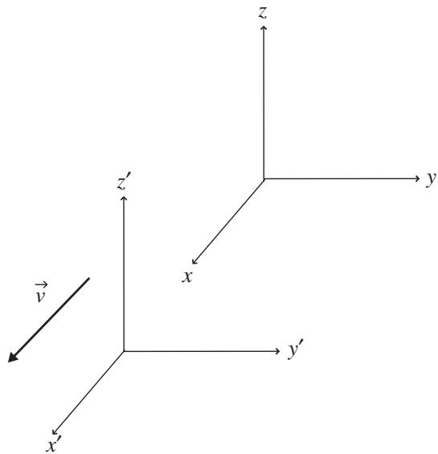

import Guide from '@/components/Guide.astro';
import Knowledge from '@/components/Knowledge.astro';
import Example from '@/components/Example.astro';
import Analysis from '@/components/Analysis.astro';
import Solution from '@/components/Solution.astro';
import Variant from '@/components/Variant.astro';
import Note from '@/components/Note.astro';
import Block from '@/components/Block.astro';
import Method from '@/components/Method.astro';
import Exercise from '@/components/Exercise.astro';

## 6.2 The electromagnetic field tensor

One of the defining characteristics of our modern world is the availabil ity of broadband communication channels which allow near-instantaneous transfer of information over great distances without the need for physical con nection. The technology used in this communication descends directly from the equations synthesized by Scotsman James Clerk Maxwell in the 1860s, now called "Maxwell's Equations." In view of the impact of electromagnetic telecommunications on our lives, it's not surprising that in 2004 the readers of Physics World voted Maxwell's Equations to be the "greatest equations" eve developed.

The four vector equations that have come to be called Maxwell's Equations are Gauss's Law for electric fields, Gauss's Law for magnetic fields, Faraday's Law, and the Ampere–Maxwell Law, each of which may be written in inte gral or differential form. The integral forms describe the behavior of electric and magnetic fields over surfaces or around paths, while the differential forms apply to specific locations. The differential forms are most relevant to the vector and tensor operations discussed in this book, involving the scalar product, divergence, curl, and partial derivatives discussed in Chapter 2. They're also closely related to the subject of this section, the electromagnetic field-strength tensor.

The differential forms of Maxwell's Equations are usually written as

Gauss's Law for electric fields: $\vec { \nabla } \circ \vec { E } = \frac { \rho } { \epsilon _ { 0 } }$

Gauss's Law for magnetic fields: $\vec { \nabla } \circ \vec { B } = 0$

Faraday's Law: ${ \vec { \nabla } } \times { \vec { E } } = - { \frac { \partial { \vec { B } } } { \partial t } } .$

Ampere–Maxwell Law: $\vec { \nabla } \times \vec { B } = \mu _ { 0 } \vec { J } + \mu _ { 0 } \epsilon _ { 0 } \frac { \partial \vec { E } } { \partial t } .$

In order to understand the electromagnetic tensor, you may find it helpful to briefly review the meaning of each of these equations.3

$$
\boxed {\vec {\nabla} \circ \vec {E} = \frac {\rho}{\epsilon_ {0}}}
$$

Gauss's Law for electric fields states that the divergence $( \vec { \nabla } \circ )$ of the electric field $( \vec { E } )$ at any location is proportional to the electric charge density $( \rho )$ at that location. That's because electrostatic field lines begin on positive charge and end on negative charge (hence the field lines tend to diverge away from locations of positive charge and converge toward locations of negative charge).

$$
\boxed {\vec {\nabla} \circ \vec {B} = 0}
$$

Gauss's Law for magnetic fields tells you that the divergence $( \vec { \nabla } \circ )$ of the magnetic field $( { \vec { B } } )$ at any location must be zero. This is true because there is apparently no isolated "magnetic charge" in the universe, so magnetic field lines neither diverge nor converge.

$$
\boxed {\vec {\nabla} \times \vec {E} = - \frac {\partial \vec {B}}{\partial t}}
$$

Faraday's Law indicates that the curl $( \vec { \nabla } \times )$ of the electric field $( \vec { E } )$ at any loca tion is equal to the negative of the time rate of change of the magnetic field at that location. That's because a changing magnetic field produces a circulating electric field.

$$
\boxed {\vec {\nabla} \times \vec {B} = \mu_ {0} \vec {J} + \mu_ {0} \epsilon_ {0} \frac {\partial \vec {E}}{\partial t}}
$$

Ampere's Law, as modified by Maxwell, tells you that the curl $( \vec { \nabla } \times )$ of the magnetic field $( { \vec { B } } )$ at any location is proportional to the electric current density $( \vec { J } )$ plus the time rate of change of the electric field at that location. This is the case because a circulating magnetic field is produced both by an electric current and by a changing electric field.

Note that Maxwell's Equations relate the spatial behavior of fields to the sources of those fields. Those sources are electric charge (with density $\rho )$ appearing in Gauss's Law for electric fields, electric current (with density $\vec { J } )$ appearing in the Ampere–Maxwell Law, changing magnetic field (with time derivative $\textstyle { \frac { \partial { \vec { B } } } { \partial t } } )$ appearing in Faraday's Law, and changing electric field (with time derivative $\textstyle { \frac { \partial { \vec { E } } } { \partial t } } )$ appearing in the Ampere–Maxwell Law.

One additional equation is needed to fully characterize electromagnetic interactions. That equation is called the "continuity equation," usually written like this:

$$
\frac {\partial \rho}{\partial t} = - \vec {\nabla} \circ \vec {J},
$$

where $\rho$ is the density of electric charge and $\vec { J }$ is the current density.

The continuity equation tells you that the time rate of change of the density of electric charge $\textstyle { \big ( } { \frac { \partial \rho } { \partial t } } { \big ) }$ equals the negative of the divergence of the electric current density $( \vec { \nabla } \circ \vec { J } )$ . That's because negative divergence means convergence, and if the convergence of the current density $\vec { J }$ is positive at a point, then more positive charge must be arriving at that location than is being carried away. If that's happening, then the density of positive charge at that point must increase (meaning that $\frac { \partial \rho } { \partial t }$ will be positive in this case).

As valuable as Maxwell's Equations are individually, the real power of these equations is realized by combining them together to produce the wave equa tion. Taking the curl of both sides of Faraday's Law and inserting the curl of $\vec { B }$ from the Ampere–Maxwell Law results in the equation

$$
\nabla^ {2} \vec {E} = \mu_ {0} \epsilon_ {0} \frac {\partial^ {2} \vec {E}}{\partial t ^ {2}},\tag{6.10}
$$

where $\nabla ^ { 2 } ( ) = \vec { \nabla } \circ \vec { \nabla } ( )$ is the vector form of the Laplacian operator.4 This equation applies to regions in which the charge density $( \rho )$ and the curren density $( \vec { J } )$ are both zero.

You can find a similar equation for the magnetic field by taking the curl of both sides of the Ampere–Maxwell Law and then inserting the curl of $\vec { E }$ from Faraday's Law. This gives

$$
\nabla^ {2} \vec {B} = \mu_ {0} \epsilon_ {0} \frac {\partial^ {2} \vec {B}}{\partial t ^ {2}}.\tag{6.11}
$$

It's instructive to compare Eqs. 6.10 and 6.11 to the general equation for a propagating wave:

$$
\nabla^ {2} \vec {A} = \frac {1}{v ^ {2}} \frac {\partial^ {2} \vec {A}}{\partial t ^ {2}},\tag{6.12}
$$

where v is the speed of propagation of the wave. Note the $1 / v ^ { 2 }$ term, which leads to the conclusion that the velocity of an electromagnetic wave depends only on the electric permittivity $( \epsilon _ { 0 } )$ and magnetic permeability $\left( \mu _ { 0 } \right)$ of free space (specifically, $\mu _ { 0 } \epsilon _ { 0 } = 1 / v ^ { 2 }$ , or $v = 1 / \sqrt { \mu _ { o } \epsilon _ { 0 } } = 3 \times 1 0 ^ { 8 }$ m/s). Most importantly, that velocity is completely independent of the motion of the observer. It was this feature of electromagnetic waves that put Albert Einstein onto the path that eventually led to the Theory of Special Relativity.

To arrive at the Theory of Special Relativity, Einstein held fast to two postulates. Those postulates are:

1) The laws of physics must be the same in all inertial (that is, non accelerating) frames of reference.

2) The speed of light in a vacuum is constant and does not depend on the motion of the source or observer.

Steadfast faithfulness to these postulates even in the face of counter-intuitive conclusions allowed Einstein to see that distances in space and intervals of time are not absolute but depend on the relative motion of the observer. Additionally, space and time are not separate but are linked together into four-dimensional spacetime, and it is the four-dimensional spacetime interval that is invariant across all inertial reference frames.

To understand Einstein's approach, consider the two Cartesian reference frames shown in Figure 6.5. As indicated by the arrow in the figure, the primed reference frame is moving with velocity $\vec { v }$ in the positive x-direction. Using the traditional Galilean approach, the coordinate (x, y, and $z )$ and time (t) values for a point measured in both the unprimed and primed coordinate systems are related by these equations:

  
Figure 6.5 Primed reference frame moving along x-axis with velocity $\vec { v } .$

$$
\begin{array}{l} {t ^ {\prime} = t,} \\ {x ^ {\prime} = x - v t,} \\ {y ^ {\prime} = y,} \\ {z ^ {\prime} = z,} \end{array}
$$

since the primed frame is moving only in the x-direction.5

Einstein realized that the second postulate of Special Relativity (the constancy of the speed of light) is inconsistent with the Galilean transform shown above, and that consistent results are obtained only when a different transform is used between the unprimed and primed coordinate systems. That transform must hold the space–time interval invariant across inertial reference frames. But what exactly is the space–time interval (that is, how should you combine the space terms and the time term)?

The answer to that question can be understood by imagining a pulse of light radiating spherically outward from a certain location. Calling the speed of light c, an observer in the unprimed coordinate system will find the square of the distance covered by a wavefront of the light wave in time t to be $x ^ { 2 } + y ^ { 2 } + z ^ { 2 } = c t ^ { 2 }$ . Likewise, an observer in the primed coordinate system will write this as $x ^ { \prime 2 } + y ^ { \prime 2 } + z ^ { \prime 2 } = c t ^ { \prime 2 }$ . But by the second postulate of special relativity, the speed of light must be the same for all observers. So

$$
c t ^ {2} - x ^ {2} - y ^ {2} - z ^ {2} = c t ^ {\prime 2} - x ^ {\prime 2} - y ^ {\prime 2} - z ^ {\prime 2},
$$

which indicates that the sign of the time term must be opposite to the sign of the spatial terms if the speed of light is to be the same for all observers. O course, the negative sign could equally well be attached to the time term (as long as the spatial terms were made positive), and you'll find some texts using that convention.

The combination of one time and three spatial coordinates into a single "four-vector" is best expressed using index notation:

$$
\begin{array}{l} x _ {0} = c t, \\ x _ {1} = x, \\ x _ {2} = y, \\ x _ {3} = z, \end{array}
$$

in which the speed of light (c) is used in the time term to ensure that all four coordinates have dimensions of length.

Using this notation, the space–time interval (ds) can be written as

$$
(d s) ^ {2} = (d x ^ {0}) ^ {2} - (d x ^ {1}) ^ {2} - (d x ^ {2}) ^ {2} - (d x ^ {3}) ^ {2}.
$$

This interval is the space–time equivalent of distance $( d s ^ { 2 } = d x ^ { 2 } + d y ^ { 2 } + d z ^ { 2 } )$ in three-dimensional space.

Transformations that preserve the invariance of the space–time interval across inertial reference frames are called "Lorentz transforms" after the Dutch physicist Hendrik Lorentz. For motion in x-direction with speed v, the Lorentz transformation is

$$
\begin{array}{l} x _ {0} ^ {\prime} = \gamma (x _ {0} - \beta x _ {1}), \\ x _ {1} ^ {\prime} = \gamma (x _ {1} - \beta x _ {0}), \\ x _ {2} ^ {\prime} = x _ {2}, \\ x _ {3} ^ {\prime} = x _ {3}, \end{array}
$$

where

$$
\beta = \frac {| v |}{c},
$$

and

$$
\gamma = \frac {1}{\sqrt {1 - \frac {v ^ {2}}{c ^ {2}}}} = \frac {1}{\sqrt {1 - \beta^ {2}}}.
$$

This form of the space–time interval can be written using the metric tensor $g _ { \alpha \beta } \colon$

$$
(d s) ^ {2} = g _ {\alpha \beta} d x ^ {\alpha} d x ^ {\beta},
$$

in which the tensor $g _ { \alpha \beta }$ corresponds to the Minkowski metric for flat space time. In matrix form, that metric is

$$
\vec {\vec {g}} = \left( \begin{array}{c c c c} 1 & 0 & 0 & 0 \\ 0 & - 1 & 0 & 0 \\ 0 & 0 & - 1 & 0 \\ 0 & 0 & 0 & - 1 \end{array} \right).
$$

As you may recall if you've studied modern physics, the invariance of the space–time interval under Lorentz tranformation leads to several interest ing results for observers in different inertial reference frames. Those results include:

(1) Length contraction: An observer in a given reference frame measures lengths in a moving reference frame to be contracted along the direction of motion.

(2) Time dilation: An observer in a given reference frame measures time in a moving reference frame to run more slowly.

(3) Relativity of simultaneity: An observer in a given reference frame will not agree with an observer in a moving reference frame as to whether two events are simultaneous.

Writing physical laws in a form that clearly fits within the framework of Special Relativity has several benefits: such "manifestly covariant" laws have the same form in all inertial reference frames, and the quantities involved transform between reference frames in predictable ways. Any covariant theory of electromagnetism must incorporate the experimental fact that quantity of charge is a scalar (invariant between reference frames), and that Maxwell's Equations and the Lorentz force law are true in all inertial reference frames. This requires a tensor version of the electromagnetic field equations and a four-vector version of the Lorentz force law, which can be accomplished by expressing the electric charge density $\rho$ and current density $\vec { J }$ as a four-vector called the "four-current":

$$
\vec {J} = (c \rho , J _ {x}, J _ {y}, J _ {z}).
$$

With the four-current in hand, a tensor version of Maxwell's Equations can be achieved by combining the components of the electric and magnetic field into an "electromagnetic field tensor." The matrix representing the contravariant version of this tensor ${ \mathrm { i s } } ^ { 6 }$

$$
F ^ {\alpha \beta} = \left( \begin{array}{c c c c} 0 & - E _ {x} / c & - E _ {y} / c & - E _ {z} / c \\ E _ {x} / c & 0 & - B _ {z} & B _ {y} \\ E _ {y} / c & B _ {z} & 0 & - B _ {x} \\ E _ {z} / c & - B _ {y} & B _ {x} & 0 \end{array} \right).\tag{6.13}
$$

The covariant version of this tensor can be found by lowering the indices using the metric tensor. The result is

$$
F _ {\alpha \beta} = \left( \begin{array}{c c c c} 0 & E _ {x} / c & E _ {y} / c & E _ {z} / c \\ - E _ {x} / c & 0 & - B _ {z} & B _ {y} \\ - E _ {y} / c & B _ {z} & 0 & - B _ {x} \\ - E _ {z} / c & - B _ {y} & B _ {x} & 0 \end{array} \right).\tag{6.14}
$$

Another useful tensor is the dual contravariant electromagnetic field tensor

$$
\mathfrak {F} ^ {\alpha \beta} = \left( \begin{array}{c c c c} 0 & - B _ {x} & - B _ {y} & - B _ {z} \\ B _ {x} & 0 & E _ {z} / c & - E _ {y} / c \\ B _ {y} & - E _ {z} / c & 0 & E _ {x} / c \\ B _ {z} & E _ {y} / c & - E _ {x} / c & 0 \end{array} \right).\tag{6.15}
$$

One benefit of these tensor expressions is that all of Maxwell's Equations may now be expressed using just two tensor equations. Those two equations are:

$$
\frac {\partial F ^ {\alpha \beta}}{\partial x ^ {\alpha}} = \mu_ {0} J ^ {\beta},\tag{6.16}
$$

and

$$
\frac {\partial \mathfrak {F} ^ {\alpha \beta}}{\partial x ^ {\alpha}} = 0.\tag{6.17}
$$

Where are Maxwell's Equations in these expressions? Well, to find Gauss's Law for electric fields, take $\beta = 0$ in Eq. 6.16:

$$
\frac {\partial F ^ {\alpha 0}}{\partial x ^ {\alpha}} = \mu_ {0} J ^ {0}.
$$

Inserting the values from the electromagnetic field-strength tensor of Eq. 6.13 and summing over the dummy index α gives

$$
\frac {\partial (0)}{\partial (c t)} + \frac {\partial (E _ {x} / c)}{\partial x} + \frac {\partial (E _ {y} / c)}{\partial y} + \frac {\partial (E _ {z} / c)}{\partial z} = \mu_ {0} (c \rho).
$$

Thus

$$
\frac {\partial (E _ {x})}{\partial x} + \frac {\partial (E _ {y})}{\partial y} + \frac {\partial (E _ {z})}{\partial z} = \mu_ {0} (c ^ {2} \rho),
$$

and, since $c ^ { 2 } = 1 / ( \epsilon _ { 0 } \mu _ { 0 } )$

$$
\frac {\partial (E _ {x})}{\partial x} + \frac {\partial (E _ {y})}{\partial y} + \frac {\partial (E _ {z})}{\partial z} = \frac {\mu_ {0}}{\epsilon_ {0} \mu_ {0}} \rho ,
$$

or

$$
\vec {\nabla} \circ \vec {E} = \frac {\rho}{\epsilon_ {0}},
$$

which is Gauss's Law for electric fields.

To get the Ampere–Maxwell Law, look at the equations that result from setting $\beta$ equal to 1, 2, and 3 in Eq. 6.16:

$$
\begin{array}{r l} & {\frac {\partial F ^ {\alpha 1}}{\partial x ^ {\alpha}} = \mu_ {0} J ^ {1},} \\ & {\frac {\partial F ^ {\alpha 2}}{\partial x ^ {\alpha}} = \mu_ {0} J ^ {2},} \\ & {\frac {\partial F ^ {\alpha 3}}{\partial x ^ {\alpha}} = \mu_ {0} J ^ {3}.} \end{array}
$$

As above, just insert the values from the electromagnetic field-strength tenso of Eq. 6.13 and sum over the dummy index α:

$$
\begin{array}{l} \frac {\partial (- E _ {x} / c)}{\partial (c t)} + \frac {\partial (0)}{\partial x} + \frac {\partial (B _ {z})}{\partial y} + \frac {\partial (- B _ {y})}{\partial z} = \mu_ {0} (J _ {x}), \\ \frac {\partial (- E _ {y} / c)}{\partial (c t)} + \frac {\partial (- B _ {z})}{\partial x} + \frac {\partial (0)}{\partial y} + \frac {\partial (B _ {x})}{\partial z} = \mu_ {0} (J _ {y}), \\ \frac {\partial (- E _ {z} / c)}{\partial (c t)} + \frac {\partial (B _ {y})}{\partial x} + \frac {\partial (- B _ {x})}{\partial y} + \frac {\partial (0)}{\partial z} = \mu_ {0} (J _ {z}). \end{array}
$$

Hence

$$
\frac {\partial (B _ {z})}{\partial y} - \frac {\partial (B _ {y})}{\partial z} = \mu_ {0} (J _ {x}) + \frac {1}{c ^ {2}} \frac {\partial (E _ {x})}{\partial t},
$$

$$
\frac {\partial (B _ {x})}{\partial z} - \frac {\partial (B _ {z})}{\partial x} = \mu_ {0} (J _ {y}) + \frac {1}{c ^ {2}} \frac {\partial (E _ {y})}{\partial t},
$$

$$
\frac {\partial (B _ {y})}{\partial x} - \frac {\partial (B _ {x})}{\partial y} = \mu_ {0} (J _ {z}) + \frac {1}{c ^ {2}} \frac {\partial (E _ {z})}{\partial t}.
$$

Recognizing the partial derivatives of the magnetic field as the components of the curl of $\vec { B }$ , this is

$$
\vec {\nabla} \times \vec {B} = \mu_ {0} \vec {J} + \mu_ {0} \epsilon_ {0} \frac {\partial \vec {E}}{\partial t},
$$

the Ampere–Maxwell Law.

The other two Maxwell Equations (Gauss's Law for magnetic fields and Faraday's Law) may be obtained in a similar fashion using the dual electro magnetic field-strength tensor (Eq. 6.15). For example, to find Gauss's Law for magnetic fields, take $\beta = 0$ in Eq. 6.17:

$$
\frac {\partial \mathfrak {F} ^ {\alpha 0}}{\partial x ^ {\alpha}} = 0.
$$

Inserting the values from the dual electromagnetic field-strength tensor of Eq. 6.15 and summing over the dummy index α gives

$$
\frac {\partial (0)}{\partial (c t)} + \frac {\partial (B _ {x})}{\partial x} + \frac {\partial (B _ {y})}{\partial y} + \frac {\partial (B _ {z})}{\partial z} = 0,
$$

which is

$$
\vec {\nabla} \circ \vec {B} = 0,
$$

Gauss's Law for magnetic fields.

And to get Faraday's Law, look at the equations that result from setting $\beta$ equal to 1, 2, and 3 in Eq. 6.17:

$$
\begin{array}{r l} & {\frac {\partial \mathfrak {F} ^ {\alpha 1}}{\partial x ^ {\alpha}} = 0,} \\ & {\frac {\partial \mathfrak {F} ^ {\alpha 2}}{\partial x ^ {\alpha}} = 0,} \\ & {\frac {\partial \mathfrak {F} ^ {\alpha 3}}{\partial x ^ {\alpha}} = 0.} \end{array}
$$

As before, just insert the values from the dual electromagnetic field-strength tensor of Eq. 6.15 and sum over the dummy index α:

$$
\begin{array}{l} \frac {\partial (- B _ {x})}{\partial (c t)} + \frac {\partial (0)}{\partial x} + \frac {\partial (- E _ {z} / c)}{\partial y} + \frac {\partial (E _ {y} / c)}{\partial z} = 0, \\ \frac {\partial (- B _ {y})}{\partial (c t)} + \frac {\partial (E _ {z} / c)}{\partial x} + \frac {\partial (0)}{\partial y} + \frac {\partial (- E _ {x} / c)}{\partial z} = 0, \\ \frac {\partial (- B _ {z})}{\partial (c t)} + \frac {\partial (- E _ {y} / c)}{\partial x} + \frac {\partial (E _ {x} / c)}{\partial y} + \frac {\partial (0)}{\partial z} = 0. \end{array}
$$

So

$$
\begin{array}{l} \frac {\partial (E _ {y})}{\partial z} - \frac {\partial (E _ {z})}{\partial y} = \frac {\partial (B _ {x})}{\partial t}, \\ \frac {\partial (E _ {z})}{\partial x} - \frac {\partial (E _ {x})}{\partial z} = \frac {\partial (B _ {y})}{\partial t}, \\ \frac {\partial (E _ {x})}{\partial y} - \frac {\partial (E _ {y})}{\partial x} = \frac {\partial (B _ {z})}{\partial t}. \end{array}
$$

Recognizing the partial derivatives of the electric field as the components of the curl of $\vec { E }$ , this is Faraday's Law:

$$
\vec {\nabla} \times \vec {E} = - \frac {\partial \vec {B}}{\partial t}.
$$

So the use of tensors allows you to write Maxwell's Equations in a simpler form. But the real power of tensors is to help you understand the behavior of electric and magnetic fields when viewed from different reference frames. Specifically, by transforming to a moving reference frame, it becomes clea that electric and magnetic fields depend on the state of motion of the observer.

To see how that comes about, imagine an observer in a reference frame moving along the positive x-axis at a constant speed v. You can investi gate the behavior of electric and magnetic fields as seen by this observer by transforming the electromagnetic field tensor to the observer's reference frame.

Recall the Lorentz transform matrix for motion along the x-axis with speed v:

$$
A = \left( \begin{array}{c c c c} \gamma & - \gamma \beta & 0 & 0 \\ - \gamma \beta & \gamma & 0 & 0 \\ 0 & 0 & 1 & 0 \\ 0 & 0 & 0 & 1 \end{array} \right).\tag{6.18}
$$

So to transform to the primed coordinate system, use

$$
\stackrel {\rightharpoonup} {F ^ {\prime}} = A \stackrel {\rightharpoonup} {F} A ^ {T},
$$

which is

$$
\begin{array}{c}\stackrel {{\rightarrow}} {{F ^ {\prime}}} = \left(\begin{array}{c c c c}\gamma&- \gamma \beta&0&0\\- \gamma \beta&\gamma&0&0\\0&0&1&0\\0&0&0&1\end{array}\right)\left(\begin{array}{c c c c}0&- E _ {x} / c&- E _ {y} / c&- E _ {z} / c\\E _ {x} / c&0&- B _ {z}&B _ {y}\\E _ {y} / c&B _ {z}&0&- B _ {x}\\E _ {z} / c&- B _ {y}&B _ {x}&0\end{array}\right)\\\times \left(\begin{array}{c c c c}\gamma&- \gamma \beta&0&0\\- \gamma \beta&\gamma&0&0\\0&0&1&0\\0&0&0&1\end{array}\right).\end{array}
$$

Multiplying the center matrix by the right matrix gives

$$
\left( \begin{array}{c c c c} (- E _ {x} / c) (- \gamma \beta) & (- E _ {x} / c) (\gamma) & - E _ {y} / c & - E _ {z} / c \\ (E _ {x} / c) (\gamma) & (E _ {x} / c) (- \gamma \beta) & - B _ {z} & B _ {y} \\ (E _ {y} / c) (\gamma) + (B _ {z}) (- \gamma \beta) & (E _ {y} / c) (- \gamma \beta) + (B _ {z}) (\gamma) & 0 & - B _ {x} \\ (E _ {z} / c) (\gamma) + (- B _ {y}) (- \gamma \beta) & (E _ {z} / c) (- \gamma \beta) + (B _ {y}) (- \gamma) & B _ {x} & 0 \end{array} \right),
$$

which, when multiplied by the left array, gives

$$
\left( \begin{array}{c c} (E _ {x} / c) \gamma^ {2} \beta - (E _ {x} / c) \gamma^ {2} \beta & - (E _ {x} / c) \gamma^ {2} + (E _ {x} / c) \gamma^ {2} \beta^ {2} \\ (E _ {x} / c) \gamma^ {2} - (E _ {x} / c) \gamma^ {2} \beta^ {2} & 0 \\ (E _ {y} / c) \gamma - (B _ {z}) \gamma \beta & - (E _ {y} / c) \gamma \beta + (B _ {z}) \gamma \\ (E _ {z} / c) \gamma + (B _ {y}) \gamma \beta & - (E _ {z} / c) \gamma \beta - (B _ {y}) \gamma \\ - (E _ {y} / c) \gamma + (B _ {z}) \gamma \beta & - (E _ {z} / c) \gamma - (B _ {y}) \gamma \beta \\ (E _ {y} / c) \gamma \beta - (B _ {z}) \gamma & (E _ {z} / c) \gamma \beta + (B _ {y}) \gamma \\ 0 & - B _ {x} \\ B _ {x} & 0 \end{array} \right).
$$

Thus

$$
\begin{array}{c}\stackrel {{\rightarrow}} {{F ^ {\prime}}} = \left(\begin{array}{c c}0&- E _ {x} / c\\E _ {x} / c&0\\\gamma (E _ {y} / c - \beta B _ {z})&\gamma (B _ {z} - \beta E _ {y} / c)\\\gamma (E _ {z} / c + \beta B _ {y})&- \gamma (B _ {y} + \beta E _ {z} / c)\end{array}\right)\\\left.\begin{array}{c c}\gamma (E _ {y} / c - \beta B _ {z})&- \gamma (E _ {z} / c + \beta B _ {y})\\- \gamma (B _ {z} - \beta E _ {y} / c)&\gamma (B _ {y} + \beta E _ {z} / c)\\0&- B _ {x}\\B _ {x}&0\end{array}\right).\end{array}
$$

Comparing this to Eq. 6.13, the components of the electric field in the new (primed) coordinate system can be related to the components of the electric field in the original (unprimed) coordinate system by

$$
\begin{array}{l} E _ {x} ^ {\prime} = E _ {x}, \\ E _ {y} ^ {\prime} = c \gamma (E _ {y} / c - \beta B _ {z}), \\ E _ {z} ^ {\prime} = c \gamma (E _ {z} / c + \beta B _ {y}), \end{array}\tag{6.19}
$$

and the magnetic field components in the new (primed) system are

$$
\begin{array}{l} B _ {x} ^ {\prime} = B _ {x}, \\ B _ {y} ^ {\prime} = \gamma (B _ {y} + \beta E _ {z} / c), \\ B _ {z} ^ {\prime} = \gamma (B _ {z} - \beta E _ {y} / c). \end{array}\tag{6.20}
$$

This is a profound result, since it indicates that the existence of electric and magnetic fields depends on the motion of the observer.

To understand the implications of these results, consider the case in which $E _ { x } = E _ { y } = E _ { z } = 0$ but one or more components of $\vec { B }$ are non-zero (this occurs, for example, when a long, straight wire carries a steady electric cur rent). This means that an observer in the unprimed coordinate system sees a magnetic field but no electric field. However, transforming to the primed coordinate system, Eqs. 6.19 and 6.20 tell you that an observer in the primed coordinate system sees both electric and magnetic fields (since in this case $E _ { \mathrm { y } } ^ { \prime } = - c \gamma \beta B _ { z }$ and $E _ { z } ^ { \prime } = c \gamma \beta B _ { y } )$ . So does the magnetic field exist or not? The answer depends on the motion of the observer.

Now consider a case in which $B _ { x } \ = \ B _ { y } \ = \ B _ { z } \ = \ 0$ but one or more components of $\vec { E }$ are non-zero in the unprimed system (for example, an elec tric charge at rest in the unprimed system). For this case, an observer in the primed system does see a magnetic field with components $B _ { \mathrm { y } } ^ { \prime } = \gamma \beta E _ { z } / c$ and $B _ { z } ^ { \prime } = - \gamma \beta E _ { y } / c$ (this makes sense, since the observer in the primed system sees a moving electric charge, which is an electric current, and electric currents produce magnetic fields). Cases such as these explain the reasoning behind the statement that electric and magnetic fields "have no independent existence."

The problems at the end of this chapter will give you an idea of the relative magnitudes of fields seen by an observer at rest and a second observer moving at a significant fraction of the speed of light.
