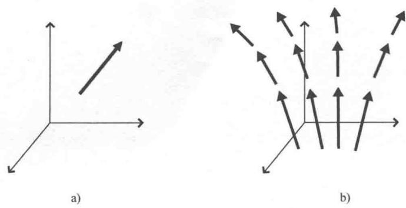
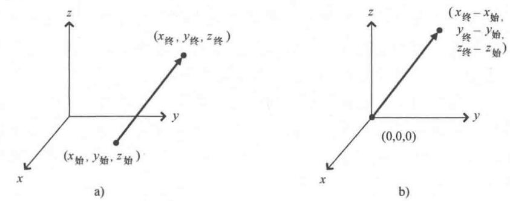

import Guide from '@/components/Guide.astro';
import Knowledge from '@/components/Knowledge.astro';
import Example from '@/components/Example.astro';
import Analysis from '@/components/Analysis.astro';
import Solution from '@/components/Solution.astro';
import Variant from '@/components/Variant.astro';
import Note from '@/components/Note.astro';
import Block from '@/components/Block.astro';
import Method from '@/components/Method.astro';
import Exercise from '@/components/Exercise.astro';

## 1.1 基本概念

定义矢量有很多种方法，最基本的定义为

矢量是一个既有大小（或度量）又有方向的物理实体的数学表示.

由定义可知，速率（物体运动的快慢）不能用矢量表示，而速度（物体运动的快慢和方向）却是一个矢量。再比如，力也是一个矢量，因为力表示出了推拉物体时的强度以及方向。但是温度只有度量没有方向，因此温度不是矢量。

"矢量"一词来源于拉丁文 vehere，意思是"携带"，18 世纪的天文学家在研究行星围绕太阳运转的"携带"机理时首次使用 ① 。为体现矢量的性质，通常在字母顶上加箭头来表示 $\vec{F}$ ；或者用粗体字母表示 F；有时也会给字母加下划线，如 $\underline{F}$ 或 $\widetilde{F}$ 。在手写涉及矢量的等式时，要养成用这些方式来表示矢量的习惯，这一点非常重要。当然，也可以用自己的方式表示矢量，只要能将矢量同其他量区分开就可以。

几何上，矢量可以用有向线段或者箭头这样的几何图形来表示，如图1.1a所示。稍后会讲到，矢量也可以用一个含有 $N$ 个数的有序数组来表示。其中， $N$ 是矢量所在空间的维数。

事实上，矢量可以表示不同的物理实体，它的真实值对应所代表的物理实体。例如，图1.1a中的矢量可以用来表示某地风的速度、火箭升空的加速度、踢球作用在足球上的力，甚至是在你的生活中每天都能遇到的数以千计的矢量。无论对矢量有多少认识，我们都必须知道矢量有两个要素：大小和方向。箭头的长度表示矢量的大小，也就是矢量所代表量的大小。比例尺由自己或者绘图的人指定，一旦确定下来，绘制其他所有矢量都要依照相同的比例。明确了比例，就可以用箭头长度来表示矢量的大小了。矢量的方向常常由箭头与某个或某些指定方向的夹角来确定（通常选取坐标轴方向），这样就可以确定矢量的方向。

  
图 1.1 矢量和矢量场的几何图形

既然矢量是由它的大小和方向所确定，那么两个长度相等、方向相同的矢量是否是同一个矢量呢？或者换种问法，如果将图1.1a中的矢量平移到另一个位置，既不改变它的大小也不改变它的方向，平移后的矢量是否还是原来的矢量呢？在一些应用中，平移前后的矢量确实是同一个矢量，这样的矢量被称为自由矢量。只要不改变大小和方向，自由矢量可以在空间中任意平移后仍然是原来的矢量。但是，很多物理和工程问题需要把矢量固定在一个给定的位置上，这样的矢量被称为"束缚矢量"或"固定矢量"。显然，固定矢量不能像自由矢量一样可以移动 ① 。还有一种矢量叫"滑移矢量"，它们可以沿着作用线平移并且不改变大小和方向；通常会在力矩和角向运动的问题

  
图 1.2 三维笛卡儿坐标系下的矢量

中遇到这类矢量.

束缚矢量在某些实际应用中非常有用，例如表示大气中不同点的风速。只要在每个感兴趣的点处画一个束缚矢量就可以表示出该点风的速率和方向（大多数人会将矢量的尾部，也就是非箭头端画在要固定的点处），称这样的矢量构成的集合为矢量域，如图1.1b所示。

如何来表示束缚矢量？很容易想到，束缚矢量是由箭头的起点和终点唯一确定的。因此，在一个三维笛卡儿坐标系中，只需要知道该矢量两个端点的坐标值 $x, y, z$ 就可以了，如图1.2a所示（非笛卡儿坐标系下矢量的表示参考本章后面的内容）。

特殊地，束缚矢量的起点固定在坐标系坐标原点处，也就是非箭头端落在坐标轴的交点处，如图1.2b所示。这种起点在坐标原点的束缚矢量是由矢量终点唯一确定的，因此矢量的表示只要列出终点坐标 $x, y, z$ 就可以了。例如，起点为坐标原点并且沿 $x$ 轴方向延伸5个单位长度的矢量可以表示为 $(5, 0, 0)$ 。在这种表示形式下，用来表示矢量的各个值被称为矢量的"分量"，矢量的分量个数就等于该矢量所在空间的维数。因此，二维空间中的矢量可以用一对数值来表示，四维时空中的矢量就用四个数值来表示。这也就是为什么计算机技术中把水平列出的数字称为"行矢量"，把竖直列出的数字称为"列矢量"。在这些矢量中有多少个数值也就是矢量所在的空间的维数是多少。

为了能更好地区分开矢量与其他实体，下面来认识一下其他具有明显特征的非矢量实体的性质。考虑我们所在房间里的温度，房间中每一个点的温度都有一个值，这个值用一个单独的数表示。这个值可能与其他点处的值都不同，但任意给定点的温度都可以用一个数来表示，也就是大小。W. R. Hamilton ① 把"从负无穷到正无穷这个数值范围内所有数的值"定义为标量，自此以后这种只有大小的量就被称为"标量"。

标量是一个只有大小的物理实体的数学表示.

标量的例子有很多，比如质量、电荷、能量、速率（矢量速度的大小为速率）。需要注意的是，空间某个区域温度的变化是既有大小又有方向的量，因此温度的变化要用矢量来表示。由此可以看出，标量中也可以产生矢量。第2章的内容会涉及这样的矢量，我们称这样的矢量为标量场的"梯度"。

标量只有大小（用单独的数来表示），矢量既有大小又有方向（三维空间中的矢量用三个数来表示），那么有没有其他的实体既有大小又有方向但是要比矢量更复杂呢（也就是说，需要比所在空间维数更多的数才能表示）？这样的实体确实存在，我们称它为"张量" ① 。本书最后三章的主要内容就是张量，但此处给出张量的简单定义：

张量是既有大小又有多个方向的物理实体的数学表示.

例如，惯量就是一个张量，惯量将旋转物体的角速度与它的角动量关联起来。因为角速度是个矢量具有方向，角动量是个矢量也有方向（这里指与角速度方向不同），那么惯性张量就有了多个方向。

在三维空间中，标量用单个数就可以表示，矢量用一个由三个数构成的序列表示，而张量用包含 $3^{R}$ 个数的矩阵表示，其中， $R$ 表示张量的阶数。因此，在三维空间中，一个二阶张量用 $32 = 9$ 个数构成的矩阵表示。在 $N$ 维空间中，标量仍然是用单个数表示，矢量用 $N$ 个数表示，相应的张量则需要由 $N^{R}$ 个数表示.

一旦认识到标量是由单个数表示，矢量是由有序数组表示，张量是由矩阵来表示，就很容易识别标量、矢量和张量了．三维空间中的标量、矢量和张量（二阶）的表示如下：

标量

(x)

$$
(x _ {1}, x _ {2}, x _ {3}) \text {或者} \left( \begin{array}{l} x _ {1} \\ x _ {2} \\ x _ {3} \end{array} \right) \quad \left( \begin{array}{l l l} x _ {1 1} & x _ {1 2} & x _ {1 3} \\ x _ {2 1} & x _ {2 2} & x _ {2 3} \\ x _ {3 1} & x _ {3 2} & x _ {3 3} \end{array} \right)
$$

请注意，标量的表示不需要下标，而矢量需要单下标，张量则要用到两个或者多个下标。此处是二阶张量，也有更高阶的张量，我们将在第5章讨论。三阶张量要用三维（立体）矩阵表示。

掌握了这些基本定义之后，我们就可以开始考虑如何来使用矢量了。所有矢量当中最有用的就是笛卡儿单位矢量，接下来一节的内容就来讨论它。
