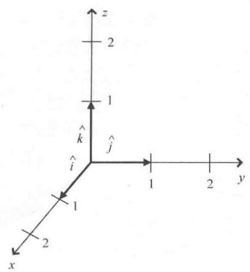
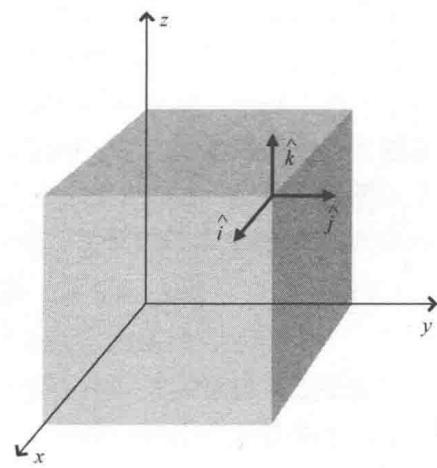

import Guide from '@/components/Guide.astro';
import Knowledge from '@/components/Knowledge.astro';
import Example from '@/components/Example.astro';
import Analysis from '@/components/Analysis.astro';
import Solution from '@/components/Solution.astro';
import Variant from '@/components/Variant.astro';
import Note from '@/components/Note.astro';
import Block from '@/components/Block.astro';
import Method from '@/components/Method.astro';
import Exercise from '@/components/Exercise.astro';

## 1.2 笛卡儿单位矢量

运用矢量解决问题就会有涉及多个矢量的情形，我们如何去处理呢？首先要明确什么是"单位矢量"。"单位矢量"是一种特殊的矢量，常常作为某些方向的标志（单位矢量也被称为"规范化四元数"）.

最常见的单位矢量为 $\hat{x}, \hat{y}, \hat{z}$ （也被记为 $\hat{i}, \hat{j}, \hat{k}$ ），分别与三维笛卡儿坐标系中 x 轴，y 轴，z 轴同方向，如图 1.3 所示。这些矢量的长度（或大小）都等于单位长度，也就是长度为 1（坐标轴上定义的一个单位），因此被称为单位矢量。

请注意，笛卡儿单位矢量 $\hat{i},\hat{j},\hat{k}$ 的起点不仅可以在坐标原点处，也可以是坐标系中的任意位置，如图1.4所示．例如，只要矢量具有单位长度并且方向与 $x$ 轴的正方向相同，那么这个矢量就是单位矢量 $\hat{i}$ 因此，笛卡儿单位矢量只是表示了 $x$ 轴， $y$ 轴， $z$ 轴的方向而并没有确定原点的位置.

  
图 1.3 三维笛卡儿坐标系中的单位矢量

  
图 1.4 任意点处的笛卡儿单位矢量

在第2章内容中就可以体会到单位矢量在特定矢量运算中的重要性，比如确定给定矢量在某个指定方向上的分解部分。这是因为单位矢量没有自己的大小，运算中不会产生影响（事实上，单位矢量也有自己的大小，只不过是1）。因此，表达式" $5\hat{i}$ "表示沿着x轴正方向5个单位长度。同理，" $-3\hat{j}$ "表示沿着y轴负方向3个单位长度， $\hat{k}$ 表示沿着z轴正方向一个单位长度。

不仅三个坐标轴相互垂直的笛卡儿系有单位矢量，其他的坐标系同样有单位矢量，第1.5节中有这样的例子。笛卡儿单位矢量的一大优势就是无论这些单位矢量在哪个位置，方向始终不变。x轴，y轴，z轴都是一直延伸到无穷的直线，并且任意点处的笛卡儿单位矢量都平行于三条坐标轴直线。

要想运用 $\hat{i}, \hat{j}, \hat{k}$ 这样的单位矢量，还需要理解另一个概念——矢量分量。下一节就来讨论如何运用单位矢量和矢量分量表示矢量。
