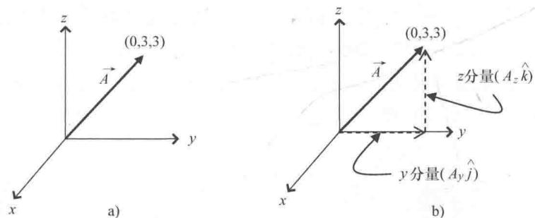
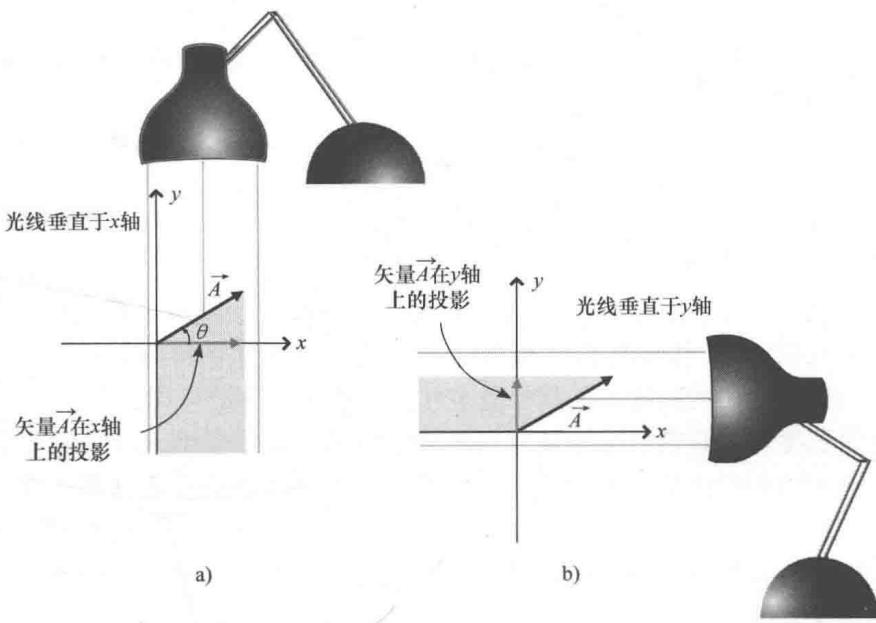

import Guide from '@/components/Guide.astro';
import Knowledge from '@/components/Knowledge.astro';
import Example from '@/components/Example.astro';
import Analysis from '@/components/Analysis.astro';
import Solution from '@/components/Solution.astro';
import Variant from '@/components/Variant.astro';
import Note from '@/components/Note.astro';
import Block from '@/components/Block.astro';
import Method from '@/components/Method.astro';
import Exercise from '@/components/Exercise.astro';

## 1.3 矢量分量

上一节内容所讲的单位矢量可以作为矢量分量表示的一部分。什么又是矢量分量？简单来说，矢量分量是矢量的组成部分。

  
图1.5 矢量 $\vec{A}$ 及其分量

为了更好地理解矢量分量，先来看图1.5所示的矢量 $\vec{A}$ 。矢量 $\vec{A}$ 是三维笛卡儿坐标系下的束缚矢量，起点在原点，终点为（ $x = 0, y = 3, z = 3$ ）。如果用坐标轴表示房间的墙角，矢量 $\vec{A}$ 就落在背面的墙壁上（ $yOz$ 平面）。

假设我们要从矢量 $\vec{A}$ 的起点移动到矢量 $\vec{A}$ 的终点，最直接的路线很简单，只需沿着矢量 $\vec{A}$ 的方向走就可以。但如果要求只能沿着坐标轴的方向移动，则从原点出发到目的地要先沿着y轴方向走3步（3个单位长度），然后向左转90°并沿z轴方向走3步（3个单位长度）。

这个小小的旅程与矢量分量有什么关系呢？简单地说，矢量 $\vec{A}$ 的分量长度就是我们沿坐标轴方向移动的距离。具体来讲，本例中矢量 $\vec{A}$ 沿 $y$ 轴方向分量的大小就是我们沿 $y$ 轴方向移动的距离（3个单位长度），记为 $A_{y}$ ；矢量 $\vec{A}$ 沿 $z$ 轴方向分量的大小就是沿 $z$ 轴方向移动的距离（也是3个单位长度），记为 $A_{z}$ ；沿 $x$ 轴方向没有任何的移动，因此矢量 $\vec{A}$ 沿 $x$ 轴方向分量的大小 $A_{x}$ 就是0.

用矢量分量可以以简洁的形式表示出矢量：

$$
\vec {A} = A _ {x} \hat {i} + A _ {y} \hat {j} + A _ {z} \hat {k}\tag{1.1}
$$

其中，矢量分量的大小 $(A_{x}, A_{y}, A_{z})$ 对应从矢量 $\vec{A}$ 的起点到达终点需要沿每个方向 $(\hat{i}, \hat{j}, \hat{k})$ 移动的步数. $^{\ominus}$

在矢量和矢量分量的有关资料中，我们可能会看到这样的提法：

"矢量分量为矢量在坐标轴上的投影。"在第4章中可以看到，得到投影的具体方法将会对如何理解矢量分量的性质产生重要影响。在笛卡儿坐标系和其他正交系（正交系中的坐标轴两两互相垂直）中，在坐标轴上的投影这个概念很容易理解，也有助于画出矢量分量的图形。

为了便于理解，我们来看图1.6中的矢量 $\vec{A}$ 、光源以及阴影。在图1.6a中，以平行于 $y$ 轴的光线去照射矢量 $\vec{A}$ 并在 $x$ 轴上产生投影（实际上光线是照射向 $y$ 轴负方向，因此光线方向反平行于 $y$ 轴），也可以说光线垂直于 $x$ 轴。

  
图1.6 向 $x$ 轴和 $y$ 轴投影定义矢量分量

同理，在图1.6b中，用反平行于 $x$ 轴的光线照射矢量 $\vec{A}$ 并在 $y$ 轴上产生投影，光线也可以说是垂直于 $y$ 轴的。平行于一个坐标轴的方向垂直于另外一个坐标轴这个细节似乎不重要，但若是在非直角坐标系中却未必成立并且会产生完全不同类型的矢量分量。在不同参考系下，这个看起来简单的细节却对矢量和张量的性质产生重大的影响，学习了第4章、第5章和第6章就可以体会到。

图 1.6 所示的二维笛卡儿坐标系不需要考虑这个问题，因此矢量 $\vec{A}$ 的分量大小也很容易确定。从图 1.6a 中可以看出，如果矢量 $\vec{A}$ 与 x 正半轴的夹角为 $\theta$ ，矢量 $\vec{A}$ 的长度就是图中直角三角形的斜边，而直角三角形沿 x 轴和 y 轴方向的直角边就是分量 $A_{x}$ 、 $A_{y}$ 。因此，根据三角学知识很简单就可以得到：

$$
\begin{array}{r l} & A _ {x} = | \vec {A} | \cos (\theta), \\ & A _ {y} = | \vec {A} | \sin (\theta). \end{array}\tag{1.2}
$$

其中， $\vec{A}$ 两侧加两条竖线表示矢量 $\vec{A}$ 的大小（长度）。请注意，无论矢量在坐标系哪个象限，只要 $\theta$ 表示的是从 $x$ 轴正方向朝着 $y$ 轴正方向转过的角度（本例中为逆时针方向），由式（1.2）就可以确定 $x$ 轴分量和 $y$ 轴分量的正负号。

例如，如果矢量 $\vec{A}$ 长度为 7m，指向从 x 正半轴逆时针旋转 $210^{\circ}$ 的方向，根据式（1.2）可以得到矢量在 x 轴和 y 轴的分量：

$$
\begin{array}{r l} & A _ {x} = | \vec {A} | \cos (\theta) = 7 \mathrm{m} \cos 2 1 0 ^ {\circ} = - 6. 1 \mathrm{m}, \\ & A _ {y} = | \vec {A} | \sin (\theta) = 7 \mathrm{m} \sin 2 1 0 ^ {\circ} = - 3. 5 \mathrm{m}. \end{array}\tag{1.3}
$$

不出所料，以原点为起点并且指向左下方的矢量其分量均是负数.

如果已知矢量的笛卡儿分量，也可以直接确定矢量的长度和方向。这是因为在以 $A_{x}$ ， $A_{y}$ 为直角边的直角三角形中，矢量就是这个三角形的斜边。由勾股定理可知，矢量 $\vec{A}$ 的长度一定为

$$
| \vec {A} | = \sqrt {A _ {x} ^ {2} + A _ {y} ^ {2}},\tag{1.4}
$$

并且由三角学知识得

$$
\theta = \arctan \left(\frac {A _ {y}}{A _ {x}}\right),\tag{1.5}
$$

其中， $\theta$ 为右手坐标系中由 $x$ 正半轴逆时针转过的角度。请注意，如果将式（1.3）中矢量 $\vec{A}$ 的分量代入式（1.5）中，会发现求出的角度是 $30^{\circ}$ ，而不是 $210^{\circ}$ 。切记，计算器上没有四个象限的反正切函数。因此，当式（1.5）中的分母（此处是 $A_{x}$ ）是负数的时候，一定要在求出的角度上加上 $180^{\circ}$ 。

如果已经掌握了单位矢量和矢量分量，就可以去做基本的矢量运算了．第2章讨论的就是矢量运算，但是根据本章后续内容的需要，大学生理工专题导读——矢量与张量分析

接下来这一节先介绍矢量的加法运算与数乘运算.
