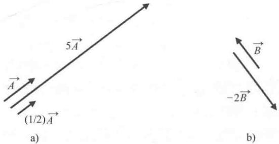
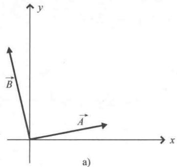
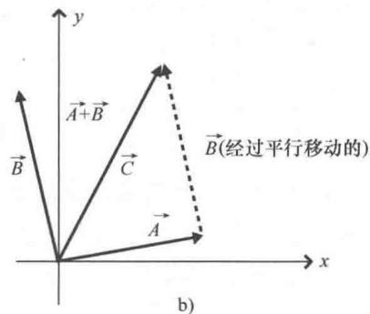
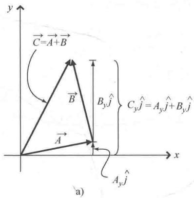
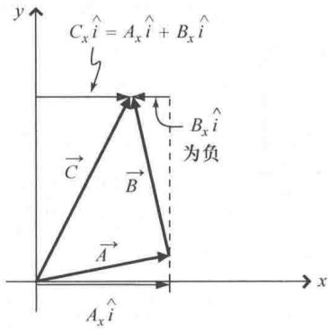

import Guide from '@/components/Guide.astro';
import Knowledge from '@/components/Knowledge.astro';
import Example from '@/components/Example.astro';
import Analysis from '@/components/Analysis.astro';
import Solution from '@/components/Solution.astro';
import Variant from '@/components/Variant.astro';
import Note from '@/components/Note.astro';
import Block from '@/components/Block.astro';
import Method from '@/components/Method.astro';
import Exercise from '@/components/Exercise.astro';

## 1.4 矢量的加法与数乘运算

在矢量分量这一节内容中，其实已经遇到了矢量的两种运算——加法和数乘。第1.3节中将矢量展开成矢量分量的表达式[式(1.1)]用的就是这两种运算：

$$
\vec {A} = A _ {x} \hat {i} + A _ {y} \hat {j} + A _ {z} \hat {k}.
$$

显然，上式中每一项都是用一个标量 $(A_{x}, A_{y}$ 或 $A_{z})$ 乘以一个单位矢量 $(\hat{i}, \hat{j}, \hat{k})$ 得到一个与该单位矢量同方向的新矢量。由于乘以了矢量分量大小，新的矢量要比单位矢量更长（若矢量分量的大小介于0到1之间，长度会变短）。由此可知，用任意的正数（标量）乘以一个矢量只会改变矢量的长度，并不会改变该矢量的方向。因此， $5\vec{A}$ 是一个矢量并且与矢量 $\vec{A}$ 方向相同，但其长度是矢量 $\vec{A}$ 长度的5倍，如图1.7a所示。同样地，用 $\frac{1}{2}$ 乘以矢量 $\vec{A}$ 得到的矢量与 $\vec{A}$ 方向相同，长度是 $\vec{A}$ 的一半。所以，矢量分量 $A_{x}\hat{i}$ 是一个与单位矢量 $\hat{i}$ 方向相同，并且长度为 $A_{x}$ 的矢量（因为单位矢量的长度为1）。

标量乘以矢量难道只会"改变长度，而不改变方向"吗？请注意：如果这个标量是个负数，数乘后不仅改变矢量的长度，也会使得矢量的方向发生反转。因此，-2乘以矢量 $\vec{B}$ 得到一个新的矢量 $-2\vec{B}$ ，该矢量的长度是矢量 $\vec{B}$ 的2倍，但方向与矢量 $\vec{B}$ 恰恰相反，如图1.7b所示。

  
图 1.7 矢量的数乘运算

式（1.1）中包含的另一种运算就是矢量加法，如果结合图1.5以及从矢量 $\vec{A}$ 的起点移动到终点的过程就不难理解为什么这么说了。从矢量 $\vec{A}$ 的起点移动到终点的过程中， $A_{y} \hat{j}$ 这个量不仅给出了需要移动的步数，同时也给出了移动的方向。同理， $A_{z} \hat{k}$ 代表了沿另一个方向移动的步数。这两个量均包含了方向的信息，因此我们不能简单地用代数方法相加，而是必须作为"矢量"相加。

运用图形也可以进行矢量的加法运算。不妨将一个矢量平行移动（不改变其大小和方向），使得该矢量的尾部落在另一个矢量的头部。那么两个矢量相加得到一个新的矢量，新矢量的起点为第一个矢量起点且终点为第二个矢量终点。如图1.5b所示，矢量 $A_{z}\hat{k}$ 的尾部落在矢量 $A_{y}\hat{j}$ 的头部上，这两个矢量相加的结果就是从 $A_{y}\hat{j}$ 起点到 $A_{z}\hat{k}$ 终点的新矢量。

利用图形法"首尾相连"计算矢量加法，不仅适用于两个相互垂直矢量的加法运算（如 $A_{y}\hat{j}$ 和 $A_{z}\hat{k}$ ），同样适用于任意矢量（也可以是任意个矢量）的加法运算。下面以图1.8为例，运用图形法来计算图1.8a中两个矢量 $\vec{A}$ 与 $\vec{B}$ 的加法。想象平移其中一个矢量，使得该矢量的起点与另一个矢量的终点重合（无论平移哪个矢量结果都是一样的）。图1.8b中是将矢量 $\vec{B}$ 平移，使得矢量 $\vec{B}$ 的起点与矢量 $\vec{A}$ 的终点重合，这两个矢量的和（即合矢量 $\vec{C} = \vec{A} +\vec{B}$ ）就是从矢量 $\vec{A}$ 起点指向矢量 $\vec{B}$ 终点的矢量。

  
图 1.8 图形法计算矢量加法

如果掌握了图形法计算矢量加法，那么只需要用直尺和量角器就可以计算两个或多个矢量的和了。先将矢量首尾相连（确保每个矢量的长度和角度保持不变），然后从第一个矢量的起点到最后一个矢量终点画出合矢量，最后测量出合矢量的长度（用直尺）和角度（用量角器）就可以了。但是这个方法既烦琐又不精确，我们不妨考虑另一种方法，也就是通过每个矢量的分量来计算矢量的和：如果矢量 $\vec{C}$ 为矢量 $\vec{A}$ 与 $\vec{B}$ 的和，那么矢量 $\vec{C}$ 沿 $x$ 轴方向分量的大小（记为 $C_x$ ）就等于矢量 $\vec{A}$ 与 $\vec{B}$ 分别沿 $x$ 轴方向分量大小的和（即 $A_x + B_x$ ），矢量 $\vec{C}$ 沿 $y$ 轴方向分量的大小（ $C_y$ ）就等于矢量 $\vec{A}$ 与 $\vec{B}$ 分别沿 $y$ 轴方向分量大小的和（即 $A_y + B_y$ ），也就是

$$
\begin{array}{l} C _ {x} = A _ {x} + B _ {x}, \\ C _ {y} = A _ {y} + B _ {y}. \end{array}
$$

图 1.9 给出了利用矢量分量求和的基本原理.

(1.6)

  
b)  
图 1.9 分量法计算矢量加法

如果确定了合矢量的分量 $C_x$ 和 $C_y$ ，也就确定了矢量 $\vec{C}$ 的大小和方向了，其中

且

$$
| \vec {C} | = \sqrt {C _ {x} ^ {2} + C _ {y} ^ {2}},\tag{1.7}
$$

$$
\theta = \arctan \left(\frac {C _ {y}}{C _ {x}}\right),\tag{1.8}
$$

下面通过举例具体说明．不妨假设图1.9中的矢量 $\vec{A} = 6\hat{i} +\hat{j}$ ，矢量 $\vec{B} = -2\hat{i} +8\hat{j}$ ，只要通过代数计算就可以求出矢量的和．由式(1.6）可得：

$$
\begin{array}{r l} & C _ {x} = A _ {x} + B _ {x} = 6 + (- 2) = 4, \\ & C _ {y} = A _ {y} + B _ {y} = 1 + 8 = 9. \end{array}
$$

因此，矢量 $\vec{C}=4\hat{i}+9\hat{j}$ 。将矢量分量代入式（1.7）就可以求出矢量 $\vec{C}$ 的大小：

$$
\begin{array}{r l} \mid \vec {C} \mid & = \sqrt {C _ {x} ^ {2} + C _ {y} ^ {2}} = \sqrt {4 ^ {2} + 9 ^ {2}} \\ & = \sqrt {1 6 + 8 1} = 9. 8 5. \end{array}
$$

由式（1.8）可以求出矢量 $\vec{C}$ 与 $x$ 正半轴的夹角 $\theta$

$$
\begin{array}{r l} \theta & = \arctan \left(\frac {C _ {y}}{C _ {x}}\right) \\ & = \arctan \left(\frac {9}{4}\right) = 6 6 ^ {\circ}. \end{array}
$$

掌握了矢量加法和数乘这两种基本运算后，就可以考虑关于矢量更高级的用法，同时也可以着手解决一些有关矢量的问题了。本章的最后列举出一系列这样的习题。
