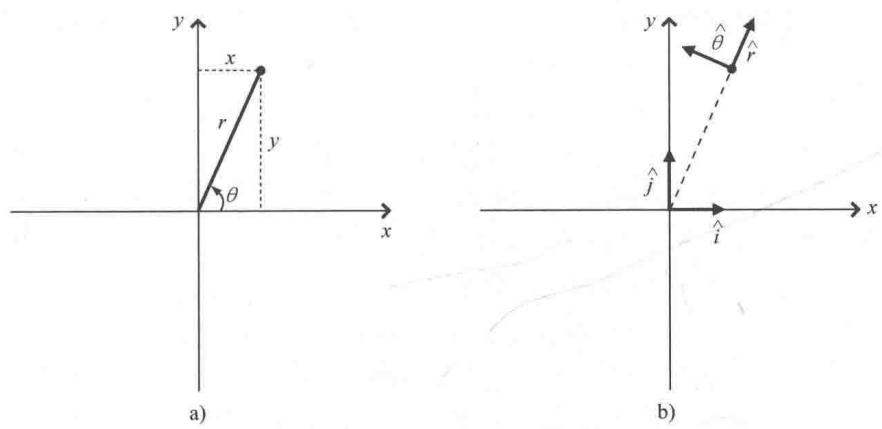
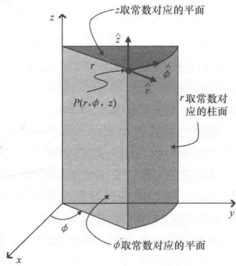
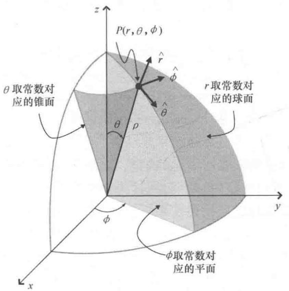

import Guide from '@/components/Guide.astro';
import Knowledge from '@/components/Knowledge.astro';
import Example from '@/components/Example.astro';
import Analysis from '@/components/Analysis.astro';
import Solution from '@/components/Solution.astro';
import Variant from '@/components/Variant.astro';
import Note from '@/components/Note.astro';
import Block from '@/components/Block.astro';
import Method from '@/components/Method.astro';
import Exercise from '@/components/Exercise.astro';

## 1.5 非笛卡儿单位矢量

笛卡儿坐标系中的坐标轴是三条相互垂直的直线，这一点非常有利于处理物理和工程中的问题。但是某些问题的一个甚至多个参数会在特定方向上保持不变或者参数变化可以预测，如果有其他坐标系的坐标轴方向恰好与之匹配，那么这些问题在这个坐标系中会更容易解决。本节讨论的主题就是这类非笛卡儿坐标系中的单位矢量。另外，坐标系之间的变换将在第4章介绍。

由前面所讲的内容可知，N 维空间中任意一个位置需要用 N 个数才能明确表示。我们的宇宙是个三维空间，其中任意一个位置需要用三个数字（例如 x, y, z）来确定。但是地球表面是二维的并且上面的点只需要用两个数字（例如经度和纬度）就可以表示（暂不考虑高度的变化）。如果你住在一个很长但又非常窄的岛上，那么只需要一个数字就可以描述约会地点的位置（例如：我将在 3.75km 的地方等你）。

要确定用多少个数来定义点的位置，应该先要定义坐标系。例如，上面提到的3.75km是从岛屿的最东边算起3.75km还是最西边算起？无论是在一维、二维、三维空间，还是更高维空间，我们都可以建立无数个坐标系来表示这个空间中点的位置。无论在哪个坐标系中，每个位置处都存在使得其中一个坐标在这个方向增加得最快的方向。如果在这个方向上放置一个长度为1个单位的矢量，这个矢量就被定义为该坐标系下的坐标单位矢量。因此在笛卡儿坐标系下，单位矢量 $\hat{i}$ 给出了x坐标增加最快的方向，单位矢量 $\hat{j}$ 给出了y坐标增加最快的方向，单位矢量 $\hat{k}$ 给出了z坐标增加最快的方向。其他坐标系同样可以定义自己的坐标单位矢量。

考虑如图1.10所示的二维坐标系．我们知道二维空间中任意的指定位置需要用两个数来确定，可以是 $x$ 和 $y$ ，即定义在两条垂直相交的直线轴上的数值． $x$ 的值表示距离 $y$ 轴向右有多远（如果 $x$ 的值为负数则表示距离 $y$ 轴向左有多远）， $y$ 的值表示距离 $x$ 轴向上有多远（如果 $y$ 的值为负数则表示距离 $x$ 轴向下有多远）．但同样，指定的位置也可以用从原点出发到该点的方向和该点到原点的距离来确定．在"极坐标"的标准形式中，到原点的距离被记为 $r$ ，用从 $x$ 正半轴开始逆时针转过的角度 $\theta$ 来表示方向.

如果已知某个点的一种坐标表示，那么该点的另一种坐标表示也很容易。例如，如果已知直角坐标 $x$ 和 $y$ 的值，也就可以确定极坐标 $r$ 和 $\theta$ 的值，即：

$$
\begin{array}{c} r = \sqrt {x ^ {2} + y ^ {2}}, \\ \theta = \arctan \left(\frac {y}{x}\right). \end{array}\tag{1.9}
$$

  
图 1.10 二维直角坐标 a）和极坐标 b）

同理，如果已知极坐标 $r$ 和 $\theta$ 的值，也可以确定直角坐标 $x$ 和 $y$ 的值，即：

$$
\begin{array}{l} x = r \cos (\theta), \\ y = r \sin (\theta). \end{array}\tag{1.10}
$$

考虑图 1.10 中所示的点，如果该点 x 和 y 的值分别是 4cm 和 9cm，则 r 的值近似等于 9.85， $\theta$ 的值为 $66^{\circ}$ 。显然， $(x,y)=(4\mathrm{~cm},9\mathrm{~cm})$ 与 $(r,\theta)=(9.85\mathrm{~cm},66^{\circ})$ 表示的是同一个位置，之所以有不同的表示形式是因为选取的参考坐标系不同，而点的位置并没有发生变化。

如果选取极坐标表示平面中的点，那么极坐标系是否也存在类似于笛卡儿坐标系中 $\hat{i}$ 和 $\hat{j}$ 这样的单位矢量呢？我们知道，在笛卡儿坐标系下单位矢量 $\hat{i}$ 给出了x增加最快的方向，单位矢量 $\hat{j}$ 给出了y增加最快的方向。稍加思考就会知道极坐标系一定也有这样的单位矢量。任意位置的单位矢量 $\hat{r}$ 应指向r增加最快的方向，单位矢量 $\hat{\theta}$ 应指向 $\theta$ 增加最快的方向。以图1.10所示的点为例，当 $\theta$ 取定一个常数时， $\hat{r}$ 指向r增加最快的方向，也就是右上方；当r取定一个常数时， $\hat{\theta}$ 指向 $\theta$ 增加最快的方向，也就是左上方。图1.10b为点的极坐标单位矢量。

根据以上定义可以得到一个重要的结论：极坐标系下，极坐标单位矢量 $\hat{r}$ 和 $\hat{\theta}$ 在不同点处具有不同的方向。 $\hat{r}$ 和 $\hat{\theta}$ 的方向是相互垂直的，但是通常会与图 1.10 所示点处的方向不同。极坐标单位矢量依赖于点的位置：

$$
\begin{array}{l} \hat {r} = \cos (\theta) \hat {i} + \sin (\theta) \hat {j}, \\ \hat {\theta} = - \sin (\theta) \hat {i} + \cos (\theta) \hat {j}. \end{array}\tag{1.11}
$$

因此，如果 $\theta = 0$ （在 x 的正半轴上），则 $\hat{r} = \hat{i}, \hat{\theta} = \hat{j}$ ；如果 $\theta = 90^{\circ}$ （在 y 的正半轴上），则 $\hat{r} = \hat{j}, \hat{\theta} = -\hat{i}$ .

类似如上的单位矢量显然依赖于点的位置，这是否意味着它们不是"真"矢量？这就要看如何定义真矢量了。如果真矢量定义为既有大小又有方向的量，那么极坐标单位矢量显然符合定义要求。但是按照第1.1节的自由矢量定义，极坐标单位矢量移动后会改变方向，显然不符合要求。

极坐标单位矢量随位置的变化意味着，如果用极坐标表示一个矢量并对矢量求导，也必须同时考虑到单位矢量的改变。但是，笛卡儿坐标表示不存在这样的问题，因为空间中任意位置的笛卡儿坐标单位矢量都是相同的，这也是笛卡儿坐标的一个优势。

三维坐标系的情况会稍微复杂一些。无论我们选择笛卡儿坐标系还是非笛卡儿坐标系，三维空间中任意一个位置都需要用三个变量来表示，并且每个坐标系都有自己的坐标单位矢量。常用的两个三维非笛卡儿坐标系是柱面坐标系和球面坐标系，如图1.11和图1.12所示。

点 P 的柱面坐标由 r, $\phi$ , z 来确定，其中，r（有时用 $\rho$ 来表示）表示点到 z 轴的垂直距离， $\phi$ 表示从 x 正半轴到 r

  
图1.11 柱面坐标

在 $xOy$ 面上的投影转过的角度， $z$ 同笛卡儿坐标中的 $z$ 是一样的。如

  
图1.12 球面坐标

果已知笛卡儿坐标 x, y, z 就可以求出柱面坐标 r, $\phi$ , z，即：

$$
r = \sqrt {x ^ {2} + y ^ {2}},
$$

$$
\phi = \arctan \left(\frac {y}{x}\right),\tag{1.12}
$$

$$
z = z.
$$

并且如果已知柱面坐标 $r$ ， $\phi$ 和 $z$ 的值，也可以求出笛卡儿坐标 $x$ ， $y$ 和 $z$ 的值：

$$
\begin{array}{l} x = r \cos (\phi), \\ y = r \sin (\phi), \\ z = z. \end{array}\tag{1.13}
$$

P 点处矢量的柱面坐标是由三个相互垂直的分量确定的，其单位矢量分别垂直于半径为 r 的柱面，垂直于过 z 轴角度为 $\phi$ 的半平面，垂直于 z 处的 xy 面。同笛卡儿坐标一样，每个柱面坐标单位矢量的方向也是相应坐标增加最快的方向。因此， $\hat{r}$ 指向 r 增加最快的方向， $\hat{\phi}$ 指向 $\phi$ 增加最快的方向， $\hat{z}$ 指向 z 增加最快的方向。单位矢量 $(\hat{r}, \hat{\phi}, \hat{z})$

构成右手系，即以右手握住 $\hat{z}$ ，四根手指从 $\hat{r}$ 弯曲指向 $\hat{\phi}$ ，竖起大拇指的方向就是 $\hat{z}$ 的方向.

笛卡儿坐标系中的单位矢量和柱面坐标系的单位矢量之间的关系如下：

$$
\begin{array}{l} \hat {r} = \cos (\phi) \hat {i} + \sin (\phi) \hat {j}, \\ \hat {\phi} = - \sin (\phi) \hat {i} + \cos (\phi) \hat {j}, \\ \hat {z} = \hat {z}. \end{array}\tag{1.14}
$$

点 $P$ 的球面坐标由 $r, \theta, \phi$ 确定，其中， $r$ 表示 $P$ 到原点的距离， $\theta$ 表示 $r$ 从 $z$ 的正半轴向 $xOy$ 面转过的角度， $\phi$ 表示从 $x$ 轴（或 $zOx$ 面）到由常数 $\phi$ 确定且包含点 $P$ 的半平面转过的角度。在 $z$ 轴正方向向上的情况下， $\theta$ 常被称为天顶角， $\phi$ 被称为方位角。如果已知笛卡儿坐标 $x, y$ 和 $z$ ，根据式（1.15）可以得到球面坐标 $r, \theta$ 和 $\phi$ ：

$$
\begin{array}{l} r = \sqrt {x ^ {2} + y ^ {2} + z ^ {2}}, \\ \theta = \arccos \left(\frac {z}{\sqrt {x ^ {2} + y ^ {2} + z ^ {2}}}\right), \\ \phi = \arctan \left(\frac {y}{x}\right). \end{array}\tag{1.15}
$$

并且如果已知 $r$ ， $\theta$ 和 $\phi$ ，也可以求出 $x$ ， $y$ 和 $z$ ，即：

$$
\begin{array}{l} {x = r \sin (\theta) \cos (\phi),} \\ {y = r \sin (\theta) \sin (\phi),} \\ {z = r \cos (\theta).} \end{array}\tag{1.16}
$$

P 点处矢量的球面坐标由三个相互垂直的分量确定，其单位矢量分别垂直于半径为 r 的球面，垂直于通过 z 轴且角度为 $\phi$ 的平面，垂直于天顶角为 $\theta$ 的圆锥．单位矢量 $(\hat{r}, \hat{\theta}, \hat{\phi})$ 构成右手系，其与笛卡儿单位矢量的关系如下：

$$
\begin{array}{l} \hat {r} = \sin (\theta) \cos (\phi) \hat {i} + \sin (\theta) \sin (\phi) \hat {j} + \cos (\theta) \hat {k}, \\ \hat {\theta} = \cos (\theta) \cos (\phi) \hat {i} + \cos (\theta) \sin (\phi) \hat {j} - \sin (\theta) \hat {k}, \\ \hat {\phi} = - \sin (\phi) \hat {i} + \cos (\phi) \hat {j}. \end{array}\tag{1.17}
$$

你可能会问："我们真的需要用到这些不同的单位矢量吗？"不仅是"需要"，如果想要描述在地球表面沿着固定经度（ $\hat{\theta}$ 的方向）的运动或者载流导线周围的磁场方向时（ $\hat{\phi}$ 的方向），这些单位矢量就带来了极大的便利。本章最后的习题会有这样的练习。
