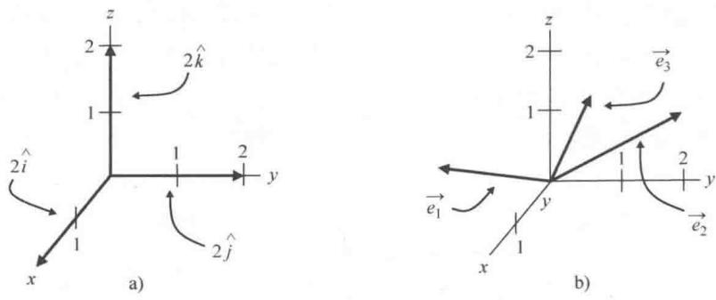

import Guide from '@/components/Guide.astro';
import Knowledge from '@/components/Knowledge.astro';
import Example from '@/components/Example.astro';
import Analysis from '@/components/Analysis.astro';
import Solution from '@/components/Solution.astro';
import Variant from '@/components/Variant.astro';
import Note from '@/components/Note.astro';
import Block from '@/components/Block.astro';
import Method from '@/components/Method.astro';
import Exercise from '@/components/Exercise.astro';

## 1.6 基矢量

考虑单位矢量 $\hat{i}$ ， $\hat{j}$ 和 $\hat{k}$ 以及诸如 $A_{x}\hat{i}$ ， $A_{y}\hat{j}$ 和 $A_{z}\hat{k}$ 这样的矢量分量时，我们可能就会发现三维笛卡儿坐标系下的任意一个矢量都由三个分量构成，并且每一个分量都表明了要朝相应坐标轴方向移动的步数。移动的步数可多可少，移动的方向可以是坐标轴的正方向也可以是反方向，空间包含了所有这样的矢量，因此我们可以到达空间中任意一个点。再结合恰当的度量， $\hat{i}$ ， $\hat{j}$ ， $\hat{k}$ 很自然就成了空间中任意矢量的基。那么， $\hat{i}$ ， $\hat{j}$ ， $\hat{k}$ 就是这个空间中的一种"基矢量"。

空间中任意一个矢量不仅可以用 $\hat{i}$ ， $\hat{j}$ 和 $\hat{k}$ 这组矢量来表示，同样也可以用三个长度是单位矢量 $\hat{i}$ ， $\hat{j}$ 和 $\hat{k}$ 的两倍的矢量来表示，如图1.13a所示。如果选择这组长度更大的矢量作为基矢量，矢量的分量会发生变化，但依然可以表示出空间中任意一个矢量。具体来说，如果单位矢量的长度是原来的两倍，要到达空间中给定的点处， $A_{x}$ ， $A_{y}$ 和 $A_{z}$ 的值也就是原来的一半大小。

有人可能会想，类似图1.13b中 $\vec{e},\vec{e}_2,\vec{e}_3$ 这样既不是单位长度，也非正交的矢量可以作为基矢量吗？如果选择的是三个共面矢量（即，三个矢量在一个平面上），很容易会想到将这些矢量放缩、组合可以到达该平面上的任意一个点，但是无法到达平面以外的点．但是，只要其中一个矢量和另外两个矢量不共面，将矢量适当地缩放、组合就可以到达空间中的任意一个点，此时矢量 $\vec{e}_1,\vec{e}_2,\vec{e}_3$ 构成一个完备基集合（数学上称它们构成了矢量空间）.

如果三个矢量是"线性无关"的，就可以确保这三个矢量不共面（也就是任意一个矢量都不能由另外两个矢量通过缩放与组合来表示），还可以确保三个矢量中的任意两个都不共线（即两个矢量在一条直线上或相互平行）。"线性无关"也常常被定义为：使得三个矢量通过缩放组合后结果为零的唯一方法是缩放每个矢量为0。换句话说，大学生理工专题导读——矢量与张量分析

  
图1.13 不同的基矢量

$\vec{e}_1, \vec{e}_2, \vec{e}_3$ 是三个线性无关的矢量，当且仅当 $A = B = C = 0$ 时，方程

$$
A \vec {e} _ {1} + B \vec {e} _ {2} + C \vec {e} _ {3} = 0\tag{1.18}
$$

成立.

只要选择三个线性无关的矢量，也可以确定一组可行的基矢量。即使选取的三个不共面矢量 $\vec{e}_1, \vec{e}_2, \vec{e}_3$ 不是单位长度，也很容易得到相应的单位矢量。我们知道，矢量除以一个正标量只改变矢量的大小，并不改变矢量的方向，因此每个矢量只要除以它的大小就可以得到同方向的单位矢量了：

$$
\begin{array}{l}\hat {e} _ {1} = \frac {\stackrel {\rightarrow} {e} _ {1}}{| \stackrel {\rightarrow} {e} _ {1} |},\\\hat {e} _ {2} = \frac {\stackrel {\rightarrow} {e} _ {2}}{| \stackrel {\rightarrow} {e} _ {2} |},\\\hat {e} _ {3} = \frac {\stackrel {\rightarrow} {e} _ {3}}{| \stackrel {\rightarrow} {e} _ {3} |}.\end{array}\tag{1.19}
$$

依据本节的概念，我们可以构造无穷多个基，但是最常用的还是像 $\hat{i},\hat{j},\hat{k}$ 这样的"规范正交"基．这样的基之所以称为"正交"，因为它们是正交的（相互垂直）；之所以称为"规范"是指它们的长度被规范为1．我们遇到的大部分问题都要运用到规范正交基.

如果想要进一步学习物理和工程学，特别是研究过程中涉及第4章到第6章将要讨论的张量时，各类坐标系下的基矢量会起到非常重要的作用. 这是因为一个坐标系沿坐标轴方向的基矢量可以用另一个坐标的偏微分表示. ① 我们以球面坐标到直角坐标的转换为例具体说明. 沿该球面 (r) 轴基矢量（即球面的径向基矢量）的笛卡儿坐标 (x, y, z) 表示为

$$
\begin{array}{r l} \vec {e} _ {r} & = \frac {\partial x \hat {i}}{\partial r} + \frac {\partial y \hat {j}}{\partial r} + \frac {\partial z \hat {k}}{\partial r} \\ & = \sin \theta \cos \phi \hat {i} + \sin \theta \sin \phi \hat {j} + \cos \theta \hat {k}. \end{array}
$$

同理， $\vec{e}_{\theta}$ 和 $\vec{e}_{\phi}$ 这两个基矢量也可以表示为

$$
\begin{array}{r l} \vec {e} _ {\theta} & = \frac {\partial x}{\partial \theta} \hat {i} + \frac {\partial y}{\partial \theta} \hat {j} + \frac {\partial z}{\partial \theta} \hat {k} \\ & = r \cos \theta \cos \phi \hat {i} + r \cos \theta \sin \phi \hat {j} - r \sin \theta \hat {k}, \\ \vec {e} _ {\phi} & = \frac {\partial x}{\partial \phi} \hat {i} + \frac {\partial y}{\partial \phi} \hat {j} + \frac {\partial z}{\partial \phi} \hat {k} \\ & = - r \sin \theta \sin \phi \hat {i} + r \sin \theta \cos \phi \hat {j}. \end{array}
$$

请注意，这些基矢量并不都是单位矢量（因为它们的大小不都等于1），也不具有相同的量纲（ $\vec{e}_r$ 无量纲，但是 $\vec{e}_{\theta}$ 和 $\vec{e}_{\phi}$ 的量纲是长度）。但它们是基矢量，并且只要除以它们的大小就可以得到同方向的单位矢量（本章的最后有相关习题，解题思路可以参考对应的线上答案）。

一般来说，如果原坐标系下的坐标记为 $x_{1}, x_{2}, x_{3}$ （刚讨论的例子中为 $r, \theta, \phi$ ），新坐标系下的坐标记为 $x'_{1}, x'_{2}, x'_{3}$ （刚讨论的例子中为 $x, y, z$ ），则沿原坐标轴方向的基矢量可以用新坐标表示如下：

$$
\begin{array}{l} \vec {e} _ {1} = \frac {\partial x _ {1} ^ {\prime}}{\partial x _ {1}} \vec {e} _ {1} ^ {\prime} + \frac {\partial x _ {2} ^ {\prime}}{\partial x _ {1}} \vec {e} _ {2} ^ {\prime} + \frac {\partial x _ {3} ^ {\prime}}{\partial x _ {1}} \vec {e} _ {3} ^ {\prime}, \\ \vec {e} _ {2} = \frac {\partial x _ {1} ^ {\prime}}{\partial x _ {2}} \vec {e} _ {1} ^ {\prime} + \frac {\partial x _ {2} ^ {\prime}}{\partial x _ {2}} \vec {e} _ {2} ^ {\prime} + \frac {\partial x _ {3} ^ {\prime}}{\partial x _ {2}} \vec {e} _ {3} ^ {\prime}, \\ \vec {e} _ {3} = \frac {\partial x _ {1} ^ {\prime}}{\partial x _ {3}} \vec {e} _ {1} ^ {\prime} + \frac {\partial x _ {2} ^ {\prime}}{\partial x _ {3}} \vec {e} _ {2} ^ {\prime} + \frac {\partial x _ {3} ^ {\prime}}{\partial x _ {3}} \vec {e} _ {3} ^ {\prime}. \end{array}\tag{1.20}
$$

换句话说，偏导数 $\frac{\partial x_1' \rightarrow e'_1}{\partial x_1} \cdot \frac{\partial x_2' \rightarrow e'_2}{\partial x_1} \cdot \frac{\partial x_3' \rightarrow e'_3}{\partial x_1} \text{为第一个原基矢量在新坐标系下的分量式．正因为如此，你会发现一些作者会用偏导数来定义基矢量.}$

这些关系在坐标变换以及张量分析的研究中极其重要. 如果涉及相关主题的研究, 可以将它们归档.
