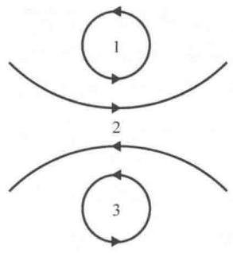
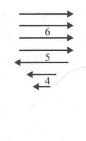
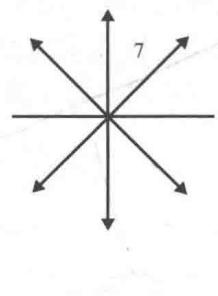
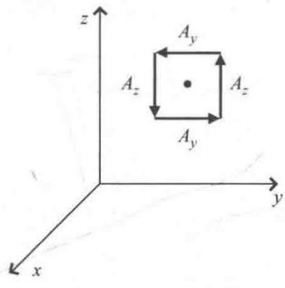
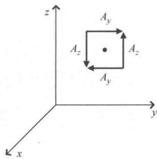
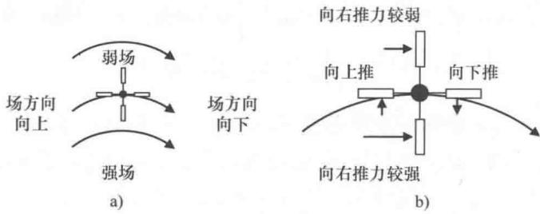

import Guide from '@/components/Guide.astro';
import Knowledge from '@/components/Knowledge.astro';
import Example from '@/components/Example.astro';
import Analysis from '@/components/Analysis.astro';
import Solution from '@/components/Solution.astro';
import Variant from '@/components/Variant.astro';
import Note from '@/components/Note.astro';
import Block from '@/components/Block.astro';
import Method from '@/components/Method.astro';
import Exercise from '@/components/Exercise.astro';

## 2.10 旋度

del 算子后面跟一个叉（ $\vec{\nabla} \times$ ）表示旋度微分运算。矢量场的旋度衡量的是场围绕一个点的旋转程度，就像散度度量的是场在某点发散的程度。但是散度得到的结果是标量，而旋度得到的结果是矢量。旋度矢量的大小与围绕关注点的环流量成比例，旋度矢量的方向垂直于场环流量最大的平面。

不妨以图2.14中的矢量场为例说明什么是矢量场中点的旋度。要想找出每个场中旋度大的点，就去找两侧场线明显不同（大小、方向，或二者都包含在内）的点。还可以用更形象的方法理解旋度。不妨做一个思维实验：想象在水流的每个点处放置一个微型桨轮。如果水流引起浆轮旋转，则浆轮中心就是一个旋度不为零的点。旋度的方向与浆轮轴的方向一致。依照惯例，正旋度的方向由右手法则确定：沿着循环方向弯曲右手的四根手指，大拇指指向正旋度的方向。

  
a)

  
b)

  
c)  
图 2.14 旋度值不同的矢量场

通过浆轮实验可以看出，图2.14a中点1、2、3以及图2.14b中点5均为高旋度位置，点4处也有一点旋度。点6周围是等速流并且图2.14c中点7周围场线是发散的，不能引起微型浆轮的旋转，也就是这些点处的旋度很小或者为零。

我们可以在笛卡儿坐标下通过旋度的微分形式或者"del叉" $(\vec{\nabla}\times)$ 算子实现定量计算：

$$
\vec {\nabla} \times \vec {A} = (\hat {i} \frac {\partial}{\partial x} + \hat {j} \frac {\partial}{\partial y} + \hat {k} \frac {\partial}{\partial z}) \times (\hat {i} A _ {x} + \hat {j} A _ {y} + \hat {k} A _ {z}),\tag{2.38}
$$

因为矢量的叉乘可以写成行列式的形式：

$$
\vec {\nabla} \times \vec {A} = \left| \begin{array}{c c c} \hat {i} & \hat {j} & \hat {k} \\ \frac {\partial}{\partial x} & \frac {\partial}{\partial y} & \frac {\partial}{\partial z} \\ A _ {x} & A _ {y} & A _ {z} \end{array} \right|,\tag{2.39}
$$

展开成

$$
\vec {\nabla} \times \vec {A} = \left(\frac {\partial A _ {z}}{\partial y} - \frac {\partial A _ {y}}{\partial z}\right) \hat {i} + \left(\frac {\partial A _ {x}}{\partial z} - \frac {\partial A _ {z}}{\partial x}\right) \hat {j} + \left(\frac {\partial A _ {y}}{\partial x} - \frac {\partial A _ {x}}{\partial y}\right) \hat {k}.\tag{2.40}
$$

请注意， $\vec{A}$ 旋度的每个分量表示场在一个坐标面上的旋转程度。如果

场旋度的 x 分量很大，这表明场在 yOz 面上关于点的环流量显著。旋度的整体方向就是旋转最快的轴，方向由右手法则确定。

等式中的每一项是如何度量旋转的呢？不妨考虑图2.15中的矢量场在给定点处的旋度。首先看图2.15a中的场和等式中旋度的 $x$ 分量：该项包括 $A_{z}$ 随 $y$ 的变化以及 $A_{y}$ 随 $z$ 的变化。先观察 $A_{z}$ ，沿着 $y$ 轴正方向从该点的左侧走向右侧， $A_{z}$ 明显增加（在该点的左侧指向 $z$ 轴负方向，在该点的右侧指向 $z$ 轴正方向），所以 $\frac{\partial A_z}{\partial y}$ 这一项一定取正；再来观察 $A_{y}$ ，可以看出点的下方为正且上方为负， $A_{y}$ 沿 $z$ 轴正方向是减小的，所以 $\frac{\partial A_y}{\partial z}$ 取负。因此，当 $\frac{\partial A_z}{\partial y}$ 减去 $\frac{\partial A_y}{\partial z}$ 时，旋度的值是增加的。因此，该点处旋度的值很大，与我们依据 $\vec{A}$ 在该点的循环判断结果一致。

图2.15b中的情况完全不同．这种情况下，图中 $\frac{\partial A_y}{\partial z}$ 与 $\frac{\partial A_z}{\partial y}$ 均为正， $\frac{\partial A_z}{\partial y}$ 减去 $\frac{\partial A_y}{\partial z}$ 的值就很小，因此旋度的 $x$ 分量就很小．旋度处处为零的矢量场称为"无旋场".

  
a)

  
b)  
图2.15 $\frac{\partial A_y}{\partial z}$ 与 $\frac{\partial A_z}{\partial y}$ 对旋度的影响

柱面和球面坐标系下的旋度为

$$
\begin{array}{r l} {\vec {\nabla} \times \vec {A}} & {= \bigg (\frac {1}{r} \frac {\partial A _ {z}}{\partial \varphi} - \frac {\partial A _ {\varphi}}{\partial z} \bigg) \hat {r} + \bigg (\frac {\partial A _ {r}}{\partial z} - \frac {\partial A _ {z}}{\partial r} \bigg) \hat {\varphi} +} \\ & {\quad \frac {1}{r} \bigg (\frac {\partial (r A _ {\varphi})}{\partial r} - \frac {\partial A _ {r}}{\partial \varphi} \bigg) \hat {z}, (\text {柱面坐标系}) ^ {\ominus}} \end{array}\tag{2.41}
$$

$$
\begin{array}{r l} \vec {\nabla} \times \vec {A} & = \frac {1}{r \sin \theta} \bigg (\frac {\partial (A _ {\varphi} \sin \theta)}{\partial \theta} - \frac {\partial A _ {\theta}}{\partial \varphi} \bigg) \hat {r} + \frac {1}{r} \bigg (\frac {1}{\sin \theta} \frac {\partial A _ {r}}{\partial \varphi} - \frac {\partial (r A _ {\varphi})}{\partial r} \bigg) \hat {\theta} + \\ & \quad \frac {1}{r} \bigg (\frac {\partial (r A _ {\theta})}{\partial r} - \frac {\partial A _ {r}}{\partial \theta} \bigg) \hat {\varphi}. (\text {球面坐标系}) ^ {\ominus} \end{array}\tag{2.42}
$$

我们常常认为矢量场的旋度在曲线的位置是非零的，这是一个错误的认识。大家知道散度既与场线向外扩散程度有关又与场线的长度变化有关，同样，旋度不仅取决于场线曲率，还取决于场强。不妨考虑指向 $\hat{\varphi}$ 方向并且以 $1 / r$ 递减的曲线型矢量场：

$$
\vec {A} = \frac {k}{r} \hat {\varphi}.
$$

在柱面坐标系下求这个场的旋度非常简单：

$$
\vec {\nabla} \times \vec {A} = \left(\frac {1}{r} \frac {\partial A _ {z}}{\partial \varphi} - \frac {\partial A _ {\varphi}}{\partial z}\right) \hat {r} + \left(\frac {\partial A _ {r}}{\partial z} - \frac {\partial A _ {z}}{\partial r}\right) \hat {\varphi} + \frac {1}{r} \left(\frac {\partial (r A _ {\varphi})}{\partial r} - \frac {\partial A _ {r}}{\partial \varphi}\right) \hat {z},
$$

由于 $A_{r} = 0$ ， $A_{z} = 0$ ，有

$$
\vec {\nabla} \times \vec {A} = \left(- \frac {\partial A _ {\varphi}}{\partial z}\right) \hat {r} + \frac {1}{r} \left(\frac {\partial (r A _ {\varphi})}{\partial r}\right) \hat {z} = \left(- \frac {\partial (k / r)}{\partial z}\right) \hat {r} + \frac {1}{r} \left(\frac {\partial (r k / r)}{\partial r}\right) \hat {z} = 0.
$$

这个结果的物理意义是什么？不妨再次用流水以及桨轮进行类比。想象在图2.16a的场中放置桨轮，力作用于浆轮。图中场线曲率中心远低于图形底部，箭头的间距表明距离中心越远，场越弱。场线在左桨处指向略微向上，而在右桨处略微向下，场线这样的弯曲方向似乎将推动桨轮顺时针旋转。但是，桨轮轴上方的场会减弱，因此上方桨受到来自场的推力比下方桨受到的推力弱，如图2.16b所示，则下方桨受到较强的力会试图推动桨轮逆时针旋转。由于距离曲率中心越远场强越弱，减弱了的场强对桨轮的作用与场中曲率向下对浆轮的

作用就会相互抵消．如果场以 1/r 减小，则左右桨受到向上－向下的推力正好被上下桨受到的弱－强推力补偿．顺时针和逆时针的力平衡，桨轮不转动——即使场线是弯曲的，这个位置的旋度也为零．在 1/r 场中，除了在曲率中心（奇点所在位置，并且必须使用 delta 函数处理）之外，所有点处的旋度都为零.

  
图 2.16 矢量场 A 的旋度补偿组成
