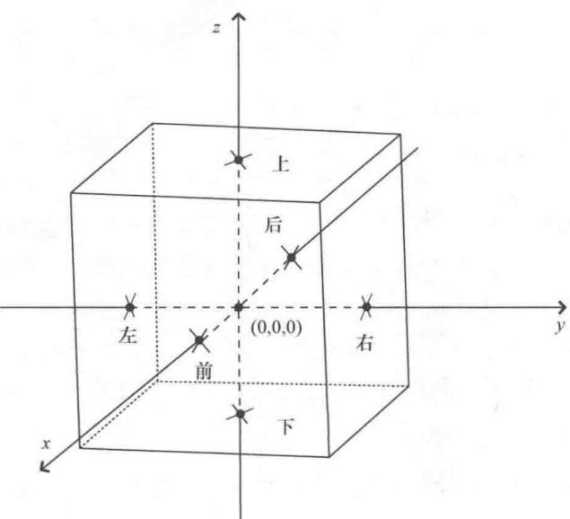
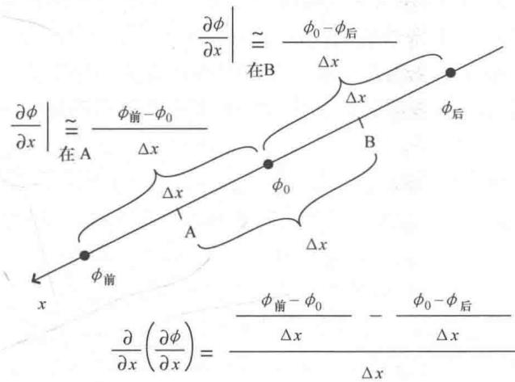
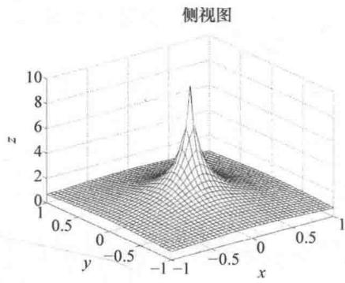
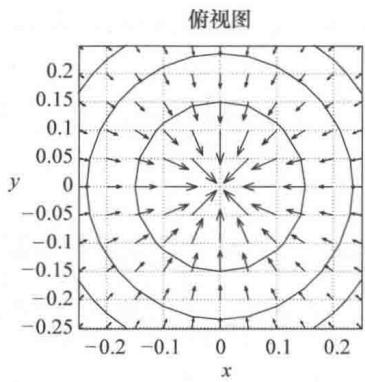
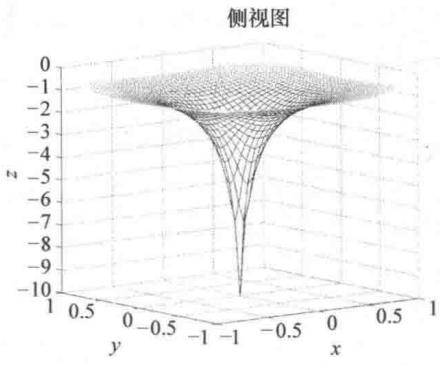
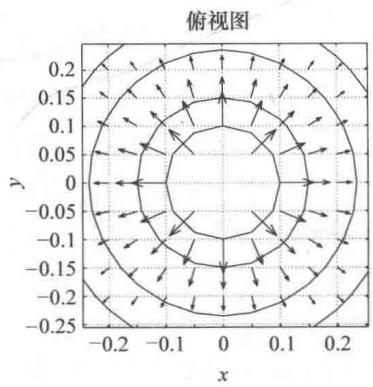

import Guide from '@/components/Guide.astro';
import Knowledge from '@/components/Knowledge.astro';
import Example from '@/components/Example.astro';
import Analysis from '@/components/Analysis.astro';
import Solution from '@/components/Solution.astro';
import Variant from '@/components/Variant.astro';
import Note from '@/components/Note.astro';
import Block from '@/components/Block.astro';
import Method from '@/components/Method.astro';
import Exercise from '@/components/Exercise.astro';

## 2.11 拉普拉斯算子

梯度作用于标量函数并产生一个矢量，散度作用于矢量并产生一个标量，能不能将这两个运算结合起来得到一种有意义的运算呢？事实证明，标量函数 $\phi$ 梯度的散度在物理学和工程领域中是最有用的数学运算之一，记为 $\vec{\nabla} \cdot (\vec{\nabla}\phi)$ 。为了纪念法国伟大的数学家和天文学家皮埃尔·西蒙·拉普拉斯（Pierre-Simon Laplace），这个运算被称为"拉普拉斯算子"，常常记为 $\vec{\nabla}^2\phi$ （有时也记为 $\Delta\phi$ ）。

要理解拉普拉斯算子的重要性，我们先来回顾一下笛卡儿坐标系下的梯度和散度这两个运算：

梯度：

$$
\vec {\nabla} \phi = \hat {i} \frac {\partial \phi}{\partial x} + \hat {j} \frac {\partial \phi}{\partial y} + \hat {k} \frac {\partial \phi}{\partial z},\tag{2.43}
$$

散度：

$$
\vec {\nabla} \cdot \vec {A} = \frac {\partial A _ {x}}{\partial x} + \frac {\partial A _ {y}}{\partial y} + \frac {\partial A _ {z}}{\partial z},\tag{2.44}
$$

因为 $\phi$ 梯度的 $x$ 分量为 $\frac{\partial\phi}{\partial x}$ ， $y$ 分量为 $\frac{\partial\phi}{\partial y}$ ， $z$ 分量为 $\frac{\partial\phi}{\partial z}$ ，该梯度矢量的散度为

$$
\vec {\nabla} \cdot (\vec {\nabla} \phi) = \nabla^ {2} \phi = \frac {\partial^ {2} \phi}{\partial x ^ {2}} + \frac {\partial^ {2} \phi}{\partial y ^ {2}} + \frac {\partial^ {2} \phi}{\partial z ^ {2}}.\tag{2.45}
$$

正如梯度（ $\vec{\nabla}$ ）、散度（ $\vec{\nabla} \cdot$ ）、旋度（ $\vec{\nabla} \times$ ）都表示微分算子，拉普拉斯算子（ $\nabla^2$ ）也是一个要作用在函数上的算子。根据前面的内容，梯度给出了标量函数增长最快的方向（上升的陡峭程度），散度反映了矢量函数从一个点"流出"的强度（当散度是负值，表示流入该点的强度），旋度表示出了矢量函数围绕一个点旋转的强度。那么，梯度的散度—拉普拉斯算子又有什么意义？

如果把拉普拉斯算子记为 $\nabla^2 = \frac{\partial^2}{\partial x^2} +\frac{\partial^2}{\partial y^2} +\frac{\partial^2}{\partial z^2}$ ，利用这个算子就可以求出函数在给定点处沿各个方向变化的变化（从图形上看表示斜率的变化）．拉普拉斯算子可以解决什么样的实际问题呢？例如，加速度为位移随时间变化的变化，位移函数的极大值和极小值处（峰和谷）斜率有显著的变化，在数字图像中可以通过寻找亮度梯度突然变化的点找到图像中的斑点和边界，要解决这类问题都要用到拉普拉斯算子.

为什么拉普拉斯算子具有这么广泛的应用？因为对于空间中的每个点，利用函数的拉普拉斯运算都可以求出该点函数值与周围各点平均函数值之间的差异。下面以图2.17中点（0，0，0）周围的区域为例进行说明。函数 $\phi$ 在三维空间的这个区域中有定义，中心点（0，0，0）的函数 $\phi$ 值为 $\phi_0$ ，图中立方体是为了表示出中心（0，0，0）点周围的六个点的位置。其中，中心点的前后有两个点（沿 $x$ 轴），左右有两个点（沿 $y$ 轴），上下有两个点（沿 $z$ 轴）。为便于分析 $\phi$ 相对于 $\phi_0$ 变化的变化，不妨以 $x$ 轴上的点为例，如图2.18所示。中心点后面点的 $\phi$ 值记为 $\phi_{\text{后}}$ ，中心点前面点的 $\phi$ 值记为 $\phi_{\text{前}}$ 。如果从（0,0,0）到这些点的距离均为 $\Delta x$ ，则 $B$ 点处 $\phi$ 的偏导数近似为 $(\phi_0 - \phi_{\text{后}}) / \Delta x$ 。同理， $A$ 点处 $\phi$ 的偏导数近似为 $(\phi_{\text{前}} - \phi_0) / \Delta x$ 。

  
图2.17 点 $(0,0,0)$ 周围 $\phi = \phi_0$ 的点

  
图2.18 $\phi$ 沿 $x$ 轴的变化

但是拉普拉斯算子不是求关于 $\phi$ 的变化，而是 $\phi$ 变化的变化。为此，有

$$
\frac {\partial}{\partial x} \bigg (\frac {\partial \phi}{\partial x} \bigg) = \frac {(\phi_ {\mathrm{前}} - \phi_ {0}) / \Delta x - (\phi_ {0} - \phi_ {\mathrm{后}}) / \Delta x}{\Delta x},
$$

$$
\frac {\partial^ {2} \phi}{\partial x ^ {2}} = \frac {\phi_ {\mathrm{前}} + \phi_ {\mathrm{后}} - 2 \phi_ {0}}{(\Delta x) ^ {2}}.\tag{2.46}
$$

结合上式考虑点（0，0，0）左右两个点，可以得到

$$
\frac {\partial^ {2} \phi}{\partial y ^ {2}} = \frac {\phi_ {\mathrm{右}} + \phi_ {\mathrm{左}} - 2 \phi_ {0}}{(\Delta y) ^ {2}},\tag{2.47}
$$

同样可以得到点（0，0，0）上下两个点的等式：

$$
\frac {\partial^ {2} \phi}{\partial z ^ {2}} = \frac {\phi_ {\mathrm{上}} + \phi_ {\mathrm{下}} - 2 \phi_ {0}}{(\Delta z) ^ {2}},\tag{2.48}
$$

如果这些点都是对称的，有 $\Delta x = \Delta y = \Delta z$ ，以上三个等式加起来可以得到：

$$
\frac {\partial^ {2} \phi}{\partial x ^ {2}} + \frac {\partial^ {2} \phi}{\partial y ^ {2}} + \frac {\partial^ {2} \phi}{\partial z ^ {2}} = \frac {\phi_ {\text {前}} + \phi_ {\text {后}} + \phi_ {\text {右}} + \phi_ {\text {左}} + \phi_ {\text {上}} + \phi_ {\text {下}} - 6 \phi_ {0}}{(\Delta x) ^ {2}},\tag{2.49}
$$

运用 del 平方的符号表示拉普拉斯算子，将上式稍加整理：

$$
\begin{array}{r l} \nabla^ {2} \phi & = \frac {- 6}{(\Delta x) ^ {2}} \Big [ \phi_ {0} - \frac {1}{6} (\phi_ {\text {前}} + \phi_ {\text {后}} + \phi_ {\text {右}} + \phi_ {\text {左}} + \phi_ {\text {上}} + \phi_ {\text {下}}) \Big ] \\ & = \frac {- 6}{(\Delta x) ^ {2}} (\phi_ {0} - \phi_ {\text {avg}}). \end{array}\tag{2.50}
$$

其中， $\phi_{avg}=\frac{1}{6}\left(\phi_{\text{前}}+\phi_{\text{后}}+\phi_{\text{右}}+\phi_{\text{左}}+\phi_{\text{上}}+\phi_{\text{下}}\right)$ 为周围六个点的平均函数值.

由式2.50可以得出，拉普拉斯算子作用于任意点处函数 $\phi$ 的结果同该点 $\phi$ 值与周围点平均 $\phi$ 值之差成比例。方程中的负号说明，当该点函数值比周围点平均函数值大时，函数拉普拉斯算子为负，当该点函数值比周围点的平均函数值小时，函数的拉普拉斯算子为正。

一点的函数值与周围相邻各点平均函数值之差与函数梯度的散度有什么关联呢？首先，前者与函数的峰谷有关。如果某点函数值大于周围各点平均值，则该点是函数的局部最大值点。同理，如果某点函数值小于周围各点平均值，该点为局部最小值点。因为拉普拉斯算子可以找到函数值比周围各点函数值都大或者都小的点，所以拉普拉斯算子也被称为"凹凸检测器"或"峰谷检测器"。

再来考虑峰谷与函数梯度的散度之间的关系。我们知道，梯度指向函数值增加最快的方向（如果梯度为负，则为下降最快的方向），散度衡量的是某个区域内矢量向外发散的程度（散度为负时，表示矢量汇聚于该区域）。现在观察图2.19a中函数的峰值以及峰值附近函数的梯度，如图2.19b所示。峰值附近，梯度矢量从各个方向"流向"峰顶。因为收敛于一点的矢量场散度为负，所以峰顶附近梯度的散度会是一个很大的负数。这与拉普拉斯算子在函数的最大值点附近是负值这个结论是一致的。

  
a)

  
b)  
图 2.19 函数 $\phi(1/r)$ 以及 $\phi$ 在峰附近的梯度和等高线

图 2.20a 和图 2.20b 是另一种情况。图中，在谷底附近，梯度向各个方向流出，因此这种情况下梯度的散度是一个很大的正数（再次与最小值点的拉普拉斯算子为正这个结论保持一致）。拉普拉斯算子在远离峰顶和谷底的值是多少？这个值取决于函数在所关注点附近的形状。如第 2.9 节所述，散度的值取决于函数从包含某个点的小体积"流出"的强度。拉普拉斯算子为梯度的散度，因此要考虑梯度矢量是从点"流入"还是"流出"（换句话说，梯度矢量是向这个点集中还是从点向外发散）。如果梯度矢量流入和流出相等，则函数的拉普拉斯算子在该点处为零。如果梯度矢量的长度和方向共同作用下，使得某点处流出大于流入，则拉普拉斯算子在该点处为正。

例如，如果你从一个坡度相同的圆对称山谷中爬出来，梯度矢量则向外分散并且长度不变，这意味着梯度的散度（即拉普拉斯算子）在该点上有一个正值。但是如果山谷有弧坡，当从谷底离开的时候，斜坡就变得不那么陡峭了（所以梯度矢量变短），梯度矢量强度的降低有可能恰好可以补偿这些矢量的向外扩散，在这种情况下，函数的拉普拉斯算子为零。

  
a)

  
b)  
图 2.20 函数 $\phi(-1/r)$ 以及 $\phi$ 在谷底附近的梯度和等高线

下面用数学方法重新推导这个过程．以三元函数 $\phi$ 为例，函数值与到原点的距离 r 成反比，可以写成 $\phi = k/r$ ，其中，k 为比例常数，r 为到原点的距离．因为 $r = (x2 + y2 + z2)^{1/2}$ ，因此 $\phi = k/(x2 + y2 + z2)^{1/2}$ ．利用式 2.45 可以求出函数 $\phi$ 的拉普拉斯算子值．首先求 $\phi$ 关于 x 的偏导数：

$$
\frac {\partial \phi}{\partial x} = \frac {- k (2 x)}{2 (x ^ {2} + y ^ {2} + z ^ {2}) ^ {3 / 2}} = \frac {- k x}{(x ^ {2} + y ^ {2} + z ^ {2}) ^ {3 / 2}},
$$

接下来再求一次关于 $x$ 的偏导数：

$$
\begin{array}{r l} \frac {\partial^ {2} \phi}{\partial x ^ {2}} & = \frac {- k}{(x ^ {2} + y ^ {2} + z ^ {2}) ^ {3 / 2}} + \left(\frac {3}{2}\right) \frac {k x (2 x)}{(x ^ {2} + y ^ {2} + z ^ {2}) ^ {5 / 2}} \\ & = \frac {- k}{(x ^ {2} + y ^ {2} + z ^ {2}) ^ {3 / 2}} + \frac {3 k x ^ {2}}{(x ^ {2} + y ^ {2} + z ^ {2}) ^ {5 / 2}}, \end{array}
$$

同理，可以求出函数关于 $y, z$ 的二阶偏导数为

$$
\frac {\partial^ {2} \phi}{\partial y ^ {2}} = \frac {- k}{(x ^ {2} + y ^ {2} + z ^ {2}) ^ {3 / 2}} + \frac {3 k y ^ {2}}{(x ^ {2} + y ^ {2} + z ^ {2}) ^ {5 / 2}},
$$

$$
\frac {\partial^ {2} \phi}{\partial z ^ {2}} = \frac {- k}{(x ^ {2} + y ^ {2} + z ^ {2}) ^ {3 / 2}} + \frac {3 k z ^ {2}}{(x ^ {2} + y ^ {2} + z ^ {2}) ^ {5 / 2}},
$$

最后，把三个二阶偏导数相加：

$$
\begin{array}{r l} \frac {\partial^ {2} \phi}{\partial x ^ {2}} + \frac {\partial^ {2} \phi}{\partial y ^ {2}} + \frac {\partial^ {2} \phi}{\partial z ^ {2}} & = \frac {- 3 k}{(x ^ {2} + y ^ {2} + z ^ {2}) ^ {3 / 2}} + \frac {3 k (x ^ {2} + y ^ {2} + z ^ {2})}{(x ^ {2} + y ^ {2} + z ^ {2}) ^ {5 / 2}} \\ & = \frac {- 3 k}{(x ^ {2} + y ^ {2} + z ^ {2}) ^ {3 / 2}} + \frac {3 k}{(x ^ {2} + y ^ {2} + z ^ {2}) ^ {3 / 2}} = 0. \end{array}
$$

因此，若三元函数与 $1 / r$ 成比例，则非原点处拉普拉斯算子为零。此时， $1 / r$ 的分母不能为零，所以函数在原点 $r = 0$ 处要特殊处理，运用的是Dirac delta函数以及积分法，而不是微分法。

有时也会在非笛卡儿坐标下计算函数的拉普拉斯算子．例如，函数 $\psi$ 在柱面和球面坐标下的拉普拉斯算子为

$$
\nabla^ {2} \psi = \frac {1}{r} \frac {\partial}{\partial r} \bigg (r \frac {\partial \psi}{\partial r} \bigg) + \frac {1}{r ^ {2}} \frac {\partial^ {2} \psi}{\partial \varphi^ {2}} + \frac {\partial^ {2} \psi}{\partial z ^ {2}}, (\text { 柱面坐标系 })\tag{2.51}
$$

$$
\nabla^ {2} \psi = \frac {1}{r ^ {2}}   \frac {\partial}{\partial r} \bigg (  r ^ {2}   \frac {\partial \psi}{\partial r}   \bigg) + \frac {1}{r ^ {2} \sin \theta}   \frac {\partial}{\partial \theta} \bigg (\sin \theta   \frac {\partial \psi}{\partial \theta}   \bigg) + \frac {1}{r ^ {2} \sin^ {2} \theta}   \frac {\partial^ {2} \psi}{\partial \varphi^ {2}}, (\text {球面坐标系})\tag{2.52}
$$
