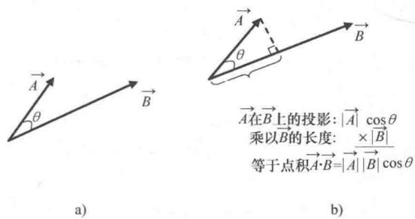

import Guide from '@/components/Guide.astro';
import Knowledge from '@/components/Knowledge.astro';
import Example from '@/components/Example.astro';
import Analysis from '@/components/Analysis.astro';
import Solution from '@/components/Solution.astro';
import Variant from '@/components/Variant.astro';
import Note from '@/components/Note.astro';
import Block from '@/components/Block.astro';
import Method from '@/components/Method.astro';
import Exercise from '@/components/Exercise.astro';

## 2.1 数量积

矢量的数量积，也称为"点"积。为什么要学习这种形式的矢量乘法呢？一是因为通过两个矢量的数量积可以求出一个矢量在另一个矢量上的投影。为什么要求投影呢？不妨举个例子，假如要求作用在物体上的力做了多少功就要涉及投影的问题。对于做功问题，很多学生的第一反应就是力所做的功等于"力乘以距离"（这个出发点是合理的）。但是，如果修过比入门课稍深入的课程，就应该知道只有在力的方向与物体位移方向相同这种特殊情况下，才能用力乘以距离定义力对物体所做的功。大多数情况下力作用的方向与位移的方向有一定的夹角，这时就需要求出力沿位移方向的分量，即投影。这是矢量点积运算应用的一个例子，本章最后的习题还有更多相关例子。

如何计算两个矢量的点积？如果已知每个矢量（记为矢量 $\vec{A}$ 和 $\vec{B}$ ）的笛卡儿分量，则可以利用式（2.1）来计算：

$$
\vec {A} \cdot \vec {B} = A _ {x} B _ {x} + A _ {y} B _ {y} + A _ {z} B _ {z}.\tag{2.1}
$$

还有另一种方法，如果已知两个矢量的夹角为 $\theta$ ，则：

$$
\vec {A} \cdot \vec {B} = | \vec {A} | | \vec {B} | \cos \theta .\tag{2.2}
$$

其中， $|\vec{A}|$ 和 $|\vec{B}|$ 表示矢量 $\vec{A}$ 和 $\vec{B}$ 的大小（长度） $^{\ominus}$ . 请注意，两个矢量点积的结果是一个标量（只有单独的值，没有方向）.

如何理解点积的物理意义？不妨考虑两个方向不同的矢量 $\vec{A}$ 和 $\vec{B}$ ，夹角为 $\theta$ ，如图2.1a所示。矢量 $\vec{A}$ 在矢量 $\vec{B}$ 方向上的投影为 $|\vec{A}|\cos (\theta)$ ，如图2.1b所示。这个投影乘以矢量 $\vec{B}$ 的长度得到 $|\vec{A}||\vec{B}|\cos (\theta)$ 。所以，点积 $\vec{A} \cdot \vec{B}$ 表示 $\vec{A}$ 在 $\vec{B}$ 方向上的投影再乘以 $\vec{B}$ 的长度。点积的运算结果也可以看作 $\vec{B}$ 在 $\vec{A}$ 方向上的投影再乘以 $\vec{A}$ 的长度值。因此，点积与两个矢量的顺序无关，即 $\vec{A} \cdot \vec{B}$ 与 $\vec{B} \cdot \vec{A}$ 的结果是一样的。

  
图2.1 两个矢量及其数量积

特别强调，其中一个矢量为单位矢量的数量积很重要。这是由于单位矢量的长度等于1，数量积 $\vec{A}\cdot\hat{k}$ 就等于矢量 $\vec{A}$ 在 $\hat{k}$ 方向（z轴方向）上的投影乘以 $\hat{k}$ 的大小（等于1）。因此，要求任意矢量在给定方向上的分量，只要求出该矢量与给定方向单位矢量的数量积即可。在物理学和工程领域，我们可能会经常遇到这样的问题：已知一个矢量（ $\vec{A}$ ）和一张曲面，求矢量在垂直于该曲面方向上的分量。如果已知该曲面

的单位法矢量（ $\hat{n}$ ），数量积 $\vec{A} \cdot \hat{n}$ 就是 $\vec{A}$ 的垂直分量.

利用数量积还可以求出两个矢量的夹角．考虑点积的两种表达式，式（2.1）和式（2.2），有：

$$
\vec {A} \cdot \vec {B} = | \vec {A} | | \vec {B} | \cos (\theta) = A _ {x} B _ {x} + A _ {y} B _ {y} + A _ {z} B _ {z}.\tag{2.3}
$$

两端同除以 $\vec{A}$ 与 $\vec{B}$ 大小的乘积，则：

$$
\cos (\theta) = \frac {A _ {x} B _ {x} + A _ {y} B _ {y} + A _ {z} B _ {z}}{| \vec {A} | | \vec {B} |},
$$

因此

$$
\theta = \arccos \left(\frac {A _ {x} B _ {x} + A _ {y} B _ {y} + A _ {z} B _ {z}}{| \vec {A} | | \vec {B} |}\right).\tag{2.4}
$$

假设 $\vec{A} = 5\hat{i} - 2\hat{j} + 4\vec{k}$ , $\vec{B} = 3\hat{i} + \hat{j} + 7\hat{k}$ , 利用式（2.4）就可以求出这两个矢量的夹角：

$$
\begin{array}{r l} \theta & = \arccos \left(\frac {(5) (3) + (- 2) (1) + (4) (7)}{\sqrt {(5) ^ {2} + (- 2) ^ {2} + (4) ^ {2}} \sqrt {(3) ^ {2} + (1) ^ {2} + (7) ^ {2}}}\right) \\ & = \arccos \left(\frac {4 1}{\sqrt {4 5} \sqrt {5 9}}\right) \\ & = 3 7. 3 ^ {\circ}. \end{array}
$$

最后要说明一点：任意单位矢量与它本身点积的结果为1（例如， $\hat{i} \cdot \hat{i} = |\hat{i}| |\hat{i}| \cos(0^\circ) = (1)(1)(1) = 1$ ），两个不同正交单位矢量的点积结果为0（例如， $\hat{i} \cdot \hat{j} = |\hat{i}| |\hat{j}| \cos(90^\circ) = (1)(1)(0) = 0$ ）.
