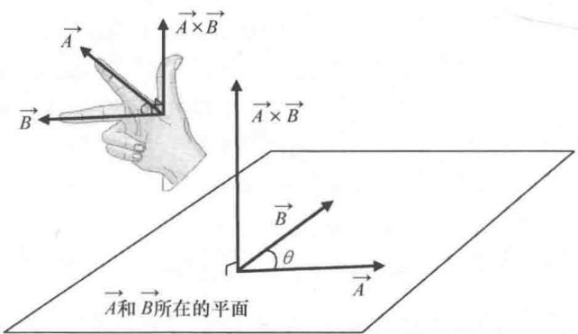
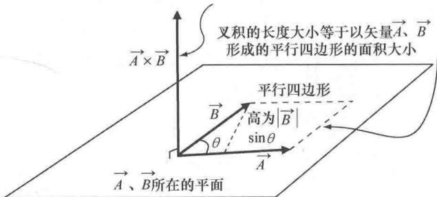

import Guide from '@/components/Guide.astro';
import Knowledge from '@/components/Knowledge.astro';
import Example from '@/components/Example.astro';
import Analysis from '@/components/Analysis.astro';
import Solution from '@/components/Solution.astro';
import Variant from '@/components/Variant.astro';
import Note from '@/components/Note.astro';
import Block from '@/components/Block.astro';
import Method from '@/components/Method.astro';
import Exercise from '@/components/Exercise.astro';

## 2.2 叉积

两个矢量相乘的另一种形式为"叉积"。点积的结果是一个标量，叉积的结果则不同，是一个矢量。为什么要学习这种形式的矢量乘法？一个原因就是利用叉积可以得出某种物理过程的结果，例如在杠杆臂的末端施加一个力或者向磁场发射一个带电粒子。

两个矢量叉积的运算要比点积稍微复杂一些. 如果已知两个矢量的笛卡儿分量，则它们的叉积为

$$
\vec {A} \times \vec {B} = (A _ {y} B _ {z} - A _ {z} B _ {y}) \hat {i} + (A _ {z} B _ {x} - A _ {x} B _ {z}) \hat {j} + (A _ {x} B _ {y} - A _ {y} B _ {x}) \hat {k}.\tag{2.5}
$$

也可以写成：

$$
\vec {A} \times \vec {B} = \left| \begin{array}{c c c} \hat {i} & \hat {j} & \hat {k} \\ A _ {x} & A _ {y} & A _ {z} \\ B _ {x} & B _ {y} & B _ {z} \end{array} \right|.\tag{2.6}
$$

如果没有见过行列式，更无法理解式（2.6）与式（2.5）的关系，可以参考本书网站上的相关内容.

由 $\vec{A}$ 和 $\vec{B}$ 的叉积得到一个矢量，该矢量的方向既垂直于 $\vec{A}$ 又垂直于 $\vec{B}$ （也就是垂直于 $\vec{A}$ 和 $\vec{B}$ 所在的平面），如图2.2所示．但是垂直于该平面的方向有两个， $\vec{A} \times \vec{B}$ 的方向究竟是哪个？利用"右手法则"确定这个方向，打开右手并且使大拇指垂直于手掌平面上另外四根手指的方向．想象用右手手掌和四根手指以最小的角度将第一个矢量（本例中的 $\vec{A}$ ）推向第二个矢量（本例中的 $\vec{B}$ ）的方向，此时大拇指的指向就是叉积的方向。

  
图2.2 叉积 $\vec{A} \times \vec{B}$ 的方向

点积和叉积还有很重要的不同之处，点积与矢量的顺序无关，但是叉积与矢量的顺序有很大的关系。不妨以图2.2中的叉积 $\vec{B}\times\vec{A}$ 为例。要想用右手手掌将矢量 $\vec{B}$ 推向矢量 $\vec{A}$ ，就要将手上下翻转（也就是大拇指指向下），又因为大拇指的指向就是叉积的方向，所以有 $\vec{B} \times \vec{A}$ 与 $\vec{A} \times \vec{B}$ 方向相反。一个矢量的负值与该矢量大小相同方向相反，因此有：

$$
\vec {A} \times \vec {B} = - \vec {B} \times \vec {A}.\tag{2.7}
$$

还有一个快速计算叉积大小的方法：

$$
| \vec {A} \times \vec {B} | = | \vec {A} | | \vec {B} | \sin (\theta).\tag{2.8}
$$

其中， $|\vec{A}|$ 表示 $\vec{A}$ 的大小， $|\vec{B}|$ 表示 $\vec{B}$ 的大小， $\theta$ 为 $\vec{A}$ 与 $\vec{B}$ 的夹角 $^{\ominus}$ .

图 2.3 描述了叉积的大小和方向。点积的几何意义是一个矢量在另一个矢量上的投影，同样，叉积也有其几何意义。两个矢量叉积的大小表示以这两个矢量为邻边的平行四边形的面积。我们知道平行四边形的面积等于底乘以高，本例中以 $\vec{A}$ ， $\vec{B}$ 为邻边的平行四边形中，底边长为 $|\vec{A}|$ ，底边上的高为 $|\vec{B}| \sin \theta$ ，因此平行四边形的面积等于 $|\vec{A}| |\vec{B}| \sin \theta$ ，恰恰就是式（2.8）。

  
图2.3 叉积对应的面积

如果矢量 $\vec{A}$ 与 $\vec{B}$ 的夹角为0°或者是180°（即， $\vec{A}$ 与 $\vec{B}$ 平行或者反平行），则两个矢量的叉积等于零．当 $\vec{A}$ 与 $\vec{B}$ 的夹角趋近于90°或者是270°，则两个矢量叉积的大小逐渐增加，并且在两个矢量相互垂直时达到最大 $|\vec{A}||\vec{B}|$ .

根据叉积的定义以及右手法则，我们可以得出以下关系式：

$$
\begin{array}{l} \hat {i} \times \hat {i} = 0, \hat {i} \times \hat {j} = \hat {k}, \hat {j} \times \hat {i} = - \hat {k}, \\ \hat {j} \times \hat {j} = 0, \hat {j} \times \hat {k} = \hat {i}, \hat {k} \times \hat {j} = - \hat {i}, \\ \hat {k} \times \hat {k} = 0, \hat {k} \times \hat {i} = \hat {j}, \hat {i} \times \hat {k} = - \hat {j}. \end{array}\tag{2.9}
$$

将以上关系式逐项应用到 $\vec{A}=A_{x}\hat{i}+A_{y}\hat{j}+A_{z}\hat{k}$ 与 $\vec{B}=B_{x}\hat{i}+B_{y}\hat{j}+B_{z}\hat{k}$ 的叉积中，就可以推导出式（2.6）与式（2.5）（本章最后有相应的习题，并且网站上有完整的参考答案）.

叉积主要应用在扭矩 $(\vec{\tau}=\vec{r}\times\vec{F})$ 以及磁力 $(\vec{F}_{B}=q\vec{v}\times\vec{B})$ 等问题中，本章最后的习题中有相关的例子.
