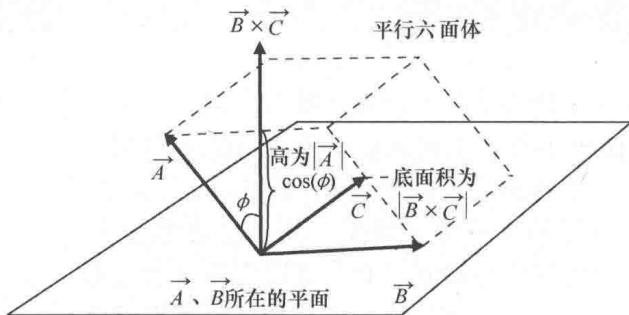

import Guide from '@/components/Guide.astro';
import Knowledge from '@/components/Knowledge.astro';
import Example from '@/components/Example.astro';
import Analysis from '@/components/Analysis.astro';
import Solution from '@/components/Solution.astro';
import Variant from '@/components/Variant.astro';
import Note from '@/components/Note.astro';
import Block from '@/components/Block.astro';
import Method from '@/components/Method.astro';
import Exercise from '@/components/Exercise.astro';

## 2.3 三重标积

在前两节中我们已经介绍了矢量的点积与叉积，那么这两种运算能不能结合到一起呢？实际上，这两种运算不仅可以结合到一起，而且这种结合非常有意义。当然，我们可以定义任意想到的数学运算，但定义数学运算不仅是为了满足好奇心，更重要是为了解决实际问题。从前面的内容已经看到了点积可以用来计算矢量在指定方向上的投影，也可以计算力所做的功，也看到了叉积在扭矩以及磁力中所起到的作用。但是将点积与叉积按照 $\vec{A}\cdot(\vec{B}\times\vec{C})$ 这样方式结合有意义吗？答案是肯定的 $^{\ominus}$ ，我们把这种运算称为"三重标积"或者"标量三重积"，其具有很多重要的应用。

这个数学运算很简单，我们知道：

$$
\vec {B} \times \vec {C} = \left(B _ {y} C _ {z} - B _ {z} C _ {y}\right) \hat {i} + \left(B _ {z} C _ {x} - B _ {x} C _ {z}\right) \hat {j} + \left(B _ {x} C _ {y} - B _ {y} C _ {x}\right) \hat {k}.\tag{2.10}
$$

又由式（2.1）知：

$$
\vec {A} \cdot \vec {B} = A _ {x} B _ {x} + A _ {y} B _ {y} + A _ {z} B _ {z}.
$$

因此，将点积与叉积结合起来有：

$$
\vec {A} \cdot (\vec {B} \times \vec {C}) = A _ {x} \left(B _ {y} C _ {z} - B _ {z} C _ {y}\right) + A _ {y} \left(B _ {z} C _ {x} - B _ {x} C _ {z}\right) + A _ {z} \left(B _ {x} C _ {y} - B _ {y} C _ {x}\right).\tag{2.11}
$$

简记为：

$$
\vec {A} \cdot (\vec {B} \times \vec {C}) = \left| \begin{array}{c c c} A _ {x} & A _ {y} & A _ {z} \\ B _ {x} & B _ {y} & B _ {z} \\ C _ {x} & C _ {y} & C _ {z} \end{array} \right|.\tag{2.12}
$$

图2.4可以帮助我们理解三重标积的几何意义．图中的矢量 $\vec{A}$ ， $\vec{B}$ ， $\vec{C}$ 分别表示平行六面体的三条棱．该平行六面体的底面积为 $|\vec{B} \times \vec{C}|$ （同图2.3），底面上的高为 $|\vec{A}| \cos (\phi)$ ，其中， $\phi$ 表示 $\vec{A}$ 与 $\vec{B} \times \vec{C}$ 方向的夹角，平行六面体的体积（底面积乘以高）则为 $(|\vec{B} \times \vec{C}|) |\vec{A}| \cos (\phi)$ ，为了与点积的定义相一致，也可以写成 $|\vec{A}| |\vec{B} \times \vec{C}| \cos (\phi)$ . 根据式(2.2）中点积的定义， $|\vec{A}| |\vec{B} \times \vec{C}| \cos (\phi)$ 就是 $\vec{A} \cdot (\vec{B} \times \vec{C})$ .

  
图 2.4 三重标积表示的体积

因此，三重标积 $\vec{A} \cdot (\vec{B} \times \vec{C})$ 可以看作以矢量 $\vec{A}, \vec{B}, \vec{C}$ 为棱的平行六面体的体积。请注意，只要矢量 $\vec{A}, \vec{B}, \vec{C}$ 符合右手系（即，用右手手掌将 $\vec{A}$ 推向 $\vec{B}$ ， $\vec{C}$ 在大拇指所指的方向投影为正，同理可以将 $\vec{B}$ 推向 $\vec{C}$ ，将 $\vec{C}$ 推向 $\vec{A}$ ），它们的三重标积一定是正数。

搞清楚了三个矢量的三重标积与平行六面体体积的关系，就很容易理解为什么三重标积可以判断三个矢量是否共面了（即，三个矢量落在一个平面上）。可以想象一下，如果矢量 $\vec{A}$ ， $\vec{B}$ ， $\vec{C}$ 在同一个平面上，图2.4中的平行六面体会变成什么样。平行六面体的高会为0，矢量 $\vec{A}$ 在 $\vec{B} \times \vec{C}$ 方向的投影会为0，那么三重积 $\vec{A} \cdot (\vec{B} \times \vec{C})$ 也就为0。反过来说，如果 $\vec{A}$ 在 $\vec{B} \times \vec{C}$ 方向的投影不为0，那么 $\vec{A}$ 就不可能落在 $\vec{B}$ 、 $\vec{C}$ 所在平面上。因此，

$$
\vec {A} \cdot (\vec {B} \times \vec {C}) = 0\tag{2.13}
$$

是矢量 $\vec{A}$ ， $\vec{B}$ ， $\vec{C}$ 共面的充分必要条件.

因为三重标积 $\vec{A}\cdot(\vec{B}\times\vec{C})$ 等于矢量 $\vec{A}$ ， $\vec{B}$ ， $\vec{C}$ 所形成的平行六面体的体积，将三重标积中的矢量循环排列（比如 $\vec{B}\cdot(\vec{C}\times\vec{A})$ 或者 $\vec{C}\cdot$ $(\vec{A} \times \vec{B}))$ ，每种排列对应的平行六面体的体积相同，因此三重标积的结果不变。有的作者把这种性质叙述为点和叉的交换不改变三重标积的结果（因为 $(\vec{A} \times \vec{B}) \cdot \vec{C}$ 就等于 $\vec{C} \cdot (\vec{A} \times \vec{B})$ ）。

三重标积还可以用来判定倒易矢量，第4章在矢量的协变分量和逆变分量这一节中对此会做出了相关的解释.
