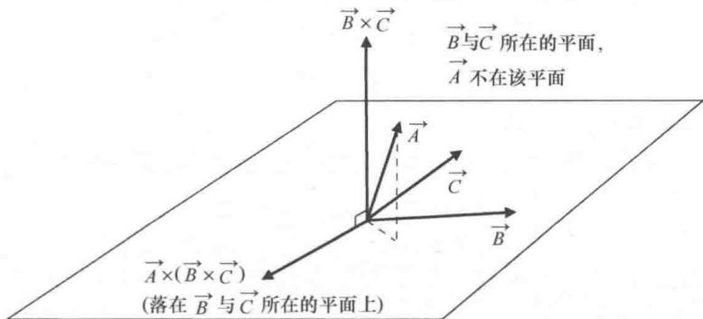

import Guide from '@/components/Guide.astro';
import Knowledge from '@/components/Knowledge.astro';
import Example from '@/components/Example.astro';
import Analysis from '@/components/Analysis.astro';
import Solution from '@/components/Solution.astro';
import Variant from '@/components/Variant.astro';
import Note from '@/components/Note.astro';
import Block from '@/components/Block.astro';
import Method from '@/components/Method.astro';
import Exercise from '@/components/Exercise.astro';

## 2.4 三重矢积

上节内容所讲的三重标积不是三个矢量相乘的唯一形式，常用的还有 $\vec{A} \times (\vec{B} \times \vec{C})$ 这种形式（被称为三重矢积）。在涉及角动量和向心加速度等问题中一般就会用到 $\vec{A} \times (\vec{B} \times \vec{C})$ 这种运算。三重标积的结果是标量（因为第二层运算为点积），而三重矢积不同，其结果为矢量（因为两层运算均为叉积）。 $\vec{A} \times (\vec{B} \times \vec{C})$ 与 $(\vec{A} \times \vec{B}) \times \vec{C}$ 具有很大不同，请注意三重矢积中括号的位置。直接计算三重矢积比较烦琐，但是有更简单的计算方法：

$$
\vec {A} \times (\vec {B} \times \vec {C}) = \vec {B} (\vec {A} \cdot \vec {C}) - \vec {C} (\vec {A} \cdot \vec {B}).\tag{2.14}
$$

前面讨论的都是矢量以不同的方式相乘，自然有人奇怪，为什么式（2.14）的右端 $\vec{B}$ 与 $\vec{A} \cdot \vec{C}$ 和 $\vec{C}$ 与 $\vec{A} \cdot \vec{B}$ 之间既没有圈也没有叉？请注意， $\vec{A} \cdot \vec{C}$ 与 $\vec{A} \cdot \vec{B}$ 都是标量，因此式（2.14）括号中的表达式只是矢量 $\vec{B}$ 与 $\vec{C}$ 的标量乘子。这是否能说明 $\vec{A} \times (\vec{B} \times \vec{C})$ 是三重矢积中第二个和第三个矢量的某种线性组合呢？答案是肯定的，如图2.5所示。

  
图 2.5 三重矢积 $\vec{A} \times (\vec{B} \times \vec{C})$ 中的矢量

从图中可以看出，矢量 $\vec{B} \times \vec{C}$ 垂直于 $\vec{B}$ 与 $\vec{C}$ 所在的平面并且方向向上。想象用右手手掌将矢量 $\vec{A}$ 推向矢量 $\vec{B} \times \vec{C}$ 的方向叉积就可以得到 $\vec{A}$ 与 $\vec{B} \times \vec{C}$ 的叉积，矢量 $\vec{A} \times (\vec{B} \times \vec{C})$ 又落回 $\vec{B}$ 、 $\vec{C}$ 所在的平面。这是因为 $\vec{B} \times \vec{C}$ 的结果是矢量且一定垂直于 $\vec{B}$ 与 $\vec{C}$ 所在的平面，然后用 $\vec{A}$ 去叉乘这个矢量，结果依然是矢量且既垂直于 $\vec{A}$ 又垂直于 $\vec{B} \times \vec{C}$ ，因此这个矢量一定落在 $\vec{B}$ 与 $\vec{C}$ 所在的平面，也就是说 $\vec{A} \times (\vec{B} \times \vec{C})$ 落回到 $\vec{B}$ 与 $\vec{C}$ 所在的平面。既然由运算 $\vec{A} \times (\vec{B} \times \vec{C})$ 得到的矢量与矢量 $\vec{B}$ 与 $\vec{C}$ 在同一个平面，那么它一定可以表示成这两个矢量的线性组合。

要注意三重矢积中三个矢量的顺序．只要按照 $(\vec{A},\vec{B},\vec{C})$ 的顺序写并且把后两个矢量括起来，那么式（2.14）可以按照法则"BAC减去CAB"来记忆．这样的法则是如何得到的？利用叉积（式(2.6)）的定义很容易就可以证明这个法则．因为

$$
\vec {A} \times (\vec {B} \times \vec {C}) = \left| \begin{array}{c c c} \hat {i} & \hat {j} & \hat {k} \\ A _ {x} & A _ {y} & A _ {z} \\ (\vec {B} \times \vec {C}) _ {x} & (\vec {B} \times \vec {C}) _ {y} & (\vec {B} \times \vec {C}) _ {z} \end{array} \right|.\tag{2.15}
$$

由式（2.5）可得：

$$
\vec {B} \times \vec {C} = \left(B _ {y} C _ {z} - B _ {z} C _ {y}\right) \hat {i} + \left(B _ {z} C _ {x} - B _ {x} C _ {z}\right) \hat {j} + \left(B _ {x} C _ {y} - B _ {y} C _ {x}\right) \hat {k}.\tag{2.16}
$$

将上式代入到式（2.15）中，有：

$$
\vec {A} \times (\vec {B} \times \vec {C}) = \left| \begin{array}{c c c} \hat {i} & \hat {j} & \hat {k} \\ A _ {x} & A _ {y} & A _ {z} \\ B _ {y} C _ {z} - B _ {z} C _ {y} & B _ {z} C _ {x} - B _ {x} C _ {z} & B _ {x} C _ {y} - B _ {y} C _ {x} \end{array} \right|.\tag{2.17}
$$

将行列式乘出来，得到：

$$
\begin{array}{r l} \vec {A} \times (\vec {B} \times \vec {C}) & = [ A _ {y} (B _ {x} C _ {y} - B _ {y} C _ {x}) - A _ {z} (B _ {z} C _ {x} - B _ {x} C _ {z}) ] \hat {i} \\ & + [ A _ {z} (B _ {y} C _ {z} - B _ {z} C _ {y}) - A _ {x} (B _ {x} C _ {y} - B _ {y} C _ {x}) ] \hat {j} \\ & + [ A _ {x} (B _ {z} C _ {x} - B _ {x} C _ {z}) - A _ {y} (B _ {y} C _ {z} - B _ {z} C _ {y}) ] \hat {k}. \end{array}\tag{2.18}
$$

这个结果看起来没有什么规律，稍加整理后有：

$$
\begin{array}{r l} \vec {A} \times (\vec {B} \times \vec {C}) & = (A _ {y} C _ {y} + A _ {z} C _ {z}) (B _ {x} \hat {i}) - (A _ {y} B _ {y} + A _ {z} B _ {z}) (C _ {x} \hat {i}) \\ & + (A _ {z} C _ {z} + A _ {x} C _ {x}) (B _ {y} \hat {j}) - (A _ {z} B _ {z} + A _ {x} B _ {x}) (C _ {y} \hat {j}) \\ & + (A _ {x} C _ {x} + A _ {y} C _ {y}) (B _ {z} \hat {k}) - (A _ {x} B _ {x} + A _ {y} B _ {y}) (C _ {z} \hat {k}). \end{array}\tag{2.19}
$$

式（2.19）已经有了一点法则的雏形，但仍不够好。为了证明式（2.14），不妨在式（2.19）的每一个行加上一个值为零的式子：

$$
\begin{array}{l l} {{A _ {x} B _ {x} C _ {x} (\hat {i}) - A _ {x} B _ {x} C _ {x} (\hat {i})}} & {{\text { 加在第一行 }}} \\ {{A _ {y} B _ {y} C _ {y} (\hat {j}) - A _ {y} B _ {y} C _ {y} (\hat {j})}} & {{\text { 加在第二行 }}} \\ {{A _ {z} B _ {z} C _ {z} (\hat {k}) - A _ {z} B _ {z} C _ {z} (\hat {k})}} & {{\text { 加在最后一行 }}} \end{array}
$$

得到：

$$
\begin{array}{r l} & \vec {A} \times (\vec {B} \times \vec {C}) \\ & = (A _ {x} C _ {x} + A _ {y} C _ {y} + A _ {z} C _ {z}) (B _ {x} \hat {i}) - (A _ {x} B _ {x} + A _ {y} B _ {y} + A _ {z} B _ {z}) (C _ {x} \hat {i}) \\ & \quad + (A _ {x} C _ {x} + A _ {y} C _ {y} + A _ {z} C _ {z}) (B _ {y} \hat {j}) - (A _ {x} B _ {x} + A _ {y} B _ {y} + A _ {z} B _ {z}) (C _ {y} \hat {j}) \\ & \quad + (A _ {x} C _ {x} + A _ {y} C _ {y} + A _ {z} C _ {z}) (B _ {z} \hat {k}) - (A _ {x} B _ {x} + A _ {y} B _ {y} + A _ {z} B _ {z}) (C _ {z} \hat {k}). \end{array}
$$

或者

$$
\begin{array}{r l} \vec {A} \times (\vec {B} \times \vec {C}) & = (A _ {x} C _ {x} + A _ {y} C _ {y} + A _ {z} C _ {z}) (B _ {x} \hat {i} + B _ {y} \hat {j} + B _ {z} \hat {k}) \\ & - (A _ {x} B _ {x} + A _ {y} B _ {y} + A _ {z} B _ {z}) (C _ {x} \hat {i} + C _ {y} \hat {j} + C _ {z} \hat {k}). \end{array}
$$

其中， $B_{x}\hat{i}+B_{y}\hat{j}+B_{z}\hat{k}$ 为矢量 $\vec{B}$ ， $C_{x}\hat{i}+C_{y}\hat{j}+C_{z}\hat{k}$ 为矢量 $\vec{C}$ 。根据式（2.1）， $A_{x}C_{x}+A_{y}C_{y}+A_{z}C_{z}$ 为矢量 $\vec{A}$ ， $\vec{C}$ 的点积， $A_{x}B_{x}+A_{y}B_{y}+A_{z}B_{z}$ 为矢量 $\vec{A}$ ， $\vec{B}$ 的点积。因此，

$$
\begin{array}{r l} \vec {A} \times (\vec {B} \times \vec {C}) & = (\vec {A} \cdot \vec {C}) \vec {B} - (\vec {A} \cdot \vec {B}) \vec {C} \\ & = \vec {B} (\vec {A} \cdot \vec {C}) - \vec {C} (\vec {A} \cdot \vec {B}). \end{array}
$$
