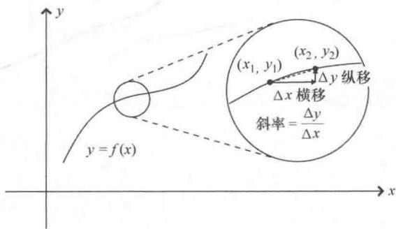
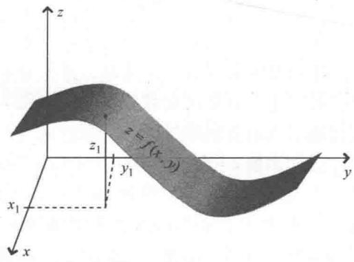
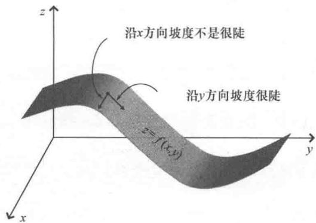
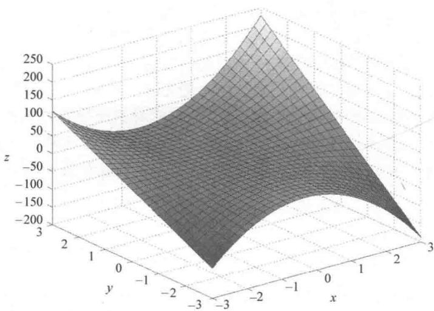

import Guide from '@/components/Guide.astro';
import Knowledge from '@/components/Knowledge.astro';
import Example from '@/components/Example.astro';
import Analysis from '@/components/Analysis.astro';
import Solution from '@/components/Solution.astro';
import Variant from '@/components/Variant.astro';
import Note from '@/components/Note.astro';
import Block from '@/components/Block.astro';
import Method from '@/components/Method.astro';
import Exercise from '@/components/Exercise.astro';

## 2.5 偏导数

点积、叉积以及三重积是矢量的基本运算，也是梯度、散度、旋度和拉普拉斯算子等更高级矢量运算的基础。梯度、散度、旋度和拉普拉斯算子属于矢量微分运算，在学习之前，我们首先要搞清楚普通导数和偏导数之间的区别。同时，这些微分运算在物理学和工程领域

中都有广泛的应用，花费时间和精力来学习这部分内容是非常必要的.

大多数人第一次接触普通导数可能是在求曲线的斜率 $\left(m = \frac{\mathrm{dy}}{\mathrm{dx}}\right)$ 或者已知位移函数（位移是时间的函数），求物体的速度 $\left(v_{x} = \frac{\mathrm{dx}}{\mathrm{dt}}\right)$ 这样的问题。很幸运，偏导数与普通导数建立在同样概念的基础上，偏导数只是将这样的概念推广到多变量的函数。但是二者的表示符号不同，普通导数记为 $\frac{\mathrm{d}}{\mathrm{dx}}$ 或者 $\frac{\mathrm{d}}{\mathrm{dt}}$ ，偏导数则记为 $\frac{\partial}{\partial x}$ 或者 $\frac{\partial}{\partial t}$ ，这样普通导数和偏导数就不会产生混淆了。

我们都知道，普通导数的产生是因为考虑到一个变量相对于另一个变量变化这样的问题。例如，已知变量 $y$ 是另一个变量 $x$ 的函数（意思是 $y$ 的值依赖于 $x$ 的值），记为 $y = f(x)$ 。 $y$ 称为"因变量"， $x$ 称为"自变量"。当自变量 $x$ 有一个微小的变化时，由 $y$ 关于 $x$ 的普通导数 $\left(\text{记作} \frac{\mathrm{d}y}{\mathrm{d}x}\right)$ 就可以得出相应 $y$ 值会有多少变化。不妨以 $x$ 为横轴 $y$ 为纵轴作图，画一条曲线， $(x_1, y_1)$ 与 $(x_2, y_2)$ 为线上的两个点，如图2.6所示。根据定义，斜率等于"纵移除以横移"，横移为 $\Delta x$ ，相应的纵移为 $\Delta y$ ，任意两点间的斜率就是 $\frac{\Delta y}{\Delta x}$ ，因此线上 $(x_1, y_1)$ 与 $(x_2, y_2)$ 这两点之间的斜率可以简单表示为 $\frac{y_2 - y_1}{x_2 - x_1} = \frac{\Delta y}{\Delta x}$ 。

  
图2.6 曲线 $y = f(x)$ 的斜率

但是，仔细观察图2.6放大的区域就会发现， $y$ 关于 $x$ 的图像在 $(x_{1}, y_{1})$ 和 $(x_{2}, y_{2})$ 两点之间有微小的弧度，所以这一小段上曲线的斜率是变化的。因此，比值 $\frac{\Delta y}{\Delta x}$ 不能代表图像上这两点之间每个点处的斜率。但是， $\frac{\Delta y}{\Delta x}$ 是连接两点 $(x_{1}, y_{1})$ 和 $(x_{2}, y_{2})$ 虚线的斜率，表示这段区间上的平均斜率（根据中值定理， $\frac{\Delta y}{\Delta x}$ 等于这两点之间曲线上某个点处的斜率，但不一定是中点）。为了求出曲线在给定点处斜率的精确值，不妨令"横移" $\Delta x$ 变得非常小。当 $\Delta x$ 趋近于0时，图2.6中虚线和曲线的差别就可以逐渐忽略。此时，将横向增量记为 $\mathrm{d}x$ ，纵向增量记为 $\mathrm{d}y$ ，则曲线上任意点处的斜率就可以记为 $\frac{\mathrm{d}y}{\mathrm{d}x}$ 。这也是为什么函数的导数等于该函数图像的斜率的原因。

假设变量 z 依赖于另外两个变量，不妨记为 x, y，即有 $z = f(x, y)$ ，可以表示为三维空间中的曲面，如图 2.7 所示。该曲面在 xOy 平面上的高为 z 并且当 x, y 取不同的值时有高有低，同时在不同方向上具有不同的变化率。因此，在该曲面上从一个点移动到另一个点

  
图 2.7 3-D 曲面 $(z=f(x,y))$

时，单个导数通常不能完整的描述高 $z$ 的变化。从图2.8中可以看出，高 $z$ 具有不同的变化率。观察图2.8中曲面的给定点，当朝向 $y$ 增加的方向移动时（ $x$ 保持不变），曲面的坡度非常陡；当朝向 $x$ 增加的方向移动时，曲面的斜率几乎为0（ $y$ 保持不变）。

这也反映了偏导数的重要性. 偏导数是保持其他自变量为常量, 只允许一个自变量（如图 2.8 中的 $x$ 或者 $y$ ）变化而形成的导数. 因

此偏导数 $\frac{\partial z}{\partial x}$ 表示曲面从给定点出发只沿x轴方向移动的斜率，偏导数 $\frac{\partial z}{\partial y}$ 表示只沿y轴方向移动的斜率.偏导数也记为 $\left.\frac{\partial z}{\partial x}\right|_{y}$ 、 $\left.\frac{\partial z}{\partial y}\right|_{x}$ ，其中竖线下标处的变量表示该变量为常量.

不难想到，通过偏导

  
图 2.8 3-D 曲面 $z=f(x,y)$ 的坡度

数可以得到 z 随 x 或者 y 变化的变化. 如果只有 x 变化, 则 $dz = \frac{\partial z}{\partial x} dx$ ;
如果只有 y 变化，则 $dz=\frac{\partial z}{\partial y}dy$ . 如果 x 与 y 都变化，则

$$
\mathrm{d} z = \frac {\partial z}{\partial x} \mathrm{d} x + \frac {\partial z}{\partial y} \mathrm{d} y.\tag{2.20}
$$

求函数的偏导数非常简单，只要会求普通导数，也就掌握了求偏导数的方法。将所有变量视为常量（要对其求导的变量除外），然后按普通求导的方法求导即可。下面来看一个具体的例子。

已知函数 $z = f(x, y) = 6x2y + 3x + 5xy + 10$ 。该多项式的项比较复杂，不太好作图，可以借助 Mathematica 或者 MATLAB 这样的计算工具，只要简单几行代码就能帮助我们了解函数的性态，如图 2.9 所示。粗略一看这张曲面，就能知道函数在 $x$ 方向和 $y$ 方向的斜率有很大不同，并且很大程度上取决于曲面上的位置。3D 图形中，边缘的斜率是最容易观察的。比如图 2.9 中的图形，考虑 $y$ 取值为 -3 时沿 $x$ 方向的斜率。当 $x$ 从 -3 变化到 3 时（ $y$ 是常量，取值 -3），斜率开始为正值，随着从 $x = -3$ 沿着 $x$ 方向朝 $x = 0$ 移动时，斜率变得平缓。当到达 $x = 0$ 附近的某个位置时，斜率变成 0。随后斜率成为负值并且当 $x$ 接近 3 的时候，变得越来越陡峭。同样可以快速分析出 $x$ 取值为 -3 沿 $y$ 方向的斜率，当 $y$ 从 -3 变化到 3 时，斜率始终取正值并且近似为常数。

  
图2.9 函数 $z = f(x,y) = 6x2y + 3x + 5xy + 10$ 在 $-3\leqslant x\leqslant 3$ ， $-3\leqslant y\leqslant 3$ 上的图形

现在我们就应该知道如何求函数的偏导数了．要求 $z=6x2y+3x+5xy+10$ 关于 x 的偏导数，只要将变量 y 视作一个常量即可，有：

$$
\frac {\partial z}{\partial x} = 1 2 x y + 3 + 5 y,\tag{2.21}
$$

同样，把变量 $x$ 视作常量就可以得到函数关于 $y$ 的偏导数：

$$
\frac {\partial z}{\partial y} = 6 x ^ {2} + 5 x.\tag{2.22}
$$

在分析偏导数的结果之前，首先要理解为什么在函数的求导过程中相应变量的指数会降低并将指数减1（例如， $\mathrm{d}(x2)=2x$ ）。答案很简单，这是因为导数表示当自变量x变化很小的时候函数z的变化率，因此导数的规范定义可以记为

$$
\frac {\mathrm{d} z}{\mathrm{d} x} \equiv \lim _ {\Delta x \rightarrow 0} \frac {z (x + \Delta x) - z (x)}{\Delta x}.\tag{2.23}
$$

因此，当 $z = x^2$ 时，有：

$$
\frac {\mathrm{d} (x ^ {2})}{\mathrm{d} x} \equiv \lim _ {\Delta x \rightarrow 0} \frac {(x + \Delta x) ^ {2} - x ^ {2}}{\Delta x}.\tag{2.24}
$$

将式（2.24）的分子展开为 $x2 + 2x\Delta x + (\Delta x)2 - x2$ ，即 $2x\Delta x +$

$(\Delta x)2$ ，再除以 $\Delta x$ 得到 $2x + \Delta x$ 。当 $\Delta x$ 趋近于 0 时， $\Delta x$ 的项可以忽略， $2x + \Delta x$ 也就趋近于 $2x$ 。那么这个 2 是怎么来的？"2"是将 $(x + \Delta x)$ 升到二次幂产生交叉项（也就是 $x$ 与 $\Delta x$ 的乘积）的数目。如果要对 $x3$ 关于 $x$ 求导，就有三个这样的交叉项。因为 $(x + \Delta x)$ 取到这个幂次产生交叉项的个数就是幂次，所以求导只需要将指数作为系数就可以了。为什么要将指数减 1 呢？这是因为求函数 $z$ 的改变量（即， $(x + \Delta x)2 - x2$ ）时，幂次最高的项（本例中为 $x2$ ）会被抵消掉，只剩下低一个幂次的项（本例中为 $x1$ ）。同样， $\frac{\mathrm{d}(x^3)}{\mathrm{d}x} = 3x^2$ 以及 $\frac{\mathrm{d}(x^n)}{\mathrm{d}x} = nx^{n-1}$ 也可以用同样的方式分析，只是稍微复杂一些。

这就是指数降低并减1的原因，但求偏导的结果又怎么理解（例如式（2.21）和式（2.22））？简单来说，它们表示曲面z的斜率随方向和位置的变化而变化。例如，曲面在 $(-3,2)$ 这个点沿x轴方向的斜率为 $12xy+3+5y=12(-3)(2)+3+5(2)=-59$ ，同一个点处沿y轴方向的斜率为 $6x2+5x=6\left[(-3)2\right]+5(-3)=39$ 。

下面对由式（2.21）计算得到的偏导数做一个简单的验证。考虑当 $y$ 取-3时曲面 $z$ 的斜率为 $12(x)(-3) + 3 + 5(-3) = -36x - 12$ 。因此，固定 $y = -3$ 并沿 $x$ 方向移动，斜率会从 $x = -3$ 处的 $+96$ 变化到 $x = -1/3$ 处的0，然后在 $x = +3$ 处减少到-120。这与我们对图2.9斜率的直观分析是一致的。

同样地，由式（2.22）可以得出曲面 $z$ 在 $x = -3$ 处沿 $y$ 方向的斜率是一个常数并且取正，这与 $z$ 的图形分析得出的结论也是一致的.

就像求普通"高阶"导数一样（例如 $\frac{\mathrm{d}}{\mathrm{d}x}\left(\frac{\mathrm{d}z}{\mathrm{d}x}\right) = \frac{\mathrm{d}^2z}{\mathrm{d}x^2}$ 和 $\frac{\mathrm{d}}{\mathrm{d}y}\left(\frac{\mathrm{d}z}{\mathrm{d}y}\right) = \frac{\mathrm{d}^2z}{\mathrm{d}y^2}$ ），也可以求高阶偏导数。例如，由 $\frac{\partial}{\partial x}\left(\frac{\partial z}{\partial x}\right) = \frac{\partial^2z}{\partial x^2}$ 可以得出 $z$ 在 $x$ 方向的斜率沿 $x$ 方向移动时的变化， $\frac{\partial}{\partial y}\left(\frac{\partial z}{\partial y}\right) = \frac{\partial^2z}{\partial y^2}$ 可以得出 $z$ 在 $y$ 方向斜率沿 $y$ 方向移动时的变化。

这里强调一下,高阶导数是导数的导数,例如表达式 $\frac{\partial2z}{\partial x2}$ 是指 $\frac{\partial z}{\partial x}$ 的导数，而不是第一个导数的平方 $\left(\frac{\partial z}{\partial x}\right)^2$ 。这个很容易验证，比如上面的例子中 $\frac{\partial z}{\partial x} = 12xy + 3 + 5y$ ， $\frac{\partial^2z}{\partial x^2} = 12y$ ，而 $\left(\frac{\partial z}{\partial x}\right)^2 = (12xy + 3 + 5y)^2$ 。按照惯例，导数的阶数通常写在"d"或者" $\partial$ "与函数之间，例如 $\mathrm{d}^2z$ 或者 $\partial^2z$ ，因此在求导时一定要注意上标的位置。

我们有可能还会遇到"混合"偏导数，例如 $\frac{\partial}{\partial x}\left(\frac{\partial z}{\partial y}\right) = \frac{\partial^2z}{\partial x\partial y}^\ominus$ 。如果已经读过前面的内容，就应该知道偏导数为函数在不同方向的斜率，自然可以想到 $\frac{\partial^2z}{\partial x\partial y}$ 表示 $y$ 方向斜率沿 $x$ 方向移动时的变化， $\frac{\partial^2z}{\partial y\partial x}$ 表示 $x$ 方向斜率沿 $y$ 方向移动时的变化。如果函数具有好的性质②，这两种表达是可以互换的，因此求偏导时可以按照任意顺序。通过上面的例子，比较式（2.21）的偏导数 $\frac{\partial}{\partial y}$ 与式（2.22）的偏导数 $\frac{\partial}{\partial x}$ 很容易就可以验证上述结论（结果均为 $12x + 5$ ）。

偏导数中的链式法则也非常重要，必须要掌握。上面的内容讨论的都是函数 $z = f(x, y)$ 中 $x$ 和 $y$ 均为最终变量，并没有涉及变量 $x$ 和 $y$ 本身又是其他变量的函数这种情况。但是这种情况也非常常见。一般会把其他的变量记为 $u$ 和 $v$ ，而 $x$ 和 $y$ 是依赖于 $u$ 和 $v$ 中一个或者两个变量的函数。如果已知 $u$ 和 $v$ 发生变化，那么函数 $z$ 相应会产生多大的变化？由偏导数的链式法可以得出：

$$
\frac {\partial z}{\partial u} = \frac {\partial z}{\partial x} \frac {\partial x}{\partial u} + \frac {\partial z}{\partial y} \frac {\partial y}{\partial u},\tag{2.25}
$$

并且

$$
\frac {\partial z}{\partial v} = \frac {\partial z}{\partial x} \frac {\partial x}{\partial v} + \frac {\partial z}{\partial y} \frac {\partial y}{\partial v}.\tag{2.26}
$$

链式法则简洁地表达了 $z$ 与 $x$ 和 $y$ 的依赖关系，因为 $x$ 和 $y$ 会随着 $u$ 的变化而变化，因此 $z$ 关于 $u$ 的变化可以写成两项的和。第一项是 $x$ 随 $u$ 的变化 $\frac{\partial x}{\partial u}$ 乘以 $z$ 随 $x$ 的变化 $\frac{\partial z}{\partial x}$ ，第二项是 $y$ 随 $u$ 的变化 $\frac{\partial y}{\partial u}$ 乘以 $z$ 随 $y$ 的变化 $\frac{\partial z}{\partial y}$ ，这两项加起来就是式（2.25），同样可以得到 $z$ 随 $v$ 变化而变化为式（2.26）.
