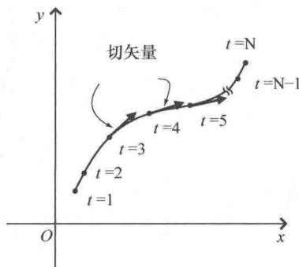

import Guide from '@/components/Guide.astro';
import Knowledge from '@/components/Knowledge.astro';
import Example from '@/components/Example.astro';
import Analysis from '@/components/Analysis.astro';
import Solution from '@/components/Solution.astro';
import Variant from '@/components/Variant.astro';
import Note from '@/components/Note.astro';
import Block from '@/components/Block.astro';
import Method from '@/components/Method.astro';
import Exercise from '@/components/Exercise.astro';

## 2.6 导数矢量

在很多关于矢量和张量的文献中，会发现"方向导数"就是矢量，并且把 $\frac{\partial}{\partial x}$ 和 $\frac{\partial}{\partial y}$ 这样的偏导数称为沿坐标轴的基矢量.

为了理解矢量和导数之间的这种对应关系，考虑如图2.10所示的路径。不妨假设该路径在 $xOy$ 平面上，我们沿着该路径移动，速度为 $\vec{v}$ ，并且移动的时候会记录时间，这样就给曲线上的每个点都赋予了一个值（如图形上的 $t$ 值）。通过对曲线赋值，曲线就被"参数化"了（ $t$ 为参数） $^{\ominus}$ 。请注意，参数值之间对应的曲线长度不必都相等（如果选择时间作为参数并且移动的过程中速度是变化的，参数值之间曲线的长度就不相等；从图2.10中可以看出，在转弯处司机很莽撞，有明显的加速）。

再举个形象的例子，假设曲线位于某个区域，区域上每个地方的气温都不同。当沿着曲线移动时，就能体会到空气温度随时间的变化（换句话说，可以画出气温与时间的关系图）。当然，我们感觉到气温变化的快慢既依赖于前进方向上温度可测变化的距离，也依赖于前进的速度（在这段距离的速度）.

  
图 2.10 参数化曲线及其切矢量

这样就很容易理解方向导数的概念了．如果函数 $f(x,y)$ 表示每个 $(x,y)$ 点的温度，方向导数 $\left(\frac{\mathrm{d}f}{\mathrm{d}t}\right)$ 表示当沿曲线移动很小的距离（在时间dt上）时函数值f的变化．根据链式法则：

$$
\frac {\mathrm{d} f}{\mathrm{d} t} = \frac {\mathrm{d} x}{\mathrm{d} t} \frac {\partial f}{\partial x} + \frac {\mathrm{d} y}{\mathrm{d} t} \frac {\partial f}{\partial y}.\tag{2.27}
$$

该式说明函数 $f$ 沿参数为 $t$ 的曲线的方向导数（即， $\frac{\mathrm{d}f}{\mathrm{d}t}$ ）等于沿曲线移动时 $x$ 坐标的变化率 $\left(\frac{\mathrm{d}x}{\mathrm{d}t}\right)$ 乘以温度函数对 $x$ 的变化率 $\left(\frac{\partial f}{\partial x}\right)$ 加上沿曲线移动时 $y$ 坐标的变化率 $\left(\frac{\mathrm{d}y}{\mathrm{d}t}\right)$ 乘以温度函数对 $y$ 的变化率 $\left(\frac{\partial f}{\partial y}\right)$ . 而 $\frac{\mathrm{d}x}{\mathrm{d}t}$ 就是速度的 $x$ 分量 $v_x, \frac{\mathrm{d}y}{\mathrm{d}t}$ 就是速度的 $y$ 分量 $v_y$ . 又因为速度是个矢量并且与移动路径相切，因此可以将方向导数 $\frac{\mathrm{d}f}{\mathrm{d}t}$ 看作是一个矢量，方向与曲线相切，长度等于 $f$ 随 $t$ 的变化率（即，气温随时间的变化率）.

这里给出一个重要概念：因为 $f$ 可以是任意函数，所以式（2.27）可以写成一个"算子"方程（即，只要添加一个函数就可以运算的方程）：

$$
\frac {\mathrm{d}}{\mathrm{d} t} = \frac {\mathrm{d} x}{\mathrm{d} t} \frac {\partial}{\partial x} + \frac {\mathrm{d} y}{\mathrm{d} t} \frac {\partial}{\partial y}.\tag{2.28}
$$

要想知道导数与矢量之间关系，只要将这个方程看作矢量方程即可：

矢量 = x 分量 · x 基矢量 + y 分量 · y 基矢量.

将该式与式（2.28）比较，就可以发现方向导数算子 $\frac{\mathrm{d}}{\mathrm{d}t}$ 表示曲线的切矢量， $\frac{\mathrm{d}x}{\mathrm{d}t}$ 、 $\frac{\mathrm{d}y}{\mathrm{d}t}$ 这两项分别表示该矢量的 $x$ 分量、 $y$ 分量， $\frac{\partial}{\partial x}$ 、 $\frac{\partial}{\partial y}$ 这两个算子表示 $x$ 、 $y$ 坐标轴方向的基矢量.

函数 $f(x,y)$ 不仅表示气温，也可以表示空间中分布在曲线区域上的任意量。因此 $f(x,y)$ 可以表示道路的海拔，风景的品质，或者在曲线上变化的其他量。同样，该路径不仅可以选择时间作为参数，也可以选择其他参数。比如路径上的每个点可以赋予s值或者 $\lambda$ 值，那么方向导数 $\frac{d}{ds}$ 或者 $\frac{d}{d\lambda}$ 依然表示曲线的切矢量， $\frac{dx}{ds}$ 或者 $\frac{dx}{d\lambda}$ 依然表示该矢量的x分量， $\frac{dy}{ds}$ 或者 $\frac{dy}{d\lambda}$ 依然表示该矢量的y分量。

理解沿坐标轴方向的基矢量与偏导数之间的关系具有重要意义，如果想要继续研究张量，我们就会发现这一点.
