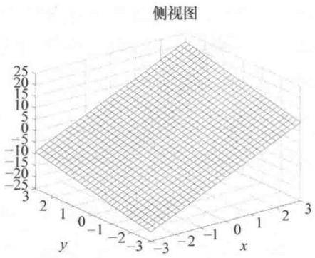
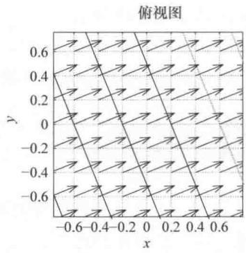

import Guide from '@/components/Guide.astro';
import Knowledge from '@/components/Knowledge.astro';
import Example from '@/components/Example.astro';
import Analysis from '@/components/Analysis.astro';
import Solution from '@/components/Solution.astro';
import Variant from '@/components/Variant.astro';
import Note from '@/components/Note.astro';
import Block from '@/components/Block.astro';
import Method from '@/components/Method.astro';
import Exercise from '@/components/Exercise.astro';

## 2.8 梯度

del 算子 $\vec{\nabla}$ 作用于标量场所得结果被称为这个标量场的梯度。由梯度可以得出标量场的两个重要特征：由梯度的大小可知标量场在空间上变化的快慢，由梯度的方向可知标量场在区域上增加最快的方向。虽然梯度作用于标量场，但其运算结果是一个矢量，既有大小又有方向。如果标量场是地形的高度，任意点处梯度的大小表示该处地形的陡峭程度，梯度的方向指向上坡并且是最陡峭的上坡。

标量场 $\psi$ 的梯度在笛卡儿坐标系下的定义为

$$
\mathrm{grad} (\psi) = \vec {\nabla} \psi \equiv \hat {i}   \frac {\partial \psi}{\partial x} + \hat {j}   \frac {\partial \psi}{\partial y} + \hat {k}   \frac {\partial \psi}{\partial z}. (\text { 笛卡儿坐标系 })\tag{2.30}
$$

因此，标量场 $\psi$ 梯度的 $x$ 分量表示标量场在 $x$ 方向的斜率，其他分量表示标量场相应方向的斜率。梯度分量平方和的平方根表示总的陡峭程度。

下面关于梯度运算举一个简单的例子．考虑图2.11a中倾斜平面，这个平面方程很简单，为 $\psi (x,y) = 5x + 2y$ ，通过式（2.30）的二维情形就可以求出 $\psi$ 的梯度：

$$
\begin{array}{r l} \vec {\nabla} \psi & = \hat {i} \frac {\partial (5 x + 2 y)}{\partial x} + \hat {j} \frac {\partial (5 x + 2 y)}{\partial y} \\ & = 5 \hat {i} + 2 \hat {j}. \end{array}
$$

由此可以看出， $\psi$ 是个标量函数，但是它的梯度是个矢量，并且沿 $x$ 轴和 $y$ 轴有分量。这些分量又能提供什么信息呢？

首先， $x$ 分量大小是 $y$ 分量大小的两倍多，这说明了该平面在 $x$ 方向倾斜的更多，而在 $y$ 方向相对平缓。另外，每个分量既不是 $x$ 的函数也不是 $y$ 的函数，因此每个方向的斜率都是常数。这些结论与图2.11a是一致的。

  
a)

  
b)  
图 2.11 函数 $\psi = 5x + 2y$ 及其梯度和等高线

梯度的大小也很容易求．因为梯度的 x 分量为 5，y 分量为 2，整个平面上梯度的大小为 $(52+22)^{1/2}=5.39$ ．也可以求出梯度矢量与 x 轴正方向的夹角为 $\arctan(2/5)=21.8^{\circ}$ ．函数 $\psi$ 中间部分的梯度和等高线见图 2.11b.

在柱面坐标系和球面坐标系下，梯度表示为

$$
\vec {\nabla} \psi \equiv \hat {r} \frac {\partial \psi}{\partial r} + \hat {\varphi} \frac {1}{r} \frac {\partial \psi}{\partial \varphi} + \hat {z} \frac {\partial \psi}{\partial z}, (\text { 柱面坐标系 })\tag{2.31}
$$

$$
\vec {\nabla} \psi \equiv \hat {r}   \frac {\partial \psi}{\partial r} + \hat {\theta}   \frac {1}{r}   \frac {\partial \psi}{\partial \theta} + \hat {\varphi}   \frac {1}{r \sin \theta} \frac {\partial \psi}{\partial \varphi}. (\text { 球面坐标系 })\tag{2.32}
$$

第2.11节的拉普拉斯算子也会涉及梯度，拉普拉斯算子是梯度的散度。接下来讨论的内容就是散度。
