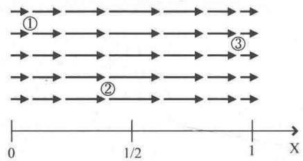
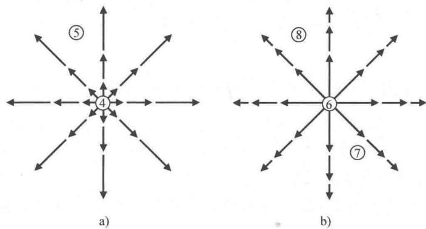

import Guide from '@/components/Guide.astro';
import Knowledge from '@/components/Knowledge.astro';
import Example from '@/components/Example.astro';
import Analysis from '@/components/Analysis.astro';
import Solution from '@/components/Solution.astro';
import Variant from '@/components/Variant.astro';
import Note from '@/components/Note.astro';
import Block from '@/components/Block.astro';
import Method from '@/components/Method.astro';
import Exercise from '@/components/Exercise.astro';

## 2.9 散度

涉及矢量场的问题时，我们可能会遇到 del 算子后跟一个点 $(\vec{\nabla} \cdot)$ ，表示矢量场的散度。散度描述了矢量在某点处"流入"或者"流出"的趋势 ① ，因此常常出现在物理问题和工程领域，用来解决矢量场空间变化的问题。例如，静电场可以用由正电荷指向径向向外的矢量来表示，就像从源流出的流矢量（如水中喷泉）一样。同样，静电场矢量指向负电荷所在的位置，类似于流体流向低洼处或下水道。杰出的苏格兰数学物理学家詹姆斯·克拉克·麦克斯韦（James Clerk Maxwell）创造了数学运算中"收敛"一词，可以用来衡量矢量"流向"指定位置的速率。现代用法中，我们会讨论反向行为（矢量从某个点流出），向外流出散度为正。如果是流体流动，任意一点的散度用来度量流矢量在该点发散的趋势（即，从该点带走的物质多于带来的物质）。散度为正的点代表了源的位置，散度为负的点代表了汇的位置。

为了加深对散度的理解，不妨以图2.12和图2.13中所示的矢量场为例进行说明。要找到矢量场中散度为正的点有两种方法。一种方法是找哪些点的场矢量是散开的，一种方法是找哪些点离开该点的场矢量大于指向该

  
图 2.12 大小变化的平行矢量场

点的场矢量，这些点就是散度为正的点．有的作者提出，想象在流动的水面上洒木屑来判断散度．如果木屑散开，这个点处为散度为正，如果木屑向一起集中，这个点处散度为负.

  
图 2.13 大小变化的径向矢量场

下面运用这些方法来判断图 2.12 以及图 2.13 中矢量场的散度. 很明显图 2.12 中的点 1、2 和图 2.13a 中的点 4、5 处散度为正（这些点流出比流入多），图 2.12 中点 3 处散度为负（流入比流出多）.

图 2.13b 中各点的散度不太明确。点 6 处的散度明显为正，但是点 7、8 处的散度呢？这两个点处场线显然同图 2.13a 的点 5 处一样沿径向发散，但是场线随径向向外逐渐变短。向外散开可以补偿流动的减缓吗？

回答这个问题还需要借助数学方法，首先要明确散度的数学表示。散度描述了矢量场在区域上如何变化，在笛卡儿坐标系下， $\vec{\nabla} \cdot$ 作用于矢量 $\vec{A}$ 或者说散度数学运算的微分形式为

$$
\vec {\nabla} \cdot \vec {A} = \left(\hat {i} \frac {\partial}{\partial x} + \hat {j} \frac {\partial}{\partial y} + \hat {k} \frac {\partial}{\partial z}\right) \cdot \left(\hat {i} A _ {x} + \hat {j} A _ {y} + \hat {k} A _ {z}\right),\tag{2.33}
$$

又因为 $\hat{i} \cdot \hat{i} = \hat{j} \cdot \hat{j} = \hat{k} \cdot \hat{k} = 1$ ，就有

$$
\vec {\nabla} \cdot \vec {A} = \left(\frac {\partial A _ {x}}{\partial x} + \frac {\partial A _ {y}}{\partial y} + \frac {\partial A _ {z}}{\partial z}\right).\tag{2.34}
$$

因此， $\vec{A}$ 的散度等于 $\vec{A}$ 的 $x$ 分量沿 $x$ 轴的变化加上 $y$ 分量沿 $y$ 轴的变化再加 $z$ 分量沿 $z$ 轴的变化。请注意，矢量场的散度是个标量，只有大小没有方向。

下面利用式（2.34）求图2.12中矢量场的散度．假设图中矢量场的大小沿 $x$ 轴呈正弦变化，为 $\vec{A} = \sin (\pi x)\hat{i}$ ，同时在 $y$ 和 $z$ 方向保持不变．因此，

$$
\vec {\nabla} \cdot \vec {A} = \frac {\partial A _ {x}}{\partial x} = \pi \cos (\pi x).\tag{2.35}
$$

其中， $A_{y}$ ， $A_{z}$ 都等于 0。当 0 &lt; x &lt; 1/2 时，该式为正，即散度为正；当 x = 1/2 时，散度等于 0；当 1/2 &lt; x &lt; 3/2 时，散度为负。以上结论与图 2.12 中直观判结果断一致。

接下来考虑图2.13a中矢量场的散度．该图表示球状对称矢量场的切片，矢量的大小随到原点距离的平方而递增，有 $\vec{A} = r^2\hat{r}$ 其中， $r^2 = (x^2 + y^2 + z^2)$ 并且

$$
\hat {r} = \frac {x \hat {i} + y \hat {j} + z \hat {k}}{\sqrt {x ^ {2} + y ^ {2} + z ^ {2}}},
$$

因此，

$$
\begin{array}{r l} \overrightarrow {A} & = r ^ {2} \hat {r} = (x ^ {2} + y ^ {2} + z ^ {2}) \frac {x \hat {i} + y \hat {j} + z \hat {k}}{\sqrt {x ^ {2} + y ^ {2} + z ^ {2}}} \\ & = (x ^ {2} + y ^ {2} + z ^ {2}) ^ {1 / 2} (x \hat {i} + y \hat {j} + z \hat {k}), \end{array}
$$

且

$$
\frac {\partial A _ {x}}{\partial x} = \left(x ^ {2} + y ^ {2} + z ^ {2}\right) ^ {1 / 2} + x \left(\frac {1}{2}\right) \left(x ^ {2} + y ^ {2} + z ^ {2}\right) ^ {- 1 / 2} (2 x).
$$

同样也可以求出 $\vec{A}$ 的 $y$ 分量关于 $y$ 的偏导数和 $z$ 分量关于 $z$ 的偏导数，把它们加起来有：

$$
\vec {\nabla} \cdot \vec {A} = 3 (x ^ {2} + y ^ {2} + z ^ {2}) ^ {1 / 2} + \frac {(x ^ {2} + y ^ {2} + z ^ {2})}{\sqrt {x ^ {2} + y ^ {2} + z ^ {2}}} = 4 (x ^ {2} + y ^ {2} + z ^ {2}) ^ {1 / 2} = 4 r.
$$

因此，图 2.13a 中矢量场的散度随到原点的距离线性增加.

最后，考虑图2.13b中矢量场的散度。图中矢量场与上一个例子类似，但是矢量大小随着到原点距离的平方递减，因此 $\vec{A} = (1 / r^2)\hat{r}$ 图2.13b中场线同图2.13a一样向外扩散，但是矢量大小的递减会影响到散度的值吗？因为 $\vec{A} = (1 / r^2)\hat{r}$ ，

$$
\overrightarrow {A} = \frac {1}{(x ^ {2} + y ^ {2} + z ^ {2})} \frac {x \hat {i} + y \hat {j} + z \hat {k}}{\sqrt {x ^ {2} + y ^ {2} + z ^ {2}}} = \frac {x \hat {i} + y \hat {j} + z \hat {k}}{(x ^ {2} + y ^ {2} + z ^ {2}) ^ {(2 / 3)}},
$$

且

$$
\frac {\partial A _ {x}}{\partial x} = \frac {1}{(x ^ {2} + y ^ {2} + z ^ {2}) ^ {3 / 2}} - x \left(\frac {3}{2}\right) (x ^ {2} + y ^ {2} + z ^ {2}) ^ {- 5 / 2} (2 x),
$$

同样也可以求出 A 的 y 分量关于 y 的偏导数和 z 分量关于 z 的偏导数，把它们加起来有：

$$
\vec {\nabla} \cdot \vec {A} = \frac {3}{(x ^ {2} + y ^ {2} + z ^ {2}) ^ {3 / 2}} - \frac {3 (x ^ {2} + y ^ {2} + z ^ {2})}{(x ^ {2} + y ^ {2} + z ^ {2}) ^ {5 / 2}} = 0.
$$

这也就验证了矢量场矢量大小随到原点距离的减小可以抵消场线向外的扩散。请注意，这个结论只适用于矢量大小以 $1 / r^2$ 的形式衰减的矢量场（并且只对原点以外的点成立） ① 。因此，要求任意点的散度时要考虑两个要素：该点处场线的间距和相对长度。这两个因素都会影响到在点周围无限小的体积内场线进或出的总流量。如果向外的流量大于向内的流量，则该点处散度为正；如果向外的流量小于向内的流量，则该点处散度为负；如果向外的流量等于向内的流量，则该点处散度为0。

目前为止，计算的都是笛卡儿坐标系下的散度。但是如果问题具有对称性，利用非笛卡儿坐标系来计算可能会更简单。柱面坐标系和球面坐标系下的散度为：

$$
\vec {\nabla} \cdot \vec {A} = \frac {1}{r} \frac {\partial}{\partial r} (r A _ {r}) + \frac {1}{r} \frac {\partial A _ {\varphi}}{\partial \varphi} + \frac {\partial A _ {z}}{\partial z}, (\text {柱面坐标系})\tag{2.36}
$$

$$
\vec {\nabla} \cdot \vec {A} = \frac {1}{r ^ {2}} \frac {\partial}{\partial r} (r ^ {2} A _ {r}) + \frac {1}{r \sin \theta} \frac {\partial}{\partial \theta} (A _ {\theta} \sin \theta) + \frac {1}{r \sin \theta} \frac {\partial A _ {\varphi}}{\partial \varphi}. (\text {球面坐标系})\tag{2.37}
$$

选择恰当的坐标系会为散度的计算带来极大的便利，大家可以尝试利用球面坐标重新计算本节的最后两个例子.
